# 04 — Telegram bot audit: @KvadroAppBot

Part of the kvadro² → HOMI migration audit. Conventions, status labels and the ID scheme are in
[`README.md`](README.md). The bot's source code is **not available**. Everything here comes from the manual
exploration recorded in `$KVADRO_ROOT/docs/telegram-bot.md` (state as of 2026-11-09). It is cross-checked with
`about.md`, `api.md` and `seo-pages.md`, and with the decompiled Mini App code where the two share a contract.

- Audit date: 2026-11-09.
- Scope: the chat bot `@KvadroAppBot` only. Out of scope: the Mini App (`03-legacy-frontend-audit.md`,
  `05-telegram-miniapp-audit.md`), the HTTP API (`08-api-inventory.md`) and the support bot `@KvadroSupportBot`,
  which was never researched (Q-BOT-016).
- Policy: HOMI will **fix** legacy bugs and logically wrong decisions instead of reproducing them. §9.1 and §9.2
  therefore give every `LB-BOT` item a "Proposed fix:" line. These are proposals, not approved changes. The inventory
  in §2–§8 records the existing behaviour exactly as observed.

## 0. Sources, abbreviations and status rules

| Short      | Path                                     |
| ---------- | ---------------------------------------- |
| `tb`       | `$KVADRO_ROOT/docs/telegram-bot.md`      |
| `ab`       | `$KVADRO_ROOT/docs/about.md`             |
| `api.md`   | `$KVADRO_ROOT/docs/api.md`               |
| `seo`      | `$KVADRO_ROOT/docs/seo-pages.md`         |
| `app/`     | `$KVADRO_ROOT/demo/app/src/`             |
| `landing/` | `$KVADRO_ROOT/demo/landing/site/`        |

Citations look like `tb:287` (a line), `tb §6.4` (a section) or `tb §6.4 l.287–308`. "Inferred" in a cell means the
same as the legacy 🔶: a deduction, not an observation.

How the status labels are applied in this document:

- **`DOCUMENTED_ONLY`**: bot behaviour that `tb` records as observed (✅, or unmarked in `tb` §3–§12). The bot's code
  is not available, so no bot behaviour can be `CONFIRMED`.
- **`UNVERIFIED`**: behaviour that `tb` marks 🔶, lists in its §12 as unchecked, or that this audit infers. Each such
  item is paired with a `Q-BOT-…`.
- **`CONFIRMED`**: only for **shared contracts** that the Mini App or landing code shows, such as the deep-link
  formats they build, the radar filter enums, the poll answer codes, the settings presets and the locale codes. The
  code reference is always given. `CONFIRMED` covers the contract, not how the bot handles it.
- **`RUNTIME_VERIFIED`**: not used.
- **Backend effects** are named after the Mini App endpoint the bot action corresponds to, by METHOD + path (see
  `08-api-inventory.md`). `tb` §9 states that the bot's own protocol is not visible from Telegram, so every such
  mapping is inferred unless stated otherwise.

**Local ID prefix.** The README scheme has no prefix for bot texts, toasts and alerts, but this audit must list every
text. They get `TXT-BOT-NNN` (§4.2, owner: this document). This prefix should be added to the README ID table.

**Diagrams** are Mermaid `stateDiagram-v2`. Their labels are English and point to `BTN-…` / `TXT-BOT-…` IDs, so
emoji and Cyrillic stay in the tables, where they are quoted verbatim.

### 0.1 Source inventory

The source items were counted while auditing. Every one of them has an ID here.

| Source item                                         | Count in source                    | Covered by |
| --------------------------------------------------- | ---------------------------------- | ---------- |
| Commands (`tb` §3)                                  | 10 (+ unknown-command behaviour)   | BOT-012…BOT-021, BOT-022 |
| Scenarios (`tb` §6.1–§6.13)                         | 13                                 | 43 scenario-step / free-text BOT items, 17 diagrams in §3 |
| Radar wizard (`tb` §6.4)                            | 8 steps + typed amount + review + edit + save | BOT-036…BOT-053, BOT-066, BOT-067 |
| Button table rows (`tb` §7)                         | 54 rows                            | BTN-001…BTN-076 (grouped rows split by action; BTN-047 and BTN-048 come from `tb` §6.6, see §4.3) |
| Toasts / alerts (`tb` §8 table)                     | 17 rows = 16 toasts + 1 alert      | TXT-BOT-039 (alert); TXT-BOT-048…056, 062…067, 075 (toasts) |
| Silent callbacks (`tb` §8, closing paragraph)       | 14 kinds                           | "none" in the toast column of §4.1 |
| Deep-link rows (`tb` §10)                           | 6                                  | BOT-027…BOT-029, BOT-031…BOT-033; plus BOT-030 (`seo` §9), BOT-034 (unknown payload), BOT-035 (support bot, from code) |
| Quirks (`tb` §11)                                   | 10                                 | LB-BOT-001…LB-BOT-014 (item 9 split in five) |
| Unchecked items (`tb` §12)                          | 18 rows                            | Q-BOT-001…Q-BOT-016 |
| Lines marked 🔶 in `tb` (legend excluded)           | 39                                 | UNVERIFIED items + Q-BOT, or the "inferred" note on backend effects |
| Bot texts (messages, prompts, captions, toasts, alerts) | —                              | TXT-BOT-001…TXT-BOT-088 |
| Behaviour seen only from the Mini App (not in `tb`) | 7 items                            | BOT-085 (Mini App release `index-BnFvC-Ft.js`), BOT-086…BOT-091 (Mini App release `index-CBlEKxdL.js`, §3.18); Mini App release `index-CIa0Ldj2.js` adds no item; what it expects of the bot is in §3.19 (Q-BOT-050, Q-BOT-051) |

## 1. Bot identity and settings to migrate explicitly

Telegram stores these settings, not the legacy backend. If HOMI keeps `@KvadroAppBot` and its token, they stay as
they are until someone changes them. A **staging or test bot** needs its own copy of every row below (`ab` §8.4
l.408–420).

| Setting                    | Legacy value                                                                 | Where it is set                               | Per language                         | ID      | Status            | Evidence |
| -------------------------- | ---------------------------------------------------------------------------- | --------------------------------------------- | ------------------------------------ | ------- | ----------------- | -------- |
| Display name               | `kvadro² · поиск жилья`                                                      | BotFather / `setMyName`                       | unknown (Q-BOT-019)                  | BOT-001 | `DOCUMENTED_ONLY` | `tb:37` |
| Username                   | `@KvadroAppBot`; `GET /api/bot` returns `KvadroAppBot`                       | fixed for the bot                             | —                                    | BOT-001 | `DOCUMENTED_ONLY` | `tb:37`; `api.md:493–497` |
| Description (empty chat)   | TXT-BOT-001, one text with RU, UZ and EN blocks                              | `setMyDescription`                            | one trilingual text was observed; per-`language_code` variants unknown (Q-BOT-019) | BOT-002 | `DOCUMENTED_ONLY` | `tb:52–68` |
| Description picture        | TXT-BOT-002: banner «Вся аренда из Telegram — в одной ленте» / «Telegramdagi barcha ijara — bitta lentada», phone mock-up | BotFather (description picture)   | RU + UZ captions on one image         | BOT-002 | `DOCUMENTED_ONLY` | `tb:54–55`; `ab:416` |
| Short description (bio)    | TXT-BOT-003                                                                  | `setMyShortDescription`                       | RU observed only (Q-BOT-019)         | BOT-003 | `DOCUMENTED_ONLY` | `tb:70–76` |
| Avatar                     | not described                                                                | BotFather                                     | —                                    | BOT-009 | `DOCUMENTED_ONLY` | `ab:416` |
| Commands                   | 10 commands, RU + EN descriptions TXT-BOT-005                                | `setMyCommands` (default and `language_code`, probably also per-chat scope) | RU, EN captured; UZ missing (Q-BOT-014) | BOT-007 | `DOCUMENTED_ONLY` | `tb:89–105` |
| Menu button                | `Открыть`, web_app → Mini App                                                | `setChatMenuButton` (default or per chat)     | unknown (Q-BOT-020)                  | BOT-004 | `DOCUMENTED_ONLY` | `tb:82` |
| Main Mini App              | `OPEN APP` in the profile                                                    | BotFather (Main Mini App)                     | —                                    | BOT-005 | `DOCUMENTED_ONLY` | `tb:83` |
| Mini App URL and domain    | `app.kvadro.app` (exact web_app URLs not visible)                            | BotFather                                     | —                                    | BOT-004, BOT-005 | `UNVERIFIED` | `ab:410–415`; `tb:1056` (Q-BOT-011) |
| Privacy policy link        | exists, target not opened                                                    | BotFather (privacy policy URL)                | —                                    | BOT-006 | `DOCUMENTED_ONLY` | `tb:84` (Q-BOT-021) |
| Inline mode                | off                                                                          | BotFather                                     | —                                    | BOT-008 | `DOCUMENTED_ONLY` | `tb:86`; `ab:418` |
| Groups (join / privacy)    | unknown; the bot was never added to a group                                  | BotFather                                     | —                                    | BOT-058 | `UNVERIFIED`      | `tb:1058` (Q-BOT-013) |
| Webhook                    | one receiver per bot: webhook or `getUpdates`                                | `setWebhook`                                  | —                                    | —       | `DOCUMENTED_ONLY` | `ab:408–411` |
| Stickers                   | welcome sticker (mascot); sticker after saving a radar                       | `sendSticker` by `file_id`                    | —                                    | BOT-010 | `DOCUMENTED_ONLY` | `tb:193`, `tb:537`; `ab:424` (Q-BOT-022) |
| Support bot                | `@KvadroSupportBot`, linked from texts and buttons                           | separate bot and token                        | —                                    | BOT-011 | `UNVERIFIED`      | `tb:48`; `ab:586` (Q-BOT-016) |

Bot API features the bot depends on (`ab` §6.3 l.309–326): inline keyboards with `callback_data`, `web_app` and `url`
buttons; **button styles** `primary` / `danger` (Bot API 9.x); `editMessageText` / `editMessageReplyMarkup`;
`answerCallbackQuery` with text and `show_alert`; localised `setMyCommands`; descriptions in three languages; menu
button and Main Mini App; `sendSticker`, `sendPhoto` with caption, `sendMediaGroup`, `sendVenue`; HTML with bold,
italic, links and `expandable_blockquote`; `setMessageReaction`; reply keyboard with `request_contact`; `/start`
payloads. The PHP Telegram client chosen for HOMI must support all of them (`ab:398`).

Migration notes:

1. **Per-chat state that lives at Telegram.** `tb:91–92` infers that the command menu switches through
   `setMyCommands` with a per-chat scope. If so, every user's chat holds its own command list (and possibly its own
   menu button). These survive a backend switch. When HOMI changes the commands or the menu-button URL, it must
   overwrite or delete those per-chat scopes, or users keep the legacy set (Q-BOT-014, Q-BOT-020).
2. **`file_id` belongs to one bot.** A test bot cannot send the production stickers or pictures by their `file_id`.
   Each asset needs a source file or a sticker-set name (Q-BOT-022).
3. **The web_app URL is part of each message.** Every old message with a web_app button (BTN-001, BTN-004, BTN-005,
   BTN-035) keeps the URL it was sent with. See §6.3.

## 2. Commands, handlers and scenario steps (BOT-NNN)

One row per command, scenario step, free-text handler, deep link, outbound message and system behaviour. Order:
identity (001–011), commands (012–022), global mechanics and language (023–026), deep links (027–035), radar wizard
(036–053), free text (054–058), listing card (059–062), `/subs` and the poll (063–071), `/fav` (072–073), `/settings`
(074), `/owner` (075–079), `/privacy` (080), outbound (081–085; 085 seen only from the Mini App, since its release
`index-BnFvC-Ft.js`); the owner cabinet and the contact requests, seen only from the Mini App since its release
`index-CBlEKxdL.js` (086–091). The same records are in
[`data/bot-handlers.json`](data/bot-handlers.json).

| ID | Kind | Trigger | Behaviour | Buttons | Backend effects | Status | Source |
| -- | ---- | ------- | --------- | ------- | --------------- | ------ | ------ |
| BOT-001 | system | Bot profile: name and username | Display name `kvadro² · поиск жилья`, username `@KvadroAppBot` (same value as `GET /api/bot` → `username`). Per-language names unknown (Q-BOT-019). | — | — | `DOCUMENTED_ONLY` | tb §1 l.37 |
| BOT-002 | system | Empty chat before the first /start (description + description picture) | Trilingual description TXT-BOT-001 with banner TXT-BOT-002, shown with the client's Start button. Per-language variants not checked (Q-BOT-019). | — | — | `DOCUMENTED_ONLY` | tb §2 l.52-68 |
| BOT-003 | system | Bot profile bio (short description) | Short description TXT-BOT-003 (RU line + support bot + site). Per-language variants not checked (Q-BOT-019). | — | — | `DOCUMENTED_ONLY` | tb §2 l.70-76 |
| BOT-004 | system | Chat menu button (left of the input field) | Label `Открыть`, type web_app, opens the Mini App. Label localisation not checked (Q-BOT-020); URL not visible (Q-BOT-011). | — | — | `DOCUMENTED_ONLY` | tb §2 l.82 |
| BOT-005 | system | Bot profile → `OPEN APP` (Main Mini App) | Main Mini App is configured and opens the Mini App from the profile. URL not visible (Q-BOT-011). | — | — | `DOCUMENTED_ONLY` | tb §2 l.83 |
| BOT-006 | system | Bot profile → Privacy Policy link | A privacy-policy link exists; its target was not opened (Q-BOT-021). In chat the policy is `/privacy` (BOT-020). | — | — | `DOCUMENTED_ONLY` | tb §2 l.84 |
| BOT-007 | system | Command menu (`/`) | 10 commands (BOT-012…BOT-021), descriptions TXT-BOT-005; the menu switches with the user's bot language (observed), probably via setMyCommands with a per-chat scope (inference). UZ descriptions not captured (Q-BOT-014). | — | Per-chat command list set on language change (mechanism inferred) | `DOCUMENTED_ONLY` | tb §3 l.85, l.91-105; §6.2 l.233 |
| BOT-008 | system | Inline query `@KvadroAppBot …` | Inline mode is off: typing the username shows no hint and no results. | — | — | `DOCUMENTED_ONLY` | tb §2 l.86 |
| BOT-009 | system | Bot profile avatar | Avatar is a bot asset to carry over together with the description picture. Not described in telegram-bot.md. | — | — | `DOCUMENTED_ONLY` | about.md §8.4 l.416, l.424 |
| BOT-010 | system | sendSticker in /start and after a radar is saved | Welcome sticker with the mascot (BOT-012) and a sticker after saving a radar (BOT-051). Sticker set / file_id unknown (Q-BOT-022). | — | — | `DOCUMENTED_ONLY` | tb §6.1 l.193; §6.4 l.537; about.md §8.4 l.424 |
| BOT-011 | system | Links to `@KvadroSupportBot` (url buttons, texts) | Support is a separate bot (`GET /api/bot` → `support`) linked from /help, the not-understood reply, /privacy, description and bio. Not researched (Q-BOT-016). | — | — | `UNVERIFIED` | tb §1 l.48 |
| BOT-012 | command | `/start` without payload (also the client Start button) | Two messages: welcome sticker (BOT-010), then TXT-BOT-006 (bold active count and heading) with live counters and buttons BTN-001, BTN-002, BTN-003. Repeating /start resends both and resets nothing. Payloads: BOT-027…BOT-034. | BTN-001, BTN-002, BTN-003 | Reads live counters: active listings, new in 24 h; Creates the bot user on first contact (implied) | `DOCUMENTED_ONLY` | tb §6.1 l.191-224 |
| BOT-013 | command | `/app` | TXT-BOT-009 with web_app button BTN-005. | BTN-005 | — | `DOCUMENTED_ONLY` | tb §6.3 l.238-244 |
| BOT-014 | command | `/new` | Starts the radar wizard as a NEW message at step 1 (BOT-036, BOT-037). Same entry as BTN-002 and BTN-030. | BTN-006, BTN-007, BTN-008, BTN-025 | Wizard state created | `DOCUMENTED_ONLY` | tb §3 l.98; §6.4 l.248-250 |
| BOT-015 | command | `/subs` | Radar list BOT-064 or empty state BOT-063 as a new message. | BTN-049, BTN-030 | Reads the user's radars (≈ `GET /api/subscriptions`, inferred) | `DOCUMENTED_ONLY` | tb §6.7 l.674-694 |
| BOT-016 | command | `/fav` | Favourites list BOT-073 or empty state BOT-072. | BTN-066 | Reads favourites (≈ `GET /api/favorites`, inferred) | `DOCUMENTED_ONLY` | tb §6.8 l.749-766 |
| BOT-017 | command | `/settings` | Settings panel TXT-BOT-074 in one message (bold heading and values, italic last line); headers BTN-067, option rows BTN-068…BTN-072, current value prefixed `✅ `. Changes: BOT-074, BOT-025. | BTN-067, BTN-068, BTN-069, BTN-070, BTN-071, BTN-072 | Reads settings: quiet, digest, locale, currency, service-news flag | `DOCUMENTED_ONLY` | tb §6.9 l.768-803 |
| BOT-018 | command | `/owner` | Branches on verification state: not verified → BOT-075 (intro + reply keyboard); verified → BOT-078. | BTN-073, BTN-074, BTN-075 | Reads owner-verification state | `DOCUMENTED_ONLY` | tb §6.10 l.815-834 |
| BOT-019 | command | `/help` | TXT-BOT-082 with url button BTN-034 (primary). | BTN-034 | — | `DOCUMENTED_ONLY` | tb §6.11 l.839-845 |
| BOT-020 | command | `/privacy` | Full policy TXT-BOT-083 with callback button BTN-076. The text is a set of promises (retention, deletion, processors) HOMI must keep or replace (BR-BOT-085…BR-BOT-094). | BTN-076 | — | `DOCUMENTED_ONLY` | tb §6.12 l.847-869 |
| BOT-021 | command | `/ping` | Replies TXT-BOT-085: database health and PostGIS version. Answers any user (LB-BOT-027). | — | DB health check; reads the PostGIS version | `DOCUMENTED_ONLY` | tb §6.13 l.871-877 |
| BOT-022 | system | Unknown command (checked `/foo`) | No reply at all (waited 13 s). See LB-BOT-014. | — | — | `DOCUMENTED_ONLY` | tb §3 l.107; §5 l.184 |
| BOT-023 | system | Callback from a wizard message started earlier | Any button → alert TXT-BOT-039 (`show_alert`) and the keyboard is removed from that message. What makes a wizard stale (superseded or TTL) is unknown (Q-BOT-018). | — | — | `DOCUMENTED_ONLY` | tb §5 l.172-173, l.179-180 |
| BOT-024 | system | Callback from an older copy of a listing card | Old copies keep working: the action applies to the current server state; only the pressed copy is re-rendered; other copies and an open /fav list stay stale (LB-BOT-007). | — | — | `DOCUMENTED_ONLY` | tb §5 l.180-181; §6.6 l.670-672 |
| BOT-025 | scenario-step | Language button BTN-003 (welcome) or BTN-070 (/settings); Mini App `PUT /api/settings` with `locale` (inferred) | Saves the language and re-renders the current message in it (welcome: no toast; /settings: toast TXT-BOT-075 in the new language); switches the command menu; later replies use the new language. | BTN-003, BTN-070 | User locale saved (`ru` / `uz_Latn` / `en`); Command menu switched for the chat (mechanism inferred) | `DOCUMENTED_ONLY` | tb §6.2 l.226-236 |
| BOT-026 | system | First contact of a new user | How the initial bot language is chosen (Telegram `language_code` or default `ru`) is not documented (Q-BOT-035). | — | Initial locale stored | `UNVERIFIED` | tb §13 l.1066 |
| BOT-027 | deep-link | `/start s_web` | From every landing button without a tag (*since `67b3942a8340`, landing intake*: a tag is dropped only when nothing is left of it after sanitising, BOT-028). Expected: ordinary welcome; source stored for attribution (inferred from /privacy). Link format CONFIRMED (`landing/landing.js:30-40`). | BTN-001, BTN-002, BTN-003 | Attribution source stored (inferred) | `UNVERIFIED` | tb §10 l.1004 |
| BOT-028 | deep-link | `/start s_web_<tag>` | Landing opened with `?s=<tag>` or `?utm_source=<tag>`; tag lower-cased, `[a-z0-9_-]{1,40}`; (*since `67b3942a8340`, landing intake*) characters outside `[a-z0-9_-]` become `-`, leading and trailing `-` are trimmed and the tag is cut to 40, so a tag is sanitised instead of dropped (`utm_source=chatgpt.com` → `s_web_chatgpt-com`). Expected as BOT-027. Format CONFIRMED (`landing/landing.js:33-40`). | BTN-001, BTN-002, BTN-003 | Attribution source + tag stored (inferred) | `UNVERIFIED` | tb §10 l.1005 |
| BOT-029 | deep-link | Suffix `--v<visit>` on any `s_…` payload | 10-char `[a-z0-9]` visit id appended on click by `stats.js`; the part before it is cut to 49 chars. Expected: joins the site visit (PostHog) to the bot user. Format CONFIRMED (`landing/stats.js:18-20`, `landing/landing.js:39`). | — | Visit id stored and linked to the user (inferred) | `UNVERIFIED` | tb §10 l.1006 |
| BOT-030 | deep-link | `/start s_seo[_<lang>][_<slice>]` | SEO pages' «Открыть в Telegram» button, slices per seo-pages.md §9 (e.g. `s_seo_tashkent_yunusobod_2k`, `s_seo_uz_kv_yunusobod-minor`). Bot response not recorded; expected as BOT-027. Since Mini App release `index-CIa0Ldj2.js` the no-access screen is a second producer of the language forms: `s_seo_en`, `s_seo_uz`, with `--l<id>` (BOT-031). | BTN-001, BTN-002, BTN-003 | Attribution source stored (inferred) | `UNVERIFIED` | seo-pages.md §9 l.353-371 |
| BOT-031 | deep-link | `/start s_<source>--l<id>` | Observed with `s_web--l51358`: sticker + welcome, then a third message TXT-BOT-008 with BTN-004. Built by the Mini App no-access screen; `<source>` is `web`, a campaign code (`fb12`, `tg3`, `ig5`), `seo` or `share`; since Mini App release `index-CIa0Ldj2.js` `seo` is `seo_en` or `seo_uz` by the interface language (`ru` keeps `seo`). The link is not built for `blocked` and, since that release, `paused`. Format CONFIRMED (`app/features/onboarding/NoAccessScreen.jsx:26-27, 66`; `app/lib/telegram/startParam.js:32-42`; `app/features/onboarding/NoAccessScreen.jsx:26,41-47,72-75`; `app/lib/telegram/startParam.js:69-79`, r33). | BTN-001, BTN-002, BTN-003, BTN-004 | Reads the listing title (rooms · district · price); Attribution source stored (inferred) | `DOCUMENTED_ONLY` | tb §10 l.1007, l.1011-1017 |
| BOT-032 | deep-link | `/start s_friend` | Share link from the Mini App «Нашли жильё?» sheet. Expected: ordinary welcome, referral attribution. Format CONFIRMED (`app/features/radar/FoundSheet.jsx:119`). | BTN-001, BTN-002, BTN-003 | Referral source stored (inferred) | `UNVERIFIED` | tb §10 l.1008 |
| BOT-033 | deep-link | `/start l_<id>` | The Mini App payload format sent to the bot: ordinary welcome, the listing is not recognised (LB-BOT-028). | BTN-001, BTN-002, BTN-003 | — | `DOCUMENTED_ONLY` | tb §10 l.1009 |
| BOT-034 | deep-link | `/start <unknown or malformed payload>` | Not tested; presumably ordinary welcome (Q-BOT-032). | BTN-001, BTN-002, BTN-003 | — | `UNVERIFIED` | tb §10 l.999-1000 |
| BOT-035 | deep-link | `t.me/<support bot>?start=l_<id>` (support bot, not @KvadroAppBot) | Built by the Mini App listing actions sheet for the SUPPORT bot; handling belongs there (Q-BOT-016). Format CONFIRMED (`app/features/listing/ListingActionsSheet.jsx:161`). | — | — | `UNVERIFIED` | code: app/features/listing/ListingActionsSheet.jsx:161 |
| BOT-036 | scenario-step | Wizard start: `/new`, BTN-002, BTN-030 | Each start sends a NEW message; later steps edit it in place. Frame TXT-BOT-010: `📡 Новый радар · шаг N из M`, context `🏠 <deal> · <object or «любой объект»>[ · <rooms>]`, question, optional hint. `◀️ Назад` on every step except 1, `✖️ Отмена` everywhere. | BTN-024, BTN-025 | Server-side wizard state (TTL unknown, Q-BOT-018) | `DOCUMENTED_ONLY` | tb §6.4 l.248-277 |
| BOT-037 | scenario-step | Wizard step 1 — deal | TXT-BOT-012 `Что ищете?` under `шаг 1 из 7`; one button per row: BTN-006, BTN-007, BTN-008, BTN-025. | BTN-006, BTN-007, BTN-008, BTN-025 | Wizard state: deal; M = 8 / 7 / 6 | `DOCUMENTED_ONLY` | tb §6.4 l.279-287 |
| BOT-038 | scenario-step | Wizard step 2 — object | TXT-BOT-013 `Какой объект?`, context `🏠 Аренда · любой объект` / `🏠 Посуточно · любой объект` / `🏠 Покупка · любой объект`; options by deal (BR-BOT-021) via BTN-009. | BTN-009, BTN-024, BTN-025 | Wizard state: types | `DOCUMENTED_ONLY` | tb §6.4 l.289-297 |
| BOT-039 | scenario-step | Wizard step 3 — rooms (apartment, house, apartment-or-house only) | TXT-BOT-014 `Сколько комнат?`; BTN-010 laid out `1` · `2` · `3` · `4+` / `1–2` · `2–3` · `✅ Не важно`; context gains `· 2 комн.` / `· 2–3 комн.`. | BTN-010, BTN-024, BTN-025 | Wizard state: rooms_min / rooms_max (inferred) | `DOCUMENTED_ONLY` | tb §6.4 l.299-308 |
| BOT-040 | scenario-step | Wizard step 4 — city, zones, districts (multi-select) | TXT-BOT-015 + city hint TXT-BOT-016 / TXT-BOT-017. Keyboard: 6 cities (BTN-011, current one `✅`), Tashkent zones BTN-012…BTN-014, districts two per row alphabetically (BTN-015), `✅ Весь <город>` (BTN-016), `Готово (N)` (BTN-017), Back/Cancel. Districts toggle in place; city and zone buttons jump to step 5 (LB-BOT-001, LB-BOT-002). | BTN-011, BTN-012, BTN-013, BTN-014, BTN-015, BTN-016, BTN-017, BTN-024, BTN-025 | Wizard state: city, districts, zones, near_metro | `DOCUMENTED_ONLY` | tb §6.4 l.310-371 |
| BOT-041 | scenario-step | Wizard step 5 — budget | Question by deal (TXT-BOT-018), median line (TXT-BOT-019; rent_long and sale), below-market paragraph (TXT-BOT-020; only where the button exists). Presets by city/deal/rooms + `✅ Не важно` (BTN-018), `✍️ Своя сумма` (BTN-019), `📊 Не дороже рынка` toggle (BTN-020). | BTN-018, BTN-019, BTN-020, BTN-024, BTN-025 | Wizard state: price_max, below_median; Reads city median and preset amounts | `DOCUMENTED_ONLY` | tb §6.4 l.373-411 |
| BOT-042 | scenario-step | Wizard step 5a — typed-amount prompt (after BTN-019) | Same message replaced by TXT-BOT-021 with `◀️ Назад` · `✖️ Отмена`; the bot now waits for text, and all text goes to BOT-043 instead of free-text parsing. | BTN-024, BTN-025 | Wizard state: awaiting amount | `DOCUMENTED_ONLY` | tb §6.4 l.412-418 |
| BOT-043 | scenario-step | Text received while waiting for an amount | Not a number (`примерно шестьсот`) → NEW message TXT-BOT-022, still waiting. A number (`650`) → keyboard removed from the prompt; step 6 arrives as a NEW message that is edited from then on. Formats and limits unknown (Q-BOT-024). | BTN-021, BTN-024, BTN-025 | Wizard state: price_max = number, USD | `DOCUMENTED_ONLY` | tb §6.4 l.418-422 |
| BOT-044 | scenario-step | Wizard step 6 — listings from whom | TXT-BOT-023; BTN-021 (`✅ Все объявления` / `Без риелторов` / `Только хозяева`); next: step 7 (rent) or review (sale). | BTN-021, BTN-024, BTN-025 | Wizard state: owner | `DOCUMENTED_ONLY` | tb §6.4 l.424-432 |
| BOT-045 | scenario-step | Wizard step 7 — who will live (rent_long, rent_daily) | TXT-BOT-024; BTN-022; next: step 8 (rent_long) or review (rent_daily). | BTN-022, BTN-024, BTN-025 | Wizard state: tenant | `DOCUMENTED_ONLY` | tb §6.4 l.434-442 |
| BOT-046 | scenario-step | Wizard step 8 — pets (rent_long only) | TXT-BOT-025 (question prefixed `🆕`); BTN-023; next: review. | BTN-023, BTN-024, BTN-025 | Wizard state: pets / pets_only (inferred) | `DOCUMENTED_ONLY` | tb §6.4 l.444-452 |
| BOT-047 | scenario-step | Review screen (after the last step, or after free text BOT-054) | TXT-BOT-027: summary rows `🏠` `📍` `💰` `👤` `👥` (+ pets), flow estimate TXT-BOT-028, conditional paragraphs TXT-BOT-029…TXT-BOT-031, closing TXT-BOT-032. Keyboard: relax buttons BTN-027 (if any), `✏️` buttons of the branch two per row (BTN-026), `✅ Сохранить` (BTN-028), `✖️ Отмена` (BTN-025). Pets row format unknown (Q-BOT-010). | BTN-027, BTN-026, BTN-028, BTN-025 | Reads the flow estimate for the last week (≈ `GET /api/feed/flow`, inferred) | `DOCUMENTED_ONLY` | tb §6.4 l.454-510 |
| BOT-048 | scenario-step | In-place edit of one step from review or the edit screen (BTN-026) | Opens that step in the same message (same «шаг N из M» header; `Изменение радара · …` for an existing radar). A choice or `◀️ Назад` returns to the review; deal change resets the budget; an object not allowed for the new deal sends the user to step 2 instead. Estimate recomputed (but see LB-BOT-005). | BTN-006, BTN-007, BTN-008, BTN-009, BTN-010, BTN-011, BTN-015, BTN-017, BTN-018, BTN-021, BTN-022, BTN-023, BTN-024 | Wizard state updated | `DOCUMENTED_ONLY` | tb §6.4 l.512-515 |
| BOT-049 | scenario-step | Relax option on the review (BTN-027) | Applies the weakening (`✅ Вместе с риелторами` → `👤 все объявления`), recomputes the screen, the button disappears. | BTN-027 | Wizard state: weakened filter | `DOCUMENTED_ONLY` | tb §6.4 l.495-498 |
| BOT-050 | scenario-step | Cancel (BTN-025) on any step, the amount prompt, the review or the edit screen | Message edited to TXT-BOT-026 `Отменил. Новый радар — /new, список — /subs`; keyboard removed; no toast; nothing saved. | BTN-025 | Wizard state discarded | `DOCUMENTED_ONLY` | tb §6.4 l.269-275; §7 l.906 |
| BOT-051 | scenario-step | Save a new radar (BTN-028) | Toast TXT-BOT-075; message edited to TXT-BOT-034 with BTN-029 · BTN-030; then NEW messages: sticker (BOT-010), starter list BOT-052 (if N > 0), first-radar tip BOT-053 (first radar only). | BTN-029, BTN-030 | Radar created: filters, mode instant, active (≈ `POST /api/subscriptions`, inferred); Starter matches recorded as delivered (inferred) | `DOCUMENTED_ONLY` | tb §6.4 l.517-566 |
| BOT-052 | scenario-step | Starter list after save | TXT-BOT-035 `🗂 Уже есть за последние 3 дня: N — свежие сверху`, numbered rows, number buttons BTN-031 five per row. A number sends the card (BOT-059) as a new message; the list does not change; buttons keep working after the radar is deleted. Held an out-of-window item (LB-BOT-003). | BTN-031 | Reads matches of the last 3 days | `DOCUMENTED_ONLY` | tb §6.4 l.538-551 |
| BOT-053 | scenario-step | First-radar tip (only after the user's first radar) | TXT-BOT-036 with BTN-032 · BTN-033. `⚡ Сразу` removes the keyboard and replaces the last paragraph with TXT-BOT-037; `📬 Подборкой` not checked (Q-BOT-010). | BTN-032, BTN-033 | Radar delivery mode set (inferred) | `DOCUMENTED_ONLY` | tb §6.4 l.552-566 |
| BOT-054 | free-text | Text that is not a command and not an awaited amount — understood | Reaction 👌 on the user's message and the review screen titled TXT-BOT-040, with parse notes TXT-BOT-041 (deal defaulted to rent_long) or TXT-BOT-042 (unknown place → `весь Ташкент`). Keyboard as BOT-047. Parsed by Google Gemini per /privacy. | BTN-027, BTN-026, BTN-028, BTN-025 | LLM call; phones and @handles masked; text not stored; Wizard state created from the parsed filters; setMessageReaction 👌 | `DOCUMENTED_ONLY` | tb §6.5 l.571-597; §5 l.182-183 |
| BOT-055 | free-text | Free text — not understood (`привет`) | No reaction; reply TXT-BOT-043 with BTN-030 and BTN-034. | BTN-030, BTN-034 | LLM call | `DOCUMENTED_ONLY` | tb §6.5 l.599-605 |
| BOT-056 | free-text | Voice message | Per /privacy, voice is parsed like text by Gemini and the audio is not stored. Not tested (Q-BOT-005). | — | Speech-to-text + parse (inferred) | `UNVERIFIED` | tb §6.5 l.607; §6.12 l.854 |
| BOT-057 | system | Non-text messages: photo, sticker, location, document, forwarded post, contact outside /owner | Not tested (Q-BOT-013). | — | — | `UNVERIFIED` | tb §12 l.1059 |
| BOT-058 | system | Bot added to a group chat | Not tested; behaviour and BotFather group settings unknown (Q-BOT-013). | — | — | `UNVERIFIED` | tb §12 l.1058 |
| BOT-059 | scenario-step | Listing card (from BTN-031, BTN-066; inferred also from a radar push, BOT-081) | Photo message with caption when photos exist, otherwise text. HTML: bold title and price, italic source line, original post in an expandable blockquote; body TXT-BOT-044. Rows: [BTN-035][BTN-036 if coordinates] / [BTN-037][BTN-038 if photos] / [BTN-039][BTN-041] / [BTN-042][BTN-044]. | BTN-035, BTN-036, BTN-037, BTN-038, BTN-039, BTN-041, BTN-042, BTN-044 | Reads listing details incl. market comparison, metro, merged duplicates | `DOCUMENTED_ONLY` | tb §6.6 l.609-653 |
| BOT-060 | scenario-step | Card in state «rented by me» (after BTN-042) | Line TXT-BOT-046 prepended; the two lower rows become `⭐ В избранное` · `↩️ Не сдано`. | BTN-039, BTN-040, BTN-043 | Listing hidden for this user | `DOCUMENTED_ONLY` | tb §6.6 l.664-665 |
| BOT-061 | scenario-step | Card hide-similar submenu (after BTN-044) | Keyboard replaced by `📢 Канал @<канал>` / `📍 Район <район>` / `✖️ Отмена`; a realtor row is promised by the tip text but was never shown. | BTN-045, BTN-046, BTN-047, BTN-048 | — | `DOCUMENTED_ONLY` | tb §6.6 l.666-668 |
| BOT-062 | scheduled-message | Listing taken down (author request, rented, sold, deleted) | Per /privacy, already-sent cards are edited to «Объявление снято». Text, buttons and triggers unknown (Q-BOT-031). | — | Edits delivered cards (needs a sent-message log) | `UNVERIFIED` | tb §6.12 l.862, l.867-869 |
| BOT-063 | scenario-step | /subs — no radars | TXT-BOT-057 with BTN-030. | BTN-030 | — | `DOCUMENTED_ONLY` | tb §6.7 l.676-682 |
| BOT-064 | scenario-step | /subs — radar list (also BTN-029, BTN-060, after BTN-058) | TXT-BOT-058 `📡 Радар (k из 10)` + explanation; one BTN-049 per radar (`▶️`/`⏸` + title TXT-BOT-059), then BTN-030. | BTN-049, BTN-030 | — | `DOCUMENTED_ONLY` | tb §6.7 l.684-694 |
| BOT-065 | scenario-step | Radar card (BTN-049; edits the list message) | TXT-BOT-060: title, status line (3 variants), summary rows, optional `🙈 скрыто: …`. Buttons: `⏸ Пауза`/`▶️ Включить`, `✏️ Изменить`, `📬 Присылать подборкой`/`📡 Присылать сразу`, `🙉 Показать скрытое` (only with hide rules), `🗑 Удалить`, `◀️ К списку`. | BTN-050, BTN-051, BTN-052, BTN-053, BTN-054, BTN-055, BTN-057, BTN-060 | Reads the radar | `DOCUMENTED_ONLY` | tb §6.7 l.696-725 |
| BOT-066 | scenario-step | Edit radar screen «Радар — что изменить?» (BTN-055) | TXT-BOT-033 + summary, the same `✏️` buttons as the review, `✅ Сохранить`, `✖️ Отмена`; steps use header TXT-BOT-011 `Изменение радара · шаг N из M`. | BTN-026, BTN-056, BTN-025 | Wizard state seeded from the radar | `DOCUMENTED_ONLY` | tb §6.7 l.721 |
| BOT-067 | scenario-step | Save an edited radar (BTN-056) | As BOT-051: toast, `✅ Радар включён`, starter list with only listings not sent before (2 three-room flats after `2 комн.` → `2–3 комн.`). | BTN-029, BTN-030, BTN-031 | Radar filters replaced (≈ `PUT /api/subscriptions/:id`, inferred) | `DOCUMENTED_ONLY` | tb §6.4 l.568-569; §6.7 l.721 |
| BOT-068 | scenario-step | Delete confirmation (BTN-057) | TXT-BOT-061 `Удалить радар «<название>»?` with `🗑 Да, удалить` (danger) · `✖️ Отмена`. | BTN-058, BTN-059 | — | `DOCUMENTED_ONLY` | tb §6.7 l.722-724 |
| BOT-069 | scenario-step | Poll «Нашли жильё?» — new message after pause (after delete: not observed) | TXT-BOT-068 with BTN-061 · BTN-062 / BTN-063 · BTN-064. | BTN-061, BTN-062, BTN-063, BTN-064 | ask_found decision; suppressed shortly after an answer (inferred) | `DOCUMENTED_ONLY` | tb §6.7 l.716, l.723, l.727-735 |
| BOT-070 | scenario-step | Poll step «Где нашли?» (BTN-062) | Message edited to TXT-BOT-069 with 7 options BTN-065; any option → TXT-BOT-070 without buttons (only `Другое` was pressed). | BTN-065 | Answer `elsewhere` + where stored (≈ `POST /api/found`, `POST /api/found/where`, inferred) | `DOCUMENTED_ONLY` | tb §6.7 l.737-746 |
| BOT-071 | scenario-step | Poll answers `🎉 Да, через kvadro²`, `🔎 Ещё ищу`, `🙅 Больше не ищу` | Replies not checked (Q-BOT-006). | BTN-061, BTN-063, BTN-064 | Poll answer stored (inferred) | `UNVERIFIED` | tb §6.7 l.747; §12 l.1050 |
| BOT-072 | scenario-step | /fav — empty | TXT-BOT-072. | — | — | `DOCUMENTED_ONLY` | tb §6.8 l.751-755 |
| BOT-073 | scenario-step | /fav — list | TXT-BOT-073 `⭐ Избранное (N)` + numbered rows; one BTN-066 per item → card as a new message. Later toggles do not refresh the list. | BTN-066 | — | `DOCUMENTED_ONLY` | tb §6.8 l.757-766; §6.6 l.672 |
| BOT-074 | scenario-step | /settings option pressed (BTN-068…BTN-072) | Toast TXT-BOT-075; panel re-rendered in place (`✅` moves, the text line changes); the current option also toasts, without change. Language: BOT-025. | BTN-068, BTN-069, BTN-070, BTN-071, BTN-072 | Settings updated (≈ `PUT /api/settings`, inferred; service news is bot-only) | `DOCUMENTED_ONLY` | tb §6.9 l.805-813 |
| BOT-075 | scenario-step | /owner — not verified | TXT-BOT-076 and a reply keyboard `📱 Поделиться номером` (request_contact) / `Отмена`. | BTN-073, BTN-074 | Owner flow state (implied) | `DOCUMENTED_ONLY` | tb §6.10 l.815-827 |
| BOT-076 | scenario-step | /owner — `Отмена` pressed (arrives as text) | TXT-BOT-077; reply keyboard removed. | — | — | `DOCUMENTED_ONLY` | tb §6.10 l.831 |
| BOT-077 | scenario-step | /owner — contact received (BTN-073) | Telegram asks the user to confirm; the contact stays in the chat. Observed outcome (no listings with that number): TXT-BOT-078. «Listings found», refusals (≥3 flats, realtor number) and foreign contacts not checked (Q-BOT-008). | — | Phone hash + verification date stored; Owner badge applied to matching listings, «обычно за несколько минут» | `DOCUMENTED_ONLY` | tb §6.10 l.832, l.836-837 |
| BOT-078 | scenario-step | /owner — already verified | TXT-BOT-079 with inline BTN-075. | BTN-075 | — | `DOCUMENTED_ONLY` | tb §6.10 l.833 |
| BOT-079 | scenario-step | Remove number (BTN-075) | No confirmation; TXT-BOT-080. | — | Phone hash deleted; owner badge removed | `DOCUMENTED_ONLY` | tb §6.10 l.834 |
| BOT-080 | scenario-step | Delete my data (BTN-076) | Not pressed (irreversible). Confirmation step, reply and scope unknown (Q-BOT-001). Promised by TXT-BOT-083: gone from the bot DB at once, from backups in ~2 weeks; PostHog person deletion requested. | — | Deletes all user data (promised); PostHog person deletion request (promised) | `UNVERIFIED` | tb §6.12 l.864, l.867 |
| BOT-081 | scheduled-message | New listing matches an active radar in instant mode | Expected: listing card (BOT-059) pushed to the chat. Not observed in ~13 min; whether the radar name is shown is unknown (Q-BOT-002). Since Mini App release `index-CIa0Ldj2.js` the Mini App accepts `?radar=<id>` (`05` TMA-012); whether this message carries such a button is unknown (Q-BOT-050). | BTN-035, BTN-036, BTN-037, BTN-038, BTN-039, BTN-041, BTN-042, BTN-044 | Delivered-card log written (dedup, takedown edits) | `UNVERIFIED` | tb §5 l.186-187; §6.6 l.611; §12 l.1046 |
| BOT-082 | scheduled-message | Digest time of the user (09:00 / 19:00 / 12:00 / 20:00) for radars in digest mode | A list of new listings at the chosen times (Asia/Tashkent). Format not observed (Q-BOT-003). | — | Digest queue drained; delivered log written (inferred) | `UNVERIFIED` | tb §6.9 l.777; §12 l.1047 |
| BOT-083 | scheduled-message | End of the user's quiet hours | No cards during quiet hours; everything that appeared overnight comes as one morning digest. Not observed (Q-BOT-003). | — | Deferred cards flushed as a digest (inferred) | `UNVERIFIED` | tb §6.9 l.775; §12 l.1047 |
| BOT-084 | scheduled-message | Service-news broadcast | Users with `📰 Новости сервиса: Присылать` receive service news. None observed; sender tool unknown (Q-BOT-004). | — | — | `UNVERIFIED` | tb §6.9 l.783; §12 l.1048 |
| BOT-085 | scheduled-message | Sample card on request of the Mini App (`POST /api/settings/card-sample`, since Mini App release `index-BnFvC-Ft.js`; not scheduled) | The bot sends one listing card into the user's chat in the saved card style (`classic` or `rich`, §3.10); the answer `{sent}` says whether it was sent. Not described in `tb`; which listing it shows, which buttons work, when it fails and any rate limit are unknown (Q-API-067, Q-BOT-046). | unknown | Writes the chat | `UNVERIFIED` | `api.md:1040-1055` (r31); `app/features/settings/SettingsScreen.jsx:162-171` (r31) |
| BOT-086 | scenario-step | Owner cabinet: the contact arrives from the Mini App (`WebApp.requestContact`, since Mini App release `index-CBlEKxdL.js`) | «Поделиться номером» in the Mini App makes Telegram send the user's contact into the bot chat. It is tied to the user's draft and checked: own contact, `+998`, the realtor and fraud checks, the limit per phone; the result shows in `GET /api/owner/listings/:id` within seconds. The Mini App adds «Загляните в чат с ботом — там может быть ответ» and sends users of clients below 6.9 to the bot to share the number there. Not described in `tb`; the chat reply, the old-client path and the relation to `/owner` (BOT-075 … BOT-077) are unknown (Q-BOT-047, Q-API-072). | unknown | Phone stored with the owner listing; `phone_set`, `phone_display`, `reject_reason` set | `UNVERIFIED` | `api.md:1346-1348`, `:1366-1369`, `:1436-1438` (r31); `app/features/owner/owner.js:89-107`; `app/features/owner/OwnerForm.jsx:1484-1620`, `:1684-1693` (r31) |
| BOT-087 | scheduled-message | A seeker sent a request (`POST /api/listings/:id/contact`; not scheduled) | The owner receives the request in the bot chat and can answer there or in «Мои объявления»: «Отклики придут в бот. Ответить можно там или в «Мои объявления»». Text and answer buttons not observed (Q-BOT-048). | unknown | Reads the request; an answer given in the chat changes its status (inferred) | `UNVERIFIED` | `api.md:820-822` (r31); `app/features/owner/owner.js:134` |
| BOT-088 | scheduled-message | The owner pressed «Дать номер» (action `give`; not scheduled) | The seeker receives the owner's number in the bot chat («Номер отправили — человек позвонит вам сам»). The Mini App tells the seeker to press «Ответил риелтор» in the bot if the answerer turns out to be a realtor, so the message probably carries that button (inferred). Form of the number and the buttons not observed (Q-BOT-048, Q-API-076). | «Ответил риелтор» (label from the Mini App text `owner.info.footGate`; no `BTN` id until it is observed) | Request `given`; writes the seeker's chat | `UNVERIFIED` | `app/features/owner/owner.js:219`; `app/i18n/locales/ru.js:654` |
| BOT-089 | scheduled-message | 10 minutes after the owner pressed «Не подходит» (action `decline`), unless it was undone | A soft refusal to the seeker with similar listings: «Через 10 минут мягко ответим, что номер вы дать не готовы, и покажем похожие». The owner is told the seeker gets the same soft answer whatever reason is chosen. Not observed (Q-BOT-048, Q-API-075). | unknown | Request `declined` or `agent`; writes the seeker's chat | `UNVERIFIED` | `app/features/owner/owner.js:220`, `:226-227` |
| BOT-090 | scheduled-message | The owner marked the flat «Сдано» (status `rented`; not scheduled) | The seekers whose requests still wait are told that the flat is let («тем, кто ждёт ответа, скажем, что квартиру сдали»); their requests become `cancelled`. Not observed (Q-BOT-048). | unknown | Requests `cancelled`; writes the seekers' chats | `UNVERIFIED` | `app/features/owner/owner.js:203`, `:240` |
| BOT-091 | scheduled-message | The cabinet opens for realtors (a later broadcast to the waiting list of `POST /api/owner/waitlist`) | Promised by the Mini App only: «Хорошо, напишем в бот, когда откроем.». Never observed; text and sender unknown (Q-BOT-049). | unknown | Reads the waiting list | `UNVERIFIED` | `app/features/owner/owner.js:110`; `api.md:1469-1470` (r31) |

## 3. Scenario state machines

Every diagram is followed by the details a diagram cannot hold. Unless a row says otherwise:

- a callback edits the message it came from (`tb` §5 l.167–170);
- no state survives a cut-over (§6);
- **outdated forms:** a wizard button pressed on an older wizard message gets the alert TXT-BOT-039 and loses its
  keyboard (BOT-023, §3.17).

### 3.1 `/start` and `/start <payload>` (`tb` §6.1, §10)

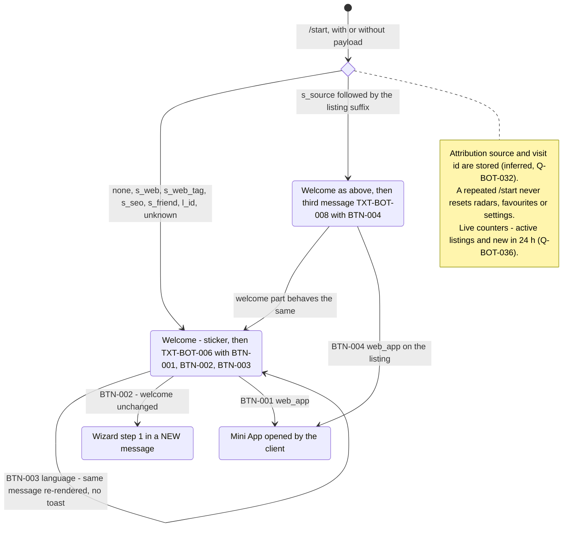

| Aspect             | Detail |
| ------------------ | ------ |
| Inputs             | `/start`, the client's Start button, `t.me/KvadroAppBot?start=<payload>` |
| Validation, errors | An unknown payload is not tested (BOT-034). `l_<id>` is not recognised (BOT-033). |
| Messages           | Send: sticker, TXT-BOT-006 (+ TXT-BOT-008 for `s_<source>--l<id>`). Edit: welcome on a language change. Delete: none. |
| TTL / outdated     | The welcome's buttons have no observed expiry. |
| Backend effects    | User created on first contact (implied); attribution stored (inferred); counters read. |

### 3.2 Language switch (`tb` §6.2)

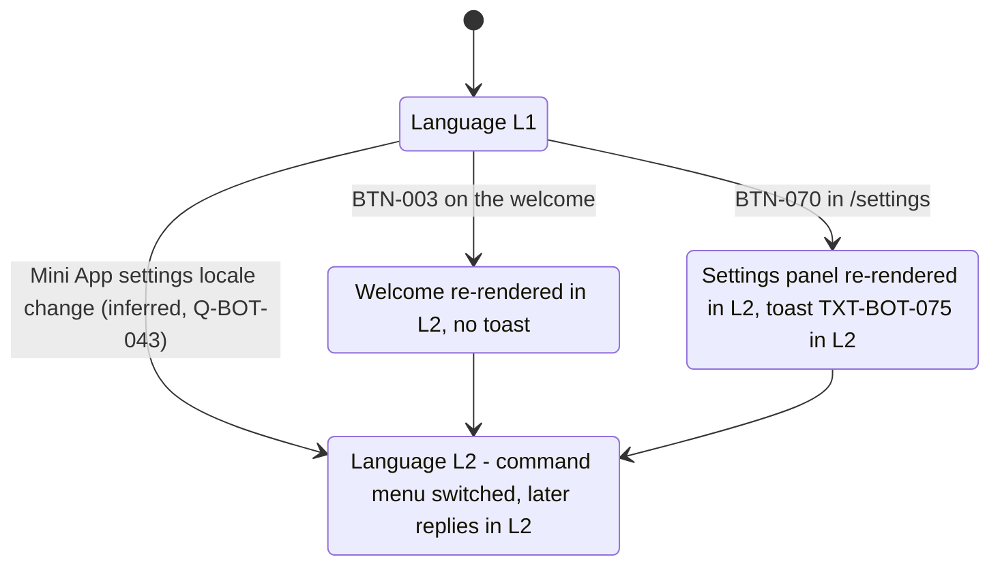

| Aspect          | Detail |
| --------------- | ------ |
| Inputs          | BTN-003, BTN-070; inferred: Mini App `PUT /api/settings` with `locale` |
| Messages        | Edit only. Pressing back to `🇷🇺 Русский` restores Russian (`tb:236`). |
| Backend effects | Locale saved (`ru`, `uz_Latn`, `en`; BR-BOT-015); per-chat command menu switched (mechanism inferred) |
| Unknown         | The initial language of a new user (BOT-026, Q-BOT-035). |

### 3.3 `/app`, `/help`, `/ping`, unknown commands (`tb` §6.3, §6.11, §6.13, §3)

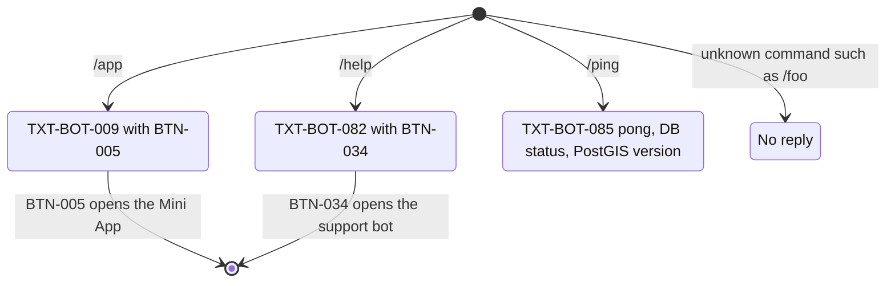

| Aspect          | Detail |
| --------------- | ------ |
| Messages        | One new message each; nothing for an unknown command. |
| Backend effects | `/ping` runs a DB health check and reads the PostGIS version. Any user can call it (LB-BOT-027). |

### 3.4 Radar wizard `/new` — main flow (`tb` §6.4)

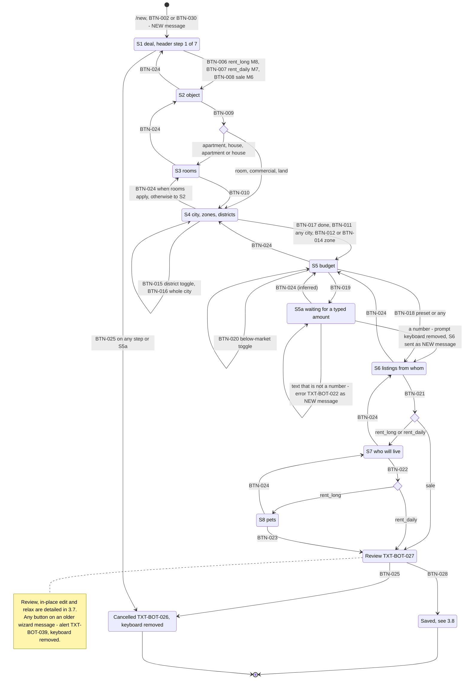

| Aspect             | Detail |
| ------------------ | ------ |
| Inputs             | `/new`, BTN-002 (welcome), BTN-030 (`/subs`, empty `/subs`, saved-radar message, not-understood reply), wizard buttons, text in S5a |
| Step header        | `📡 Новый радар · шаг N из M` (new radar) or `Изменение радара · шаг N из M` (edit). M = 8 / 7 / 6 by deal; step 1 always shows `из 7` (BR-BOT-017). How N is counted when step 3 is skipped is not recorded (Q-BOT-025). |
| Context line       | `🏠 <Аренда\|Посуточно\|Покупка> · <объект или «любой объект»>[ · <комнаты>]`; holds only deal, object and rooms (BR-BOT-018) |
| Validation, errors | S5a only: a non-number gets TXT-BOT-022 and the wait continues. Limits and accepted formats are unknown (Q-BOT-024). |
| Messages           | Send: one wizard message per start; S6 as a new message after a typed amount; one error message per bad amount. Edit: every step. Delete: none; Cancel removes the keyboard. |
| TTL / outdated     | The wizard state is server-side. Buttons on an older wizard get alert TXT-BOT-039 and lose the keyboard; what counts as older is unknown (Q-BOT-018). |
| Backend effects    | None until Save; Save creates a radar (§3.8). |

#### Wizard option sets and limits

| Step | Question (TXT) | Options, layout as shown | Default | Next | Shown when |
| ---- | -------------- | ------------------------ | ------- | ---- | ---------- |
| 1 deal | `Что ищете?` (TXT-BOT-012) | `🔑 Снять надолго` / `🌙 Снять посуточно` / `🏷 Купить` / `✖️ Отмена`, one per row | — | 2 | always |
| 2 object, rent_long | `Какой объект?` (TXT-BOT-013) | `Квартира` · `Дом` / `Квартира или дом` · `Комната / подселение` / `Помещение` | none marked; context «любой объект» | 3 or 4 | always |
| 2 object, rent_daily | same | `Квартира` · `Дом` / `Комната / подселение` | same | 3 or 4 | always |
| 2 object, sale | same | `Квартира` · `Дом` / `Квартира или дом` · `Участок` / `Помещение` | same | 3 or 4 | always |
| 3 rooms | `Сколько комнат?` (TXT-BOT-014) | `1` · `2` · `3` · `4+` / `1–2` · `2–3` · `✅ Не важно` | `Не важно` | 4 | apartment, house, apartment-or-house |
| 4 area | TXT-BOT-015 + hint | cities (3 + 3 per row), Tashkent zones, districts (2 per row, alphabetical), `✅ Весь <город>` · `Готово (N)`, `◀️ Назад` · `✖️ Отмена` | city of the last choice with `Весь <город>`; Tashkent at first | 5 | always |
| 5 budget | TXT-BOT-018 + TXT-BOT-019 + TXT-BOT-020 | presets (3 per row) / `✍️ Своя сумма` · `✅ Не важно` / `📊 Не дороже рынка` | `Не важно` | 6 | always |
| 6 owner | `От кого объявления?` (TXT-BOT-023) | `✅ Все объявления` / `Без риелторов` / `Только хозяева` | `Все объявления` | 7 or review | always |
| 7 tenant | `Кто будет жить?` (TXT-BOT-024) | `👨‍👩‍👧 Семья` / `👨 Парень / парни` / `👩 Девушка / девушки` / `✅ Не важно` | `Не важно` | 8 or review | rent_long, rent_daily |
| 8 pets | `🆕 Можно ли с животными?` (TXT-BOT-025) | `🐾 Не запрещены` / `🐾 Разрешены` / `✅ Не важно` | `Не важно` | review | rent_long |

Every step except 1 ends with the row `◀️ Назад` · `✖️ Отмена` (`tb:267`). Single-choice buttons advance at once; only
the districts are multi-select (`tb:277`).

### 3.5 Wizard step 4 — city, zones, districts (`tb` l.310–371)

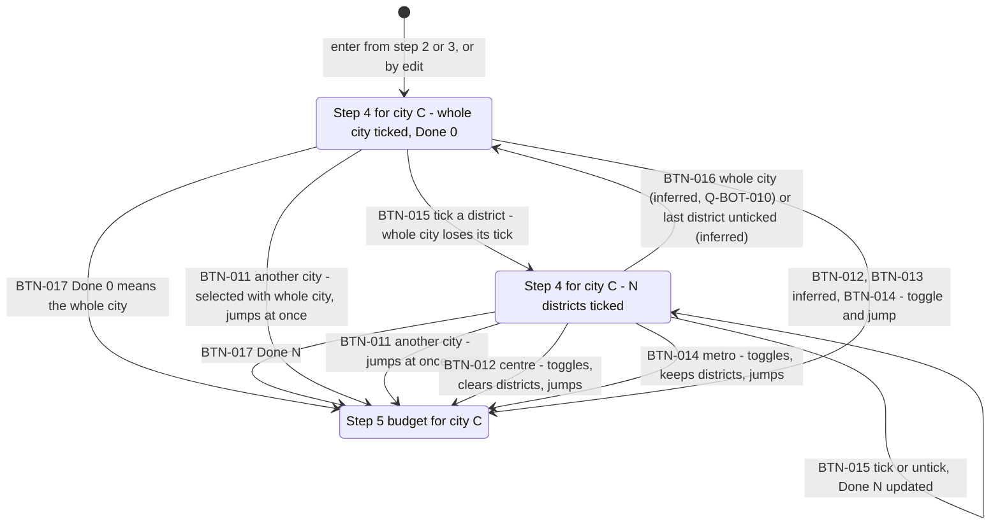

| City                | Districts (count) | Zones | Hint text | "Не дороже рынка" in step 5 |
| ------------------- | ----------------: | ----- | --------- | --------------------------- |
| Ташкент             | 12 (`tb:353`)     | `🏛 Центр`, `🏙 Ближе к центру`, `🚇 Рядом с метро (до ~1 км)` | TXT-BOT-016 | yes |
| Ташкентская область | 22 (`tb:354`)     | none  | TXT-BOT-017 (a) | yes |
| Андижан             | 15 (`tb:355`)     | none  | TXT-BOT-017 (b) | no |
| Наманган            | 13 (`tb:356`)     | none  | TXT-BOT-017 (b) | no |
| Фергана             | 17 (`tb:357`)     | none  | TXT-BOT-017 (b), with the typo «Весь Фергана» (LB-BOT-009) | no |
| Коканд              | 0 (`tb:358`)      | none  | TXT-BOT-017 (c) | no |

The source of truth for the 79 district names is `tb:351–358`. `tb:360` infers they equal `GET /api/meta` →
`cities[].districts` / `zones`. The codes behind the labels are needed to migrate radars (Q-BOT-044). Zone codes in the
shared contract are `center` and `near_center`, and "near metro" is a separate boolean `near_metro`: CONFIRMED,
`app/features/filters/options.js:4`, `app/features/filters/model.js:21–23`.

### 3.6 Wizard step 5 — budget and typed amount (`tb` l.373–422)

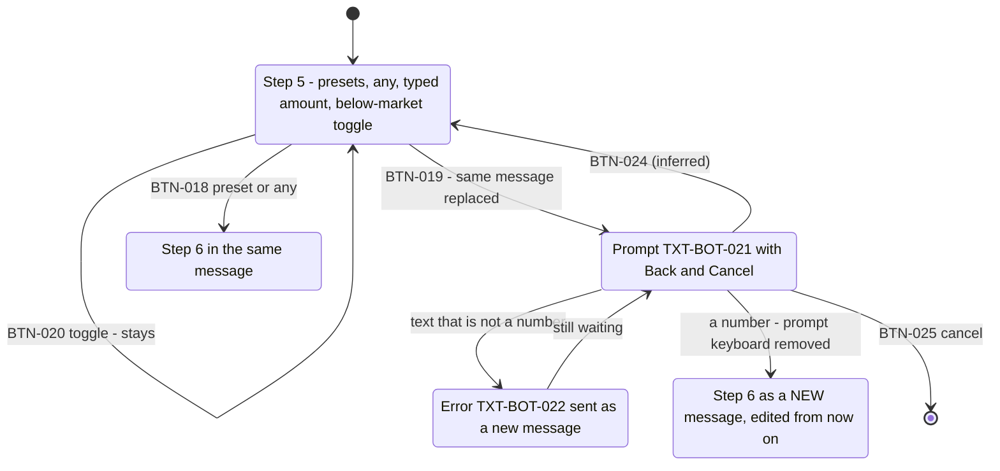

Observed presets and median lines (rent_long, 2 rooms, unless the deal says otherwise; live values change):

| Deal / city                      | Question (TXT-BOT-018)              | Median line (TXT-BOT-019)                         | Presets, USD                            | `📊 Не дороже рынка` |
| -------------------------------- | ----------------------------------- | ------------------------------------------------- | --------------------------------------- | -------------------- |
| rent_long · Ташкент              | `Бюджет в месяц — до скольки?`      | `Ташкент: половина квартир — до $700 в месяц`     | 300, 400, 500, 600, 800, 1 000, 1 500   | yes |
| rent_long · Ташкентская область  | same                                | `…: половина квартир — до $250 в месяц`           | 200, 250, 300, 450                      | yes |
| rent_long · Андижан              | same                                | `… — до $300 в месяц`                             | 200, 300, 350, 500                      | no |
| rent_long · Наманган             | same                                | `… — до $300 в месяц`                             | 200, 300, 400, 500                      | no |
| rent_long · Коканд               | same                                | `… — до $240 в месяц`                             | 200, 250, 300, 400                      | no |
| rent_long · Фергана              | same                                | `… — до $250 в месяц`                             | 200, 250, 350, 450                      | no |
| rent_daily                       | `Бюджет за сутки — до скольки?`     | none                                              | 30, 50, 80, 120                         | no |
| sale (Ташкент)                   | `Бюджет на покупку — до скольки?`   | `Ташкент: половина квартир — до $94 000`          | 40 000, 60 000, 80 000, 100 000, 150 000, 200 000 | yes |

Limits: the budget is a **maximum** only. It is always in **USD**: the typed amount is "in dollars", one number, for
example `650` or `85000`. There is no minimum price and no observed upper bound (Q-BOT-024). Presets depend on city,
deal and rooms. `tb:399–400` ties the below-market button to `CityMeta.median` (inferred). That the presets come from
`GET /api/cities` → `presets` is this audit's inference (Q-BOT-044).

### 3.7 Review, in-place edit and relax (`tb` l.454–515)

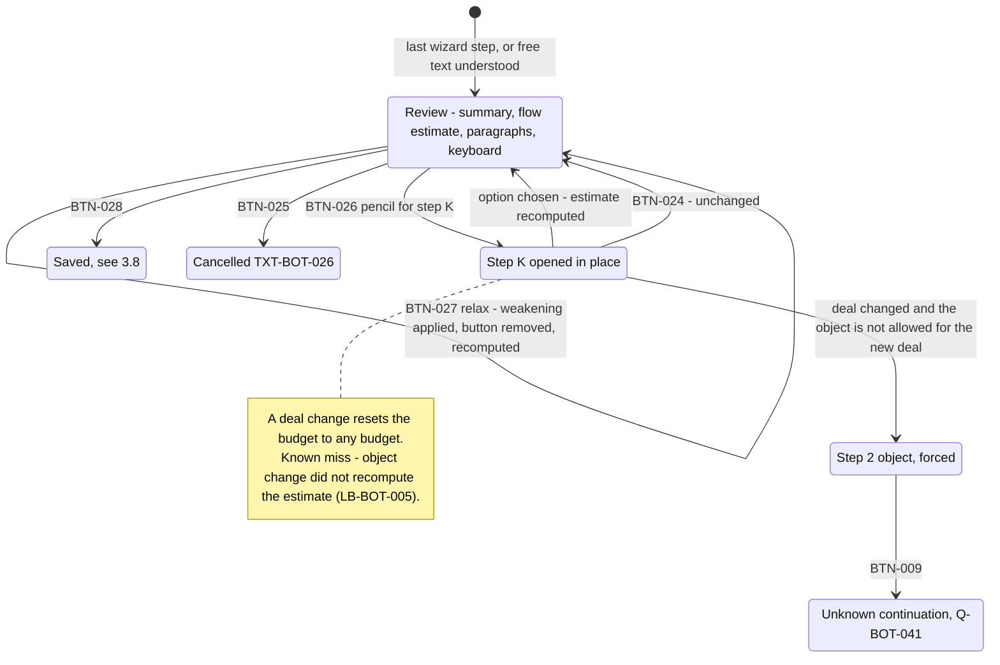

| Element                  | Values / rule | Evidence |
| ------------------------ | ------------- | -------- |
| Title                    | `📡 Новый радар — проверьте` (wizard), `Вот что я понял — проверьте` (free text), `Радар — что изменить?` (edit) | `tb:459`, `tb:579`, `tb:721` |
| `🏠` row                 | `Аренда · квартира · 2 комн.`, `Аренда · квартира · 2–3 комн.`, `Посуточно · комната`, `Покупка · дом`, `Покупка · участок`, `Покупка · помещение` | `tb:476` |
| `📍` row                 | `Ташкент · Юнусабад, Чиланзар`, `Ташкент · Юнусабад`, `весь Ташкент` | `tb:477` |
| `💰` row                 | `до $650/мес`, `до $800/мес`, `до $100 000, не дороже рынка`, `любой бюджет` | `tb:478` |
| `👤` row                 | `все объявления`, `без риелторов`, `только хозяева` | `tb:479` |
| `👥` row                 | `для семьи`; absent for `Не важно` (other values not recorded) | `tb:480` |
| pets row                 | absent for `Не важно`; format for the other values not checked (Q-BOT-010) | `tb:481` |
| Flow estimate            | TXT-BOT-028, three tiers; recomputed after each edit | `tb:483–487` |
| Too broad                | TXT-BOT-029; seen at ≈20/day, not at ≈19 | `tb:493` |
| Too few even without extras | TXT-BOT-030 | `tb:494` |
| Broaden options          | TXT-BOT-031 + one BTN-027 per option above the `✏️` rows | `tb:495–498` |
| `✏️` buttons per branch  | rent_long apartment/house: Сделка, Объект, Комнаты, Районы, Бюджет, Риелторы, Кто живёт, Животные · rent_daily apartment: … Бюджет, Риелторы, Кто живёт · rent_daily room: Сделка, Объект, Районы, Бюджет, Риелторы, Кто живёт · sale apartment/house: Сделка, Объект, Комнаты, Районы, Бюджет, Риелторы · sale land/commercial: Сделка, Объект, Районы, Бюджет, Риелторы | `tb:502–508` |
| Always                   | `✅ Сохранить` (primary) and `✖️ Отмена` | `tb:510` |

The rent_long branches for room and commercial are not listed in `tb:502–508`. By BR-BOT-043 they presumably lack
`✏️ Комнаты`.

### 3.8 Save and the messages after it (`tb` l.517–569)

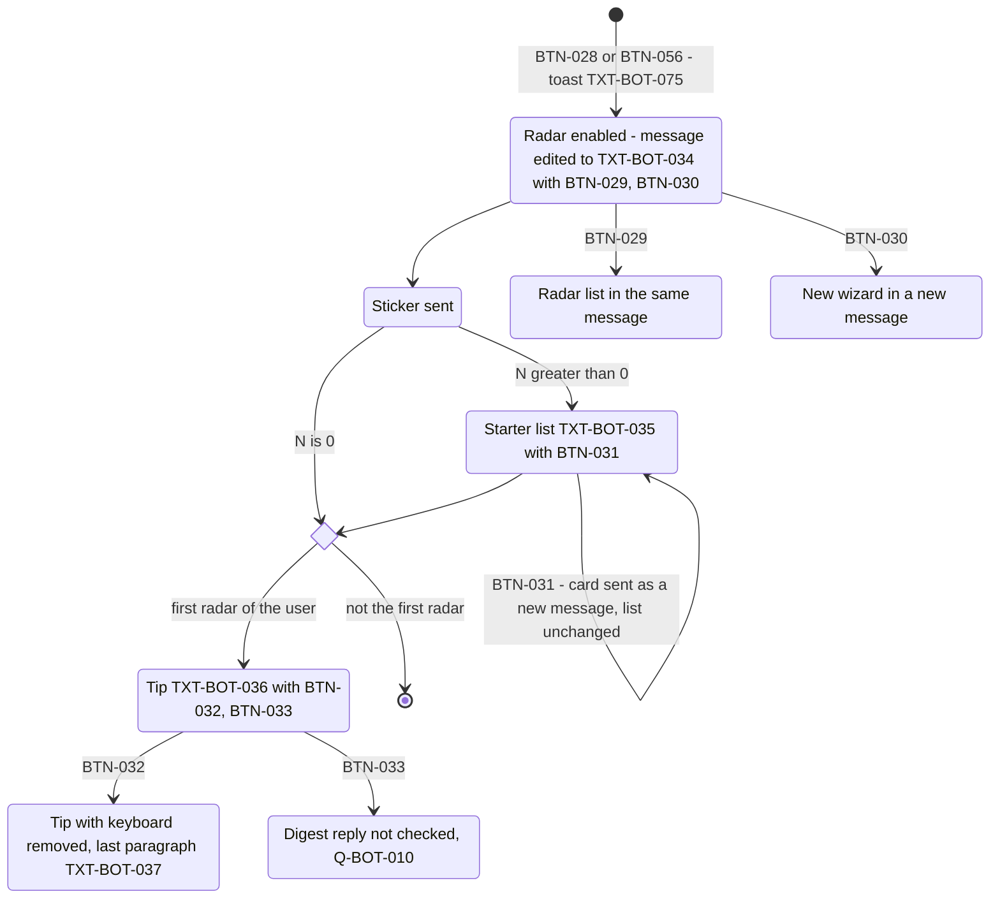

| Aspect          | Detail |
| --------------- | ------ |
| Messages        | Edit: the review becomes TXT-BOT-034. Send: sticker; starter list (N > 0); tip (first radar only); one card per BTN-031. |
| Starter list    | Matches of the last 3 days, newest first, numbered; number buttons five per row; they keep working after the radar is deleted. After an edit the list holds only listings not sent before (`tb:568–569`). Whether the sticker and tip also follow an edit is not recorded. |
| Backend effects | Radar created (BOT-051) or its filters replaced (BOT-067); starter listings recorded as delivered (inferred, needed for BR-BOT-049). |

### 3.9 Free text (`tb` §6.5)

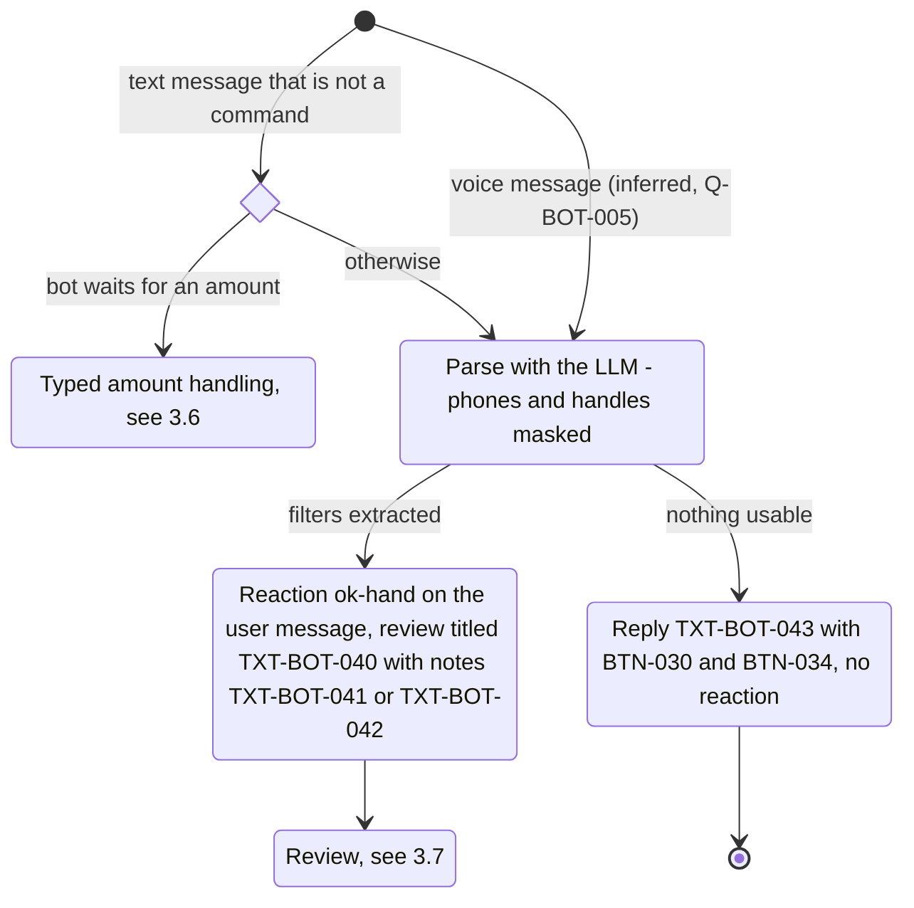

| Aspect             | Detail |
| ------------------ | ------ |
| Inputs             | Any non-command text; voice according to `/privacy` (BOT-056). Other message types are not tested (BOT-057). |
| Validation, errors | A missing deal defaults to rent_long with note TXT-BOT-041. An unsupported place (`Самарканд`) falls back to `весь Ташкент` with note TXT-BOT-042 (LB-BOT-017). Nothing understood → TXT-BOT-043. |
| Messages           | Send: review (new message) or TXT-BOT-043. Reaction: 👌 on understood text only (seen on two messages). |
| Backend effects    | Gemini call; message text and voice are not stored (BR-BOT-055). No radar is created until Save. |

### 3.10 Listing card (`tb` §6.6)

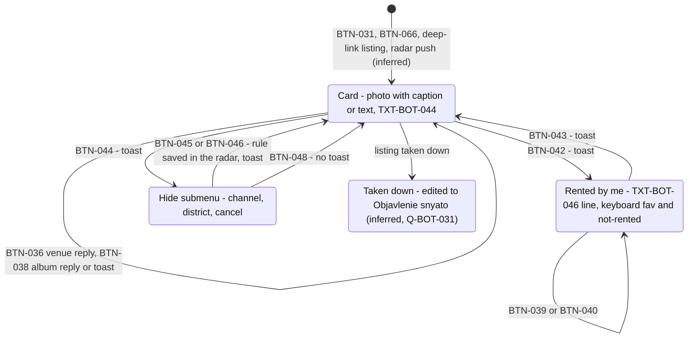

| Element      | Detail | Evidence |
| ------------ | ------ | -------- |
| Variants     | Photo message with caption when photos are available; a text message otherwise (seen on two cards whose photo button answers `Фото больше недоступны`) | `tb:612–615` |
| Formatting   | HTML: title and price bold, source line italic, original post in an expandable blockquote | `tb:617` |
| Rows         | `🏠` title · deal; `💰` price; `📊` market comparison; `📍` district · complex/landmark (distance here when there is no metro); `🚇` station · distance to centre; `🏢` area · floor; `🛠` renovation (· furniture); `👨‍👩‍👧` deposit (LB-BOT-004); `📝` summary from the post; `🔗` `@<канал>` link to the post · `ещё N` duplicates · `🕐` time, age | `tb:619–644` |
| Keyboard     | `[📱 Открыть в приложении] [📍 На карте]` / `[🔗 Открыть оригинал] [📷 Ещё N фото]` / `[⭐ В избранное] [Это риелтор]` / `[Уже сдано] [Скрыть похожие]`; map only with coordinates, photos only if the post has photos | `tb:648–653` |
| Stale copies | Old copies keep working; the action applies to the server state and only the pressed copy changes (BOT-024, LB-BOT-007) | `tb:670–672` |
| Backend      | Favourite toggle; realtor vote per phone; rented vote with undo; hide rule stored in the radar | §4.1 |

**Card style** (seen from the Mini App only; release `index-BnFvC-Ft.js` of 2026-11-14; `tb` is at r20 of 2026-11-09
and does not describe it). The user picks how the bot sends listing cards: `classic` or `rich` (`03` SCR-048,
BR-APP-074; `GET` / `PUT /api/settings` field `card_style`, a missing value meaning `classic`). `classic` is the card
described above; the Mini App's mock of it is a short form: some of its rows (🏠 💰 📊 📍 🏢, the owner line, the
quote) and the keyboard abbreviated as [📱 📍] [🔗 📷 +5] [⭐ …] (`app/features/settings/CardStylePicker.jsx:97-126`). `rich` is known only from the Mini App's mock and one sentence
of the API docs: photos that swipe inside the card, the price as a heading, the title in bold, the market line, a
table Район / Метро / Площадь / Сдаёт, «📝 Описание ›», button rows [📱 📍] [🔗 ⭐] [… ], and "only recent Telegram
versions" show it (`CardStylePicker.jsx:128-165`; `api.md:986-987`, r31; the Mini App hint
`settings.cards.hint`). How it is built on the Bot API, which Telegram version it needs and what a `rich` user on
an older client receives are unknown (Q-BOT-046). The Mini App can ask the bot for a sample card (BOT-085).
`UNVERIFIED`.

### 3.11 `/subs` — radar list, radar card, edit, delete (`tb` §6.7)

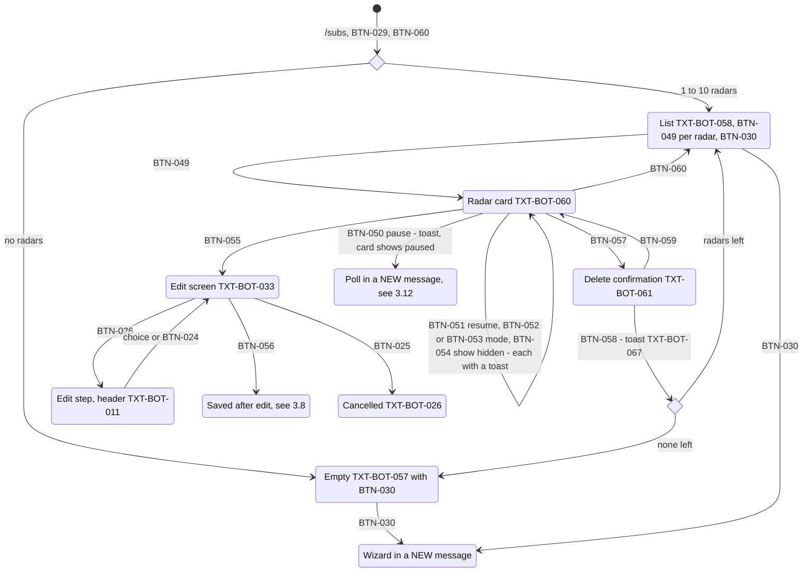

| Aspect          | Detail |
| --------------- | ------ |
| Radar title     | `<сделка> · <объект> · <комнаты> · <город> · <первый район> +N · <бюджет>`, prefixed `▶️` (on) or `⏸` (paused) (`tb:692–693`) |
| Status line     | `▶️ Включён — новые объявления приходят сразу` / `⏸ На паузе — объявления не приходят` / `📬 Подборкой — список новых объявлений в заданное время (/settings)` (`tb:710–711`) |
| Limits          | `k из 10`; behaviour at the limit not checked (Q-BOT-007) |
| Messages        | Everything edits the `/subs` message, except the poll after a pause (new message) and BTN-030 (new wizard message). |
| Backend effects | pause/resume ≈ `PATCH /api/subscriptions/:id` (`active`); mode ≈ same (`mode`); show hidden ≈ same (`unhide`); edit-save ≈ `PUT /api/subscriptions/:id`; delete ≈ `DELETE /api/subscriptions/:id`. All inferred (`tb` §9). |

### 3.12 Poll «Нашли жильё?» (`tb` l.727–747)

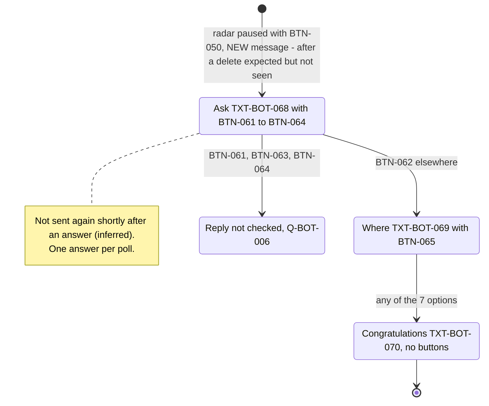

Shared answer codes, CONFIRMED in the Mini App (`app/features/radar/FoundSheet.jsx:28–75`; `api.md:953–964`): answer
`kvadro` / `elsewhere` / `searching` / `stopped`; where `telegram` / `olx` / `site` / `agent` / `friends` / `street` /
`other`; trigger `pause` / `delete`. The mapping from the bot's buttons to these codes is inferred by order and
meaning (`tb:985`). The Mini App's own sheet also offers sharing via `?start=s_friend` (BOT-032). The bot's poll has
no such button.

### 3.13 `/fav` (`tb` §6.8)

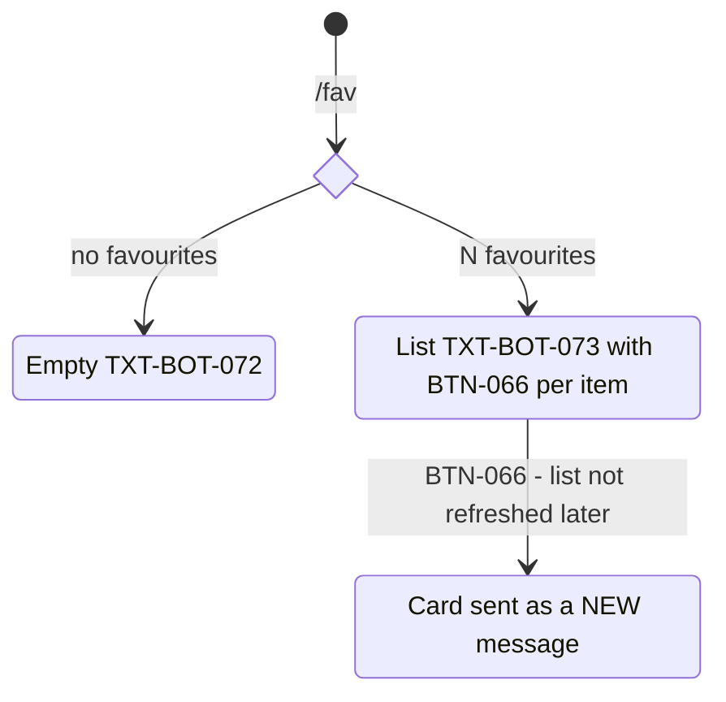

The number of favourites shown and any cap are not recorded. The Mini App contract returns the full list with
`next_cursor: null` (`api.md:926–941`).

### 3.14 `/settings` (`tb` §6.9)

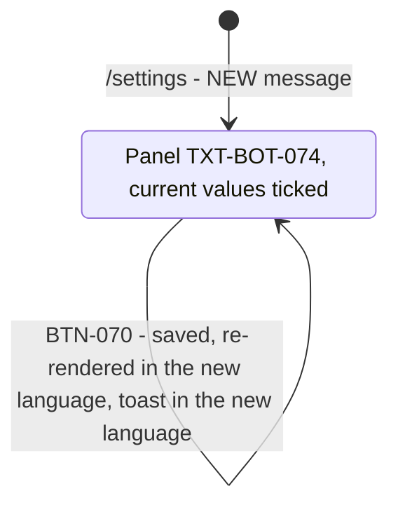

| Row            | Options (RU)                                                  | Observed value on the test account | Code (inferred, `tb:990`) |
| -------------- | ------------------------------------------------------------- | ---------------------------------- | ------------------------- |
| 🌙 Тихие часы  | `выкл`, `22:00–08:00`, `23:00–08:00`, `00:00–09:00`, `23:00–07:00` | `выкл`                         | `off`, `22-08`, `23-08`, `00-09`, `23-07` |
| 📬 Время подборок | `09:00`, `09:00 и 19:00`, `12:00 и 20:00`, `19:00`         | `09:00 и 19:00`                    | `09`, `09,19`, `12,20`, `19` |
| 🌐 Язык        | `🇷🇺 Русский`, `🇺🇿 Oʻzbekcha`, `🇬🇧 English`                  | `🇷🇺 Русский`                      | `ru`, `uz_Latn`, `en` |
| 💱 Валюта      | `Доллары, $`, `Сумы`                                          | `Доллары, $`                       | `USD`, `UZS` |
| 📰 Новости сервиса | `Присылать`, `Не присылать`                               | `Присылать`                        | none in the Mini App contract (bot-only) |

That the presets are delivered by the server (`quiet_presets`, `digest_presets`) is CONFIRMED for the Mini App:
`app/features/settings/SettingsPages.jsx:96–134`, `api.md:845–854`. Times are in Asia/Tashkent.

### 3.15 `/owner` (`tb` §6.10)

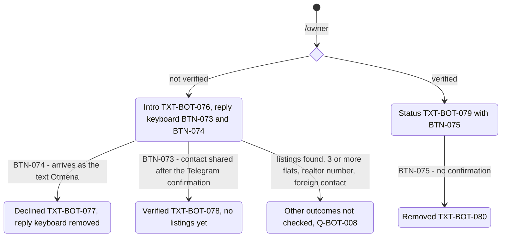

| Aspect             | Detail |
| ------------------ | ------ |
| Validation         | Not visible. Whether the bot checks that the contact belongs to the sender (`contact.user_id`) is unknown (Q-BOT-008). |
| Messages           | Send: intro, reply, status. The user's contact message stays in the chat history. Whether the reply keyboard is removed after a share is not recorded (Q-BOT-037). |
| Backend effects    | Phone **hash** and verification date stored; badge «Хозяин · номер подтверждён» on matching listings, usually within minutes; removal deletes the hash and the badge (BR-BOT-081…BR-BOT-084). |

### 3.16 `/privacy` and data deletion (`tb` §6.12)

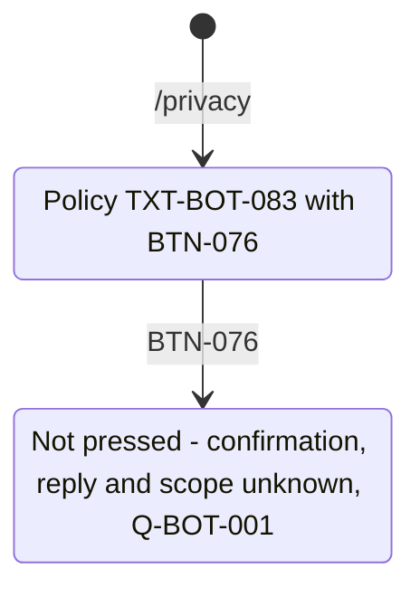

The promised effects (BR-BOT-085…BR-BOT-094): data gone from the bot DB at once and from backups in about two weeks;
PostHog person deletion requested (asynchronous); the owner hash removed. Nothing about the actual handler is known.

### 3.17 Outdated and legacy callbacks (`tb` §5)

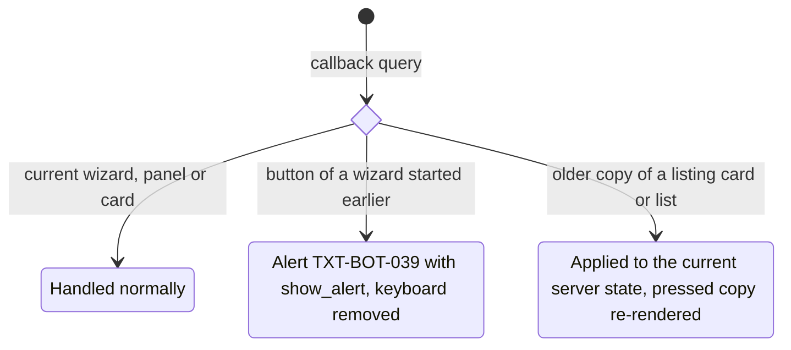

What makes a wizard "earlier" (a newer wizard exists, or a TTL ran out) is not recorded (Q-BOT-018). After a cut-over,
every legacy callback is "old" to the new backend (§6.3).

### 3.18 Owner cabinet and contact requests (seen from the Mini App only)

Mini App release `index-CBlEKxdL.js` added the owner cabinet «Сдать квартиру» and the seeker's request to an owner
(`03` SCR-049 … SCR-062; `08` API-037 … API-054). The bot takes part in both. `tb` is of 2026-11-09 and predates
the cabinet, and no bot code or chat was seen. Everything below comes from the Mini App's texts and the contract
(`api.md` §16, r31), so every row is `UNVERIFIED`; the questions are Q-BOT-047 … Q-BOT-049 (§9.3) and Q-API-068 …
Q-API-078 (`02` §12a). There is no diagram: no step of the bot was observed. Two rows rest on the landing privacy
page of the release, which was an uncommitted working copy at the read and is not cited as a release.

| # | Touchpoint | What the bot or the backend does, by the Mini App's texts and the contract | Items | Evidence |
| - | ---------- | -------------------------------------------------------------------------- | ----- | -------- |
| 1 | Phone intake | The contact that the user shares through `requestContact` arrives in the bot chat. It is matched to the user and the draft and checked: the sender's own contact (else `not_own`), a `+998` number (else `not_uz`), the realtor check («номер встречается в объявлениях о разных квартирах» → `agent`), the fraud list (`fraud`) and the limit of 2 flats per phone (`limit`). Then `phone_set`, `phone_display` and `reject_reason` are set on the listing. The bot may answer in the chat («Загляните в чат с ботом — там может быть ответ»). That the number itself is stored is stated only by the uncommitted privacy page. | BOT-086; `02` BR-API-170 … BR-API-172; `05` TMA-034; Q-BOT-047; `02` Q-API-072 | `app/features/owner/owner.js:89-107`; `api.md:1346-1348`, `:1366-1369` (r31) |
| 2 | Old clients | A client below 6.9 cannot share the number from the Mini App and is sent to the bot. The bot then has to offer a share button in the chat, most likely the reply keyboard of `/owner` (BTN-073; inferred), and to lead back to the draft. | BOT-086; `03` LB-APP-060; Q-BOT-047 | `app/features/owner/owner.js:94`; `tb:827` |
| 3 | Requests to the owner | Each request of a seeker is delivered to the owner in the bot. The owner can answer there or in the app («Отклики придут в бот. Ответить можно там или в «Мои объявления»»), so the message needs answer buttons for at least "give" and "decline" (inferred). | BOT-087; `02` BR-API-180; Q-BOT-048 | `app/features/owner/owner.js:134`; `api.md:820-822` (r31) |
| 4 | «Дать номер» | The owner's number goes to the seeker («человек позвонит вам сам»). | BOT-088; `02` BR-API-181 | `app/features/owner/owner.js:219` |
| 5 | «Не подходит» | After 10 minutes, the window of the undo, a soft refusal goes to the seeker with similar listings. | BOT-089; `02` BR-API-181 | `app/features/owner/owner.js:220`, `:226-227` |
| 6 | Reasons and «Оказался риелтором» | The seeker is marked as a realtor: «на ваши квартиры он больше не напишет», so the seeker can no longer write to this owner's flats. | `02` BR-API-181; `02` Q-API-077 | `app/features/owner/owner.js:221-222`, `:234` |
| 7 | «Сдано» | The seekers who still wait are told that the flat is let; their requests become `cancelled`. | BOT-090; `02` BR-API-176 | `app/features/owner/owner.js:203`, `:240` |
| 8 | Expiry | A request without an answer expires (`expired`, «Без ответа»). The timing is unknown, and so is whether the seeker is told. | `02` BR-API-186; `02` Q-API-075; Q-BOT-048 | `app/features/owner/owner.js:239`; `api.md:1420` (r31) |
| 9 | «Обычно отвечает за N мин» | `response_minutes` is computed from the owner's answer times and shown to seekers. | `02` BR-API-188; `02` Q-API-076 | `$KVADRO_ROOT/demo/app/docs/CHANGELOG.md:19` (r31); `api.md:349` (r31) |
| 10 | Publish | The listing goes into the feed and to the matching radars («уже уходит тем, у кого включён радар»). The server counts `sent`, `opened`, `favorites` and `daily`. | `02` BR-API-174, BR-API-175; the push is BOT-081 | `app/features/owner/owner.js:131`; `api.md:1393-1404` (r31) |
| 11 | Complaints and support | Complaints lead to `withdrawn`: the listing moves to «История» and gets a support button. Support can set `held`: the listing is paused, and the owner cannot resume it. The support account is `GET /api/bot` → `support`. | `02` BR-API-177; `08` API-003 | `api.md:1358-1359`, `:549-551` (r31) |
| 12 | Waiting list | Realtors on the waiting list are to get a message later («напишем в бот, когда откроем»). | BOT-091; `02` BR-API-182 | `app/features/owner/owner.js:110` |
| 13 | Description | Phone numbers in the owner's description are hidden on the server. | `02` BR-API-165 | `api.md:1390` (r31); `app/features/owner/owner.js:73` |
| 14 | Retention and privacy | By the uncommitted privacy page only: photos are kept while the listing is in the feed or paused; the number and the form answers until the user deletes their data; requests until data deletion. The seeker's Telegram name is "not stored", yet `OwnerRequest.name` is served. | `02` Q-API-072; `02` Q-API-077 | the landing privacy page, an uncommitted working copy at the read |
| 15 | Bot entry | By the uncommitted privacy page only, «Сдаю квартиру» exists "in the bot or the app". That suggests an entry of the bot's own, likely a link with `startapp=owner_new` (inferred). | Q-BOT-049; `05` TMA-046 | the landing privacy page, an uncommitted working copy at the read; `api.md:1349-1350` (r31) |

Nothing read from a committed source changes `/owner` (§3.15, BOT-075…BOT-079); whether its texts changed is part of
Q-BOT-049.

### 3.19 What Mini App release `index-CIa0Ldj2.js` expects of the bot (seen from the Mini App only)

Mini App release `index-CIa0Ldj2.js` proves no new message and no new inbound update of the bot, so this section adds
no `BOT` item. It lists what the release expects of the bot. No bot document describes any of it (`tb` is of
2026-11-09), and no bot code or chat was seen: everything below is `UNVERIFIED` or inferred. The questions are
Q-BOT-050 and Q-BOT-051 (§9.3). There is no diagram: no step of the bot was observed.

| Point | What the Mini App shows | Ids |
| ----- | ----------------------- | --- |
| Radar link | The Mini App reads `?radar=<id>` from the page address only and then takes the filters of that radar as the search; `start_param` has no such form. So the bot would have to open the Mini App by a URL with the query, in a `web_app` button or as the menu URL; a `startapp` link cannot carry it (inferred). The id must be the numeric `id` that `GET /api/subscriptions` returns for the same user, and a listing link in the same launch wins. That the bot sends such links is stated only by a comment in the Mini App's source (`app/features/radar/radarLink.js:1-13`, `app/app/useAppBootstrap.js:135-149`, r33; `api.md:1314-1317`, r35). | BOT-081, BOT-082; `05` TMA-012; `03` BR-APP-107, LB-APP-079; Q-BOT-050 |
| `paused` | While the bot is paused, `GET /api/meta` answers `403 {"detail": "paused"}` and the Mini App shows «Бот на паузе», «Скоро вернёмся. Ваши Радары и избранное на месте.» `GET /api/bot` must still answer without authorisation, with the username and the support account. The Mini App passes no source to `/start` for this reason. What the bot itself does during a pause is not stated: commands, radar cards, digests (`app/features/onboarding/NoAccessScreen.jsx:13,22,26`, r33; `api.md:69-75`, `:1370`, r35). | `02` BR-API-194; `03` SCR-003; BOT-081, BOT-082; Q-BOT-051 |
| Day limit | A user who opened very many listings within a day sees «Лимит на сегодня» with the text «За сутки открыто очень много объявлений. Попробуйте позже — Радар продолжит присылать новые в чат.» So radar cards are expected to keep coming while the opening of listings is limited (`app/components/ErrorState.jsx:14-25`, r33; `api.md:712-714`, r35). | `02` BR-API-193; `03` SCR-008; BOT-081, BOT-082; Q-BOT-051 |
| `/start` sources | The no-access screen sends `s_seo_en` and `s_seo_uz` next to `s_seo`, `s_web`, `s_share` and the campaign codes, each with an optional `--l<listing id>`. No source arrives for `blocked` and `paused`. Whether the bot treats the two new payloads like `s_seo` is not known (`app/features/onboarding/NoAccessScreen.jsx:26,41-47,72-75`; `app/lib/telegram/startParam.js:69-79`, r33). | BOT-030, BOT-031; Q-BOT-032 |
| Listing links | `l_<id>[-<source>]` and `?listing=<id>` are unchanged; an id must be a positive safe integer. A link to a sale listing switches the feed under the card to sale. The share link `https://t.me/<bot>?startapp=l_<id>` and the support link `https://t.me/<support>?start=l_<id>` are unchanged (`app/lib/telegram/startParam.js:17-25`, `app/app/App.jsx:244-264`, r33). | `05` TMA-010, TMA-013; `03` BR-APP-108 |
| Landing | Nothing in the release changes what the landing sends: `l_<id>-web` and the SEO forms are parsed as before. | — |

## 4. Buttons, callbacks and texts

### 4.1 Buttons and callback actions (BTN-NNN)

One row per button or callback action. Option groups that behave the same are one row, with all labels listed.
EN/UZ labels are given only where `tb` §13 captured them. All other labels are known in RU only (Q-BOT-014). In
`data/bot-handlers.json` every BTN record has `kind: "callback"`. The real transport (callback, web_app, url,
request_contact, reply text) is in its `trigger`.

| ID | Label(s) | Appears on | Type | Action → result | Toast / alert | Backend effect | Status | Source |
| -- | -------- | ---------- | ---- | --------------- | ------------- | -------------- | ------ | ------ |
| BTN-001 | `📱 Открыть kvadro²` · EN `📱 Open kvadro²` | Welcome (/start) row 1 | web_app, primary | Opens the Mini App (client side; no update reaches the bot) | — | — | `DOCUMENTED_ONLY` | tb §6.1 l.216; §13 l.1087 |
| BTN-002 | `📡 Включить радар` · EN `📡 Turn on radar` | Welcome row 2 | callback | NEW message: wizard step 1 (BOT-037); the welcome is unchanged | none | Wizard state created | `DOCUMENTED_ONLY` | tb §6.1 l.217; §7 l.887 |
| BTN-003 | Two of `🇷🇺 Русский` · `🇺🇿 Oʻzbekcha` · `🇬🇧 English` (always the two other languages) | Welcome row 3 | callback | Language switched; the same welcome re-rendered in the new language (BOT-025); command menu switched | none | User locale updated (≈ `PUT /api/settings`, inferred) | `DOCUMENTED_ONLY` | tb §6.1 l.218; §6.2 l.231-234; §7 l.888 |
| BTN-004 | `🏠 Открыть квартиру` | Third message of `s_<source>--l<id>` (BOT-031) | web_app, primary | Opens the Mini App on that listing (URL and start_param inferred) | — | — | `UNVERIFIED` | tb §10 l.1017; §7 l.889; §9 l.993 |
| BTN-005 | `📱 Открыть приложение` | /app | web_app | Opens the Mini App | — | — | `DOCUMENTED_ONLY` | tb §6.3 l.244; §7 l.890 |
| BTN-006 | `🔑 Снять надолго` | Wizard step 1; `✏️ Сделка` | callback | deal = rent_long, M = 8; edits to step 2 (rent_long objects); in edit mode budget reset and back to review, or step 2 if the object is not allowed | none | Wizard state: deal | `DOCUMENTED_ONLY` | tb §6.4 l.264, l.287; §7 l.891 |
| BTN-007 | `🌙 Снять посуточно` | Wizard step 1; `✏️ Сделка` | callback | deal = rent_daily, M = 7; step 2 (daily objects); edit mode as BTN-006 | none | Wizard state: deal | `DOCUMENTED_ONLY` | tb §6.4 l.264, l.287 |
| BTN-008 | `🏷 Купить` | Wizard step 1; `✏️ Сделка` | callback | deal = sale, M = 6; step 2 (sale objects); edit mode as BTN-006 (room → sale forces step 2) | none | Wizard state: deal | `DOCUMENTED_ONLY` | tb §6.4 l.264, l.287, l.514-515 |
| BTN-009 | `Квартира`, `Дом`, `Квартира или дом`, `Комната / подселение`, `Помещение`, `Участок` (set per deal, BR-BOT-021) | Wizard step 2; `✏️ Объект` | callback | types set; next step 3 (apartment, house, both) or step 4 (room, commercial, land); in edit mode back to review | none | Wizard state: types (`apartment` / `house` / both / `room` / `commercial` / `land`, inferred) | `DOCUMENTED_ONLY` | tb §6.4 l.293-297; §7 l.892 |
| BTN-010 | `1` `2` `3` `4+` `1–2` `2–3` `Не важно` (default `✅ Не важно`) | Wizard step 3; `✏️ Комнаты` | callback | rooms set; context line gains `· N комн.`; next step 4 (edit mode: review) | none | Wizard state: rooms_min / rooms_max (inferred) | `DOCUMENTED_ONLY` | tb §6.4 l.308; §7 l.893 |
| BTN-011 | `Ташкент` `Ташкентская область` `Андижан` / `Наманган` `Коканд` `Фергана` (current one `✅`) | Wizard step 4 | callback | City chosen with `Весь <город>` and the wizard jumps straight to step 5 with that city's budget (LB-BOT-002) | none | Wizard state: city, districts cleared | `DOCUMENTED_ONLY` | tb §6.4 l.321-322, l.369; §7 l.894 |
| BTN-012 | `🏛 Центр` | Wizard step 4, Tashkent only | callback | Toggles zone `center` (on or off), clears districts already ticked, jumps to step 5 (LB-BOT-001) | none | Wizard state: zones (center), districts cleared | `DOCUMENTED_ONLY` | tb §6.4 l.370; §7 l.895; §11 l.1023-1025 |
| BTN-013 | `🏙 Ближе к центру` | Wizard step 4, Tashkent only | callback | Not pressed; inferred to behave like `🏛 Центр` | none (inferred) | Wizard state: zones (near_center, inferred) | `UNVERIFIED` | tb §6.4 l.371 |
| BTN-014 | `🚇 Рядом с метро (до ~1 км)` | Wizard step 4, Tashkent only | callback | Toggles near-metro (on or off), keeps ticked districts, jumps to step 5 (LB-BOT-001) | none | Wizard state: near_metro | `DOCUMENTED_ONLY` | tb §6.4 l.370; §7 l.895 |
| BTN-015 | District name (per-city list, tb l.351-358; two per row, alphabetical) | Wizard step 4 | callback | Toggles `✅` in place; `Весь <город>` loses `✅`; `Готово (N)` counter updated; stays on step 4 | none | Wizard state: districts | `DOCUMENTED_ONLY` | tb §6.4 l.366; §7 l.896 |
| BTN-016 | `Весь <город>` (e.g. `✅ Весь Ташкент`, `Весь Фергана`) | Wizard step 4 | callback | Whole city; inferred to clear ticked districts (not pressed) | none | Wizard state: districts cleared (inferred) | `UNVERIFIED` | tb §6.4 l.368; §7 l.897 |
| BTN-017 | `Готово (N)` | Wizard step 4 | callback | Step 5; N = 0 with `✅ Весь <город>` means the whole city; in edit mode back to review | none | — | `DOCUMENTED_ONLY` | tb §6.4 l.367; §7 l.898 |
| BTN-018 | `до $<amount>` presets (per city/deal/rooms, §3.6) and `✅ Не важно` | Wizard step 5; `✏️ Бюджет` | callback | price_max set (or none); step 6 (edit mode: review) | none | Wizard state: price_max | `DOCUMENTED_ONLY` | tb §6.4 l.385-409; §7 l.899 |
| BTN-019 | `✍️ Своя сумма` | Wizard step 5 | callback | Same message replaced by TXT-BOT-021 with Back/Cancel; bot waits for a number (BOT-042) | none | Wizard state: awaiting amount | `DOCUMENTED_ONLY` | tb §6.4 l.412-418; §7 l.900 |
| BTN-020 | `📊 Не дороже рынка` | Wizard step 5 (Tashkent, Tashkent region; rent_long and sale) | callback | Toggles `✅`, stays on step 5; combinable with an amount (`💰 до $100 000, не дороже рынка`) | none | Wizard state: below_median | `DOCUMENTED_ONLY` | tb §6.4 l.399-411; §7 l.901 |
| BTN-021 | `Все объявления` (default `✅`) · `Без риелторов` · `Только хозяева` | Wizard step 6; `✏️ Риелторы` | callback | owner set; next step 7 (rent) or review (sale) | none | Wizard state: owner (`any` / `no_agents` / `owners`, inferred) | `DOCUMENTED_ONLY` | tb §6.4 l.432; §7 l.902 |
| BTN-022 | `👨‍👩‍👧 Семья` · `👨 Парень / парни` · `👩 Девушка / девушки` · `✅ Не важно` | Wizard step 7; `✏️ Кто живёт` | callback | tenant set; next step 8 (rent_long) or review (rent_daily) | none | Wizard state: tenant (`family` / `men` / `women` / null, inferred) | `DOCUMENTED_ONLY` | tb §6.4 l.442; §7 l.903 |
| BTN-023 | `🐾 Не запрещены` · `🐾 Разрешены` · `✅ Не важно` | Wizard step 8; `✏️ Животные` | callback | pets set; review | none | Wizard state: pets / pets_only (inferred) | `DOCUMENTED_ONLY` | tb §6.4 l.452; §7 l.904 |
| BTN-024 | `◀️ Назад` | Wizard steps 2-8, typed-amount prompt, edit steps | callback | Previous step with the earlier choice marked `✅`; from an edited step back to the review / edit screen unchanged; from the amount prompt presumably step 5 (not stated) | none | — | `DOCUMENTED_ONLY` | tb §6.4 l.267-268, l.418, l.512-513; §7 l.905 |
| BTN-025 | `✖️ Отмена` | Every wizard step, amount prompt, review, «Радар — что изменить?», edit steps | callback | Message edited to TXT-BOT-026; keyboard removed; nothing saved (BOT-050) | none | Wizard state discarded | `DOCUMENTED_ONLY` | tb §6.4 l.269-275; §7 l.906 |
| BTN-026 | `✏️ Сделка` `✏️ Объект` `✏️ Комнаты` `✏️ Районы` `✏️ Бюджет` `✏️ Риелторы` `✏️ Кто живёт` `✏️ Животные` (only the branch's steps, two per row) | Review; «Радар — что изменить?» | callback | Opens that step in the same message (BOT-048) | none | — | `DOCUMENTED_ONLY` | tb §6.4 l.500-515; §7 l.907 |
| BTN-027 | Relax option, e.g. `✅ Вместе с риелторами` (others unknown, Q-BOT-039) | Review, when broadening options exist | callback | Applies the weakening, recomputes the review, the button disappears (BOT-049) | none | Wizard state weakened (≈ flow `options` / `POST /api/subscriptions/:id/relax`, inferred) | `DOCUMENTED_ONLY` | tb §6.4 l.495-498; §7 l.908; §9 l.983 |
| BTN-028 | `✅ Сохранить` (primary) | Review of a new radar (wizard or free text) | callback | Message edited to TXT-BOT-034; then sticker, starter list, first-radar tip as new messages (BOT-051) | TXT-BOT-075 `Сохранил ✅` | Radar created (≈ `POST /api/subscriptions`, inferred) | `DOCUMENTED_ONLY` | tb §6.4 l.519-566; §7 l.909 |
| BTN-029 | `📡 Радар` | «✅ Радар включён» | callback | The same message becomes the /subs list (BOT-064) | none | — | `DOCUMENTED_ONLY` | tb §6.4 l.533; §7 l.910 |
| BTN-030 | `➕ Новый радар` | «✅ Радар включён», /subs list, /subs empty, not-understood reply | callback | NEW message: wizard step 1 | none | Wizard state created | `DOCUMENTED_ONLY` | tb §6.4 l.248-249; §7 l.911 |
| BTN-031 | `1` … `N` (five per row) | Starter list «🗂 Уже есть…» | callback | Card (BOT-059) as a NEW message; list unchanged; works after the radar is deleted | none | — | `DOCUMENTED_ONLY` | tb §6.4 l.550-551; §7 l.912 |
| BTN-032 | `⚡ Сразу` | First-radar tip | callback | Keyboard removed; last paragraph replaced with TXT-BOT-037 | none observed | Radar mode instant (≈ `PATCH /api/subscriptions/:id` mode, inferred) | `DOCUMENTED_ONLY` | tb §6.4 l.564-565; §7 l.913 |
| BTN-033 | `📬 Подборкой` | First-radar tip | callback | Not checked; inferred to set digest mode | unknown | Radar mode digest (inferred) | `UNVERIFIED` | tb §6.4 l.564-566 |
| BTN-034 | `✉️ Написать в поддержку` (primary) | /help; not-understood reply | url | Opens `https://t.me/KvadroSupportBot` | — | — | `DOCUMENTED_ONLY` | tb §6.5 l.605; §6.11 l.845; §7 l.938 |
| BTN-035 | `📱 Открыть в приложении` (primary) | Listing card row 1 | web_app, primary | Opens the listing in the Mini App (URL inferred, not visible) | — | — | `DOCUMENTED_ONLY` | tb §6.6 l.657; §7 l.914 |
| BTN-036 | `📍 На карте` | Listing card row 1, only with coordinates | callback | Venue message as a reply to the card: title `3-комн. квартира · Чиланзар · $600`, address `Чиланзар · Чиланзар-19` (TXT-BOT-045) | none | — | `DOCUMENTED_ONLY` | tb §6.6 l.658; §7 l.915 |
| BTN-037 | `🔗 Открыть оригинал` | Listing card row 2 | url | Opens `https://t.me/<канал>/<id поста>` | — | — | `DOCUMENTED_ONLY` | tb §6.6 l.659; §7 l.916 |
| BTN-038 | `📷 Ещё N фото` | Listing card row 2, if the post has photos | callback | Album (media group) of N photos without captions, as a reply; button stays. No photos → no album | on failure TXT-BOT-050 `Фото больше недоступны` | — | `DOCUMENTED_ONLY` | tb §6.6 l.660; §7 l.917; §11 l.1032 |
| BTN-039 | `⭐ В избранное` | Listing card row 3 (also in rented state) | callback | Pressed copy's button → `★ В избранном` | TXT-BOT-048 `Добавил в избранное ⭐ — список: /fav` | Favourite toggled on server (≈ `POST /api/listings/:id/favorite`) | `DOCUMENTED_ONLY` | tb §6.6 l.661; §7 l.918; §9 l.986 |
| BTN-040 | `★ В избранном` | Listing card row 3 | callback | Pressed copy's button → `⭐ В избранное`; on a stale copy the server toggle can ADD instead (LB-BOT-007) | TXT-BOT-049 `Убрал из избранного` | Favourite toggled on server (≈ `POST /api/listings/:id/favorite`) | `DOCUMENTED_ONLY` | tb §6.6 l.662, l.670-672 |
| BTN-041 | `Это риелтор` | Listing card row 3 | callback | Label unchanged; no undo (LB-BOT-008) | TXT-BOT-053; repeat → TXT-BOT-054 `Уже отмечено` | Phone marked as realtor's for all its listings (≈ `POST /api/listings/:id/report` reason `agent`, inferred) | `DOCUMENTED_ONLY` | tb §6.6 l.663; §7 l.919; §9 l.988 |
| BTN-042 | `Уже сдано` | Listing card row 4 | callback | Line TXT-BOT-046 prepended; lower two rows → `⭐ В избранное` · `↩️ Не сдано` (BOT-060) | TXT-BOT-055 | Rented vote; listing hidden for the voter (≈ `POST /api/listings/:id/report` reason `rented`) | `DOCUMENTED_ONLY` | tb §6.6 l.664; §7 l.920; §9 l.987 |
| BTN-043 | `↩️ Не сдано` | Card in rented state | callback | Text and keyboard restored | TXT-BOT-056 `Вернул объявление` | Rented vote withdrawn (≈ `DELETE /api/listings/:id/hide`, inferred) | `DOCUMENTED_ONLY` | tb §6.6 l.665; §9 l.987 |
| BTN-044 | `Скрыть похожие` | Listing card row 4 | callback | Keyboard → submenu (BOT-061) | TXT-BOT-051 `Что скрыть?` | — | `DOCUMENTED_ONLY` | tb §6.6 l.666; §7 l.921 |
| BTN-045 | `📢 Канал @<канал>` | Hide-similar submenu | callback | Card keyboard restored; rule shown as `🙈 скрыто: @<канал>` on the radar card | TXT-BOT-052 | Hide rule (channel) stored in the radar (≈ `POST /api/listings/:id/block-author` kind source, inferred) | `DOCUMENTED_ONLY` | tb §6.6 l.667; §7 l.922; §9 l.989 |
| BTN-046 | `📍 Район <район>` | Hide-similar submenu | callback | As BTN-045 with a district rule | TXT-BOT-052 | Hide rule (district) stored in the radar | `DOCUMENTED_ONLY` | tb §6.6 l.667; §7 l.922 |
| BTN-047 | Realtor row (label unknown; «этого риелтора» in the tip text) | Hide-similar submenu (never shown) | callback | Unknown | unknown | Hide rule (phone/author), inferred | `UNVERIFIED` | tb §6.4 l.557; §6.6 l.666; §12 l.1054 |
| BTN-048 | `✖️ Отмена` | Hide-similar submenu | callback | Card keyboard restored | none | — | `DOCUMENTED_ONLY` | tb §6.6 l.668 |
| BTN-049 | `▶️ <название>` / `⏸ <название>` (TXT-BOT-059) | /subs list | callback | The list message becomes the radar card (BOT-065) | none | — | `DOCUMENTED_ONLY` | tb §6.7 l.692-693; §7 l.923 |
| BTN-050 | `⏸ Пауза` | Radar card (active) | callback | Status «на паузе», button → `▶️ Включить`; poll BOT-069 as a NEW message | TXT-BOT-062 `На паузе ⏸` | Radar active = false (≈ `PATCH /api/subscriptions/:id`); ask_found evaluated | `DOCUMENTED_ONLY` | tb §6.7 l.716; §7 l.924; §9 l.978 |
| BTN-051 | `▶️ Включить` | Radar card (paused) | callback | Status back to active | TXT-BOT-063 (variant with new matches unknown, Q-BOT-045) | Radar active = true (≈ `PATCH /api/subscriptions/:id`; `starter`, inferred) | `DOCUMENTED_ONLY` | tb §6.7 l.717; §9 l.978 |
| BTN-052 | `📬 Присылать подборкой` | Radar card (instant) | callback | Status «📬 Подборкой…», button → `📡 Присылать сразу` | TXT-BOT-064 | Radar mode digest (≈ `PATCH /api/subscriptions/:id`) | `DOCUMENTED_ONLY` | tb §6.7 l.718; §7 l.925; §9 l.979 |
| BTN-053 | `📡 Присылать сразу` | Radar card (digest) | callback | Button → `📬 Присылать подборкой` | TXT-BOT-065 `Теперь — сразу` | Radar mode instant (≈ `PATCH /api/subscriptions/:id`) | `DOCUMENTED_ONLY` | tb §6.7 l.719; §9 l.979 |
| BTN-054 | `🙉 Показать скрытое` | Radar card, only with hide rules | callback | `🙈` line and the button disappear | TXT-BOT-066 | All hide rules of the radar removed (≈ `PATCH /api/subscriptions/:id` unhide) | `DOCUMENTED_ONLY` | tb §6.7 l.720; §7 l.926; §9 l.980 |
| BTN-055 | `✏️ Изменить` | Radar card | callback | Message → «Радар — что изменить?» (BOT-066) | none | Wizard state seeded from the radar | `DOCUMENTED_ONLY` | tb §6.7 l.721; §7 l.927 |
| BTN-056 | `✅ Сохранить` (primary) | «Радар — что изменить?» | callback | As BTN-028; starter list only with listings not sent before (BOT-067) | TXT-BOT-075 `Сохранил ✅` | Radar filters replaced (≈ `PUT /api/subscriptions/:id`) | `DOCUMENTED_ONLY` | tb §6.4 l.568-569; §6.7 l.721; §7 l.909; §9 l.981 |
| BTN-057 | `🗑 Удалить` | Radar card | callback | Message → TXT-BOT-061 confirmation (BOT-068) | none | — | `DOCUMENTED_ONLY` | tb §6.7 l.722; §7 l.928 |
| BTN-058 | `🗑 Да, удалить` (danger) | Delete confirmation | callback | Message → /subs list, or «Радаров пока нет…» at zero; the poll did not come this time | TXT-BOT-067 `Радар удалён` | Radar deleted (≈ `DELETE /api/subscriptions/:id`; ask_found) | `DOCUMENTED_ONLY` | tb §6.7 l.723; §7 l.928; §9 l.982 |
| BTN-059 | `✖️ Отмена` | Delete confirmation | callback | Back to the radar card | none | — | `DOCUMENTED_ONLY` | tb §6.7 l.724 |
| BTN-060 | `◀️ К списку` | Radar card | callback | Message → /subs list | none | — | `DOCUMENTED_ONLY` | tb §6.7 l.725; §7 l.929 |
| BTN-061 | `🎉 Да, через kvadro²` | Poll «Нашли жильё?» | callback | Not checked | none (tb §8) | Answer `kvadro` (inferred) | `UNVERIFIED` | tb §6.7 l.735, l.747; §9 l.985 |
| BTN-062 | `🏠 Да, в другом месте` | Poll «Нашли жильё?» | callback | Message edited to TXT-BOT-069 (BOT-070) | none | Answer `elsewhere` (inferred) | `DOCUMENTED_ONLY` | tb §6.7 l.737-745; §7 l.930 |
| BTN-063 | `🔎 Ещё ищу` | Poll «Нашли жильё?» | callback | Not checked | none (tb §8) | Answer `searching` (inferred) | `UNVERIFIED` | tb §6.7 l.735, l.747 |
| BTN-064 | `🙅 Больше не ищу` | Poll «Нашли жильё?» | callback | Not checked | none (tb §8) | Answer `stopped` (inferred) | `UNVERIFIED` | tb §6.7 l.735, l.747 |
| BTN-065 | `📢 Telegram-канал` · `🛒 OLX` / `🌐 Uybor, Uysot…` · `🤝 Риелтор` / `👥 Знакомые` · `🪧 На доме, на улице` / `Другое` | Poll «Где нашли?» | callback | Message edited to TXT-BOT-070 without buttons (only `Другое` pressed) | none | Where stored (`telegram` / `olx` / `site` / `agent` / `friends` / `street` / `other`, inferred) | `DOCUMENTED_ONLY` | tb §6.7 l.745-746; §7 l.931; §12 l.1050 |
| BTN-066 | `<n>. <комнаты>-комн. квартира · <район> · $<цена>` | /fav list | callback | Card (BOT-059) as a NEW message | none | — | `DOCUMENTED_ONLY` | tb §6.8 l.766; §7 l.932 |
| BTN-067 | `🌙 Тихие часы` `📬 Время подборок` `🌐 Язык` `💱 Валюта` `📰 Новости сервиса` · EN `🌙 Quiet hours` `📬 Digest times` `🌐 Language` `💱 Currency` `📰 Service news` · UZ `🌙 Sokinlik soatlari` `📬 Toʻplamlar vaqti` `🌐 Til` `💱 Valyuta` `📰 Xizmat yangiliklari` | /settings section headers | callback | Nothing: no edit (LB-BOT-026) | none | — | `DOCUMENTED_ONLY` | tb §6.9 l.805-806; §7 l.934; §13 l.1107-1132 |
| BTN-068 | `выкл` `22:00–08:00` `23:00–08:00` / `00:00–09:00` `23:00–07:00` · EN `off` · UZ `oʻch.` | /settings quiet hours | callback | `✅` moves; line becomes e.g. `🌙 Тихие часы: 23:00–08:00. В это время…` | TXT-BOT-075 | Quiet hours saved (≈ `PUT /api/settings` quiet `off`/`22-08`/`23-08`/`00-09`/`23-07`, inferred) | `DOCUMENTED_ONLY` | tb §6.9 l.792-793, l.807-808; §9 l.990 |
| BTN-069 | `09:00` `09:00 и 19:00` / `12:00 и 20:00` `19:00` · EN `and` · UZ `va` | /settings digest times | callback | `✅` moves; line becomes e.g. `📬 Подборки: 19:00 — …` | TXT-BOT-075 | Digest times saved (≈ `PUT /api/settings` digest `09`/`09,19`/`12,20`/`19`, inferred) | `DOCUMENTED_ONLY` | tb §6.9 l.795-796, l.808; §9 l.990 |
| BTN-070 | `🇷🇺 Русский` `🇺🇿 Oʻzbekcha` `🇬🇧 English` | /settings language | callback | Panel re-rendered in the new language; command menu switched (BOT-025) | TXT-BOT-075 in the new language | Locale saved | `DOCUMENTED_ONLY` | tb §6.2 l.231-234; §6.9 l.798 |
| BTN-071 | `Доллары, $` `Сумы` · EN `Dollars, $` `Soʻm` · UZ `Dollar, $` `Sumi` | /settings currency | callback | `✅` moves; line `💱 Валюта: Сумы` | TXT-BOT-075 | Currency saved (`USD` / `UZS`) | `DOCUMENTED_ONLY` | tb §6.9 l.800, l.808; §13 l.1109, l.1131 |
| BTN-072 | `Присылать` `Не присылать` · EN `Send` `Don’t send` · UZ `Yuborish` `Yubormaslik` | /settings service news | callback | `✅` moves; line `📰 Новости сервиса: Не присылать` | TXT-BOT-075 | Service-news opt-in saved (bot-only field) | `DOCUMENTED_ONLY` | tb §6.9 l.802, l.809; §9 l.991 |
| BTN-073 | `📱 Поделиться номером` | /owner reply keyboard | request_contact | Telegram asks to confirm; the user's contact is sent; reply TXT-BOT-078 in the no-listings case (BOT-077) | — | Phone hash + date stored; badge matching | `DOCUMENTED_ONLY` | tb §6.10 l.827, l.832; §7 l.935 |
| BTN-074 | `Отмена` | /owner reply keyboard | reply | Reply TXT-BOT-077; reply keyboard removed (BOT-076) | — | — | `DOCUMENTED_ONLY` | tb §6.10 l.831; §7 l.936 |
| BTN-075 | `🗑 Убрать номер` | /owner when verified | callback | No confirmation; TXT-BOT-080 (edit or new message not recorded) (BOT-079) | none | Phone hash removed; badge removed | `DOCUMENTED_ONLY` | tb §6.10 l.833-834; §7 l.937 |
| BTN-076 | `🗑 Удалить мои данные` | /privacy | callback | Not pressed; confirmation and reply unknown (BOT-080) | unknown | All user data deleted (promised) | `UNVERIFIED` | tb §6.12 l.867; §7 l.939; §12 l.1045 |

### 4.2 Texts, toasts and alerts (TXT-BOT-NNN)

Short texts are quoted verbatim. Long texts point to their lines in `tb`, which stays the source of truth.
`<…>` marks placeholders. Live numbers in examples change over time.

| ID          | Kind    | Where                                  | Text (RU, verbatim) or source lines | Other languages | Status | Source |
| ----------- | ------- | -------------------------------------- | ----------------------------------- | --------------- | ------ | ------ |
| TXT-BOT-001 | profile | Description, empty chat (BOT-002)      | trilingual block, `tb:57–68`        | RU/UZ/EN in one text | `DOCUMENTED_ONLY` | `tb:57–68` |
| TXT-BOT-002 | image   | Description banner (BOT-002)           | «Вся аренда из Telegram — в одной ленте» / «Telegramdagi barcha ijara — bitta lentada» | RU + UZ on the image | `DOCUMENTED_ONLY` | `tb:54–55` |
| TXT-BOT-003 | profile | Bio (BOT-003)                          | `tb:72–76`                          | unknown | `DOCUMENTED_ONLY` | `tb:72–76` |
| TXT-BOT-004 | label   | Menu button (BOT-004)                  | `Открыть`                           | unknown (Q-BOT-020) | `DOCUMENTED_ONLY` | `tb:82` |
| TXT-BOT-005 | menu    | Command descriptions (BOT-007)         | `Начало`, `Открыть приложение`, `Новый радар`, `Радар`, `Избранное`, `Настройки`, `Я хозяин: подтвердить номер`, `Помощь и связь`, `Конфиденциальность`, `Проверка связи` | EN in `tb:96–105`; UZ unknown | `DOCUMENTED_ONLY` | `tb:94–105`, `tb:1134` |
| TXT-BOT-006 | message | Welcome (BOT-012)                      | `tb:195–210`; bold: active count and «Чем удобнее каналов» (`tb:212`) | EN TXT-BOT-007; UZ unknown | `DOCUMENTED_ONLY` | `tb:195–212` |
| TXT-BOT-007 | message | Welcome, EN                            | `tb:1070–1085`                      | — | `DOCUMENTED_ONLY` | `tb:1068–1087` |
| TXT-BOT-008 | message | Third message of `s_<source>--l<id>`   | `Квартира, по которой вы пришли: <2-комн. квартира · Юнусабад · $600>. Откройте её кнопкой ниже 👇` | unknown | `DOCUMENTED_ONLY` | `tb:1013–1015` |
| TXT-BOT-009 | message | `/app`                                 | `Лента объявлений, карточки с галереей и избранное — в приложении:` | unknown | `DOCUMENTED_ONLY` | `tb:241` |
| TXT-BOT-010 | frame   | Wizard step frame                      | `📡 Новый радар · шаг N из M` + `🏠 <сделка> · <объект>[ · <комнаты>]` + question + hint | unknown | `DOCUMENTED_ONLY` | `tb:254–262` |
| TXT-BOT-011 | frame   | Edit-radar step header                 | `Изменение радара · шаг N из M`     | unknown | `DOCUMENTED_ONLY` | `tb:721` |
| TXT-BOT-012 | prompt  | Step 1                                 | `Что ищете?`                        | unknown | `DOCUMENTED_ONLY` | `tb:284` |
| TXT-BOT-013 | prompt  | Step 2                                 | `Какой объект?`                     | unknown | `DOCUMENTED_ONLY` | `tb:291` |
| TXT-BOT-014 | prompt  | Step 3                                 | `Сколько комнат?`                   | unknown | `DOCUMENTED_ONLY` | `tb:305` |
| TXT-BOT-015 | prompt  | Step 4                                 | `Какие районы? Отметьте один или несколько и нажмите «Готово».` | unknown | `DOCUMENTED_ONLY` | `tb:313` |
| TXT-BOT-016 | hint    | Step 4, Tashkent                       | `tb:338` (zones, distance rule, unlocated listings) | unknown | `DOCUMENTED_ONLY` | `tb:338` |
| TXT-BOT-017 | hint    | Step 4, other cities: (a) region, (b) Andijan/Namangan/Fergana with the city name, (c) Kokand | `tb:345–347` | unknown | `DOCUMENTED_ONLY` | `tb:345–347` |
| TXT-BOT-018 | prompt  | Step 5 question by deal                | `Бюджет в месяц — до скольки?` / `Бюджет за сутки — до скольки?` / `Бюджет на покупку — до скольки?` | unknown | `DOCUMENTED_ONLY` | `tb:378`, `tb:406–407` |
| TXT-BOT-019 | hint    | Step 5 median line                     | `<Город>: половина квартир — до $<N> в месяц`; sale `<Город>: половина квартир — до $<N>` | unknown | `DOCUMENTED_ONLY` | `tb:380`, `tb:392–397`, `tb:407` |
| TXT-BOT-020 | hint    | Step 5 below-market explanation        | `tb:382`; the same rule is worded in the Mini App (`app/i18n/locales/ru.js:413–416`) | unknown | `DOCUMENTED_ONLY` | `tb:382` |
| TXT-BOT-021 | prompt  | Typed-amount prompt                    | `Напишите сумму в долларах одним числом, например 650 или 85000.` | unknown | `DOCUMENTED_ONLY` | `tb:415` |
| TXT-BOT-022 | error   | Typed amount not a number              | `Не понял сумму. Напишите число в долларах, например 650.` | unknown | `DOCUMENTED_ONLY` | `tb:419` |
| TXT-BOT-023 | prompt  | Step 6                                 | `От кого объявления?` + `tb:429`    | unknown | `DOCUMENTED_ONLY` | `tb:427–430` |
| TXT-BOT-024 | prompt  | Step 7                                 | `Кто будет жить?` + `Скрою объявления «только девушкам / парням / семье», которые вам не подходят.` | unknown | `DOCUMENTED_ONLY` | `tb:437–440` |
| TXT-BOT-025 | prompt  | Step 8                                 | `🆕 Можно ли с животными?` + `tb:449` | unknown | `DOCUMENTED_ONLY` | `tb:447–450` |
| TXT-BOT-026 | message | Cancel                                 | `Отменил. Новый радар — /new, список — /subs` | unknown | `DOCUMENTED_ONLY` | `tb:272` |
| TXT-BOT-027 | message | Review                                 | `📡 Новый радар — проверьте` + summary rows (`tb:458–470`, variants `tb:474–481`) | unknown | `DOCUMENTED_ONLY` | `tb:458–481` |
| TXT-BOT-028 | line    | Flow estimate                          | `📡 По последней неделе — ≈3 объявления в день (дубли из разных каналов — одной карточкой).` / `📡 По последней неделе — 2 объявления за неделю: радар будет срабатывать нечасто.` / `📡 За последнюю неделю таких объявлений не было — радар будет срабатывать редко.` | unknown | `DOCUMENTED_ONLY` | `tb:485–487` |
| TXT-BOT-029 | line    | Review, too broad                      | `Это много: сузьте условия или после сохранения включите «📬 Присылать подборкой» в /subs.` | unknown | `DOCUMENTED_ONLY` | `tb:493` |
| TXT-BOT-030 | line    | Review, almost nothing                 | `tb:494`                            | unknown | `DOCUMENTED_ONLY` | `tb:494` |
| TXT-BOT-031 | line    | Review, broaden options                | `Чтобы приходило больше:` + `• вместе с риелторами — 2 за неделю` | unknown | `DOCUMENTED_ONLY` | `tb:495` |
| TXT-BOT-032 | line    | Review closing                         | `Радар будет проверять каналы и присылать новые объявления по этим условиям сразу, как они появляются.` | unknown | `DOCUMENTED_ONLY` | `tb:469` |
| TXT-BOT-033 | message | Edit screen title                      | `Радар — что изменить?`             | unknown | `DOCUMENTED_ONLY` | `tb:721` |
| TXT-BOT-034 | message | Radar saved                            | `✅ Радар включён` + summary + `Подходит уже сейчас: N — список ниже. Дальше радар будет присылать новые карточками, как только появятся.` | unknown | `DOCUMENTED_ONLY` | `tb:521–531` |
| TXT-BOT-035 | message | Starter list                           | `🗂 Уже есть за последние 3 дня: N — свежие сверху` + rows `<n>. 2-комн. квартира · Юнусабад · $700 · @<канал> · 30.10 17:00` + `Нажмите номер, чтобы открыть карточку.` | unknown | `DOCUMENTED_ONLY` | `tb:540–548` |
| TXT-BOT-036 | message | First-radar tip                        | `tb:554–562`                        | unknown | `DOCUMENTED_ONLY` | `tb:554–562` |
| TXT-BOT-037 | line    | Tip after `⚡ Сразу`                   | `⚡ Хорошо — новые объявления буду присылать сразу, по одной. Поменять: /subs.` | unknown | `DOCUMENTED_ONLY` | `tb:565` |
| TXT-BOT-038 | line    | Tip after `📬 Подборкой`               | not checked                         | unknown | `UNVERIFIED` | `tb:566` (Q-BOT-010) |
| TXT-BOT-039 | alert   | Outdated wizard button                 | `Форма устарела — начните заново: /new` | unknown | `DOCUMENTED_ONLY` | `tb:173`, `tb:946` |
| TXT-BOT-040 | message | Free-text review title                 | `Вот что я понял — проверьте` + review body | unknown | `DOCUMENTED_ONLY` | `tb:579–591` |
| TXT-BOT-041 | line    | Parse note, deal defaulted             | `Не назвали тип сделки — поставил по умолчанию, поправьте кнопками ниже.` | unknown | `DOCUMENTED_ONLY` | `tb:595` |
| TXT-BOT-042 | line    | Parse note, unknown place              | `Не понял, к какому району отнести: <Самарканд>. Районы можно выбрать кнопкой «✏️ Районы».` | unknown | `DOCUMENTED_ONLY` | `tb:596` |
| TXT-BOT-043 | message | Free text not understood               | `Не понял, что искать. Опишите жильё, например: «двушка в Юнусабаде до 600$ без риелторов» — или настройте радар кнопками.` | unknown | `DOCUMENTED_ONLY` | `tb:602` |
| TXT-BOT-044 | message | Listing card body                      | `tb:619–634`, row variants `tb:638–644` | unknown | `DOCUMENTED_ONLY` | `tb:619–644` |
| TXT-BOT-045 | venue   | `📍 На карте` venue                    | title `<3-комн. квартира · Чиланзар · $600>`, address `<Чиланзар · Чиланзар-19>` | unknown | `DOCUMENTED_ONLY` | `tb:658` |
| TXT-BOT-046 | line    | Card, rented by me                     | `🚫 Сдано — по вашей отметке (для других снимем, когда подтвердят)` | unknown | `DOCUMENTED_ONLY` | `tb:664` |
| TXT-BOT-047 | message | Card after takedown                    | «Объявление снято» (exact text unknown) | unknown | `UNVERIFIED` | `tb:862`, `tb:868` (Q-BOT-031) |
| TXT-BOT-048 | toast   | `⭐ В избранное`                       | `Добавил в избранное ⭐ — список: /fav` | unknown | `DOCUMENTED_ONLY` | `tb:661`, `tb:947` |
| TXT-BOT-049 | toast   | `★ В избранном`                        | `Убрал из избранного`               | unknown | `DOCUMENTED_ONLY` | `tb:662`, `tb:948` |
| TXT-BOT-050 | toast   | `📷 Ещё N фото` without photos         | `Фото больше недоступны`            | unknown | `DOCUMENTED_ONLY` | `tb:660`, `tb:949` |
| TXT-BOT-051 | toast   | `Скрыть похожие`                       | `Что скрыть?`                       | unknown | `DOCUMENTED_ONLY` | `tb:666`, `tb:950` |
| TXT-BOT-052 | toast   | Hide rule saved                        | `Скрыл. Убрать правило — /subs → радар → «Показать скрытое»` | unknown | `DOCUMENTED_ONLY` | `tb:667`, `tb:951` |
| TXT-BOT-053 | toast   | `Это риелтор`                          | `Запомнил номер как риелторский — отмечу во всех его объявлениях` | unknown | `DOCUMENTED_ONLY` | `tb:663`, `tb:952` |
| TXT-BOT-054 | toast   | `Это риелтор` again                    | `Уже отмечено`                      | unknown | `DOCUMENTED_ONLY` | `tb:663`, `tb:953` |
| TXT-BOT-055 | toast   | `Уже сдано`                            | `Отметил как сданное — у вас скрыто; другим снимем, когда подтвердят ещё` | unknown | `DOCUMENTED_ONLY` | `tb:664`, `tb:954` |
| TXT-BOT-056 | toast   | `↩️ Не сдано`                          | `Вернул объявление`                 | unknown | `DOCUMENTED_ONLY` | `tb:665`, `tb:955` |
| TXT-BOT-057 | message | `/subs` empty                          | `Радаров пока нет. Опишите, что ищете, — включу первый: он будет следить за каналами и присылать новые подходящие объявления сюда, в чат.` | unknown | `DOCUMENTED_ONLY` | `tb:679` |
| TXT-BOT-058 | message | `/subs` list                           | `📡 Радар (k из 10)` + `Радар проверяет каналы и присылает новые объявления в чат. ▶️ — включён, ⏸ — на паузе. Нажмите на радар, чтобы изменить.` | unknown | `DOCUMENTED_ONLY` | `tb:687–689` |
| TXT-BOT-059 | label   | Radar title                            | `<сделка> · <объект> · <комнаты> · <город> · <район> +N · <бюджет>`, e.g. `Аренда · квартира · 2 комн. · Ташкент · Юнусабад +1 · до $800/мес` | unknown | `DOCUMENTED_ONLY` | `tb:692–693` |
| TXT-BOT-060 | message | Radar card                             | `tb:698–708`; status lines `tb:710–711`; `🙈 скрыто: <@канал · район>` | unknown | `DOCUMENTED_ONLY` | `tb:698–712` |
| TXT-BOT-061 | message | Delete confirmation                    | `Удалить радар «<название>»?`       | unknown | `DOCUMENTED_ONLY` | `tb:722` |
| TXT-BOT-062 | toast   | `⏸ Пауза`                              | `На паузе ⏸`                        | unknown | `DOCUMENTED_ONLY` | `tb:716`, `tb:956` |
| TXT-BOT-063 | toast   | `▶️ Включить`                          | `Радар снова включён ▶️ Нового подходящего пока нет — пришлю, как появится` (variant with finds unknown) | unknown | `DOCUMENTED_ONLY` | `tb:717`, `tb:957` |
| TXT-BOT-064 | toast   | `📬 Присылать подборкой`               | `Теперь — подборкой в заданное время` | unknown | `DOCUMENTED_ONLY` | `tb:718`, `tb:958` |
| TXT-BOT-065 | toast   | `📡 Присылать сразу`                   | `Теперь — сразу`                    | unknown | `DOCUMENTED_ONLY` | `tb:719`, `tb:959` |
| TXT-BOT-066 | toast   | `🙉 Показать скрытое`                  | `Скрытое снова показывается`        | unknown | `DOCUMENTED_ONLY` | `tb:720`, `tb:960` |
| TXT-BOT-067 | toast   | `🗑 Да, удалить`                       | `Радар удалён`                      | unknown | `DOCUMENTED_ONLY` | `tb:723`, `tb:961` |
| TXT-BOT-068 | message | Poll                                   | `🏠 Нашли жильё?` + `Подскажите одной кнопкой — так мы поймём, помогает ли kvadro² искать.` | unknown | `DOCUMENTED_ONLY` | `tb:730–732` |
| TXT-BOT-069 | message | Poll, where                            | `🏠 Где нашли?` + `Подскажите — так мы поймём, каких объявлений нам не хватает.` | unknown | `DOCUMENTED_ONLY` | `tb:740–742` |
| TXT-BOT-070 | message | Poll, thanks                           | `🎉 Поздравляем! Спасибо, что рассказали — это помогает нам стать лучше.` | unknown | `DOCUMENTED_ONLY` | `tb:746` |
| TXT-BOT-071 | message | Poll replies to kvadro / searching / stopped | not checked                   | unknown | `UNVERIFIED` | `tb:747` (Q-BOT-006) |
| TXT-BOT-072 | message | `/fav` empty                           | `В избранном пусто. Нажмите «⭐ В избранное» под карточкой — она появится здесь.` | unknown | `DOCUMENTED_ONLY` | `tb:754` |
| TXT-BOT-073 | message | `/fav` list                            | `⭐ Избранное (N)` + `<n>. 2-комн. квартира · Юнусабад · $700 · @<канал>` + `Нажмите на объявление, чтобы снова открыть карточку.` | unknown | `DOCUMENTED_ONLY` | `tb:760–763` |
| TXT-BOT-074 | message | `/settings` panel                      | RU `tb:773–786`                     | EN `tb:1092–1105`; UZ `tb:1114–1127` | `DOCUMENTED_ONLY` | `tb:773–786` |
| TXT-BOT-075 | toast   | Any `/settings` option; radar save     | `Сохранил ✅`                       | UZ `Saqlab qoʻydim ✅`, EN `Saved ✅` | `DOCUMENTED_ONLY` | `tb:945`, `tb:231–232` |
| TXT-BOT-076 | message | `/owner` intro                         | `tb:818–825`                        | unknown | `DOCUMENTED_ONLY` | `tb:818–825` |
| TXT-BOT-077 | message | `/owner` declined                      | `Хорошо, номер не подтверждаем. Вернуться — /owner.` | unknown | `DOCUMENTED_ONLY` | `tb:831` |
| TXT-BOT-078 | message | `/owner` verified, no listings         | `✅ Номер подтверждён` + `Объявлений с этим номером пока нет. Когда оно появится в одном из каналов, которые читает kvadro², метка встанет сама — обычно за несколько минут.` | unknown | `DOCUMENTED_ONLY` | `tb:832` |
| TXT-BOT-079 | message | `/owner` already verified              | `✅ Ваш номер подтверждён` + the paragraph of TXT-BOT-078 | unknown | `DOCUMENTED_ONLY` | `tb:833` |
| TXT-BOT-080 | message | Number removed                         | `Номер убран, метка «номер подтверждён» снята. Подтвердить снова — /owner.` | unknown | `DOCUMENTED_ONLY` | `tb:834` |
| TXT-BOT-081 | message | `/owner` with listings found / refusals | not checked                        | unknown | `UNVERIFIED` | `tb:836–837` (Q-BOT-008) |
| TXT-BOT-082 | message | `/help`                                | `✉️ Вопрос, жалоба или идея — напишите в поддержку: @KvadroSupportBot. Ответим там же.` | unknown | `DOCUMENTED_ONLY` | `tb:842` |
| TXT-BOT-083 | message | `/privacy`                             | `tb:850–865` (legal text; see BR-BOT-085…094) | unknown | `DOCUMENTED_ONLY` | `tb:850–865` |
| TXT-BOT-084 | message | Delete-my-data confirmation / result   | not checked                         | unknown | `UNVERIFIED` | `tb:867` (Q-BOT-001) |
| TXT-BOT-085 | message | `/ping`                                | `🏓 pong · БД: ок · PostGIS: 3.5.2` | unknown | `DOCUMENTED_ONLY` | `tb:874` |
| TXT-BOT-086 | message | Radar push                             | expected = TXT-BOT-044; radar name unknown | unknown | `UNVERIFIED` | `tb:1046` (Q-BOT-002) |
| TXT-BOT-087 | message | Digest                                 | not observed                        | unknown | `UNVERIFIED` | `tb:1047` (Q-BOT-003) |
| TXT-BOT-088 | message | Service news                           | not observed                        | unknown | `UNVERIFIED` | `tb:1048` (Q-BOT-004) |

### 4.3 How callbacks are answered

- **Toasts** (`answerCallbackQuery` with text): TXT-BOT-048…056, 062…067, 075, the 16 toasts of `tb` §8.
- **Alert** (`show_alert`): TXT-BOT-039 only (`tb:172–173`).
- **Silent** (no toast; `tb:963–965`, 14 kinds): wizard step buttons, `✏️`, `◀️ Назад`, `✖️ Отмена`, the welcome
  language buttons, `✏️ Изменить`, `🗑 Удалить` (first step), `◀️ К списку`, poll answers, number buttons,
  `📍 На карте`, `📷` (on success), `🗑 Убрать номер`, `/settings` headers.
- Not in `tb` §7, so the BTN list adds them: BTN-047 (the realtor row promised by the tip text, `tb:557`, `tb:666`)
  and BTN-048 (the submenu `✖️ Отмена`, `tb:668`). `tb` §7 row coverage: every one of its 54 rows maps to at least one
  BTN. Grouped rows are split where the effect differs: deal → 006–008, zones → 012–014, favourite → 039/040,
  rented → 042/043, mode → 052/053, pause → 050/051, delete → 057–059, save → 028/056, tip → 032/033, poll → 061–064,
  settings options → 068–072.

## 5. Scheduled and outbound messages

The bot writes nothing outside a user action except the items below (`tb:186–187`; BOT-087 … BOT-091 are known from
the Mini App only, §3.18). **None of them was observed** (`tb` §12). HOMI therefore has no reference behaviour for
its most important outbound function. It has to be specified (Q-BOT-002, Q-BOT-003, Q-BOT-033, Q-BOT-048, Q-BOT-049), or captured on a test account before the cut-over.

| ID      | Message                         | Trigger                                              | What is known | What is not known | Status |
| ------- | ------------------------------- | ---------------------------------------------------- | ------------- | ----------------- | ------ |
| BOT-081 | Radar push (instant)            | A new listing matches an active radar in instant mode | One card per listing, «сразу, как появятся» (TXT-BOT-034, TXT-BOT-036); card format presumably BOT-059 | Radar name on the card; silent or not; triggers beyond «new» (price change, repost); throttling; since Mini App release `index-CIa0Ldj2.js` whether it carries a `?radar=<id>` button (Q-BOT-050) | `UNVERIFIED` |
| BOT-082 | Digest                          | User digest times 09 / 09+19 / 12+20 / 19, Asia/Tashkent | Only radars in digest mode (`tb:777`) | Format, size cap, empty digest, one digest for all radars or one per radar | `UNVERIFIED` |
| BOT-083 | Morning digest after quiet hours | End of the quiet window                             | No cards in the window; overnight items in one morning digest (`tb:775`) | Exact send time; whether it also applies to instant radars only; edge cases | `UNVERIFIED` |
| BOT-084 | Service news                    | Broadcast by the team                                | Opt-out in `/settings` (`tb:783`, BTN-072) | Content, frequency, admin tool (`ab:585`) | `UNVERIFIED` |
| BOT-085 | Sample card                     | `POST /api/settings/card-sample` from the Mini App    | One card in the saved card style; `{sent}` answers the Mini App (`api.md:1040-1055`, r31) | Which listing, buttons, failure cases, rate limit (Q-API-067, Q-BOT-046) | `UNVERIFIED` |
| BOT-087 | Request to the owner            | A seeker sent `POST /api/listings/:id/contact`        | The owner gets the request in the chat and can answer there or in «Мои объявления» (`app/features/owner/owner.js:134`; `api.md:820-822`, r31) | Text, answer buttons, what an answer in the chat does (Q-BOT-048) | `UNVERIFIED` |
| BOT-088 | The owner's number to the seeker | The owner pressed «Дать номер» (`give`)              | The seeker gets the number in the chat; the Mini App tells the seeker to press «Ответил риелтор» in the bot (`app/features/owner/owner.js:219`; `app/i18n/locales/ru.js:654`) | Form of the number (text or contact), buttons (Q-BOT-048, Q-API-076) | `UNVERIFIED` |
| BOT-089 | Soft refusal                    | 10 minutes after «Не подходит» (`decline`), unless it was undone | A soft answer with similar listings, the same whatever reason the owner chose (`app/features/owner/owner.js:220`, `:226-227`) | Text, which listings are "similar", the real delay (Q-BOT-048, Q-API-075) | `UNVERIFIED` |
| BOT-090 | «Квартиру сдали»                | The owner marked the flat «Сдано» (`rented`)          | The seekers whose requests still wait are told; their requests become `cancelled` (`app/features/owner/owner.js:203`, `:240`) | Text, buttons (Q-BOT-048) | `UNVERIFIED` |
| BOT-091 | Waiting-list notice             | The cabinet opens for realtors                        | Promised by the Mini App: «Хорошо, напишем в бот, когда откроем.» (`app/features/owner/owner.js:110`) | Whether it was ever sent, its text and sender (Q-BOT-049) | `UNVERIFIED` |
| BOT-069 | Poll «Нашли жильё?»             | Radar paused (seen); radar deleted (expected)        | New message after a pause; suppressed shortly after an answer (inferred) | Suppression window; exact rule (`ask_found`) | `DOCUMENTED_ONLY` |
| BOT-062 | Card edited to «Объявление снято» | Listing taken down                                  | Promised in `/privacy` (`tb:862`) | Text, buttons, trigger list | `UNVERIFIED` |
| —       | Favourite notifications (price drop, removal) | —                                       | Not seen in the bot or the app (`ab:575`) | Whether they exist (Q-BOT-033) | — |

Reconstruction of the delivery pipeline, from `ab` §5.3 l.202–207 and the settings texts. Every element is
`UNVERIFIED`:

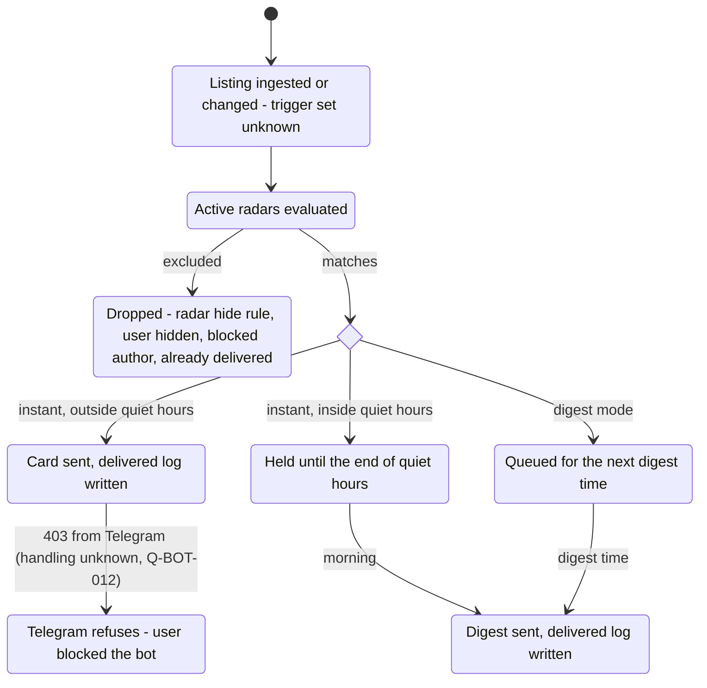

Migration constraint (`ab:430`): the **list of delivered cards** must be migrated. Without it, radars re-send old
listings after the switch, and the «Объявление снято» edits (BOT-062) cannot find the old messages. That needs
`chat_id` + `message_id` per delivered card.

## 6. Deep links and old `callback_data`

### 6.1 `/start` payloads of @KvadroAppBot

| ID      | Payload                         | Built by                                                                 | Format status | Bot handling | Handling status |
| ------- | ------------------------------- | ------------------------------------------------------------------------ | ------------- | ------------ | --------------- |
| BOT-027 | `s_web`                         | Landing, every bot button (`landing/landing.js:30–45`)                   | `CONFIRMED`   | Ordinary welcome; source stored (inferred) | `UNVERIFIED` |
| BOT-028 | `s_web_<tag>`                   | Landing with `?s=` or `?utm_source=`; tag lower-cased, `[a-z0-9_-]{1,40}`; (*since `67b3942a8340`, landing intake*) other characters become `-`, edge `-` trimmed, cut to 40 (`landing/landing.js:33–40`) | `CONFIRMED` | as above | `UNVERIFIED` |
| BOT-029 | `<payload>--v<visit>`           | `landing/stats.js:18–20` on click; visit `[a-z0-9]{10}`; payload cut to 49 chars first; skipped if `--v` is already there | `CONFIRMED` | Site visit joined to the bot user (inferred) | `UNVERIFIED` |
| BOT-030 | `s_seo[_<lang>][_<slice>]`      | SEO pages (`seo` §9 l.353–369); `lang` = `uz` / `en`, absent for ru. Since Mini App release `index-CIa0Ldj2.js` the no-access screen is a second producer of the language forms: `s_seo_en`, `s_seo_uz`, with `--l<id>` (BOT-031) | `DOCUMENTED_ONLY` (server-rendered) | as BOT-027 (inferred) | `UNVERIFIED` |
| BOT-031 | `s_<source>--l<id>`             | Mini App no-access screen (`app/features/onboarding/NoAccessScreen.jsx:26–27, 66`); `source` from `getStartSource()` = `web`, `fb12`/`tg3`/`ig5`, `seo`, `share` (`app/lib/telegram/startParam.js:32–42`); since Mini App release `index-CIa0Ldj2.js` `seo` is `seo_en` or `seo_uz` by the interface language (`ru` keeps `seo`); not built for `blocked` and, since that release, `paused` (`app/features/onboarding/NoAccessScreen.jsx:26,41-47,72-75`; `app/lib/telegram/startParam.js:69-79`, r33) | `CONFIRMED` | Welcome + TXT-BOT-008 + BTN-004 (seen with `s_web--l51358`) | `DOCUMENTED_ONLY` |
| BOT-032 | `s_friend`                      | Mini App «Нашли жильё?» share (`app/features/radar/FoundSheet.jsx:119`)  | `CONFIRMED`   | Ordinary welcome, referral (inferred) | `UNVERIFIED` |
| BOT-033 | `l_<id>`                        | Nobody sends it to this bot; it is the Mini App `startapp` format        | —             | Ordinary welcome; listing ignored | `DOCUMENTED_ONLY` |
| BOT-034 | anything else                   | —                                                                        | —             | not tested | `UNVERIFIED` |

Edge case seen in the code: if `start_param` is `l_` followed by something that is not a number, `getStartSource()`
returns `share` but `getStartListingId()` returns null. The bot then receives `s_share` without `--l<id>`. Payload
length: up to 59 characters from `landing.js` (`s_web_` + 40 + `--v` + 10) and up to 62 from `stats.js` (49 + `--v` +
10). Telegram's limit is 64.

### 6.2 Related links that are not `/start` payloads of this bot

- `t.me/KvadroAppBot?startapp=l_<id>[-<source>]` opens the Mini App directly (sharing, site, SEO, campaigns). It is
  handled by the Mini App (`app/lib/telegram/startParam.js:13–54`; `ab:261`) and audited in
  `05-telegram-miniapp-audit.md`. The bot's own web_app buttons may carry the same format (`tb:993`, inferred).
- `t.me/<support bot>?start=l_<id>` (BOT-035) goes to the support bot (`app/features/listing/ListingActionsSheet.jsx:161`).
- `t.me/<канал>/<пост>` in BTN-037 links to the source channel and must stay as it is (`ab:385`).

### 6.3 Compatibility requirements at the cut-over

Users keep cards, wizards, panels and reply keyboards from the legacy bot in their chats (`ab:421–423`). The legacy
`callback_data` grammar is **unknown** (`ab:560`; Q-BOT-017).

1. **Obtain the legacy grammar before the switch** (Q-BOT-017). Listing cards are long-lived (radar pushes,
   `/fav`, starter lists), and their favourite, rented, realtor and hide buttons need the listing id from the old
   data.
2. **Catch-all.** Any callback the new router cannot decode gets `answerCallbackQuery` with `show_alert` and
   TXT-BOT-039 (`Форма устарела — начните заново: /new`). For wizard-like messages the keyboard is also removed, as
   the legacy bot does (BOT-023). For old listing cards that cannot be decoded, a card-specific alert pointing to
   the Mini App would be the better fallback (proposal).
3. **web_app buttons keep their URLs.** Old messages with BTN-001, BTN-004, BTN-005, BTN-035 open the URL they were
   sent with; a menu button set per chat keeps its URL until it is reset. The legacy Mini App URL (domain, path,
   query) must keep serving or redirecting after the cut-over (Q-BOT-011).
4. **Old reply keyboards.** The `/owner` reply keyboard stays on clients. The new bot must accept a contact message
   without an active `/owner` state, and it must check that the contact is the sender's own (`contact.user_id`).
5. **Per-chat command lists and menu buttons** set by the legacy bot persist at Telegram (§1, note 1).
6. **Server-side conversation state** is lost unless it is migrated: open wizards and the typed-amount wait. After
   the switch a typed number would go to free-text parsing. This is acceptable if item 2 is in place.
7. **One webhook.** The switch is a single `setWebhook` (`ab:408–411`). Decide whether pending updates are dropped
   or processed.
8. **Delivered-card log** must be migrated (§5).
9. New `callback_data` must fit 64 bytes. It should carry a version prefix so that a future change does not repeat
   this problem (proposal).

## 7. Localization

| Topic                  | Finding | Status | Evidence |
| ---------------------- | ------- | ------ | -------- |
| Languages              | Russian, Uzbek (Latin script), English | `DOCUMENTED_ONLY` | `tb:1066` |
| Codes                  | `ru`, `uz_Latn`, `en` in the shared settings contract | `CONFIRMED` (Mini App: `app/i18n/index.js:1–18`; `api.md:424`, `api.md:848`) | `tb:1066` infers the bot uses the same codes |
| Initial language       | Not documented | `UNVERIFIED` | Q-BOT-035 |
| Switching              | Welcome buttons (BTN-003), `/settings` (BTN-070), probably the Mini App | `DOCUMENTED_ONLY` / Mini App path `UNVERIFIED` | `tb` §6.2; Q-BOT-043 |
| Effect of a switch     | Current message re-rendered; command menu switched; later replies in the new language; `/settings` toast in the new language | `DOCUMENTED_ONLY` | `tb:231–234` |
| Description, bio       | One trilingual description; bio seen in RU | `DOCUMENTED_ONLY` | `tb:52–76`; Q-BOT-019 |
| Captured texts         | RU: everything. EN: `/start`, `/settings`, commands. UZ: `/settings` only. UZ command descriptions not captured. | `DOCUMENTED_ONLY` | `tb:1060`, `tb:1134`; Q-BOT-014 |
| Number format          | RU `18 657`, `$1 000`, `$94 000`; EN `18,662` | `DOCUMENTED_ONLY` | `tb:185` |
| Time zone              | Asia/Tashkent for everything | `DOCUMENTED_ONLY` | `tb:185`, `tb:785` |
| Cyrillic Uzbek         | Not supported by the legacy bot | `DOCUMENTED_ONLY` | `tb:1066` |
| Known typos and inconsistencies | `Весь Фергана`; UZ `oʻch..` (two dots); UZ header `Sokinlik soatlari` vs text `Sokin soatlar`; UZ currency `Sumi` vs EN `Soʻm`; EN welcome uses Uzbek city names (Toshkent, Andijon, Qoʻqon, Fargʻona) next to the English «Tashkent Region» | `DOCUMENTED_ONLY` | `tb:1036–1038`; LB-BOT-009…013 |

## 8. Business rules (BR-BOT-NNN)

One line per rule. Status is that of the rule as a statement about the legacy bot. Where the Mini App code confirms a
shared contract, the rule is marked `CONFIRMED` with the code reference.

| ID         | Rule | Status | Evidence |
| ---------- | ---- | ------ | -------- |
| BR-BOT-001 | Callbacks edit the current message (`editMessageText` + new keyboard). New messages are sent only for: the wizard step after a typed amount, cards opened by number or from `/fav`, the starter list, the first-radar tip, the venue, the photo album and the poll. | `DOCUMENTED_ONLY` | `tb:167–170` |
| BR-BOT-002 | Only the actions listed in `tb` §8 answer with a toast; the outdated-form case uses `show_alert`; the 14 kinds in `tb:963–965` answer silently. | `DOCUMENTED_ONLY` | `tb:171–173`, `tb:941–965` |
| BR-BOT-003 | The selected option is marked with the prefix `✅ `; in the district multi-select every ticked item gets it. | `DOCUMENTED_ONLY` | `tb:174–175` |
| BR-BOT-004 | Button style `primary`: `📱 Открыть kvadro²`, `📱 Открыть в приложении`, `🏠 Открыть квартиру`, `✉️ Написать в поддержку`, `✅ Сохранить`; `danger`: `🗑 Да, удалить`; all others default. | `DOCUMENTED_ONLY` | `tb:176–178` |
| BR-BOT-005 | A reply keyboard exists only in `/owner`; all other buttons are inline. | `DOCUMENTED_ONLY` | `tb:87` |
| BR-BOT-006 | Unknown commands get no reply. | `DOCUMENTED_ONLY` | `tb:107`, `tb:184` |
| BR-BOT-007 | The bot writes on its own only for radar pushes, digests and service news (plus the poll after a pause). | `DOCUMENTED_ONLY` | `tb:186–187`, `tb:716` |
| BR-BOT-008 | Numbers: RU `18 657`, `$1 000`; EN `18,662`. All times in Asia/Tashkent. | `DOCUMENTED_ONLY` | `tb:185`, `tb:785` |
| BR-BOT-009 | A button on an earlier wizard answers with alert `Форма устарела — начните заново: /new` and removes that message's keyboard. | `DOCUMENTED_ONLY` | `tb:179–180` |
| BR-BOT-010 | Buttons on older copies of listing cards keep working against the current server state; only the pressed copy is updated. | `DOCUMENTED_ONLY` | `tb:180–181`, `tb:670–672` |
| BR-BOT-011 | `/start` always sends the sticker and the welcome; a repeat resets nothing. | `DOCUMENTED_ONLY` | `tb:193`, `tb:220–221` |
| BR-BOT-012 | The welcome shows two live counters: active listings and new in the last 24 h (18 657 / 1 050 → 18 582 / 1 048 within ~25 min). | `DOCUMENTED_ONLY` | `tb:197`, `tb:222–223` |
| BR-BOT-013 | The welcome language row always shows the two languages other than the current one. | `DOCUMENTED_ONLY` | `tb:218` |
| BR-BOT-014 | A language change re-renders the current message, switches the command menu and all later replies; only the `/settings` path shows a toast (in the new language). | `DOCUMENTED_ONLY` | `tb:218`, `tb:231–234` |
| BR-BOT-015 | Locale codes are `ru`, `uz_Latn`, `en`. | `CONFIRMED` | `app/i18n/index.js:1–18`; `api.md:424`, `api.md:848` |
| BR-BOT-016 | Every wizard start sends a new message; the following steps edit that message. | `DOCUMENTED_ONLY` | `tb:248–250` |
| BR-BOT-017 | Step count M: 8 for rent_long, 7 for rent_daily, 6 for sale; step 1 shows `шаг 1 из 7` before a deal is chosen. | `DOCUMENTED_ONLY` | `tb:264–265` |
| BR-BOT-018 | The context line accumulates only deal, object and rooms; districts and budget are not shown in it. | `DOCUMENTED_ONLY` | `tb:266` |
| BR-BOT-019 | `◀️ Назад` is on every step except step 1 and returns to the previous step with the earlier choice ticked. | `DOCUMENTED_ONLY` | `tb:267–268` |
| BR-BOT-020 | Single-choice buttons advance immediately; only the districts step is multi-select. | `DOCUMENTED_ONLY` | `tb:277` |
| BR-BOT-021 | Object options per deal: rent_long {Квартира, Дом, Квартира или дом, Комната / подселение, Помещение}; rent_daily {Квартира, Дом, Комната / подселение}; sale {Квартира, Дом, Квартира или дом, Участок, Помещение}. Matches the shared `TYPES_BY_DEAL` (rent_long: apartment, house, room, commercial; rent_daily: apartment, house, room; sale: apartment, house, commercial, land). | `CONFIRMED` (contract) | `tb:293–297`; `app/features/filters/options.js:7–11` |
| BR-BOT-022 | The rooms step exists only for apartment and house (including «Квартира или дом»); it is skipped for room, commercial and land, as in the shared `NO_ROOMS_TYPES`. | `CONFIRMED` (contract) | `tb:301–302`; `app/features/filters/model.js:5` |
| BR-BOT-023 | Rooms options: `1`, `2`, `3`, `4+`, `1–2`, `2–3`, `Не важно`; default `Не важно`. | `DOCUMENTED_ONLY` | `tb:308` |
| BR-BOT-024 | Six cities: Ташкент, Ташкентская область, Андижан, Наманган, Коканд, Фергана. | `DOCUMENTED_ONLY` | `tb:38–39`, `tb:321–322` |
| BR-BOT-025 | Zones (`🏛 Центр`, `🏙 Ближе к центру`) and `🚇 Рядом с метро` exist only for Tashkent. | `DOCUMENTED_ONLY` | `tb:345–346`, `tb:353` |
| BR-BOT-026 | District lists: Tashkent 12, Tashkent region 22, Andijan 15, Namangan 13, Fergana 17, Kokand none (only «Весь Коканд»). | `DOCUMENTED_ONLY` | `tb:351–358` |
| BR-BOT-027 | «Центр» = from Amir Temur square to the Small Ring (east) and Tashkent City / Sebzar (west); «Ближе к центру» = a further ~2 km ring without the centre; «Рядом с метро» = nearest station within ~1 km. Distance is measured from the block, landmark or metro named in the listing, not from its district. | `DOCUMENTED_ONLY` | `tb:338` |
| BR-BOT-028 | Listings without a recognisable place never match zone or district radars; `Весь <город>` matches all listings of the city (for regions: city and region). | `DOCUMENTED_ONLY` | `tb:338`, `tb:345–347` |
| BR-BOT-029 | Ticking a district removes the tick from `Весь <город>`; `Готово (N)` counts ticked districts; `N = 0` with `Весь <город>` means the whole city. | `DOCUMENTED_ONLY` | `tb:366–367` |
| BR-BOT-030 | «Центр» clears already ticked districts, «Рядом с метро» keeps them. This matches the shared contract: `zones` and `districts` exclude each other, and `near_metro` is a separate boolean. | `CONFIRMED` (contract) | `tb:370`; `api.md:155–156`, `api.md:182`; `app/features/filters/options.js:4` |
| BR-BOT-031 | Budget presets and the median line depend on city, deal and rooms (observed sets in §3.6). | `DOCUMENTED_ONLY` | `tb:385–407` |
| BR-BOT-032 | The median line and «Не дороже рынка» appear only for Tashkent and Tashkent region (rent_long, sale), never for rent_daily; without the button its paragraph is also absent. | `DOCUMENTED_ONLY` | `tb:390–407` |
| BR-BOT-033 | «Не дороже рынка»: price not above the usual price of the nearest similar listings (else by district) and not above the district, with +10 % tolerance; rent compares the same number of rooms, sale compares price per m²; listings without a usual price are not delivered. The Mini App words the same rule. | `DOCUMENTED_ONLY` | `tb:382`; `app/i18n/locales/ru.js:412–416` |
| BR-BOT-034 | «Не дороже рынка» is a toggle that stays on the step and combines with an amount; a preset or `Не важно` advances to step 6. | `DOCUMENTED_ONLY` | `tb:409–411` |
| BR-BOT-035 | The budget is a maximum in USD. A typed amount must be one number in dollars; a non-number gets an error and the wait continues; a number removes the prompt keyboard and continues the wizard in a new message. | `DOCUMENTED_ONLY` | `tb:378`, `tb:413–422` |
| BR-BOT-036 | «Без риелторов» hides explicit realtors and keeps unmarked listings; «Только хозяева» keeps only listings explicitly marked as owner's. | `DOCUMENTED_ONLY` | `tb:429` |
| BR-BOT-037 | The tenant step exists for rent_long and rent_daily and hides listings restricted to other tenant groups («только девушкам / парням / семье»). | `DOCUMENTED_ONLY` | `tb:434–440` |
| BR-BOT-038 | Pets only for rent_long: «Не запрещены» drops listings «без животных» and keeps unspecified ones; «Разрешены» keeps only explicit «можно с животными». In the shared model these are `pets` and `pets_only`, never both. | `CONFIRMED` (contract) | `tb:444–449`; `api.md:160–161`, `api.md:181`; `app/features/filters/options.js:23` |
| BR-BOT-039 | Review summary rows `🏠 📍 💰 👤` are always shown; `👥` and the pets row are omitted for «Не важно». | `DOCUMENTED_ONLY` | `tb:474–481` |
| BR-BOT-040 | The flow estimate uses the last week, has three wordings (≈N per day / N per week / none) and is recomputed after each edit. | `DOCUMENTED_ONLY` | `tb:483–487` |
| BR-BOT-041 | The «Это много» warning appears at about 20 listings per day (seen at ≈20, not at ≈19); the exact threshold is unknown. | `UNVERIFIED` | `tb:493`; Q-BOT-039 |
| BR-BOT-042 | A relax button applies its weakening, recomputes the review and disappears. | `DOCUMENTED_ONLY` | `tb:495–498` |
| BR-BOT-043 | The review shows `✏️` buttons only for the steps of the current branch, two per row, then `✅ Сохранить` and `✖️ Отмена`. | `DOCUMENTED_ONLY` | `tb:500–510` |
| BR-BOT-044 | An edited step returns to the review on a choice; `◀️ Назад` returns to the review unchanged. | `DOCUMENTED_ONLY` | `tb:512–513` |
| BR-BOT-045 | Changing the deal resets the budget to «любой бюджет»; if the object is not allowed for the new deal, the wizard goes to «Какой объект?» instead of the review. | `DOCUMENTED_ONLY` | `tb:514–515` |
| BR-BOT-046 | Cancel on any step, prompt, review or edit screen replaces the text with `Отменил. Новый радар — /new, список — /subs`, removes the keyboard and saves nothing. | `DOCUMENTED_ONLY` | `tb:269–275` |
| BR-BOT-047 | Save: toast `Сохранил ✅`; message → «✅ Радар включён» with `📡 Радар` · `➕ Новый радар`; then a sticker, the starter list (if any), and the tip (first radar only). | `DOCUMENTED_ONLY` | `tb:519–566` |
| BR-BOT-048 | The starter list holds matches from the last 3 days, newest first; number buttons five per row; a number sends the card as a new message; the list never changes and works after the radar is deleted. | `DOCUMENTED_ONLY` | `tb:541–551` |
| BR-BOT-049 | After an edit, the starter list contains only listings not sent before. | `DOCUMENTED_ONLY` | `tb:568–569`; `ab:200–201` |
| BR-BOT-050 | The «Как пользоваться» tip with the delivery question is sent only after the user's first radar; the digest times in it come from the settings (inferred). | `DOCUMENTED_ONLY` | `tb:552–566` |
| BR-BOT-051 | Any text except an awaited amount is parsed as a search description. | `DOCUMENTED_ONLY` | `tb:573` |
| BR-BOT-052 | Understood text gets a 👌 reaction and the review titled «Вот что я понял — проверьте»; not understood text gets no reaction and the hint with `➕ Новый радар` / `✉️ Написать в поддержку`. | `DOCUMENTED_ONLY` | `tb:575–605`, `tb:182–183` |
| BR-BOT-053 | A phrase without a deal defaults to rent_long and shows a note. | `DOCUMENTED_ONLY` | `tb:595` |
| BR-BOT-054 | A phrase with an unsupported place sets `весь Ташкент` and names the place in a note. | `DOCUMENTED_ONLY` | `tb:596–597` |
| BR-BOT-055 | Phrases and voice are parsed by Google Gemini; the bot stores neither the messages nor the audio. | `DOCUMENTED_ONLY` | `tb:607`, `tb:854` |
| BR-BOT-056 | A card is a photo with caption when photos are available, otherwise text; HTML with bold title and price, italic source and the original post in an expandable blockquote. | `DOCUMENTED_ONLY` | `tb:612–617` |
| BR-BOT-057 | `📍 На карте` is shown only with coordinates; `📷 Ещё N фото` only if the post has photos. | `DOCUMENTED_ONLY` | `tb:649–650` |
| BR-BOT-058 | The `🔗` line links the channel name to the original post, shows time and age, and `ещё N` for duplicates merged from other channels. | `DOCUMENTED_ONLY` | `tb:644` |
| BR-BOT-059 | The `📊` line compares with the N nearest listings «в обычных домах» within a radius (`на 20% ниже обычного у 12 ближайших в обычных домах (до ~0,3 км, ~$625/мес)`) or with the district (`на уровне обычного (Юнусабад, ~$640/мес)`), per m² where shown (`~$11/м²/мес`). | `DOCUMENTED_ONLY` | `tb:622`, `tb:640` |
| BR-BOT-060 | Favourite is a server-side toggle (pressing on a stale copy flips the current state). | `DOCUMENTED_ONLY` | `tb:670–672`; `api.md:636–647` |
| BR-BOT-061 | «Это риелтор» marks the phone number as a realtor's in all its listings; a repeat answers «Уже отмечено»; it cannot be undone in the bot. | `DOCUMENTED_ONLY` | `tb:663`; `ab:224` |
| BR-BOT-062 | «Уже сдано» hides the listing for the voter at once and for others after more confirmations (threshold unknown); `↩️ Не сдано` undoes it. | `DOCUMENTED_ONLY` | `tb:664–665`; `ab:223` |
| BR-BOT-063 | «Скрыть похожие» offers channel and district (and, per the tip, the realtor); the rule is stored in the radar, shown as `🙈 скрыто: …`, and removed only all together with «Показать скрытое». | `DOCUMENTED_ONLY` | `tb:557`, `tb:666–667`, `tb:711–712`, `tb:720` |
| BR-BOT-064 | At most 10 radars per user (`k из 10`); behaviour at the limit not checked. | `DOCUMENTED_ONLY` | `tb:687`, `tb:694`; Q-BOT-007 |
| BR-BOT-065 | Radar title = deal · object · rooms · city · first district `+N` · budget. | `DOCUMENTED_ONLY` | `tb:692–693` |
| BR-BOT-066 | A radar has three visible states: on/instant, paused, on/digest. | `DOCUMENTED_ONLY` | `tb:710–711` |
| BR-BOT-067 | Pausing sends the poll «Нашли жильё?» as a new message; it is not repeated shortly after an answer (inferred). | `DOCUMENTED_ONLY` | `tb:716`, `tb:723`; Q-BOT-006 |
| BR-BOT-068 | Deleting a radar needs a confirmation; afterwards the message shows the list, or the empty state at zero. | `DOCUMENTED_ONLY` | `tb:722–724` |
| BR-BOT-069 | Editing an existing radar uses the header `Изменение радара · шаг N из M`; saving behaves like a new radar's save. | `DOCUMENTED_ONLY` | `tb:721` |
| BR-BOT-070 | Poll codes: answer `kvadro` / `elsewhere` / `searching` / `stopped`; where `telegram` / `olx` / `site` / `agent` / `friends` / `street` / `other`; trigger `pause` / `delete`. | `CONFIRMED` (contract) | `app/features/radar/FoundSheet.jsx:28–75`; `api.md:953–964`; bot mapping inferred at `tb:985` |
| BR-BOT-071 | One answer per poll; «Да, в другом месте» leads to «Где нашли?»; any where-option ends with the thanks message without buttons. | `DOCUMENTED_ONLY` | `tb:737–746`, `tb:1050` |
| BR-BOT-072 | `/fav` lists favourites numbered, one button each; a button sends the card as a new message; the list is not refreshed. | `DOCUMENTED_ONLY` | `tb:757–766`, `tb:672` |
| BR-BOT-073 | Quiet-hours presets: off, 22:00–08:00, 23:00–08:00, 00:00–09:00, 23:00–07:00. | `DOCUMENTED_ONLY` | `tb:792–793` |
| BR-BOT-074 | Digest presets: 09:00, 09:00 и 19:00, 12:00 и 20:00, 19:00. | `DOCUMENTED_ONLY` | `tb:795–796` |
| BR-BOT-075 | Values seen on the test account (probably the defaults): quiet off, digests 09:00 и 19:00, currency USD, service news on. | `UNVERIFIED` | `tb:788` |
| BR-BOT-076 | Every `/settings` option, even the current one, saves, toasts `Сохранил ✅` and re-renders; headers do nothing. | `DOCUMENTED_ONLY` | `tb:805–810` |
| BR-BOT-077 | Quiet hours: no cards in the window; everything from the night arrives as one digest in the morning. | `UNVERIFIED` | `tb:775`; `ab:206–207`; Q-BOT-003 |
| BR-BOT-078 | Digest times are per user and apply only to radars in digest mode. | `DOCUMENTED_ONLY` | `tb:777`, `tb:711` |
| BR-BOT-079 | Currency is USD or UZS; its effect on bot prices is not checked. | `UNVERIFIED` | `tb:800`, `tb:812`; Q-BOT-015 |
| BR-BOT-080 | «Новости сервиса» (send / don't send) is a bot-only setting with no field in the Mini App contract. | `DOCUMENTED_ONLY` | `tb:802`, `tb:991` |
| BR-BOT-081 | `/owner` takes the number of the user's own account through `request_contact`; only a hash and the verification date are stored. | `DOCUMENTED_ONLY` | `tb:822`, `tb:852` |
| BR-BOT-082 | The badge «Хозяин · номер подтверждён» is set when the hash matches a listing's phone, but not if the number appears in listings for 3 or more different flats or is marked as a realtor's. | `DOCUMENTED_ONLY` | `tb:820–824`; `ab:232–235` |
| BR-BOT-083 | The badge appears automatically when such a listing appears, usually within minutes. | `DOCUMENTED_ONLY` | `tb:832` |
| BR-BOT-084 | Removing the number needs no confirmation and removes the badge. | `DOCUMENTED_ONLY` | `tb:834` |
| BR-BOT-085 | Stored per user: Telegram ID, language and settings, radars, favourites, card marks, listings opened in the app, cards received, arrival source (link tag, site visit id) and an action log. Name and contacts are not stored. | `DOCUMENTED_ONLY` | `tb:852` |
| BR-BOT-086 | The action log (what was pressed and when, without texts) is kept 180 days. | `DOCUMENTED_ONLY` | `tb:852`; `ab:268` |
| BR-BOT-087 | Anti-fraud for votes and complaints stores three profile flags (Premium, has @username, has photo) and estimates the account age from the Telegram ID. | `DOCUMENTED_ONLY` | `tb:852`; `ab:228` |
| BR-BOT-088 | Phone numbers and @handles are masked before text goes to Gemini. | `DOCUMENTED_ONLY` | `tb:854` |
| BR-BOT-089 | Geolocation stays in the app and is never sent to the bot or stored. | `DOCUMENTED_ONLY` | `tb:856` |
| BR-BOT-090 | Analytics go to PostHog (EU) under a random id without Telegram ID, name or phone; on data deletion a PostHog erase is requested, which completes asynchronously. | `DOCUMENTED_ONLY` | `tb:858`; `ab:431–432` |
| BR-BOT-091 | Support bot: message-to-user mapping kept 90 days; texts without phones and handles only until the conversation ends; a Gemini summary kept one year. | `DOCUMENTED_ONLY` | `tb:860`; `ab:269` |
| BR-BOT-092 | On an author's takedown request the listing leaves the feed, map, site and broadcasts, and already sent cards are edited to «Объявление снято». | `DOCUMENTED_ONLY` | `tb:862` |
| BR-BOT-093 | Removed listings (rented, sold, deleted) are kept 90 days; then phone, text and photos are erased and only price, district and area remain. | `DOCUMENTED_ONLY` | `tb:862`; `ab:270` |
| BR-BOT-094 | «Удалить мои данные» deletes from the bot DB at once; backups keep the data for about two weeks. | `DOCUMENTED_ONLY` | `tb:864`; `ab:272–273` |
| BR-BOT-095 | `s_<source>--l<id>` adds a third message naming the listing, with a web_app button to open it. | `DOCUMENTED_ONLY` | `tb:1011–1017` |
| BR-BOT-096 | Payload grammar: tag `[a-z0-9_-]{1,40}`, visit `--v` + `[a-z0-9]{10}`, the part before the visit cut to 49 chars; listing suffix `--l<id>`. (*since `67b3942a8340`, landing intake*) The landing sanitises the tag before the check (characters outside `[a-z0-9_-]` → `-`, leading and trailing `-` trimmed, cut to 40) instead of dropping it, so `utm_source=chatgpt.com` arrives as `s_web_chatgpt-com`. | `CONFIRMED` (contract) | `landing/landing.js:33–40`; `landing/stats.js:18–20`; `app/features/onboarding/NoAccessScreen.jsx:66` |
| BR-BOT-097 | `l_<id>` sent to the bot is not recognised; the user gets the ordinary welcome. | `DOCUMENTED_ONLY` | `tb:1009` |
| BR-BOT-098 | The arrival source (link tag and site visit id) is stored per user. | `DOCUMENTED_ONLY` | `tb:852` |
| BR-BOT-099 | Radar changes from the Mini App need a chat with the bot: the API answers `409 {"detail":"no_chat"}` before any change, and the app asks for write access and retries once. | `CONFIRMED` (client) | `app/lib/chatAccess.js:11–51`; `api.md:80–85` |
| BR-BOT-100 | Delivery modes: `instant` (one card per listing, at once) and `digest` (a list at the user's digest times). | `DOCUMENTED_ONLY` | `tb:561`, `tb:710–711`; `ab:205–206` |
| BR-BOT-101 | Matching respects the radar's hide rules, the user's hidden listings and blocked authors, and cards already delivered. | `UNVERIFIED` | `ab:202–204`; Q-BOT-033 |
| BR-BOT-102 | `/ping` reports the database state and the PostGIS version. | `DOCUMENTED_ONLY` | `tb:874–877` |
| BR-BOT-103 | Quiet-hours and digest presets are server data (`quiet_presets`, `digest_presets`), not client constants. | `CONFIRMED` (contract) | `app/features/settings/SettingsPages.jsx:96–134`; `api.md:845–854` |
| BR-BOT-104 | Shared radar filter enums: deal `rent_long` / `rent_daily` / `sale`; owner `any` / `no_agents` / `owners`; tenant `family` / `men` / `women` / null; zones `center` / `near_center`; `near_metro`, `below_median`, `pets`, `pets_only` booleans. | `CONFIRMED` (contract) | `app/features/filters/options.js:4–25`; `app/features/filters/model.js:12–39`; `api.md:146–172` |

## 9. Legacy bugs, questionable decisions and open questions

### 9.1 Legacy bugs and quirks (`tb` §11 and this audit)

Each item records existing behaviour exactly. The proposed fix is a proposal for HOMI, not an approved change.

- **LB-BOT-001** · `bug` · `DOCUMENTED_ONLY` — Zone buttons (`🏛 Центр`, `🚇 Рядом с метро`) toggle **and** jump to
  the budget step, both when switching on and off, although the hint invites combining them with districts. Evidence:
  `tb:370`, `tb:1023–1025`; BTN-012, BTN-014.

  Proposed fix: zones are toggles that stay on step 4 like districts; only `Готово (N)` advances.
- **LB-BOT-002** · `bug` · `DOCUMENTED_ONLY` — Choosing another city jumps straight to the budget step; that city's
  districts can only be chosen after `◀️ Назад`. Evidence: `tb:369`, `tb:1026`; BTN-011.

  Proposed fix: a city button re-renders step 4 with that city's districts and zones; `Готово` advances.
- **LB-BOT-003** · `bug` · `DOCUMENTED_ONLY` — The list «Уже есть за последние 3 дня» showed first a post dated 30.10
  on 09.11. Evidence: `tb:1027`, `tb:542`.

  Proposed fix: filter and label by one date (first seen or posted), state which one, and apply the same 3-day window
  to both.
- **LB-BOT-004** · `bug` · `DOCUMENTED_ONLY` — The card shows `👨‍👩‍👧 депозит` for a post saying «без депозита»: a
  negation or field-mapping error, and a family icon on a deposit line. Evidence: `tb:629`, `tb:1028–1029`.

  Proposed fix: parse deposit as a tri-state (required / not required / unknown) and render it with its own icon and
  wording.
- **LB-BOT-005** · `bug` · `DOCUMENTED_ONLY` — The flow estimate was not recomputed after changing the object
  (flat → room, daily); it kept «2 объявления за неделю». Evidence: `tb:1030–1031`.

  Proposed fix: recompute the estimate after every change of any filter.
- **LB-BOT-006** · `bug` · `DOCUMENTED_ONLY` — `📷 Ещё N фото` on text-only cards answers «Фото больше недоступны».
  Evidence: `tb:615`, `tb:1032`; BTN-038.

  Proposed fix: show the button only when photos can be delivered, and remove it from a card (edit) when they expire.
- **LB-BOT-007** · `bug` · `DOCUMENTED_ONLY` — On older copies of a card the favourite label is not synchronised and a
  press toggles instead of setting: «★ В избранном» on a stale copy **added** the listing. The open `/fav` list does
  not refresh either. Evidence: `tb:670–672`, `tb:1033–1034`; BTN-040.

  Proposed fix: callbacks carry the intended state (set / unset) and are idempotent; the answer re-renders the pressed
  copy from the server state.
- **LB-BOT-008** · `bug` · `DOCUMENTED_ONLY` — `Это риелтор` cannot be undone in the bot, unlike `Уже сдано`.
  Evidence: `tb:663`, `tb:1035`; BTN-041.

  Proposed fix: after a vote, offer `↩️ Не риелтор` that withdraws this user's vote, with the same semantics as
  `↩️ Не сдано`.
- **LB-BOT-009** · `bug` · `DOCUMENTED_ONLY` — Grammar: «Весь Фергана» (and the generic `Весь <город>` for feminine
  names). Evidence: `tb:346`, `tb:1036`.

  Proposed fix: one label that does not depend on gender, e.g. «Весь город» or «Фергана целиком», per language.
- **LB-BOT-010** · `bug` · `DOCUMENTED_ONLY` — UZ: `oʻch..` with two dots in the quiet-hours line. Evidence:
  `tb:1036`, `tb:1116`.

  Proposed fix: proofread UZ strings; the abbreviation `oʻch.` gets exactly one dot.
- **LB-BOT-011** · `bug` · `DOCUMENTED_ONLY` — UZ: the header button says `Sokinlik soatlari`, the text says
  `Sokin soatlar`. Evidence: `tb:1037`, `tb:1116`, `tb:1129`.

  Proposed fix: one term per concept in the UZ glossary, used in buttons and texts.
- **LB-BOT-012** · `bug` · `DOCUMENTED_ONLY` — UZ currency label `Sumi` vs EN `Soʻm`. Evidence: `tb:1037`,
  `tb:1109`, `tb:1131`.

  Proposed fix: use `soʻm` in UZ (and keep `Soʻm` in EN), from one currency glossary.
- **LB-BOT-013** · `bug` · `DOCUMENTED_ONLY` — The EN welcome names cities in Uzbek (Toshkent, Andijon, Qoʻqon,
  Fargʻona) next to the English «Tashkent Region». Evidence: `tb:1037–1038`, `tb:1071`.

  Proposed fix: one EN naming convention for all places (English exonyms: Tashkent, Andijan, Kokand, Fergana), taken
  from the city reference data.
- **LB-BOT-014** · `bug` · `DOCUMENTED_ONLY` — Unknown commands are ignored silently, with no hint about `/help`.
  Evidence: `tb:107`, `tb:1039`; BOT-022.

  Proposed fix: answer with a short line listing the main commands.

### 9.2 Questionable design decisions

This is behaviour that is not a bug but looks logically wrong or confusing: irreversible actions without undo,
wizard steps that skip, inconsistent texts, dead ends, missing confirmations. Each is tagged `decision`.

- **LB-BOT-015** · `decision` · `DOCUMENTED_ONLY` — Step 1 says `шаг 1 из 7`, then the total changes to 8 or 6 once
  the deal is chosen, so the counter is wrong for two branches. Evidence: `tb:264–265`.

  Proposed fix: do not show a total on step 1 (or show `шаг 1`), then `N из M` for the chosen branch.
- **LB-BOT-016** · `decision` · `UNVERIFIED` — M is fixed per deal, but the rooms step is skipped for room, commercial
  and land. The numbering then probably jumps or never reaches M. Evidence: `tb:264`, `tb:301–302`; Q-BOT-025.

  Proposed fix: compute M from the actual branch (deal + object) and number only the steps shown.
- **LB-BOT-017** · `decision` · `DOCUMENTED_ONLY` — A phrase naming an unsupported city (`купить дом в Самарканде`)
  produces a radar for **весь Ташкент**, only with a note. A user who skims the review saves a radar for the wrong
  city. Evidence: `tb:596–597`.

  Proposed fix: do not default to another city; ask for the city (step 4 opened) and say which cities are supported.
- **LB-BOT-018** · `decision` · `DOCUMENTED_ONLY` — While waiting for a typed amount, every text is treated as an
  amount: a search phrase gets «Не понял сумму», each bad input adds a new error message, and only bare numbers in
  dollars are accepted. Evidence: `tb:418–422`, `tb:573`.

  Proposed fix: accept common formats (`650$`, `85 000`, `85k`, `1,2 млн`). Let commands and a clear search phrase
  leave the wait. Edit one error message instead of stacking new ones.
- **LB-BOT-019** · `decision` · `UNVERIFIED` — Budgets in the wizard are always in dollars («сумму в долларах»,
  `$` presets), even for users who chose `Сумы` in `/settings`. Evidence: `tb:415`, `tb:800`, `tb:812`; Q-BOT-015.

  Proposed fix: show presets and accept typed amounts in the user's currency; store USD internally, as the API does.
- **LB-BOT-020** · `decision` · `DOCUMENTED_ONLY` — Cancelling an **edit** of an existing radar shows the new-radar
  text `Отменил. Новый радар — /new, список — /subs`, which reads as if something was lost, and leaves the user out
  of the radar card. Evidence: `tb:906`, `tb:721`.

  Proposed fix: in edit mode, Cancel returns to the unchanged radar card.
- **LB-BOT-021** · `decision` · `UNVERIFIED` — Saving an edit always says `✅ Радар включён`. For a paused radar it is
  unclear whether saving re-activates it, so the text either lies or silently resumes the radar. Evidence:
  `tb:568–569`, `tb:721`; Q-BOT-030.

  Proposed fix: keep the radar's active state on edit and title the message «Радар изменён», with its real status.
- **LB-BOT-022** · `decision` · `DOCUMENTED_ONLY` — One tap of `Это риелтор` is announced as marking the number
  in **all** its listings, cannot be undone, and is offered on every card. The Mini App instead hides the `agent`
  reason when the listing is already known as not from an owner. A single mistaken or malicious tap thus labels a
  person. Evidence: `tb:663`; `api.md:689–690`; `ab:224`, `ab:228`; Q-BOT-029.

  Proposed fix: count it as one vote with an anti-fraud weight and a threshold. Word the toast as "thanks, we'll check".
  Allow undo (LB-BOT-008) and hide the button where the listing is already marked.
- **LB-BOT-023** · `decision` · `DOCUMENTED_ONLY` — `🗑 Убрать номер` removes the owner verification without
  confirmation, while deleting a radar asks for one. Evidence: `tb:834`, `tb:722`.

  Proposed fix: add a confirmation step (`🗑 Да, убрать` danger · `✖️ Отмена`).
- **LB-BOT-024** · `decision` · `DOCUMENTED_ONLY` — `🙉 Показать скрытое` removes **all** hide rules of a radar at
  once, without confirmation, and there is no way to remove one rule. Evidence: `tb:720`, `tb:711–712`.

  Proposed fix: list the rules with one remove button each, plus «remove all» behind a confirmation.
- **LB-BOT-025** · `decision` · `UNVERIFIED` — «Скрыть похожие» stores the rule **in a radar**, while the same intent
  in the Mini App (`block-author`, hidden list) is **global**. For a card opened from `/fav`, from a starter list of a
  deleted radar, or with several radars, the target radar is undefined. Evidence: `tb:667`, `tb:989`; Q-BOT-028.

  Proposed fix: make hide rules user-wide and shared with the Mini App's hidden list. If per-radar scope is kept,
  ask which radar when it is ambiguous.
- **LB-BOT-026** · `decision` · `DOCUMENTED_ONLY` — `/settings` section headers are callback buttons that do
  nothing, which reads as a dead tap. Evidence: `tb:805–806`; BTN-067.

  Proposed fix: put section titles in the message text, or make a header answer silently and visibly do nothing
  (no spinner).
- **LB-BOT-027** · `decision` · `DOCUMENTED_ONLY` — `/ping` is in the public command menu and tells any user the
  database state and the exact PostGIS version (information disclosure). Evidence: `tb:105`, `tb:874–877`.

  Proposed fix: remove it from the public menu; answer `pong` to everyone and show details only to admins.
- **LB-BOT-028** · `decision` · `DOCUMENTED_ONLY` — `/start l_<id>` is ignored, although `l_<id>` is the listing
  format used by the Mini App, the share links and the support bot. Users who paste such a link into the bot get a
  plain welcome. Evidence: `tb:1009`; `app/lib/telegram/startParam.js:13–25`.

  Proposed fix: treat `l_<id>` like `s_<source>--l<id>` (send the listing message with `🏠 Открыть квартиру`).
- **LB-BOT-029** · `decision` · `UNVERIFIED` — `/owner` promises «храним не сам номер, а его хэш». An unkeyed hash of
  a phone number is reversible by enumeration (the Uzbek numbering space is small), so the promise may be weaker than
  it sounds. Evidence: `tb:822`, `tb:852`; Q-BOT-042.

  Proposed fix: keyed HMAC-SHA-256 over the E.164 number with a server-side secret; review the privacy text with the
  security reviewer.
- **LB-BOT-030** · `decision` · `UNVERIFIED` — The bot asks «Кто будет жить?» for **rent_daily**, but the shared
  contract says `tenant` is rent_long only, and the Mini App resets `tenant` when switching to daily. Bot and app may
  therefore store radars the other side does not expect. Evidence: `tb:434`, `tb:505–506`; `api.md:180`;
  `app/features/filters/sheet/DealSections.jsx:62–64`; Q-BOT-027.

  Proposed fix: decide one rule for daily rent (tenant allowed or not) and apply it in bot, app and API alike.
- **LB-BOT-031** · `decision` · `DOCUMENTED_ONLY` — «Центр» silently unticks the districts already chosen (the
  contract makes zones and districts exclusive), while «Рядом с метро» keeps them. Nothing tells the user, and the
  hint text talks about combining. Evidence: `tb:338`, `tb:370`; `api.md:182`.

  Proposed fix: state in the hint that a zone replaces districts (or disable district buttons while a zone is on),
  and say in the step text what was cleared.

### 9.3 Open questions (Q-BOT-NNN)

Each question names the check that would close it. "Test account" means a throwaway Telegram account used with the
legacy production bot, with the product owner's approval. Data created on it is deleted afterwards. No real user
data is involved.

| ID        | Question | Linked items | Check that closes it | Who |
| --------- | -------- | ------------ | -------------------- | --- |
| Q-BOT-001 | What does `🗑 Удалить мои данные` do: confirmation step, reply text, scope (radars, votes, owner hash, attribution, delivered log), PostHog erase? | BOT-080, BTN-076, TXT-BOT-084, BR-BOT-094 | Press it on a test account at the end of all other checks and record every message; or read the legacy handler | owner / test account |
| Q-BOT-002 | Format of a real-time radar push: same card as BOT-059? radar name? silent notification? | BOT-081, TXT-BOT-086 | Test account with a broad radar (Ташкент, аренда, любой бюджет) left on for an hour; capture the pushes | test account |
| Q-BOT-003 | Digest format, size cap, empty digests; quiet-hours boundary and morning digest time | BOT-082, BOT-083, BR-BOT-077, TXT-BOT-087 | Test account: one radar in digest mode with `09:00 и 19:00`, quiet hours `23:00–07:00`; capture 07:00–09:30 and 19:00 messages | test account |
| Q-BOT-004 | Service news: content, frequency, who sends it, tool used, effect of opting out | BOT-084, BTN-072, TXT-BOT-088 | Ask the product owner; keep a test account subscribed and capture the next broadcast | owner |
| Q-BOT-005 | Voice queries: accepted? same review screen? limits on length? | BOT-056 | Send a 5-second voice note from a phone on a test account | test account |
| Q-BOT-006 | Replies to `🎉 Да, через kvadro²`, `🔎 Ещё ищу`, `🙅 Больше не ищу` and the other where-options; poll after delete; suppression window | BOT-069…BOT-071, TXT-BOT-071 | Pause/delete radars on a test account across several days, one answer each; owner for the suppression rule | test account / owner |
| Q-BOT-007 | Behaviour at the 10-radar limit from `/new`, free text, `➕ Новый радар` and on resume | BR-BOT-064 | Create 10 radars on a test account, then try an 11th by each path | test account |
| Q-BOT-008 | `/owner` outcomes: number with listings, ≥3 flats, realtor number, contact of another person | BOT-077, TXT-BOT-081, BR-BOT-082 | Read the legacy handler; or send a forwarded foreign contact on a test account (no real number stored) | owner |
| Q-BOT-009 | When is the realtor row in «Скрыть похожие» shown, with which label and scope? | BTN-047 | Open cards of listings with a known phone on a test account; or the legacy handler | test account |
| Q-BOT-010 | Untested wizard details: `🏙 Ближе к центру`, `✅ Весь <город>`, pets row in the summary, reply to `📬 Подборкой` in the tip, Back from the amount prompt | BTN-013, BTN-016, BTN-024, BTN-033, TXT-BOT-038 | Press each on a test account, then cancel | test account |
| Q-BOT-011 | Exact web_app URLs and `start_param` of the menu button, Main Mini App, BTN-001, BTN-004, BTN-005, BTN-035 | BOT-004, BOT-005 | Owner reads BotFather settings; for inline buttons, read `reply_markup` of the test chat with an MTProto user client (read-only dump of one's own chat) | owner |
| Q-BOT-012 | What happens when a user blocks the bot: deliveries stopped, user flagged, radars paused? | BOT-081, BR-BOT-099 | Owner / legacy code; block the bot on a test account and observe the Mini App `409 no_chat` | owner |
| Q-BOT-013 | Non-text messages (photo, sticker, location, document, forwarded post, contact outside `/owner`) and group behaviour | BOT-057, BOT-058 | Send each type on a test account; add the bot to a private test group | test account |
| Q-BOT-014 | All UZ and EN texts beyond `/start` and `/settings`; UZ command descriptions; whether commands use per-chat scopes | BOT-007, TXT-BOT-005 | Switch a test account to uz and en and repeat every scenario; owner calls `getMyCommands` per `language_code` and per chat scope | test account / owner |
| Q-BOT-015 | Does `Сумы` change prices on cards, lists, presets and the summary? | BR-BOT-079, LB-BOT-019 | Set `Сумы` on a test account and repeat `/new`, a card and `/fav` | test account |
| Q-BOT-016 | Functionality of `@KvadroSupportBot`, including its `?start=l_<id>` payload | BOT-011, BOT-035 | Separate audit of the support bot | owner |
| Q-BOT-017 | Legacy `callback_data` grammar and how wizard state is stored | §6.3 | Legacy handler source; or a read-only dump of `reply_markup` (callback bytes) of a test chat through an MTProto user client | owner |
| Q-BOT-018 | What makes a wizard "outdated": a newer wizard, a TTL, or a restart? | BOT-023, BOT-036 | Start wizard A, then B, press A; separately leave one wizard 24 h and press | test account |
| Q-BOT-019 | Are name, description and short description set per `language_code` or once? | BOT-001…BOT-003 | Owner calls `getMyName`, `getMyDescription`, `getMyShortDescription` for `ru`, `uz`, `en`; or view the profile with the Telegram UI in each language | owner |
| Q-BOT-020 | Is the menu button label localised, and is it set per chat? | BOT-004, TXT-BOT-004 | View the chat with the Telegram UI in EN and UZ; owner calls `getChatMenuButton` for a test chat | owner |
| Q-BOT-021 | Target and content of the privacy-policy link in the profile | BOT-006 | Open the link from the bot profile | anyone |
| Q-BOT-022 | Sticker set names or source files for both stickers; description picture and avatar files | BOT-009, BOT-010 | Owner provides files or sticker-set names (`file_id` cannot be reused by another bot) | owner |
| Q-BOT-023 | What the phrase parser extracts (city, districts, zones, metro, rooms, budget, owner, tenant, pets, below market), which languages and currencies it accepts, and its prompt | BOT-054, BOT-055 | Legacy prompt and schema from the owner; a fixed list of test phrases in ru/uz/en on a test account | owner / test account |
| Q-BOT-024 | Typed-amount parser: accepted formats, minimum and maximum, zero or negative, commands during the wait, wait TTL | BOT-043, LB-BOT-018 | Send `650$`, `85 000`, `85k`, `0`, `-5`, `9999999999`, `/subs` during the wait on a test account | test account |
| Q-BOT-025 | Step numbering when the rooms step is skipped | LB-BOT-016 | `/new` → `🔑 Снять надолго` → `Комната / подселение`; read the next header | test account |
| Q-BOT-026 | Editing in the bot a radar created in the Mini App with filters the bot cannot show (`price_min`, `polygon`, `furnished`, `renovation`, floors, area, `market`, `appliances`, `posted_days`): shown? kept on save? | BOT-066, BOT-067 | Create such a radar in the Mini App on a test account; edit its budget in the bot; reopen it in the Mini App | test account |
| Q-BOT-027 | Is `tenant` stored for rent_daily radars made in the bot? | LB-BOT-030, BR-BOT-037 | Create a rent_daily radar with `Семья` in the bot; read `GET /api/subscriptions` in the Mini App devtools on the test account | test account |
| Q-BOT-028 | Scope of hide rules: which radar gets a rule from `/fav`, a starter list or with several radars; relation to `GET /api/hidden` and `Subscription.hidden` (a count, not a list) | BTN-045, BTN-046, LB-BOT-025 | Test account with two radars; hide from a `/fav` card; compare both radar cards and the Mini App hidden list | test account |
| Q-BOT-029 | Vote thresholds for «Уже сдано» and «Это риелтор»; the anti-fraud formula | BR-BOT-061, BR-BOT-062, BR-BOT-087 | Legacy code or owner | owner |
| Q-BOT-030 | Does saving an edit of a paused radar resume it? | LB-BOT-021 | Pause a radar on a test account, edit and save, reopen its card | test account |
| Q-BOT-031 | Text, buttons and triggers of the «Объявление снято» edit | BOT-062, TXT-BOT-047 | Owner / legacy code; or watch a card of a listing known to be rented | owner |
| Q-BOT-032 | Bot replies to and storage of `s_web`, `s_web_<tag>`, `--v<visit>`, `s_seo…`, `s_friend` and unknown payloads, and since Mini App release `index-CIa0Ldj2.js` of `s_seo_en--l<id>` and `s_seo_uz--l<id>` from the no-access screen; first-touch or last-touch attribution | BOT-027…BOT-034 | Send `/start <payload>` for each on a test account; owner for the attribution table | test account / owner |
| Q-BOT-033 | Delivery triggers (new, price change, repost, status change); favourite notifications; exclusion rules | BOT-081, BR-BOT-101 | Legacy code or owner (`ab:574–575`) | owner |
| Q-BOT-034 | Telegram send rate, retry on 429, volumes (users, active radars, sends per day) | §5 | Owner (`ab:590–591`) | owner |
| Q-BOT-035 | Initial language of a new user, and the language of commands before any choice | BOT-026 | Start the bot from a fresh test account with the Telegram UI in English, then Uzbek | test account |
| Q-BOT-036 | Definitions of «актуальных» and «за сутки новых» in the welcome | BR-BOT-012 | Owner; compare with the landing live data at the same minute | owner |
| Q-BOT-037 | Is the `/owner` reply keyboard removed after a successful share? What does other text do while it is shown? | BOT-075…BOT-077 | Test account: share, then type text while the keyboard is up | test account |
| Q-BOT-038 | Cap on the starter list and on `/fav` length | BOT-052, BOT-073 | A broad radar on a test account; add 30 favourites | test account |
| Q-BOT-039 | Thresholds of the flow wordings and «Это много»; the full set of relax options and their labels | BR-BOT-040, BR-BOT-041, BTN-027 | Owner / legacy code; or vary filters on a test account | owner |
| Q-BOT-040 | Where «Новости сервиса» is stored (no API field) and how to migrate it | BR-BOT-080 | Owner / DB schema | owner |
| Q-BOT-041 | After a deal change forces step 2 in edit mode, does the flow return to the review or continue step by step? | BOT-048 | Test account: review of a room rental → `✏️ Сделка` → `🏷 Купить` → pick an object | test account |
| Q-BOT-042 | Phone hash scheme (normalisation, algorithm, salt or key); needed to migrate owner verifications | BR-BOT-081, LB-BOT-029 | Owner / legacy code | owner |
| Q-BOT-043 | Does a language change in the Mini App switch the bot's language and command menu? | BOT-025 | Change language in the Mini App on a test account, then `/start` and open the command menu | test account |
| Q-BOT-044 | Are the bot's cities, districts, zones, median availability and presets the same data as `GET /api/meta` / `GET /api/cities`, and what are the codes behind the labels? | BR-BOT-026, BR-BOT-031, BR-BOT-032 | Compare the Mini App's `/api/meta` response (devtools on a test account) with `tb:351–358` and §3.6 | test account |
| Q-BOT-045 | Text of the `▶️ Включить` toast when new matches exist | BTN-051, TXT-BOT-063 | Resume a radar on a test account after a few hours paused | test account |
| Q-BOT-046 | What is the `rich` listing card at the Bot API level (one message with swipeable photos and a caption? a media group? another construct that "only recent Telegram versions" show), which Telegram version is its floor, and what does a `rich` user on an older client receive (`classic` instead?)? Did the legacy bot's own `/settings` gain a card-style row? | BOT-085, BOT-059, §3.10 | The operator's answer (WP-02 request); or switch a test account to `rich` in the legacy Mini App, press «Прислать пример в чат» and record the message on a recent and an older Telegram client | operator / test account |
| Q-BOT-047 | How does the bot take the owner's phone: does the contact from the Mini App's `requestContact` arrive as an ordinary contact message; how is it tied to the draft; what does the bot answer in the chat; does it share the handler and keyboard of `/owner`, and does a cabinet confirmation also set the `/owner` verification; what does a client below 6.9 get in the chat, and how does it return to the draft? | BOT-086, BOT-075 … BOT-077, `05` TMA-034, `03` LB-APP-060 | The operator's answer; a test owner account on legacy on a recent and an older client | operator / test account |
| Q-BOT-048 | The request messages: text and buttons of the request the owner receives; what the seeker receives on `given` (the number as text or as a contact; the button «Ответил риелтор»), in the soft refusal (which "similar" listings) and when the flat is let; whether `expired` is announced; whether an answer in the chat and one in the app act on one state. | BOT-087 … BOT-090 | The operator's answer; a test owner and a test seeker on legacy | operator / test account |
| Q-BOT-049 | The bot's own side of the cabinet: does it have an entry («Сдаю квартиру» "in the bot or the app" by the uncommitted privacy page: a command, a menu button, a `startapp=owner_new` link); who produces `owner_new` links; was the waitlist message ever sent, and what does it say; did the `/owner` badge text become «Проверенный хозяин · номер подтверждён», and did `/privacy` or `/help` change? | BOT-091, BOT-075 … BOT-079, `05` TMA-046 | The operator's answer; open the legacy bot with a test account | operator / test account |
| Q-BOT-050 | Does the bot open the Mini App with `?radar=<id>` — from which message (the radar push, the digest, the radar card of `/subs`), with which button text, and with the numeric id that `GET /api/subscriptions` returns? The only statement is a comment in the Mini App's source. | BOT-081, BOT-082, `05` TMA-012, `03` BR-APP-107, LB-APP-079 | The operator's answer; read the `web_app` buttons of a radar message on a test account | operator / test account |
| Q-BOT-051 | What does the bot do while the product is `paused` (`02` BR-API-194): does it answer `/start` and commands, does it keep sending radar cards and digests, does it say that it is paused? And during a user's daily limit (`02` BR-API-193): do radar cards keep coming, as the Mini App's text promises? | BOT-081, BOT-082, `03` SCR-003, SCR-008 | The operator's answer | operator |

## 10. Boundary: what the bot does and what the Mini App does

The two are **different interfaces over the same user data**. HOMI should keep them as separate adapters (bot update
handlers vs `/api/v1` controllers) over shared domain services, and must not merge their UX.

| Capability | Bot (`@KvadroAppBot`) | Mini App | Shared data / contract | Divergence to resolve |
| ---------- | --------------------- | -------- | ---------------------- | --------------------- |
| Entry, onboarding | `/start`, description, deep links `s_…` | Language and city onboarding, access gate (`403` reasons; since Mini App release `index-CIa0Ldj2.js` also `paused`); since that release the page query `?radar=<id>` opens a radar's search | User record, locale, attribution | Whether the bot sends `?radar=<id>` links (Q-BOT-050); what the bot does while `paused` (Q-BOT-051) |
| Browsing listings | Only cards: starter lists, `/fav`, pushes | Feed, map, filters, sort, listing screen | Listing details | — |
| Creating a radar | Wizard (deal, object, rooms, city, districts, zones, metro, max price, below market, owner, tenant, pets) or LLM phrase | Full filter sheet (also `price_min`, `polygon`, furnished, renovation, floors, area, market, appliances, `posted_days`) | `Subscription`, `SearchFilters` (BR-BOT-104) | The bot cannot show or edit the extra filters (Q-BOT-026); tenant on rent_daily (LB-BOT-030) |
| Managing radars | `/subs`: pause, mode, show hidden, edit, delete | Radar tab: toggle, edit, delete | `PATCH`/`PUT`/`DELETE /api/subscriptions/:id` (inferred for the bot) | `Subscription.hidden` is a count in the app, a rule list in the bot (Q-BOT-028) |
| Radar delivery | **Bot only**: pushes, digests, quiet hours | — (asks for write access on `409 no_chat`) | Settings `quiet`, `digest`; delivered log | Unobserved (§5) |
| Favourites | Toggle on cards, `/fav` list | Heart, Favourites tab | `POST /api/listings/:id/favorite`, `GET /api/favorites` | — |
| Rented / realtor votes | `Уже сдано` with undo; `Это риелтор` without undo, always offered | `report` reasons rented / agent / wrong_data / fraud; rented had no undo up to Mini App release `index-CBlEKxdL.js`; since Mini App release `index-CIa0Ldj2.js` it can undo «Уже сдано» too; agent hidden when `is_owner` is false and, since that release, also when the author is not a phone (`author.kind`) | `POST /api/listings/:id/report`; since Mini App release `index-CIa0Ldj2.js` `DELETE /api/listings/:id/report` | Undo and visibility differ (LB-BOT-008, LB-BOT-022); whether the two undos are one operation is `02` Q-API-079 |
| Hiding | «Скрыть похожие» → channel / district rules **per radar** | Hide listing, block author **globally**, «Скрытое» list | `POST /api/listings/:id/hide`, `…/block-author`, `GET /api/hidden` | Scope differs (LB-BOT-025) |
| Poll «Нашли жильё?» | After pause (and delete), in chat | After pause/delete if `ask_found`, as a sheet, plus a «share» button | `POST /api/found`, `POST /api/found/where` | Bot has no share step |
| Settings | Quiet, digest, language, currency, **service news** | Quiet, digest, language, currency, theme, city, graphics | `GET/PUT /api/settings` | Service news is bot-only (Q-BOT-040) |
| Owner verification | **Bot only** (`/owner`, contact sharing) | Shows the badge «Проверенный хозяин» («Хозяин ✓» up to Mini App release `index-BnFvC-Ft.js`), the owner chip and an info sheet | Phone hash, `owner_verified` | — |
| Listing a flat (since Mini App release `index-CBlEKxdL.js`) | Takes the owner's contact, delivers the requests and the answers (BOT-086…BOT-091, §3.18) | The whole cabinet «Сдать квартиру»: form, photos, place, contact mode, publish, «Мои объявления», requests | `/api/owner/*` (`08` API-037 … API-053) | Whether the bot has an entry of its own (Q-BOT-049) |
| Contact request to an owner (since Mini App release `index-CBlEKxdL.js`) | Delivers the request to the owner and the answer to the seeker (BOT-087…BOT-090) | The request sheet on the listing screen; the owner answers in «Отклики» | `POST /api/listings/:id/contact`, `GET /api/owner/requests` | Answers in the chat and in the app over one state (Q-BOT-048) |
| Privacy, deletion | **Bot only** (`/privacy`, delete button) | Geolocation stays local | — | Deletion untested (Q-BOT-001) |
| Support | Links to `@KvadroSupportBot` | Links to the support bot, also with `?start=l_<id>` | `GET /api/bot` → `support` | Support bot not audited (Q-BOT-016) |
| Sharing | — | `shareMessage` / `startapp=l_<id>` links | `POST /api/listings/:id/share` | — |
| Contact / call | — (phone only in the original post) | Call page `/call/<token>`; since Mini App release `index-CBlEKxdL.js` a listing whose owner hides the number has a request instead of a call | — | — |
| Health | `/ping` (public) | — | — | LB-BOT-027 |

## 11. Summary

| Kind | Count | By status |
| ---- | ----: | --------- |
| BOT · system | 17 | DOCUMENTED_ONLY 13, UNVERIFIED 4 |
| BOT · command | 10 | DOCUMENTED_ONLY 10 |
| BOT · scenario-step | 41 | DOCUMENTED_ONLY 38, UNVERIFIED 3 |
| BOT · deep-link | 9 | DOCUMENTED_ONLY 2, UNVERIFIED 7 |
| BOT · free-text | 3 | DOCUMENTED_ONLY 2, UNVERIFIED 1 |
| BOT · scheduled-message | 11 | UNVERIFIED 11 (BOT-085 since Mini App release `index-BnFvC-Ft.js`, BOT-087 to BOT-091 since `index-CBlEKxdL.js`) |
| **BOT total** | **91** | DOCUMENTED_ONLY 65, UNVERIFIED 26 |
| BTN · web_app | 4 | DOCUMENTED_ONLY 3, UNVERIFIED 1 |
| BTN · callback | 68 | DOCUMENTED_ONLY 60, UNVERIFIED 8 |
| BTN · url | 2 | DOCUMENTED_ONLY 2 |
| BTN · request_contact | 1 | DOCUMENTED_ONLY 1 |
| BTN · reply | 1 | DOCUMENTED_ONLY 1 |
| **BTN total** | **76** | DOCUMENTED_ONLY 67, UNVERIFIED 9 |
| TXT-BOT (texts, toasts, alerts) | 88 | DOCUMENTED_ONLY 80, UNVERIFIED 8 |
| BR-BOT (business rules) | 104 | CONFIRMED 10, DOCUMENTED_ONLY 89, UNVERIFIED 5 |
| LB-BOT (bugs 14 + decisions 17) | 31 | DOCUMENTED_ONLY 25, UNVERIFIED 6 |
| Q-BOT (open questions) | 51 | — |

### Findings that matter most for the migration

1. **Old messages will outlive the backend.** The legacy `callback_data` grammar is unknown (Q-BOT-017). Every
   delivered card, wizard and panel in users' chats breaks at the cut-over unless the grammar is obtained or a
   catch-all is built (§6.3). web_app buttons keep their old URLs, so the old Mini App URL must keep working.
   Per-chat command menus (if the legacy bot set them) persist at Telegram.
2. **The core outbound behaviour was never observed.** Radar pushes, digests, quiet hours, service news and the
   «Объявление снято» edits are all `UNVERIFIED` (BOT-062, BOT-081…BOT-084). HOMI needs a capture on a test account
   or a spec from the owner. The delivered-card log must be migrated, or radars re-send old listings (§5).
3. **The bot and the Mini App share the radar model but not all of its rules.** The bot cannot express half of
   `SearchFilters` (Q-BOT-026). It asks the tenant question for daily rent against the contract (LB-BOT-030). Hiding
   is per radar in the bot and global in the app (LB-BOT-025). HOMI needs one domain rule set behind both adapters.
4. **`/privacy` is a set of legal promises.** It promises retention of 180/90 days, a 1-year support summary,
   immediate deletion, a two-week backup tail, masking before Gemini and a PostHog erase. The delete button itself
   was never tested (Q-BOT-001). The phone-hash scheme is needed to migrate owner verifications (Q-BOT-042) and is
   probably weak (LB-BOT-029).
5. **Fix rather than port the wizard and card quirks.** Examples: zone and city buttons jump steps (LB-BOT-001,
   LB-BOT-002); the wrong-city fallback in free text (LB-BOT-017); the irreversible, single-tap realtor label
   (LB-BOT-008, LB-BOT-022); the public `/ping` (LB-BOT-027); silent unknown commands (LB-BOT-014).
