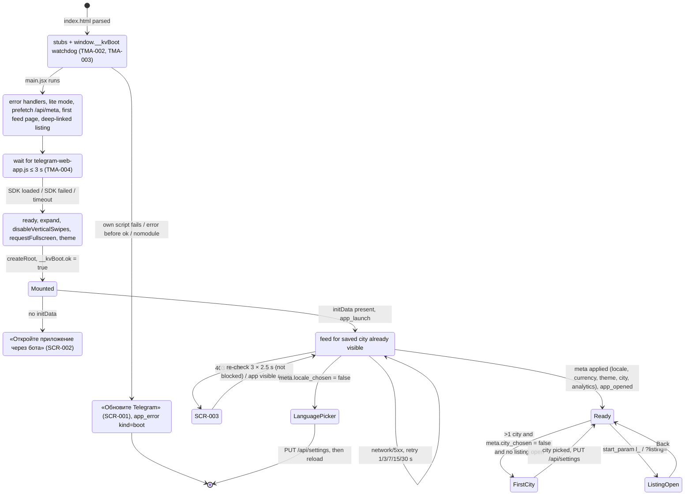
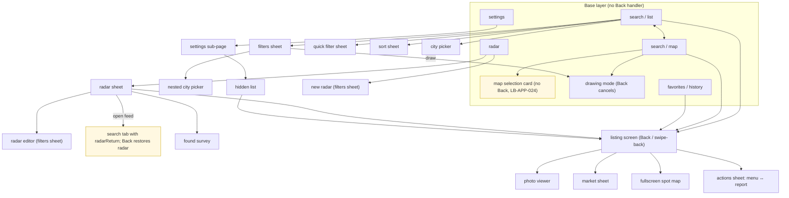

# 05 — Telegram Mini App integration audit: kvadro² Mini App

This document lists every point where the legacy Mini App (`app.kvadro.app`) touches the Telegram WebApp platform, as
`TMA-NNN` items. Screens are in [`03-legacy-frontend-audit.md`](03-legacy-frontend-audit.md) (`SCR-NNN`). The bot's own
behaviour is in `04-telegram-bot-audit.md` (`BOT-NNN`). Endpoints are named by `METHOD path`.

Evidence comes from the recovered code `$KVADRO_ROOT/demo/app/…`. Nothing was run. "Not used" items are `CONFIRMED`
absences: they were checked by grep over `$KVADRO_ROOT/demo/app/src` and `index.html` for the API name. Server-side
claims (signature checks, prepared messages) are `DOCUMENTED_ONLY`, because the legacy backend source is not
available. Text added for a later release names it. The audit is brought up to `index-CBlEKxdL.js` (SVN r31), whose
intake cites files "at r31", and to the pinned release `index-CIa0Ldj2.js` (source at SVN r33; `wave-1/baseline.md`);
text of that intake cites the source "at r33", the state the release was read in, and the changelog at r36.

Policy (HOMI, 2026-11-09): legacy bugs are fixed, not reproduced. Mini App defects are tracked as `LB-APP-NNN` in
`03-legacy-frontend-audit.md` §5 and §5b.

## 1. Integration points

### 1.1 SDK loading and boot

#### TMA-001 — Official SDK script tag (CONFIRMED)

- **Tag:** `<script id="tg-sdk" async crossorigin="anonymous" src="https://telegram.org/js/telegram-web-app.js">` with
  `<link rel="preconnect" href="https://telegram.org" crossorigin>` (`$KVADRO_ROOT/demo/app/index.html:145-152`).
- **`async`:** a hanging telegram.org must not keep the page white.
- **`crossorigin`:** makes SDK errors readable instead of «Script error.»; about 30% of Android sessions had that
  according to the comment.
- **Version:** the SDK is unpinned; it is whatever telegram.org serves.
- **CSP:** the inline boot scripts are allowed by sha256, so `index.html` must stay byte-identical.
- **Port note:** a Next.js port must keep `connect-src` / `script-src` for telegram.org and either recompute hashes or
  use nonces (Q-APP-016).

#### TMA-002 — Stubs for native callbacks before the SDK loads (CONFIRMED)

- **`window.__tg__postBackgroundChange = … || function(){}`:** Telegram Android 12.10+ calls it on return from
  background; per the comment it caused about 60% of «Script error.» reports.
- **`window.TelegramGameProxy = … || {receiveEvent(){}}`:** old iOS clients call it at start.
- **Evidence:** `index.html:9-20`.
- **Port note:** keep both as the first inline script, before any framework code.

#### TMA-003 — Boot watchdog and boot error reporting (CONFIRMED)

- **State:** `window.__kvBoot = {ok, watching, sdk, show}` (`index.html:28,126,131`).
- **Before `ok`:** errors are posted as `app_error` with `kind: "boot"`. The payload includes `tg: WebApp.version` and
  `platform: WebApp.platform`, and the error source is stripped of `?…` / `#…`, because Telegram's own code reports the
  page URL with `#tgWebAppData` (`index.html:63-90`).
- **Handover:** `installGlobalErrorHandlers()` sets `watching` (`$KVADRO_ROOT/demo/app/src/lib/errors.js:101-104`);
  `main.jsx` sets `ok` after mount (`$KVADRO_ROOT/demo/app/src/main.jsx:50-52`).
- **SDK failure:** marked as `sdk = "error"` and does not show the boot screen.

#### TMA-004 — Waiting up to 3 s for the SDK, and adopting a late SDK (CONFIRMED)

- **Wait:** `waitForTelegramSdk(3000, initTelegramApp)` resolves at once if `Telegram.WebApp` exists, the tag is missing
  or `__kvBoot.sdk === 'error'`; otherwise on load, error or timeout (`$KVADRO_ROOT/demo/app/src/lib/telegram/webApp.js:75-108`;
  `main.jsx:19,40`).
- **Late SDK:** if it loads after the timeout and has `initData`, the live `webApp` binding is replaced and
  `initTelegramApp` runs again (`webApp.js:93-104`). Since release `index-CIa0Ldj2.js`, when the first render had no
  initData (the state of SCR-002), the App is rendered again with a new key, which remounts it and restarts the launch
  (`main.jsx:41-64` at r33).
- **Edge case:** up to `index-CBlEKxdL.js` parts of the app captured `webApp` at module load, e.g. `pushBackHandler`
  stored the instance per push (`$KVADRO_ROOT/demo/app/src/lib/telegram/buttons.js:16`), and a Back handler
  registered without the SDK was dropped. Fixed in legacy since release `index-CIa0Ldj2.js`: handlers registered
  before the SDK work once it arrives (TMA-022, TMA-023; `buttons.js:17-27,36-46,58-69,76-85`, `webApp.js:203-205` at
  r33).

#### TMA-005 — Native bridge used directly when the SDK never loads (CONFIRMED)

- **Behaviour:** without an SDK, the app posts `web_app_ready` and `web_app_expand` itself.
- **Bridges** (`webApp.js:16-40,82-85`):
  - `window.TelegramWebviewProxy.postEvent` (mobile);
  - `window.external.notify` (Windows);
  - `parent.postMessage` (Web).
- **Effect:** Telegram stops its loading animation even if telegram.org is unreachable.

### 1.2 Identity, authorisation, user and language

#### TMA-006 — Where initData comes from (CONFIRMED)

- **Source:** `getInitData() = webApp?.initData || hashInitData`. `hashInitData` is `#tgWebAppData=…`, read **once at
  module load**, because analytics later removes the hash from the URL (`webApp.js:110-128`).
- **Gate:** `hasInitData()` decides between the app and the «Откройте приложение через бота» state
  (`$KVADRO_ROOT/demo/app/src/app/App.jsx:228-230`).
- **Boot script:** reads the same two sources (`index.html:38-43`).

#### TMA-007 — `Authorization: tma <initData>` on every API call (CONFIRMED client; server check DOCUMENTED_ONLY)

- **Client:** `apiFetch` sends `Authorization: tma ${getInitData()}` on every `/api/*` request
  (`$KVADRO_ROOT/demo/app/src/lib/api/client.js:74-86`), and so does the boot XHR (`index.html:78`).
  - `prefetch` is skipped without initData (`client.js:35-38`).
  - `GET /api/bot` is a plain `fetch` without the header (`$KVADRO_ROOT/demo/app/src/lib/api/meta.js:15-23`).
  - `app_error` can be sent with an empty `tma ` value (`$KVADRO_ROOT/docs/api.md` §11).
- **Server:** verifies the signature per `$KVADRO_ROOT/CLAUDE.md` "Architecture" and `$KVADRO_ROOT/docs/api.md` §1.
- **Gaps:** expiry handling (`auth_date`) is not visible in the client, and there is no 401 handling in the client at
  all. An expired initData surfaces as silent meta retries and generic «Не загрузилось» errors (LB-APP-047).

#### TMA-008 — The user's language from `initDataUnsafe` (CONFIRMED)

- **Reading:** `initDataUnsafe.user.language_code`, or without the SDK the `user` JSON parsed from the hash initData
  (`webApp.js:137-155`).
- **Mapping:** `uz*` → `uz_Latn`, `en*` → `en`, else `ru`. The pre-meta locale detector and the boot screen ignore `en`
  (LB-APP-032).
- **Not used:** no other `initDataUnsafe` field: no user id, name, photo, `is_premium`, `chat_type` or
  `receiver`/`chat`. The user's identity is resolved server-side from initData.

#### TMA-009 — Keeping initData out of logs and analytics (CONFIRMED)

- **Address bar:** before PostHog loads, `history.replaceState` drops the hash (`$KVADRO_ROOT/demo/app/src/lib/analytics.js:123-125`).
- **PostHog:** `before_send` strips hashes from URL properties and removes `tgWebAppData=…` from all strings; replay
  network names are stripped (`analytics.js:165-184`).
- **Error reports:** sources drop `?…#…` (`errors.js:49-54`; `index.html:63-68`).
- **Port note:** a Next.js port must reproduce this, including with server logging of request URLs.

### 1.3 Launch parameters and deep links

#### TMA-010 — `start_param` opens a listing (CONFIRMED)

- **Parsing:** `new URLSearchParams(initData).get('start_param')`. `^l_(\d+)` gives the listing id; otherwise the page
  query `?listing=<id>` is used; the id must be a positive integer (`$KVADRO_ROOT/demo/app/src/lib/telegram/startParam.js:6-25`).
- **Effect:** the listing is prefetched before mount and opened as the initial `listingId` (`main.jsx:36-39`;
  `App.jsx:61`). `app_launch` and `app_opened` record `entry: 'link'`.
- **Since release `index-CIa0Ldj2.js`:** the id must be a positive safe integer (`Number.isSafeInteger`; before,
  `Number.isInteger`; `startParam.js:21` at r33). The listing is prefetched and opened only once per launch: the mark
  `sessionStorage['kv-start-done']` = `<initData hash>:<id>` keeps a reload of the WebView from opening the card again
  (`startParam.js:28,31,38-62`, `main.jsx:36-39`, `App.jsx:82-89` at r33; `03` BR-APP-106). `app_launch` and
  `app_opened` still read the unmarked id, so such a reload is logged as a second link entry (`03` LB-APP-080). A sale
  listing from the link switches the feed under it to sale (`03` BR-APP-108).

#### TMA-011 — Source formats inside `start_param` (CONFIRMED)

- **Formats** (`startParam.js:2,32-54`):
  - `l_<id>` → source `share`;
  - `l_<id>-web` → `web`;
  - `l_<id>-(fb|tg|ig)<1-4 digits>` → campaign code;
  - `l_<id>-seo[-…]` → `seo`;
  - `l_<id>-[seo-]<channel 4-32>-<post 1-12 digits>` → `https://t.me/<channel>/<post>`, offered on the no-access
    screen.
- **Uses:** the source is used only for the bot hand-off on the no-access screen. The landing and SEO pages that create
  these links are in `03b-legacy-landing-seo-audit.md`.

#### TMA-012 — Query parameters of the Mini App URL (CONFIRMED)

- **Parameters** (these are not `start_param`):
  - `?listing=<id>` (TMA-010);
  - `?news=<a-z_{1,32}>`: entry `news`; `pets` opens the pets filter (`$KVADRO_ROOT/demo/app/src/lib/newFeatures.js:24-30`;
    `$KVADRO_ROOT/demo/app/src/app/useAppBootstrap.js:115-124`);
  - `?map=gl|leaflet|auto`: map engine override (`$KVADRO_ROOT/demo/app/src/features/map/engine.js:74-87`);
  - `?mapdebug`: exposes `window.kvGL` (`$KVADRO_ROOT/demo/app/src/features/map/gl/useMapInstance.js:118-120`);
  - `?owner=new`: since release `index-CBlEKxdL.js` it opens the owner form on a new draft, like the `start_param`
    `owner_new` (TMA-046; `$KVADRO_ROOT/demo/app/src/lib/telegram/share.js:60-71` at r31);
  - `?radar=<id>`: since release `index-CIa0Ldj2.js` it replaces the search by the filters of the radar with that id.
    The id must be a positive safe integer, and the parameter is skipped when the launch names a listing (`03`
    BR-APP-107; `$KVADRO_ROOT/demo/app/src/features/radar/radarLink.js:7-13`,
    `$KVADRO_ROOT/demo/app/src/app/useAppBootstrap.js:135-149` at r33). There is no `start_param` form of it.
- **Open question:** whether bot buttons actually use `?listing=` / `?news=` is Q-APP-019; whether the bot opens the
  Mini App with `?radar=<id>` is `04` Q-BOT-050.

#### TMA-013 — Deep links the Mini App creates (CONFIRMED)

| Link | Where | Evidence |
| ---- | ----- | -------- |
| `https://t.me/<bot>?startapp=l_<id>` | share fallback text | `$KVADRO_ROOT/demo/app/src/features/listing/ListingTitleRow.jsx:49` |
| `https://t.me/<bot>?start=s_<source>[--l<id>]` | no-access «Перейти в бота»; since release `index-CIa0Ldj2.js` the source `seo` is `seo_en` / `seo_uz` by the interface language (`ru` keeps `seo`), and the link is not built for `blocked` and `paused` | `$KVADRO_ROOT/demo/app/src/features/onboarding/NoAccessScreen.jsx:66`; `NoAccessScreen.jsx:41-47,72-75`, `$KVADRO_ROOT/demo/app/src/lib/telegram/startParam.js:69-79` at r33 |
| `https://t.me/<bot>?start=s_friend` | survey «Рассказать друзьям» | `$KVADRO_ROOT/demo/app/src/features/radar/FoundSheet.jsx:119` |
| `https://t.me/<support>?start=l_<id>` | actions «Написать в поддержку» | `$KVADRO_ROOT/demo/app/src/features/listing/ListingActionsSheet.jsx:161` |
| `https://t.me/<support>` | settings and no-access support rows | `$KVADRO_ROOT/demo/app/src/features/settings/AboutGroup.jsx:35`; `NoAccessScreen.jsx:79` |
| `https://t.me/<bot>` | after `no_chat`, «Перезапустить» confirm | `$KVADRO_ROOT/demo/app/src/lib/chatAccess.js:50-52` |
| `https://t.me/<username>` | boot screen «Вернуться в бота» without SDK | `index.html:94-101` |

- **Bot username sources:** `meta.bot_username` (authorised `GET /api/meta`) for share and chat restart;
  `GET /api/bot` → `{username, support}` (no auth) for the boot screen, no-access screen, actions sheet and settings.

#### TMA-046 — `start_param` `owner_new` opens the owner form (CONFIRMED)

- **Since:** release `index-CBlEKxdL.js` (`$KVADRO_ROOT/demo/app/docs/CHANGELOG.md:5-45` at r31).
- **Parsing:** a `start_param` equal to `owner_new` or `owner-new`, or the page query `owner=new` (TMA-012). Any of
  them opens the owner form on a new draft, once, when the app mounts
  (`$KVADRO_ROOT/demo/app/src/lib/telegram/share.js:60-71`; `$KVADRO_ROOT/demo/app/src/app/App.jsx:133-135`, both at
  r31). It stands beside TMA-010 to TMA-012.
- **Effect:** the form of `03` SCR-050 with a new draft (`03` BR-APP-075). Every such launch sends
  `POST /api/owner/listings`, so it creates one more draft (`03` LB-APP-054).
- **Attribution:** `getStartSource()` returns `null` for anything that is not `l_…`, so a cabinet launch has no source
  in `app_launch` (`$KVADRO_ROOT/demo/app/src/lib/telegram/startParam.js:32-35` at r31).
- **Producer:** neither the Mini App, the landing (`$KVADRO_ROOT/demo/landing/site`) nor the legacy docs build such a
  link; `$KVADRO_ROOT/docs/api.md:1349-1350` (r31) only names it. The likely producer is the bot or a campaign
  (`inferred`; `04` Q-BOT-049).

### 1.4 Window, viewport, safe areas and theme

#### TMA-014 — `ready()` and `expand()` (CONFIRMED)

- **Behaviour:** both are called once in `initTelegramApp` (`webApp.js:188-189`), or as raw events without the SDK
  (TMA-005).

#### TMA-015 — Vertical swipes disabled (CONFIRMED)

- **Behaviour:** `disableVerticalSwipes()` when `isVersionAtLeast('7.7')` (`webApp.js:190-192`). Sheets and
  pull-to-refresh rely on this.

#### TMA-016 — Fullscreen on mobile (CONFIRMED)

- **Behaviour:** `requestFullscreen()` when `isVersionAtLeast('8.0')` and `platform ∈ {ios, android, android_x}`. The
  `fullscreenChanged` event toggles `html.fullscreen` from `isFullscreen` (`webApp.js:158,193-199`).
- **Not used:** `exitFullscreen` and `fullscreenFailed`.
- **CSS:** `.fullscreen` places the collapsed title inside Telegram's header row and adds a hero gradient
  (`$KVADRO_ROOT/demo/app/src/styles/chrome.css:223-230`; `$KVADRO_ROOT/demo/app/src/styles/listing.css:35-43`).

#### TMA-017 — Safe areas (CONFIRMED)

- **CSS variables only:** `--top-inset = --tg-safe-area-inset-top + --tg-content-safe-area-inset-top`;
  `--bottom-inset = --tg-safe-area-inset-bottom` (`$KVADRO_ROOT/demo/app/src/styles/tokens.css:30-31`).
- **Not used:** `safeAreaChanged` / `contentSafeAreaChanged`, left and right insets, and `env(safe-area-inset-*)`, even
  though `viewport-fit=cover` is set (`index.html:5`).

#### TMA-018 — Viewport height (CONFIRMED absence)

- **Not used:** `viewportHeight`, `viewportStableHeight`, `viewportChanged` and `--tg-viewport-*`.
- **Instead:** full-screen layers use `position: fixed; inset: 0`; one `100vh` remains (`$KVADRO_ROOT/demo/app/src/styles/misc.css:3`).

#### TMA-019 — `themeParams` and colour scheme (CONFIRMED)

- **CSS:** only `--tg-theme-bg-color`, `--tg-theme-secondary-bg-color`, `--tg-theme-text-color` and
  `--tg-theme-hint-color` are read, and only in auto + light. Dark and explicit-light use a fixed palette (`tokens.css:2-68`).
- **JS:** the scheme comes from `webApp.colorScheme` (`$KVADRO_ROOT/demo/app/src/lib/telegram/theme.js:29`), and
  `themeChanged` re-applies it (`webApp.js:200-201`).
- **Not used:** `button_color`, `accent_text_color`, `section_*` and the other `themeParams`. The accent is the brand
  yellow `#ffd23f`.

#### TMA-020 — Header and background colour (CONFIRMED)

- **Behaviour:** `setHeaderColor` and `setBackgroundColor` from 6.1. From 6.9 they get the exact `--bg` hex, except in
  auto + light, which passes `bg_color` (`theme.js:36-49`).
- **Not used:** `setBottomBarColor`.

#### TMA-021 — The app theme overrides the Telegram theme (CONFIRMED)

- **Behaviour:** the user's `auto | light | dark` choice lives in `kv-theme`. It is applied before the first paint and
  replaced on every start by `meta.theme` (`useAppBootstrap.js:81`; `theme.js:56-62`).
- **Settings:** the theme setting writes `PUT /api/settings {theme}` (`$KVADRO_ROOT/demo/app/src/features/settings/SettingsScreen.jsx:98-114`).

### 1.5 Buttons

#### TMA-022 — BackButton through a handler stack (CONFIRMED)

- **Mechanism:** `pushBackHandler(handler)` keeps a module-level array (`buttons.js:5-35`).
  - The first push calls `BackButton.onClick(onBackPressed)` and `show()`.
  - The press runs the **last** handler, wrapped in `safeCallback`.
  - Removing the last handler calls `offClick` and `hide()`.
  - Up to `index-CBlEKxdL.js` each unsubscribe used the WebApp instance captured at push time, and a handler pushed
    while the SDK was absent was dropped.
  - Since release `index-CIa0Ldj2.js` handlers always go on the stack. `syncBackButton()` binds and shows the button
    when the stack is not empty and the SDK exists, unbinds and hides it when the stack empties, and runs again from
    `initTelegramApp()`, so handlers pushed before a late SDK start working (`buttons.js:17-27,36-46,58-69` at r33).
- **Without the SDK** (since release `index-CIa0Ldj2.js`): the listing layer, the settings sub-pages and the owner
  form show a close cross of their own (TMA-047).
- **Layers using it:** `03-legacy-frontend-audit.md` §1.2. There is no Back on the root tabs; Telegram then shows its
  Close.
- **Owner layers** (since release `index-CBlEKxdL.js`): they push onto the same stack, in this order. The lazy frame
  pushes its close while the chunk loads (`$KVADRO_ROOT/demo/app/src/components/LazyPage.jsx:97-118` at r31). Then
  the owner form pushes its own handler: it closes an open photo menu, steps back from the phone and mode steps to
  the questionnaire, and otherwise closes the form, each time with a light haptic
  (`$KVADRO_ROOT/demo/app/src/features/owner/OwnerForm.jsx:370-385` at r31). An open place picker pushes its close on
  top (`$KVADRO_ROOT/demo/app/src/features/owner/PlacePicker.jsx:51-52` at r31); on the first map step of a new draft
  that close shuts the whole form. «Мои объявления» and «Отклики» close like any settings sub-page, and the limit
  sheet closes itself (`03` SCR-049 to SCR-058).
- **Gesture parity:** swipe-back exists on iOS and desktop only (`$KVADRO_ROOT/demo/app/src/hooks/useSwipeBack.js:27`).
- **Gaps:** the map selection card is not in the stack (LB-APP-024).

#### TMA-023 — SettingsButton (CONFIRMED)

- **Behaviour:** `SettingsButton.onClick` + `show()` when `isVersionAtLeast('7.0')` (`buttons.js:42-54`). The handler
  closes the listing, filters and radar editor, switches to settings and scrolls to the top
  (`$KVADRO_ROOT/demo/app/src/app/useTelegramButtons.js:10-23`).
- **Since release `index-CIa0Ldj2.js`:** `setSettingsHandler` replaces `showSettingsButton`, and
  `syncSettingsButton()` binds the item lazily, like Back (TMA-022), still only from Bot API 7.0
  (`buttons.js:17-27,36-46,58-69,76-85` at r33). The handler gives a light haptic; closes the listing, the filters
  sheet, the radar editor, the radar-create sheet, the quick filter, the city picker and the sort sheet; remembers the
  feed scroll (`03` BR-APP-105); opens the settings tab; and scrolls to the top (`useTelegramButtons.js:12-40` at
  r33).
- **Gap:** up to `index-CBlEKxdL.js` other sheets stayed open. Since release `index-CIa0Ldj2.js` the handler closes
  them, but not the owner form or «Мои объявления» (`03` LB-APP-046, partly fixed).

#### TMA-024 — MainButton, SecondaryButton, BottomButton (CONFIRMED absence)

- **Not used.** Every primary action is an in-page HTML button: the CTA bar, sheet footers and the radar sheet footer.
- **Port note:** porting to `MainButton` would be a product change, not parity.

#### TMA-047 — A close control of the app's own while the SDK is absent (CONFIRMED)

- **Since:** release `index-CIa0Ldj2.js` (`$KVADRO_ROOT/demo/app/docs/CHANGELOG.md:16` at r36).
- **Rule:** the cross `FallbackClose` renders if and only if the module's `webApp` binding is empty, read through
  `useSyncExternalStore` (`$KVADRO_ROOT/demo/app/src/components/FallbackClose.jsx:12-21` at r33). Subscribers are told
  at the end of every `initTelegramApp()` (`$KVADRO_ROOT/demo/app/src/lib/telegram/webApp.js:204-206,210-220` at
  r33).
- **Late SDK:** an SDK that loads after the 3 s wait and has `initData` is adopted (TMA-004): the system Back button
  binds (TMA-022) and the cross disappears. A late SDK without `initData` is not adopted, so the cross stays
  (`webApp.js:94-105` at r33).
- **Where:** the listing layer in its three states: error, skeleton and content
  (`$KVADRO_ROOT/demo/app/src/features/listing/ListingScreen.jsx:178,205,252`); every `SubPage`
  (`$KVADRO_ROOT/demo/app/src/features/settings/SubPage.jsx:33`); the owner form layer
  (`$KVADRO_ROOT/demo/app/src/features/owner/OwnerForm.jsx:1491`), all at r33. The screens are `03` SCR-018, SCR-019,
  SCR-033, SCR-050 and SCR-057.
- **Look:** a round glass button with the icon `X` 20 px and the aria-label «Закрыть», fixed at the top right below
  the top inset, 44 × 44 px (`$KVADRO_ROOT/demo/app/src/styles/settings.css:157` at r33).
- **Beside:** TMA-004 (the late SDK), TMA-005 (the bridge without the SDK), TMA-022 (the BackButton it replaces) and
  TMA-043 (outside Telegram, where Back was a no-op).
- **Parity scenarios:** `no-sdk-listing` (without the SDK, with initData in `#tgWebAppData=`, the cross shows on the
  listing) and `no-sdk-listing-close` (the cross closes the listing).

### 1.6 Feedback and dialogs

#### TMA-025 — Haptic feedback (CONFIRMED)

- **Calls:** `HapticFeedback.impactOccurred(style)` (`light` by default, `medium` for primary actions) and
  `notificationOccurred('success' | 'error')` (`$KVADRO_ROOT/demo/app/src/lib/telegram/haptics.js:8-18`).
- **Gating:** there is no version gate (`?.` only).
- **Not used:** `selectionChanged`.
- **Uses:** about 60 call sites, including tabs, chips, sheets, the lasso, pull-to-refresh, favourites, results of API
  mutations and the Back handlers.
- **Since release `index-CBlEKxdL.js`:** the owner cabinet adds two calls that the list above does not have. The
  `heavy` impact belongs to the celebration after publishing (`03` BR-APP-096;
  `$KVADRO_ROOT/demo/app/src/features/owner/OwnerForm.jsx:45-68,842-883` at r31). `notificationOccurred('warning')`
  marks a missing field at «Дальше», a denied or failed location and a point outside the rectangle (`03` BR-APP-081,
  BR-APP-097, SCR-051). The card-style sub-page of release `index-BnFvC-Ft.js` already plays `warning` (`03`
  BR-APP-074).

#### TMA-026 — `showConfirm` (CONFIRMED)

- **Behaviour:** `WebApp.showConfirm` when `isVersionAtLeast('6.2')`, else `window.confirm` (`$KVADRO_ROOT/demo/app/src/lib/telegram/dialogs.js:9-17`).
- **Uses:** clear history, delete radar, return all hidden, and «Открыть чат с ботом?» after `no_chat` (SCR-043).
  Since release `index-CBlEKxdL.js` also three confirmations of the owner cabinet: «Отметить «Сдано»? …», «Снять
  объявление?» and «Удалить черновик?» (`$KVADRO_ROOT/demo/app/src/features/owner/owner.js:765-775` at r31; `03`
  BR-APP-088).

#### TMA-027 — `showPopup`, `showAlert`, `showScanQrPopup` (CONFIRMED absence)

- **Not used.** All other feedback is in-app toasts.

### 1.7 Links, calls and sharing

#### TMA-028 — `openLink` and `openTelegramLink` (CONFIRMED)

- **Routing:** `https://t.me/…` goes to `openTelegramLink`; any other URL to `openLink` (external browser; no
  `try_instant_view`). Outside Telegram, `window.open(url, '_blank', 'noopener')`.
- **Debounce:** the same URL is ignored for 1.5 s; the function returns `false` then (`$KVADRO_ROOT/demo/app/src/lib/telegram/links.js:42-74`).
- **Uses:** original posts, channel chips, offers, the methodology page, Yandex / Google maps, the call page, support,
  Instagram and bot hand-offs. Since release `index-CBlEKxdL.js` also two links of the owner cabinet through
  `openTelegramLink`: «Открыть бот» of the phone step, to `https://t.me/<meta.bot_username>` (TMA-034;
  `$KVADRO_ROOT/demo/app/src/features/owner/OwnerForm.jsx:1684-1693` at r31), and «Поддержка» of a held or withdrawn
  owner listing, to `https://t.me/<support>` from `GET /api/bot`
  (`$KVADRO_ROOT/demo/app/src/features/owner/OwnerListings.jsx:100-105`, `OwnerPanel.jsx:123` at r31).

#### TMA-029 — Phone calls (CONFIRMED)

- **Android** (`platform.startsWith('android')`): sets `location.href = 'tel:<+998…>'` and watches `visibilitychange`
  and `blur` for 1.2 s. If the app was left, `via: 'tel'`; otherwise it opens the server call page (`call_url`,
  `/call/<token>`) with `openLink`, `via: 'browser'`.
- **Other platforms:** straight to the call page (`links.js:14-40`; `$KVADRO_ROOT/demo/app/src/features/listing/hooks/useListingContact.js:54-81`).
- **Gap:** the dead end is LB-APP-028.

#### TMA-030 — `shareMessage` with a prepared message (CONFIRMED client; server mechanism DOCUMENTED_ONLY)

- **Flow:** when `isVersionAtLeast('8.0')`, `POST /api/listings/:id/share` returns `{id}`, then
  `WebApp.shareMessage(id)`.
- **Stale window recovery:** if the SDK throws `WebAppShareMessageOpened` (an earlier window never reported closing),
  the app calls the **internal** `Telegram.WebView.receiveEvent('prepared_message_failed', {error: 'STALE'})` and
  retries once (`$KVADRO_ROOT/demo/app/src/lib/telegram/share.js:12-28`; release 2026-11-06).
- **Server side:** is said to use Bot API `savePreparedInlineMessage` (🔶 in `$KVADRO_ROOT/docs/about.md` §5.8).
- **Port note:** the internal call depends on SDK internals and needs a regression test on SDK updates.
- **Not used:** the result callback and the `shareMessageSent` / `shareMessageFailed` events.

#### TMA-031 — Share fallbacks (CONFIRMED)

- **In Telegram:** `openTelegramLink('https://t.me/share/url?url=…&text=…')`.
- **Outside Telegram:** `navigator.share`, else a new tab (`share.js:56-70`).
- **Uses:** listing share fallback and the survey's «Рассказать друзьям».

#### TMA-032 — `switchInlineQuery`, `shareToStory`, `sendData`, `downloadFile`, `openInvoice` (CONFIRMED absence)

- **Not used.**

### 1.8 Permissions, device and storage

#### TMA-033 — `requestWriteAccess` after `409 no_chat` (CONFIRMED)

- **Flow** (`$KVADRO_ROOT/demo/app/src/lib/chatAccess.js:27-55`; `share.js:34-42`):
  1. Radar create, enable, edit or widen gets `409 {"detail":"no_chat"}`. Since release `index-CBlEKxdL.js` the
     contact request to an owner (`POST /api/listings/:id/contact`, `08` API-054) enters the same flow
     (`$KVADRO_ROOT/demo/app/src/features/listing/ContactRequestSheet.jsx:59-68` at r31).
  2. `requestWriteAccess` runs when `isVersionAtLeast('6.9')`.
  3. Denied → `chat_access_declined`, and the error is rethrown.
  4. Allowed → `chat_access_allowed`, and the request is retried once.
  5. If the method is unavailable or the retry still says `no_chat`: confirm `chat.restart` → `https://t.me/<bot>`,
     then rethrow.
- **Toast:** «Радар не включён — боту нужно разрешение писать вам в чат». The contact request shows its own line in
  the sheet instead: «Ответ хозяина придёт в бот — разрешите боту писать вам и отправьте ещё раз.» (`03` SCR-061).

#### TMA-034 — `requestContact` and phone sharing (CONFIRMED client since release `index-CBlEKxdL.js`; bot side DOCUMENTED_ONLY; a CONFIRMED absence before it)

- **Before the release:** up to `index-BnFvC-Ft.js` the Mini App did not use `requestContact`. Phone verification was
  only a bot feature (`/owner` with a `request_contact` reply keyboard, `$KVADRO_ROOT/docs/about.md` §5.6, §6.3;
  DOCUMENTED_ONLY).
- **Call:** `WebApp.requestContact(callback)`, only when the method exists and `isVersionAtLeast('6.9')`. The client
  resolves with the first callback argument (shared or not) and nothing else. Below 6.9 it resolves `null`
  (`$KVADRO_ROOT/demo/app/src/lib/telegram/share.js:45-58` at r31).
- **Use:** «Поделиться номером» on the phone step of the owner form (`03` SCR-053, BR-APP-084).
- **What reaches whom:** the contact goes to the bot as a message in the user's chat. The Mini App gets only the yes
  or no, and learns the result by polling `GET /api/owner/listings/:id` (`$KVADRO_ROOT/docs/api.md:1346-1348`, r31;
  `$KVADRO_ROOT/demo/app/src/features/owner/owner.js:89` at r31). The bot's side is DOCUMENTED_ONLY: the contract and
  the Mini App's texts say that the bot receives and checks the contact, and no bot code or chat was seen (`04`
  BOT-086, Q-BOT-047; `02` BR-API-170).
- **Fallback:** on an old client (`null`) the step shows «Открыть бот», which opens `https://t.me/<meta.bot_username>`
  through `openTelegramLink` (`$KVADRO_ROOT/demo/app/src/features/owner/OwnerForm.jsx:1684-1693`;
  `$KVADRO_ROOT/demo/app/src/lib/telegram/links.js:55-69`, both at r31). In the chat the bot then has to offer a share
  button of its own, probably the reply keyboard of `/owner` (`$KVADRO_ROOT/docs/telegram-bot.md:827`; `inferred`;
  `04` Q-BOT-047). Whether the owner gets back to the same draft is `03` LB-APP-060 and Q-APP-027.
- **Port note** (external, not verified here): the Telegram SDK may pass contact data to the callback as a second
  argument. Legacy ignores it.

#### TMA-035 — Location (CONFIRMED)

- **Telegram LocationManager** (from `isVersionAtLeast('8.0')`): `init` (unless `isInited`), `isLocationAvailable`,
  `isAccessRequested && !isAccessGranted` → `denied`, `getLocation`. Fields read: `latitude`, `longitude`,
  `horizontal_accuracy`.
- **Fallback:** browser geolocation, `enableHighAccuracy`, 12 s timeout, max age 60 s (`$KVADRO_ROOT/demo/app/src/lib/geo/location.js:5-78`).
- **Not used:** `openSettings`.
- **Uses:** the city picker («Определить по геопозиции»), the map «Где я» and the fullscreen spot map. Since release
  `index-CBlEKxdL.js` also «Найти меня» of the owner's place picker (`03` SCR-051, BR-APP-097;
  `$KVADRO_ROOT/demo/app/src/features/owner/PlacePicker.jsx:123-141,170-179` at r31).
- **Gap:** no timeout on the Telegram path (LB-APP-009). The location is never sent to the server
  (`$KVADRO_ROOT/docs/about.md` §5.11), with one exception since release `index-CBlEKxdL.js`. After «Найти меня» the
  picker's map flies to the user's position, and the next address lookup sends that centre to `POST /api/owner/place`
  (`PlacePicker.jsx:63-83,139-140` at r31). So the user's own position reaches the server as a map centre (`inferred`
  from the two code paths; `02` Q-API-074).

#### TMA-036 — Home-screen shortcut (CONFIRMED)

- **Calls** (from `isVersionAtLeast('8.0')`): `checkHomeScreenStatus(cb)` with a 1.5 s timeout → `unknown`;
  `addToHomeScreen()`; event `homeScreenAdded` (`$KVADRO_ROOT/demo/app/src/lib/telegram/homeScreen.js:11-65`).
- **Uses:** the timed offer (SCR-041) and the settings row (SCR-032).
- **Not used:** the `homeScreenChecked` event.

#### TMA-037 — DeviceStorage (CONFIRMED)

- **Writes:** from `isVersionAtLeast('9.0')`, every `storageSet` also writes `DeviceStorage.setItem` / `removeItem`.
- **Restore:** `getItem` restores `kv-nudge`, `kv-home`, `kv-city` and, since release `index-DY_DH7h-.js`, `kv-visits`
  (the visit times of the return banner, SCR-046) when they are missing locally, with a 1.5 s timeout each
  (`$KVADRO_ROOT/demo/app/src/lib/storage.js:6-87`;
  `$KVADRO_ROOT/demo/app/docs/releases/2026-11-14_index-DY_DH7h-/REPORT.md:22`). Since release `index-CBlEKxdL.js`
  also `kv-owner-tip` (the tip of the owner chip, `03` BR-APP-101) and `kv-req-tip` (the request tip, `03`
  BR-APP-092): both joined `DEVICE_SYNCED_KEYS` (`storage.js:6` at r31;
  `$KVADRO_ROOT/demo/app/docs/CHANGELOG.md:33` at r31). The mark `kv-start-done` of release `index-CIa0Ldj2.js`
  (TMA-010) is a sessionStorage key and is not mirrored.
- **Gaps:** LB-APP-012, LB-APP-021.

#### TMA-038 — CloudStorage, SecureStorage, BiometricManager, Accelerometer, Gyroscope, DeviceOrientation (CONFIRMED absence)

- **Not used.**

#### TMA-039 — Closing (CONFIRMED)

- **`close()`:** used by the no-access «Вернуться в бот» (`$KVADRO_ROOT/demo/app/src/lib/telegram/webApp.js:131`;
  `NoAccessScreen.jsx:68`) and the boot screen «Вернуться в бота» (`index.html:93`).
- **Not used:** `enableClosingConfirmation`, so an unsaved filter draft can be lost by closing.

#### TMA-040 — Activity and visibility (CONFIRMED)

- **Mechanism:** the app uses `document.visibilitychange`, not Telegram's `activated` / `deactivated` events. It drives
  the immediate meta retry (`useAppBootstrap.js:150-158`), the contact-link refresh (`useListingContact.js:36-52`) and
  `tel:` detection (TMA-029). Since release `index-DY_DH7h-.js` it also drives the visit sessions of the return banner:
  going to the background on the search tab records a visit, and a return after ≥ 6 h starts a new session and
  re-reads the radars (`$KVADRO_ROOT/demo/app/src/app/useReturnNudge.js:50-71` at the pin; BR-APP-070). Since
  release `index-CBlEKxdL.js` a return to the app also refetches the owner's pending counter
  (`$KVADRO_ROOT/demo/app/src/lib/ownerPending.js:45-50` at r31; `03` BR-APP-091). While the owner form waits for the
  phone, the return polls the listing at once and restarts the poll after its 90 s timeout
  (`$KVADRO_ROOT/demo/app/src/features/owner/OwnerForm.jsx:1573-1599` at r31; `03` BR-APP-084). Since release
  `index-CIa0Ldj2.js` a return after ≥ 6 h also runs the long-return check, which reloads the search feed or asks
  `GET /api/feed/new` for the fresh pill (`useReturnNudge.js:52-74`, `$KVADRO_ROOT/demo/app/src/app/App.jsx:438-468`
  at r33; `03` BR-APP-104), and the minute clock of the age labels is checked again on `visibilitychange`
  (`$KVADRO_ROOT/demo/app/src/features/listing/minuteClock.js:4-43` at r33; `03` BR-APP-109).

### 1.9 Platform checks, version gates and life outside Telegram

#### TMA-041 — Platform checks (CONFIRMED)

- **`WebApp.platform`:** fullscreen on `ios` / `android` / `android_x`; `tel:` on `android*`; sent in `app_launch` and
  `app_error`.
- **User-Agent:**
  - `Telegram-Android/… (…; LOW|AVERAGE|HIGH)` selects lite graphics;
  - `/Android/` disables swipe-back and enables the graphics setting and scroll measurement
    (`$KVADRO_ROOT/demo/app/src/lib/graphics.js:22,47-59`).
- **Client version:** `WebApp.version` goes into error reports and, since release `index-BnFvC-Ft.js`, into
  `app_launch` as `tg`, as it is, without the 10-character cut of `app_error.tg`
  (`$KVADRO_ROOT/demo/app/src/app/useAppBootstrap.js:61` at r29; `$KVADRO_ROOT/demo/app/docs/CHANGELOG.md:63`).
  Legacy asks whether the bot uses it to choose between card styles (`$KVADRO_ROOT/docs/api.md:1318-1320`, r31,
  open question 16; Q-API-067).

#### TMA-042 — Version gates (CONFIRMED)

| Telegram WebApp version | Feature | Evidence |
| ----------------------- | ------- | -------- |
| none (optional chaining) | `ready`, `expand`, `close`, `HapticFeedback`, `openLink`, `openTelegramLink`, `BackButton`, `onEvent` | `webApp.js`, `haptics.js`, `links.js`, `buttons.js` |
| 6.1 | `setHeaderColor`, `setBackgroundColor` (`bg_color` key) | `theme.js:36-49` |
| 6.2 | `showConfirm` (else `window.confirm`) | `dialogs.js:11` |
| 6.9 | exact hex header and background; `requestWriteAccess`; since release `index-CBlEKxdL.js` `requestContact` (TMA-034) | `theme.js:42`; `share.js:36`; `share.js:45-58` at r31 |
| 7.0 | `SettingsButton` | `buttons.js:43` |
| 7.7 | `disableVerticalSwipes` | `webApp.js:190` |
| 8.0 | `requestFullscreen` (mobile), `shareMessage`, home-screen API, `LocationManager` | `webApp.js:193`; `share.js:13,48`; `homeScreen.js:12`; `location.js:6` |
| 9.0 | `DeviceStorage` | `storage.js:10` |

This matches `$KVADRO_ROOT/docs/about.md` §9.1.

#### TMA-043 — Outside Telegram (CONFIRMED)

- **Rendering:** with no initData the app renders only «Откройте приложение через бота в Telegram.» (SCR-002).
- **Fallbacks** still exist in the library code, for robustness:
  - links → `window.open`;
  - share → `navigator.share`;
  - confirm → `window.confirm`;
  - location → browser geolocation;
  - Back, Settings and haptics → no-ops. Since release `index-CIa0Ldj2.js` Back is no longer nothing for the listing
    layer, the sub-pages and the owner form: without the SDK they show a close cross of their own (TMA-047).
- **Boot screen:** reaches the bot through `GET /api/bot` and `https://t.me/<username>`.

#### TMA-044 — Isolating exceptions in Telegram event handlers (CONFIRMED)

- **Mechanism:** `safeCallback` wraps handlers for `BackButton`, `SettingsButton`, `fullscreenChanged` and
  `themeChanged`, so an exception does not break the SDK dispatcher. It is rethrown asynchronously for the global error
  log (`webApp.js:167-177`).

#### TMA-045 — Dev-only Telegram emulator (CONFIRMED; dev tooling, not product behaviour)

- **What it is:** a Vite plugin (`apply: 'serve'`) injects `tools/dev/telegram-client.js` as the first script of the
  dev page (`$KVADRO_ROOT/demo/app/tools/dev/telegram.mjs:1-31`).
- **What it does** (`telegram-client.js:1-14,209-281`):
  - asks for a real initData, stores it in localStorage `kvdev-initData` and puts it into the URL hash;
  - emulates `TelegramWebviewProxy` (Telegram Desktop): Back and Settings buttons in a dev bar, popups through
    `confirm()`, links in new tabs;
  - answers `web_app_*` requests (theme, viewport, safe area, write access, home screen, prepared message, fullscreen,
    close).
- **Scope:** not in builds or parity.
- **Port note:** HOMI can copy the idea for local development; it is not a feature to port.

## 2. Bot and Mini App: separate interfaces

The bot and the Mini App are different Telegram interfaces that share one backend and one user record. The Mini App is
a WebView authorised by `initData`. The bot is a chat interface driven by Bot API updates. Sources:
`$KVADRO_ROOT/docs/about.md` §5.3–§5.11, §6.3 (✅ facts unless marked); `04-telegram-bot-audit.md` has the detail.

| Capability | Mini App (`app.kvadro.app`) | Bot (`@KvadroAppBot`) |
| ---------- | --------------------------- | --------------------- |
| Browse and search listings, filters, sort, map, lasso | **yes** (SCR-007 to SCR-017) | no |
| Listing details: photos, market comparison, history, nearby, original text, translation | **yes** (SCR-018 to SCR-022) | listing cards in chat with a short version (§5.4) |
| Contact the author (call page, «Написать», open post) | **yes** | the card has «оригинал» and venue buttons |
| Favourites, history, hidden list | **yes** (SCR-024, SCR-025, SCR-039) | a favourite button on cards (§5.4) |
| Hide, block author, report (`rented`, `agent`, `wrong_data`, `fraud`) | **yes** (SCR-023); since release `index-CIa0Ldj2.js` an undo of «Уже сдано» (`DELETE /api/listings/:id/report`) | «Это риелтор», «Уже сдано», «Скрыть похожие» on cards; undo «↩️ Не сдано» existed only in the bot up to `index-CBlEKxdL.js` (§5.5) |
| Create, edit, pause, delete radars; flow estimate; widen | **yes** (SCR-026 to SCR-031); since release `index-CIa0Ldj2.js` a link `?radar=<id>` opens a radar's search | a step-by-step wizard and free-text (Gemini) creation (§5.3); whether its messages carry that link is unknown (`04` Q-BOT-050) |
| **Deliver** radar results (instant / digest, quiet hours) | no; only settings and status | **yes**: messages in the chat (§5.3) |
| Settings: language, currency, theme, quiet hours, digest time | **yes** (SCR-032 to SCR-038); language and currency also apply to the bot (`notify.languageHint`, `notify.currencyHint`); since release `index-BnFvC-Ft.js` also the style of the bot's listing cards (`classic` / `rich`) and «Прислать пример в чат» (SCR-048) | `setMyCommands` localisation follows the language (§6.3); sends the listing cards in the chosen style and the sample card (`POST /api/settings/card-sample`, `04` BOT-085, §3.10) |
| Owner phone verification (`owner_verified`) | no for `/owner`; since release `index-CBlEKxdL.js` the owner cabinet confirms a phone with `requestContact` (TMA-034), and the listing screen shows «Проверенный хозяин» with an info sheet (SCR-062) | **yes**: `/owner` with `request_contact` (§5.6) |
| List a flat for rent («Сдать квартиру»: form, photos, place, contact mode, publish, «Мои объявления», requests) | **yes** since release `index-CBlEKxdL.js` (SCR-049 to SCR-060) | receives the owner's contact, delivers the requests and the answers (`04` BOT-086 to BOT-091); whether it has an entry of its own is unknown (`04` Q-BOT-049) |
| Ask an owner who hides the number for it | **yes** since release `index-CBlEKxdL.js` (SCR-061, `POST /api/listings/:id/contact`) | delivers the request and the answer (`04` BOT-087 to BOT-090) |
| Privacy policy, «Удалить мои данные» | no (SCR-032) | **yes**: `/privacy` (§5.11) |
| Support conversation | only a link to the support account | a separate support account; the main bot handles the conversation per §5.11 🔶 |
| Share a listing | `shareMessage` / `startapp` link (TMA-030, TMA-031) | 🔶 `savePreparedInlineMessage` on the server prepares the message |
| Entry deep links | receives `startapp=l_<id>[-src]` (TMA-010, TMA-011) and, since release `index-CBlEKxdL.js`, `startapp=owner_new` (TMA-046); since release `index-CIa0Ldj2.js` the page query `?radar=<id>` (TMA-012) | receives `start=s_<src>[--l<id>]`, `s_friend`, `s_web…` (§5.10); since release `index-CIa0Ldj2.js` also `s_seo_en` and `s_seo_uz` from the gate (TMA-013) |
| Write access | asks for it (`requestWriteAccess`, TMA-033), since release `index-CBlEKxdL.js` also before a contact request | needs it to deliver radars and, since that release, the answers to contact requests |
| Access gate (closed beta) | shows reasons from `403` (SCR-003); since release `index-CIa0Ldj2.js` also `paused`, «Бот на паузе» | «Старт» in the bot unlocks `join` (text `noAccess.text.join`); what the bot does while it is `paused` is unknown (`04` Q-BOT-051) |

Rule for the port: every Mini App action that results in a chat message (radar create, enable, edit, widen; since
release `index-BnFvC-Ft.js` the sample card) depends on the bot's write access. The `409 no_chat` contract (TMA-033)
is the seam between the two interfaces. The sample card is the exception: it reports a failure as `sent: false`, not
as `409 no_chat`, and the Mini App does not ask for write access first (`03` BR-APP-074; Q-API-067). Since release
`index-CBlEKxdL.js` the contact request to an owner joins the actions behind `409 no_chat`: the owner's answer comes
as a chat message (`08` API-054). The owner's phone confirmation depends on the bot in another way: the bot has to
receive the contact that `requestContact` sends (TMA-034).

## 3. Diagrams

### 3.1 Start-up

### 3.2 Screen stack and Back

How it works:

- Each layer below the base calls `pushBackHandler(onClose)` when it mounts, and Telegram's Back runs only the newest
  one (TMA-022).
- The radar-return handler is pushed while the search tab is active after «Смотреть найденное»
  (`$KVADRO_ROOT/demo/app/src/app/useTelegramButtons.js:54-79`).
- The Settings button jumps straight to the settings tab (TMA-023).

## 4. Port notes for Next.js

- **Rendering model.** Everything depends on `initData`, which exists only on the client. Render the Mini App as a
  client-side SPA (static export or client components). Server rendering adds nothing and complicates CSP
  (`$KVADRO_ROOT/docs/about.md` §9.1).
- **Back stack.** Keep a single navigation model where Telegram Back closes the top layer, and swipe-back works on iOS
  and desktop. If URLs are introduced, Back must still call the in-app handler, not `history.back()` beyond the app.
- **Boot shell.** Keep the pre-framework stubs, the watchdog and the ES5 failure screen as the first inline scripts, and
  allow them by hash or nonce in CSP (TMA-001 to TMA-003).
- **Version gates.** Keep each gate per §1.9; old clients must degrade, not crash.
- **Storage keys.** Keep the `kv-*` names and the DeviceStorage behaviour, or migrate them explicitly
  (`03-legacy-frontend-audit.md` §3.2).
- **Close without the SDK.** Keep a close control of the app's own wherever a layer relies on BackButton (TMA-047).

## 5. Summary

| Group | Items | Status |
| ----- | ----- | ------ |
| SDK loading and boot | TMA-001 to TMA-005 | CONFIRMED |
| Identity, auth, language, privacy | TMA-006 to TMA-009 | CONFIRMED (server signature check DOCUMENTED_ONLY) |
| Launch parameters and deep links | TMA-010 to TMA-013, TMA-046 | CONFIRMED |
| Window, viewport, safe areas, theme | TMA-014 to TMA-021 | CONFIRMED (TMA-018 is an absence) |
| Buttons | TMA-022 to TMA-024, TMA-047 | CONFIRMED (TMA-024 is an absence) |
| Feedback and dialogs | TMA-025 to TMA-027 | CONFIRMED (TMA-027 is an absence) |
| Links, calls, sharing | TMA-028 to TMA-032 | CONFIRMED (TMA-030 server side DOCUMENTED_ONLY; TMA-032 is an absence) |
| Permissions, device, storage | TMA-033 to TMA-040 | CONFIRMED (TMA-038 is an absence; TMA-034 was one up to `index-BnFvC-Ft.js`, its bot side is DOCUMENTED_ONLY) |
| Platform, gates, outside Telegram, dev tooling | TMA-041 to TMA-045 | CONFIRMED |
| **Total** | **47** (42 used integration points, 5 confirmed absences) | — |
