# 06 — Database schema (reconstructed logical model)

Part of the kvadro² → HOMI migration audit (rules, labels and ID scheme: [`README.md`](README.md)). The data migration
that uses this model is [`14-data-migration-plan.md`](14-data-migration-plan.md).

- **Audit date:** 2026-11-09. Legacy Mini App release `index-plF_TOcT.js`; landing data snapshot 2026-11-08. Brought
  up to the pinned release `index-DY_DH7h-.js` (`wave-1/baseline.md`) for the three fields it changed: report
  `detail`, `price_kind: business` and radar `entry` `feed`/`return`.
- **The legacy database is not available** — no DDL, no dump, no row counts, no sample (`Q-SYS-002`). Every table
  boundary, column type, key and index below is **reconstructed**, never observed. `RUNTIME_VERIFIED` is not used.
- **IDs defined here:** `ENT-NNN` (entities), `BR-DATA-NNN` (business rules about data), `LB-DATA-NNN` (legacy data
  defects and questionable data decisions, each with a proposed fix — never ported as-is), `Q-DATA-NNN` (open
  questions with the check that closes them).
- **Short references:** "Doc" = `$KVADRO_ROOT/docs/api.md`; "About" = `$KVADRO_ROOT/docs/about.md`; "Bot" =
  `$KVADRO_ROOT/docs/telegram-bot.md`; "SEO" = `$KVADRO_ROOT/docs/seo-pages.md`; "Fixtures" =
  `$KVADRO_ROOT/demo/landing/tools/parity/fixtures/data/` (production landing data, snapshot of 2026-11-08 per
  `$KVADRO_ROOT/demo/landing/docs/RECOVERY.md:74`, `:92`); "Mocks" = `$KVADRO_ROOT/demo/app/tools/parity/mocks.mjs`
  (hand-written parity mocks — shapes only, values fabricated); client paths are relative to `$KVADRO_ROOT/demo/app/`.
  `02`, `03`, `04`, `05`, `08` are the sibling audit documents.

## 1. Method and confidence

### 1.1 What the model is rebuilt from

| Source | What it proves | Confidence ceiling for this document |
| ------ | -------------- | ------------------------------------ |
| Mini App client code (decompiled prod bundle) and the contract `docs/api.md` it agrees with | Wire field names, JSON types, nullability the client tolerates, closed enum sets the client branches on, which values the server must persist so that a later read returns them (settings round-trip, radar list, hidden list) | `CONFIRMED` for the **wire shape**; the storage behind it is `UNVERIFIED` |
| Landing production files and data snapshot (Fixtures) | Shapes of `live.json`, `pins-*.json`; real listing id range; real district code format; place-level median keys | `CONFIRMED` (production output of 2026-11-08) |
| Bot behaviour notes (`docs/telegram-bot.md`, audit `04`) | What the bot reads and writes, option sets, settings presets, the per-radar hide rules, `/owner`, `/privacy` promises | `DOCUMENTED_ONLY` (observed by the legacy team, no code) |
| SEO notes (`docs/seo-pages.md`) | Slugs, place dictionary needs, median/index rules, CSV columns, photo URL signing | `DOCUMENTED_ONLY` |
| Product description (`docs/about.md` §4) | The logical entity list and retention promises | `DOCUMENTED_ONLY` (✅ lines) or `UNVERIFIED` (🔶 lines) |
| HOMI repository (`backend/database/migrations/*`, `backend/app/Models/*`, ADRs) | What already exists on the target side | Facts about HOMI (not labelled) |

### 1.2 Structure proven by contract or code vs structure inferred

| Proven (`CONFIRMED`) | Inferred (`UNVERIFIED` unless the legacy docs state it: `DOCUMENTED_ONLY`) |
| -------------------- | --------------------------------------------------------------------------- |
| Every field name and JSON type of `ListingPreview`, `ListingDetails`, `Subscription`, `SearchFilters` (25 keys), `MetaResponse`, `CityMeta`, `CityStats`, `SettingsResponse`, hidden list, map points, flow, events (`08` §1.7–§1.8, API-001…API-034) | Which of those fields are **stored** and which are computed on read (e.g. `title`, `price`, `age`, `status_text`, `median_*`) |
| Closed enum sets the client branches on: `deal`, `types`, `owner`, `tenant`, `zones`, `market`, `posted_days`, `sort`, report `reason`, survey `answer`/`where`/`trigger`, radar `entry`, `mode`, PATCH bodies, locales, currencies, themes, listing and map tones, history `kind`, `nearby.kind`, `author.kind`, access reasons, event names | Whether the server stores the same codes or maps them (`Q-DATA-029`, `Q-DATA-030`) |
| Listing ids are JSON integers; production ids were 47 265 – 49 829 in the 2026-11-08 landing snapshot (Fixtures `pins-sale.json`, `pins-rent.json`) and a bot link carried `--l51358` (`04` BOT-031) | Column type, sequence, gaps, reuse (`Q-DATA-022`) |
| Production district codes in landing data use Uzbek Latin with underscores (`mirzo_ulugbek`, `shayxontohur`, Fixtures `pins-rent.json`) while SEO URL slugs use hyphens (`mirzo-ulugbek`, SEO:67-68) | The code format inside `meta.cities[].districts[].code` and inside stored radar filters (`Q-DATA-029`) |
| Production landing medians include place-level keys `pt:<lat>:<lon>` and `pt:<lat>:<lon>:near` beside district codes (Fixtures `pins-rent.json` → `medians`, 690 distinct keys) | How place medians are stored and refreshed (`Q-DATA-031`) |
| Photo URL shape `/media/<listing_id>/<n>.jpg?e=&s=` and the `.s.jpg` thumbnail derivation (`src/lib/images.js:9-14`); photo numbers start at `0` (SEO:218) | Storage path, originals, signing algorithm (`Q-DATA-026`, `Q-DATA-027`) |
| A per-user server profile exists and round-trips `locale`, `currency`, `theme`, `city`, `quiet`, `digest` (BR-API-144, BR-API-145) | Its table and column layout (`Q-DATA-007`) |
| Radars, favourites, hidden listings, blocked authors and survey answers are server-side state shared with the bot (API-011…API-033) | Their tables, keys and timestamps (`Q-DATA-011` … `Q-DATA-020`) |

Rule for the rest of the document: the **entity** carries the label of the evidence that it exists with the described
semantics; each **field** carries its own label in the `St.` column (`C` = `CONFIRMED`, `D` = `DOCUMENTED_ONLY`,
`U` = `UNVERIFIED`); every **legacy storage detail** (table name, column type, key, index) is `UNVERIFIED` and is
written as "probable" or "required by" — not as a fact. Types are given as the PostgreSQL type the wire value
requires; the real legacy column type is unknown until `Q-DATA-001` is answered. Section 4 is the **proposed HOMI**
design (`PROPOSED`), not a description of legacy storage.

### 1.3 What upgrades this document

1. `pg_dump --schema-only` of the legacy database plus `pg_stat_user_tables` row counts (`Q-DATA-001`,
   `Q-DATA-002`) → replace "probable" storage notes with the real DDL, keep the `ENT` ids and add a legacy-table
   column to the index in §2.
2. A sanitised sample (`Q-DATA-003`) → profile null rates, enum values, code formats; close the `U` fields.
3. Answers from the legacy owner to the `Q-DATA` list in §6.

## 2. Logical entities

### 2.0 Index

`Migrate` refers to the decision in `14-data-migration-plan.md` §2 (`migrate` = copy rows; `rebuild` = recompute in
HOMI from migrated data or reference sources; `drop` = do not carry over; `config` = deployment configuration, not
rows).

| ID | Entity | Group | Status | Migrate |
| -- | ------ | ----- | ------ | ------- |
| ENT-001 | User (Telegram account) | Identity | `CONFIRMED` | migrate |
| ENT-002 | User settings | Identity | `CONFIRMED` | migrate |
| ENT-003 | Access grant and closed-beta state | Identity | `CONFIRMED` (reasons) / `DOCUMENTED_ONLY` (conditions) | migrate + config |
| ENT-004 | Beta invitation | Identity | `DOCUMENTED_ONLY` | migrate (if open invites exist) |
| ENT-005 | Acquisition attribution | Identity | `DOCUMENTED_ONLY` | migrate |
| ENT-006 | Analytics identity (PostHog distinct id) | Identity | `DOCUMENTED_ONLY` | migrate |
| ENT-007 | Data-erasure request | Identity | `DOCUMENTED_ONLY` | migrate (pending) + replay |
| ENT-008 | Subscription (radar) | Radar | `CONFIRMED` | migrate |
| ENT-009 | Radar hide rule | Radar | `DOCUMENTED_ONLY` | migrate |
| ENT-010 | Sent listing card (delivered-card log) | Radar | `DOCUMENTED_ONLY` | migrate (mandatory) |
| ENT-011 | Pending delivery (digest and quiet-hours queue) | Radar | `UNVERIFIED` | migrate or rebuild |
| ENT-012 | Bot conversation state | Radar | `DOCUMENTED_ONLY` | drop |
| ENT-013 | Service-news broadcast | Radar | `UNVERIFIED` | drop history; opt-out migrates with ENT-002 |
| ENT-014 | Favourite | Personal | `CONFIRMED` | migrate |
| ENT-015 | View history entry | Personal | `CONFIRMED` | migrate |
| ENT-016 | Hidden listing | Personal | `CONFIRMED` | migrate |
| ENT-017 | Blocked author | Personal | `CONFIRMED` | migrate |
| ENT-018 | Vote / report | Personal | `CONFIRMED` (reasons) / `DOCUMENTED_ONLY` (effects) | migrate |
| ENT-019 | Owner verification | Personal | `DOCUMENTED_ONLY` | migrate (transitional, see LB-DATA-005) |
| ENT-020 | Found answer (survey «Нашли жильё?») | Personal | `CONFIRMED` | migrate |
| ENT-021 | Action log | Personal | `DOCUMENTED_ONLY` | drop (proposed) |
| ENT-022 | Support conversation | Personal | `UNVERIFIED` | out of scope until `Q-SYS-003` |
| ENT-023 | Listing | Listings | `CONFIRMED` | migrate |
| ENT-024 | Listing alias (merged-duplicate redirect) | Listings | `CONFIRMED` (behaviour) | migrate |
| ENT-025 | Publication (channel post) | Listings | `CONFIRMED` (shape) / `DOCUMENTED_ONLY` (storage) | migrate |
| ENT-026 | Listing history event (price timeline) | Listings | `CONFIRMED` | migrate |
| ENT-027 | Photo | Listings | `CONFIRMED` (URLs) / `DOCUMENTED_ONLY` (storage) | migrate (files) |
| ENT-028 | Listing location | Listings | `CONFIRMED` | migrate |
| ENT-029 | Listing attributes | Listings | `CONFIRMED` | migrate |
| ENT-030 | Author (phone or source) | Listings | `CONFIRMED` | migrate |
| ENT-031 | Market comparison (per listing) | Listings | `CONFIRMED` (shape) | rebuild + compare |
| ENT-032 | Median aggregate | Listings | `DOCUMENTED_ONLY` | rebuild + compare |
| ENT-033 | Price index series (rent index, sale prices) | Listings | `DOCUMENTED_ONLY` | migrate published values + rebuild |
| ENT-034 | Listing status and status change | Listings | `CONFIRMED` (label) / `DOCUMENTED_ONLY` (states) | migrate |
| ENT-035 | Listing translation | Listings | `UNVERIFIED` | drop or migrate (optional) |
| ENT-036 | Nearby place link (park, school) | Listings | `CONFIRMED` (shape) | rebuild |
| ENT-037 | Takedown request | Listings | `DOCUMENTED_ONLY` | migrate (mandatory) |
| ENT-038 | Call link token | Listings | `CONFIRMED` (link) / `UNVERIFIED` (storage) | drop |
| ENT-039 | Prepared share message | Listings | `UNVERIFIED` | drop |
| ENT-040 | Channel (Telegram source) | Sources | `DOCUMENTED_ONLY` | migrate |
| ENT-041 | Exchange rate (USD/UZS) | Sources | `CONFIRMED` (value) / `DOCUMENTED_ONLY` (source) | rebuild |
| ENT-042 | City or region | Dictionaries | `CONFIRMED` | rebuild + code map |
| ENT-043 | District | Dictionaries | `CONFIRMED` | rebuild + code map |
| ENT-044 | Zone | Dictionaries | `CONFIRMED` | rebuild + code map |
| ENT-045 | Quarter (массив / квартал) | Dictionaries | `DOCUMENTED_ONLY` | rebuild + code map |
| ENT-046 | Metro station | Dictionaries | `DOCUMENTED_ONLY` | rebuild + code map |
| ENT-047 | Place (landmark, residential complex ЖК, mahalla) | Dictionaries | `CONFIRMED` (labels, `pt:` keys) / `DOCUMENTED_ONLY` (gazetteer) | migrate if exported, else rebuild |
| ENT-048 | Point of interest (school with rating, park) | Dictionaries | `DOCUMENTED_ONLY` | rebuild |
| ENT-049 | Renovation | Dictionaries | `CONFIRMED` | rebuild + code map |
| ENT-050 | Appliance | Dictionaries | `CONFIRMED` | rebuild + code map |
| ENT-051 | Price preset and typical price | Dictionaries | `CONFIRMED` | rebuild |
| ENT-052 | Enumerations and presets (quiet, digest, locales, currencies, relax codes, feature codes) | Dictionaries | `CONFIRMED` | config |
| ENT-053 | Translatable names and server display strings | Dictionaries | `CONFIRMED` | rebuild |
| ENT-054 | Landing data snapshot | Landing / SEO | `CONFIRMED` | rebuild |
| ENT-055 | SEO slice aggregate | Landing / SEO | `DOCUMENTED_ONLY` | rebuild |
| ENT-056 | Salary reference (Natskomstat) | Landing / SEO | `DOCUMENTED_ONLY` | migrate (manual) |
| ENT-057 | CSP violation report | Landing / SEO | `UNVERIFIED` | drop |
| ENT-058 | Client device state (`kv-*` keys) | Outside the DB | `CONFIRMED` | not migrated (client-side) |
| ENT-059 | Telegram-side chat state (commands, menu button, sent messages) | Outside the DB | `DOCUMENTED_ONLY` | not migrated; reset plan |
| ENT-060 | Owner listing (cabinet «Сдать квартиру») | Owner cabinet | `DOCUMENTED_ONLY` | not migrated (DEC-40); HOMI's owner listings are native (DEC-70) |
| ENT-061 | Owner listing photo | Owner cabinet | `DOCUMENTED_ONLY` | not migrated (DEC-40); HOMI's owner listings are native (DEC-70) |
| ENT-062 | Contact request (seeker → owner) | Owner cabinet | `DOCUMENTED_ONLY` | not migrated (DEC-40); HOMI's owner listings are native (DEC-70) |
| ENT-063 | Owner waitlist entry | Owner cabinet | `DOCUMENTED_ONLY` | not migrated (DEC-40); HOMI's owner listings are native (DEC-70) |

Common field-table columns: **Field** (logical name; wire name in backticks when it differs or is the source),
**Type** (PostgreSQL type the value requires), **Null**, **Values / notes**, **Evidence**, **St.**

### 2.1 Identity and access

#### ENT-001 — User (Telegram account) · `CONFIRMED`

- **Purpose.** One row per Telegram user who started the bot or opened the Mini App. Every authenticated request is
  resolved from `initData` `user.id` (BR-API-004, BR-API-006); every user-owned entity references it.
- **Writers / readers.** Created on first contact (BOT-012, BOT-026; possibly API-001 — `Q-API-004`); read by every
  `/api/*` endpoint and every bot handler; written by the access gate (ENT-003) and by erasure (ENT-007).

| Field | Type | Null | Values / notes | Evidence | St. |
| ----- | ---- | ---- | -------------- | -------- | --- |
| `telegram_user_id` | `bigint` | no | Natural key. Telegram ids exceed 2³¹, so `integer` is wrong. Equals the private chat id used for deliveries. Example `100000001`. | BR-API-006; About:155; TMA-007 | D |
| created_at | `timestamptz` | no | First contact; which channel creates the row is open (`Q-API-004`). | 04 BOT-012 | U |
| last_seen_at | `timestamptz` | yes | Needed for the `join` re-check and activity; not visible. | BR-API-013 | U |
| is_premium | `boolean` | yes | Anti-abuse flag; captured from `initData` / update. | BR-API-007; BR-BOT-087 | D |
| has_username | `boolean` | yes | Flag only — the `@username` itself is **not** stored. | BR-API-007 | D |
| has_photo | `boolean` | yes | Flag only. | BR-API-007 | D |
| account_age_estimate | `date` or `smallint` (months) | yes | Derived from the Telegram id; formula unknown. | BR-API-007; BR-API-106 | D |
| bot_chat_state | enum `active`, `never_started`, `blocked_bot` | no | Drives `409 {"detail":"no_chat"}` (BR-API-077) and `403 join` (BR-API-012). Whether stored or probed per request is unknown. | BR-API-021; Q-BOT-012 | U |
| is_team | `boolean` | yes | `meta.analytics.team`; per-user analytics tagging. | 08 API-001 (`analytics.team`) | C (wire) / U (storage) |
| is_product_owner | `boolean` | yes | Accounts allowed in `private` mode ("owner list"); may be configuration, not a column. | BR-API-016 | D |
| access fields | — | — | See ENT-003. | | |
| analytics id | — | — | See ENT-006. | | |
| settings | — | — | See ENT-002 (1:1). | | |

- **Keys and relations.** PK `telegram_user_id` (probable). 1:1 ENT-002, ENT-006; 1:N ENT-005, ENT-008, ENT-010,
  ENT-014 … ENT-020.
- **Invariants.** No name, phone or other contact is stored for the profile (BR-DATA-003). A repeated `/start` never
  resets user data (BR-BOT-011). One row per Telegram id; ids are never reused (BR-DATA-001).
- **Indexes needed.** PK lookup on every request; partial index on `bot_chat_state = 'active'` for delivery scans.
- **Retention.** Until the user asks for erasure; then hard-deleted at once, backups age out in ≈ 2 weeks
  (BR-API-129).
- **Storage status.** Table and columns `UNVERIFIED` → `Q-DATA-006`, `Q-DATA-048`, `Q-DATA-049`.

#### ENT-002 — User settings · `CONFIRMED`

- **Purpose.** Display and notification preferences shared by bot and Mini App: `GET /api/meta` and
  `GET /api/settings` read them, `PUT /api/settings` (partial) and the bot `/settings` write them (BR-API-144,
  BR-API-145, BR-API-147).
- **Writers / readers.** API-025 (SCR-004, SCR-005, SCR-032 … SCR-038), BOT-025, BOT-074 / readers API-001,
  API-024, BOT-017, radar delivery (quiet/digest), every server-formatted string (locale × currency, BR-API-146).

| Field | Type | Null | Values / notes | Evidence | St. |
| ----- | ---- | ---- | -------------- | -------- | --- |
| `locale` | `text` | no | `ru`, `uz_Latn`, `en` (wire codes; `uz_Latn` is not BCP 47 — LB-API-048). Initial value from Telegram `language_code` is unknown (`Q-BOT-035`). | Doc:424, :848; BR-API-143; BR-BOT-015 | C |
| `locale_chosen` | `boolean` | no | `false` → first-launch language picker. Proposed derivation "locale explicitly stored" (LB-API-018). | 08 API-001; `App.jsx:234` | C (wire) / U (storage) |
| `currency` | `char(3)` | no | `USD`, `UZS`. Default observed `USD` on a test account (BR-BOT-075). | BR-API-143 | C |
| `theme` | `text` | no | `auto`, `light`, `dark`. | BR-API-143 | C |
| `city` | `text` | yes | City code (ENT-042); `null` allowed on the wire. | 08 API-001 | C |
| `city_chosen` | `boolean` | yes | `false` (strict) → first-launch city picker. | `App.jsx:257`; BR-APP-055 | C (wire) / U (storage) |
| `quiet` | `text` | no | `off` or `HH-HH` in Asia/Tashkent; bot presets `off`, `22-08`, `23-08`, `00-09`, `23-07`; contract examples `23-08`, `22-09` (`Q-API-029`). | Doc:846; BR-BOT-073; BR-API-084 | C (format) / D (presets) |
| `digest` | `text` | no | `HH` or `HH,HH` in Asia/Tashkent; bot presets `09`, `09,19`, `12,20`, `19`; contract examples `09,21`, `21`. Must be a string (`digest.split(',')`). | Doc:847; BR-BOT-074; `RadarSheet.jsx:52-61` | C (format) / D (presets) |
| service_news | `boolean` | no | «Новости сервиса» `Присылать` / `Не присылать`; bot-only, absent from the Mini App contract. | BR-BOT-080; BR-API-148 | D |
| updated_at | `timestamptz` | yes | Not visible. | — | U |

- **Keys and relations.** 1:1 with ENT-001 (probably columns of the user row — `Q-DATA-007`).
- **Invariants.** BR-DATA-013, BR-DATA-014, BR-DATA-015. A settings write must make `/api/meta` reflect it on the
  next read (BR-API-145) — one source of truth, no cache split.
- **Indexes needed.** None beyond the user key; delivery jobs scan by `digest` hour → index on the parsed digest hours
  in HOMI (§4).
- **Retention.** Lifetime of the user.

#### ENT-003 — Access grant and closed-beta state · `CONFIRMED` (reasons) / `DOCUMENTED_ONLY` (conditions)

- **Purpose.** The closed-beta gate evaluated on `GET /api/meta`: `403 {"detail": "private"|"invite"|"full"|
  "blocked"|"join"}` (BR-API-011, BR-API-012). Mode and owner list are deployment configuration (BR-API-016); seat
  usage, operator blocks and admitted users are per-user data.
- **Writers / readers.** Operator / admin tooling (unknown, `Q-SYS-004`), bot `/start` (opens `join`, BR-API-013),
  invite consumption (ENT-004) / API-001 (gate), API-004, API-029, API-030 (403 handling, BR-API-014).

| Field | Type | Null | Values / notes | Evidence | St. |
| ----- | ---- | ---- | -------------- | -------- | --- |
| mode (config) | enum `open`, `private`, `invite`, `full` | no | Deployment-wide; whether any restriction is active today is unknown. | BR-API-016; About:248-252 | D |
| owner list (config) | list of Telegram ids | — | Accounts allowed in `private`. | BR-API-012 | D |
| seat limit (config) | `integer` | yes | For `full`. | BR-API-012 | D |
| user access state | enum `admitted`, `pending_invite`, `waitlisted`, `blocked` | no | Per user; `join` is derived from ENT-001 `bot_chat_state`. | BR-API-012 | U |
| admitted_at | `timestamptz` | yes | Needed to count seats. | — | U |
| admitted_via | `text` | yes | Invite token / owner / open mode. | — | U |
| blocked_at, blocked_reason | `timestamptz`, `text` | yes | Operator block (`blocked`). | BR-API-012 | U |

- **Invariants.** BR-DATA-007. A user admitted before the cut-over must stay admitted after it (migration
  requirement, `14` §2).
- **Storage status.** `UNVERIFIED` → `Q-DATA-008`, `Q-DATA-048`.

#### ENT-004 — Beta invitation · `DOCUMENTED_ONLY`

- **Purpose.** «Войти можно по ссылке-приглашению: откройте её и нажмите «Старт» в боте» (`src/i18n/locales/ru.js:34`;
  BR-API-012) — an invitation link consumed through the bot's `/start` payload.
- **Fields (all `U`).** token (`text`, unique; carried in a `/start` payload whose grammar is unknown — not among the
  observed payloads BOT-027 … BOT-034), created_by, created_at (`timestamptz`), max_uses / used_count (`integer`),
  expires_at (`timestamptz`, null), consumed_by (→ ENT-001, for single-use invites).
- **Invariants.** An invite never admits a `blocked` user (inferred from the reason precedence, `UNVERIFIED`).
- **Storage status.** Existence of a table and its shape `UNVERIFIED` → `Q-DATA-008`. If the legacy mode is `open`
  at the cut-over, only already-admitted users (ENT-003) matter.

#### ENT-005 — Acquisition attribution · `DOCUMENTED_ONLY`

- **Purpose.** «Источник прихода (метка ссылки, номер визита на сайте)» is stored per user (BR-BOT-085, BR-BOT-098);
  the site visit id joins landing/SEO analytics with the bot user in PostHog (BR-API-121).
- **Writers / readers.** BOT-027 … BOT-032 (`/start s_…`), possibly API-001 from `start_param` (`Q-API-004`) /
  analytics, PostHog joins.

| Field | Type | Null | Values / notes | Evidence | St. |
| ----- | ---- | ---- | -------------- | -------- | --- |
| user | → ENT-001 | no | | | U |
| raw_payload | `varchar(64)` | no | Full `/start` payload ≤ 64 chars (Telegram limit); legacy builders produce ≤ 62. | 04 §6.1 | C (grammar) |
| source | `text` | no | `web`, `seo`, `friend`, `share`, campaign `fb\|tg\|ig` + 1–4 digits, others (`s_<source>`). | BR-API-119; BR-API-120 | C (grammar) / D (storage) |
| tag | `varchar(40)` | yes | `[a-z0-9_-]{1,40}` from landing `?s=` / `?utm_source=`. | BR-BOT-096; `landing.js:33-37` | C |
| seo_lang, seo_slice | `text` | yes | From `s_seo[_<lang>][_<slice>]`. | BOT-030; SEO:353-369 | D |
| visit_id | `char(10)` | yes | `[a-z0-9]{10}` from `--v<visit>`. | BOT-029; `stats.js:18-20` | C (format) |
| listing_ref | `bigint` | yes | `--l<id>` suffix (no-access hand-off). | BOT-031; BR-API-015 | C (format) |
| touch | enum `first`, `last`, `every` | — | Which `/start` is kept is unknown. | Q-BOT-032 | U |
| created_at | `timestamptz` | no | | | U |

- **Invariants.** Payload grammar per BR-BOT-096; never contains personal data.
- **Retention.** Unknown (not listed among the `/privacy` periods; deleted with the user — BR-API-129).
- **Storage status.** `UNVERIFIED` → `Q-DATA-009`.

#### ENT-006 — Analytics identity (PostHog distinct id) · `DOCUMENTED_ONLY`

- **Purpose.** Events go to PostHog EU under a random per-user id instead of the Telegram id; `meta.analytics.id`
  delivers it to the client as the identified distinct id (BR-API-126, BR-BOT-090). «Чтобы не порвать историю,
  соответствие «пользователь → ID в PostHog» нужно перенести» (About:431-432).

| Field | Type | Null | Values / notes | Evidence | St. |
| ----- | ---- | ---- | -------------- | -------- | --- |
| user | → ENT-001 | no | 1:1 | | U |
| distinct_id | `text` (format unknown: UUID?) | no | Unique; delivered as `meta.analytics.id: string`. | 08 API-001; `src/lib/analytics.js:157-160` | C (wire) / D (semantics) |
| created_at | `timestamptz` | no | | | U |
| deletion_requested_at | `timestamptz` | yes | PostHog person deletion on erasure (async). | BR-API-128 | D |

- **Invariants.** BR-DATA-021. Must survive the migration byte-for-byte, otherwise every returning user becomes a new
  PostHog person.
- **Storage status.** `UNVERIFIED` → `Q-DATA-010`.

#### ENT-007 — Data-erasure request · `DOCUMENTED_ONLY`

- **Purpose.** «Удалить мои данные» (BOT-080, BTN-076) deletes the user's data from the database at once and from
  backups after ≈ 2 weeks, and requests a PostHog person deletion (BR-API-128, BR-API-129, BR-BOT-094). A record of
  the request is needed at least for the PostHog follow-up and for the migration window (replay on HOMI, `14` §7.6).
- **Fields (all `U`).** subject (Telegram id, kept after the user row is gone — or a keyed hash of it), requested_at,
  db_deleted_at, posthog_request_id, posthog_completed_at, backups_expire_at.
- **Storage status.** Whether any trace is kept is unknown → `Q-DATA-042`. If none is kept, HOMI must still receive
  the list of erasures performed on legacy between the dump and the cut-over (`14` §7.6).

### 2.2 Radar and delivery

#### ENT-008 — Subscription (radar) · `CONFIRMED`

- **Purpose.** A saved search that delivers new matching listings to the user's bot chat; one entity shared by the
  Mini App (API-018 … API-023, SCR-026 … SCR-030) and the bot (BOT-051, BOT-063 … BOT-068, wizard BOT-036 …
  BOT-050, free text BOT-054) (BR-API-075).

| Field | Type | Null | Values / notes | Evidence | St. |
| ----- | ---- | ---- | -------------- | -------- | --- |
| `id` | `bigint` or `text` | no | Wire `number\|string`; mocks use numbers. Probably also embedded in bot `callback_data` (`Q-BOT-017`). | Doc:368-378; Mocks `subs` | C (wire) |
| user | → ENT-001 | no | Owner; every route checks ownership. | 08 API-020 … API-023 | D |
| `active` | `boolean` | no | Pause / resume. | Doc:373 | C |
| `mode` | `text` | no | `instant`, `digest`. Default for Mini App-created radars unknown (`Q-API-031`); bot sets `instant` then the first-radar tip may switch it (BOT-051, BOT-053). | Doc:374; BR-BOT-100 | C |
| `filters` | `jsonb` (probable) | no | The full `SearchFilters` object, 25 keys (field list below). Stored radars from before 2026-11-06 may still hold `zone` instead of `zones` (`Q-API-013`). | 08 §1.7; BR-API-039 | C (wire) / U (storage) |
| `hidden` | `integer` | yes | Count of listings suppressed by the radar's hide rules (ENT-009); `> 0` shows «Скрыто: N». | Doc:376; BR-API-091 | C |
| entry | `text` | yes | Creation source for statistics: `filters`, `empty`, `few`, `prompt`, and since `index-DY_DH7h-.js` `feed` and `return` (API-019, BR-API-086; Mini App only; bot creations have none). Lost on re-activation through `PATCH` (LB-API-034). | 08 API-019; BR-API-086 | C (wire) / U (storage) |
| relaxed | `text` | yes | Flow-option code applied before saving (statistics only; may not describe the saved filters — LB-API-035). | 08 API-019; BR-API-087 | C (wire) / U (storage) |
| created_at | `timestamptz` | no | Server may send `created_at` (unread by the client). | Doc:402-414 | D |
| updated_at, paused_at | `timestamptz` | yes | Not visible. | — | U |
| title, new_count, finds, hidden_count | — | — | Fields the server may send but the client ignores; probably computed. | Doc:402-414 | D |

`SearchFilters` as stored in a radar (all keys must be present on output — BR-API-039, LB-API-005):

| Key | Type | Values | Notes | St. |
| --- | ---- | ------ | ----- | --- |
| `city` | `text` | city code (ENT-042) | client fallback `tashkent` | C |
| `deal` | `text` | `rent_long`, `rent_daily`, `sale` | | C |
| `types` | `text[]` | `apartment`, `house`, `room`, `commercial`, `land` — allowed per deal (BR-API-028) | default `['apartment']`; unknown values crash the old client (LB-API-006) | C |
| `districts` | `text[]` | district codes (ENT-043) | exclusive with `zones`, `polygon` (UI only — LB-API-025) | C |
| `rooms_min`, `rooms_max` | `smallint` | 1–4 / 1–3; `4` = «4+»; `rooms_max null` + `rooms_min` = "or more" | | C |
| `price_min`, `price_max` | `integer` | **USD** whole dollars | UZS input converted at entry time (LB-API-027) | C |
| `zones` | `text[]` | `center`, `near_center` (canonical order) | replaced `zone` (string) on 2026-11-06 | C |
| `near_metro` | `boolean` | | Tashkent only | C |
| `below_median` | `boolean` | | only apartment-only, non-daily, city `median` | C |
| `owner` | `text` | `any`, `no_agents`, `owners` | | C |
| `tenant` | `text` | `family`, `men`, `women`, `null` | contract: rent_long only; the bot also asks for rent_daily (LB-BOT-030) | C |
| `pets`, `pets_only` | `boolean` | never both | rent_long only | C |
| `furnished` | `boolean` | `true`, `false`, `null` (any) | | C |
| `renovation` | `text[]` | codes per deal (ENT-049) | | C |
| `floor_not_first`, `floor_not_last` | `boolean` | | | C |
| `area_min`, `area_max` | `integer` | 1–10 000 m² | sale only | C |
| `market` | `text` | `new`, `secondary`, `null` | sale only | C |
| `appliances` | `text[]` | codes (ENT-050) | rentals only | C |
| `posted_days` | `smallint` | `1`, `3`, `7`, `null` | feed-only filter; stored in radars although hidden in the editor (LB-API-026) | C |
| `polygon` | `jsonb` (`[lat, lon][]`) | 3–40 vertices, 5 decimals, open ring | | C |

- **Keys and relations.** PK `id`; FK user; 1:N ENT-009, ENT-010 (deliveries made "by" the radar), ENT-011.
- **Invariants.** BR-DATA-009, BR-DATA-010, BR-DATA-011, BR-DATA-012. Limit `meta.max_subscriptions` (default 10)
  per user (BR-API-076) — total or active is unknown (`Q-DATA-015`). The server does not visibly prevent twins
  (LB-API-037 → LB-DATA-012).
- **Indexes needed.** (user) for the list; (active, mode) for matching scans; in HOMI, structured columns plus a
  GiST index on the radar polygon and a unique (user, filters hash) — §4.
- **Retention.** Until deleted by the user or erasure. Whether deletion also removes hide rules and delivery records
  is unknown (`Q-API-031`).
- **Storage status.** `UNVERIFIED` → `Q-DATA-011`, `Q-DATA-015`.

#### ENT-009 — Radar hide rule · `DOCUMENTED_ONLY`

- **Purpose.** Bot «Скрыть похожие» (BTN-044 → BTN-045 channel, BTN-046 district, BTN-047 realtor promised) stores a
  rule **in a radar**; listings matching a rule are not delivered by that radar and are counted in
  `Subscription.hidden`; «🙉 Показать скрытое» / `PATCH {unhide: true}` removes all rules of the radar at once
  (BR-BOT-063, BR-API-091, LB-BOT-024).

| Field | Type | Null | Values / notes | St. |
| ----- | ---- | ---- | -------------- | --- |
| radar | → ENT-008 | no | Which radar receives a rule created from a `/fav` card or a starter list of a deleted radar is undefined (LB-BOT-025, `Q-BOT-028`). | D |
| kind | `text` | no | `channel`, `district`, `author` (author: promised by the tip, never observed). | D |
| value | `text` | no | Channel handle/id, district code, author key. | U |
| created_at | `timestamptz` | no | | U |
| suppressed count | `integer` | — | Feeds `hidden`; stored counter or computed. | U |

- **Invariants.** Scope is the radar, not the user — the Mini App's hidden list (ENT-016, ENT-017) is user-wide;
  this split is a legacy decision to fix (LB-DATA-006).
- **Storage status.** `UNVERIFIED` → `Q-DATA-012`.

#### ENT-010 — Sent listing card (delivered-card log) · `DOCUMENTED_ONLY`

- **Purpose.** Records every listing card the bot sent to a user. It serves two rules: a radar never re-sends what
  the user already received (BR-API-081, BR-BOT-101, BR-BOT-049, BR-API-089 "unseen"), and taken-down listings get
  their already-sent cards edited to «Объявление снято» (BR-API-066, BR-BOT-092, BOT-062) — which needs `chat_id` +
  `message_id` (`04` §5). About:430 makes its migration mandatory.
- **Writers / readers.** BOT-081 (instant), BOT-082 / BOT-083 (digest), BOT-052 (starter list — inferred to count as
  delivered), BTN-031 / BTN-066 / BOT-031 (cards opened by number, from `/fav`, by deep link — logging unknown) /
  radar matching, PATCH resume (`starter` = unseen), takedown edits.

| Field | Type | Null | Values / notes | St. |
| ----- | ---- | ---- | -------------- | --- |
| user | → ENT-001 | no | | D |
| listing | → ENT-023 | no | The listing id at send time; after a merge it may point to a non-survivor (resolve via ENT-024). | D |
| radar | → ENT-008 | yes | Null for starter/fav/deep-link cards; per-user vs per-radar dedup is unknown (`Q-API-031`). | U |
| origin | enum `instant`, `digest`, `starter`, `fav`, `number`, `deeplink` | no | Proposed classification; legacy may not record it. | U |
| chat_id | `bigint` | no | = Telegram user id for private chats. | D |
| message_id | `bigint` | no | One per card message; a digest is one message for many listings (format unknown, `Q-BOT-003`). | D |
| sent_at | `timestamptz` | no | | U |
| state | enum `sent`, `edited_removed`, `failed` | no | After a takedown edit; 403 from Telegram when the user blocked the bot. | U |

- **Keys.** Probable unique (user, listing) for dedup, plus (chat_id, message_id) for edits.
- **Indexes needed.** (user, listing) for matching exclusion; (listing) for takedown fan-out.
- **Retention.** Unknown; must at least cover listings that can still match (active + withdrawn < 90 days)
  (BR-DATA-016).
- **Storage status.** `UNVERIFIED` → `Q-DATA-013`.

#### ENT-011 — Pending delivery (digest and quiet-hours queue) · `UNVERIFIED`

- **Purpose.** Matches held for the next digest hour (`digest` mode) or until the end of quiet hours (instant mode
  inside the quiet window → morning digest) (BR-API-082, BR-API-083, BR-BOT-077, BOT-082, BOT-083).
- **Fields (all `U`).** user, radar, listing, matched_at, release_at (next digest or quiet-window end, computed in
  Asia/Tashkent), released_at.
- **Alternative.** No queue table: the digest is recomputed at send time from "matches since the last digest minus
  ENT-010". Then the state to migrate is `last_digest_sent_at` per user (or per radar).
- **Storage status.** `UNVERIFIED` → `Q-DATA-014`.

#### ENT-012 — Bot conversation state · `DOCUMENTED_ONLY`

- **Purpose.** Server-side wizard state (BOT-036 … BOT-050: deal, types, rooms, city, districts, zones, metro,
  budget, below-market, owner, tenant, pets, edit target radar), the typed-amount wait (BOT-042), the `/owner` flow
  (BOT-075) and "which wizard is current" for the outdated-form alert (BOT-023, BR-BOT-009).
- **Fields (all `U`).** chat/user, kind (`wizard_new`, `wizard_edit`, `amount_wait`, `owner`), payload (partial
  `SearchFilters`), message_id of the wizard message, version/sequence, expires_at (TTL unknown, `Q-BOT-018`).
- **Storage status.** Location (DB, Redis, memory) unknown → `Q-DATA-041`. Not migrated (`14` §2): after the switch
  every legacy callback is "old" and gets the catch-all alert (`04` §6.3).

#### ENT-013 — Service-news broadcast · `UNVERIFIED`

- **Purpose.** «Новости сервиса» broadcasts by the team to users who did not opt out (BOT-084, BR-BOT-007).
  Possibly linked to the Mini App `?news=<code>` entry and `meta.new_features` (BR-APP-057) — inferred.
- **Fields (all `U`).** campaign id, text per locale, news code, created_by, sent_at; recipients (user, message_id,
  status).
- **Storage status.** Admin tool and storage unknown → `Q-DATA-040`, `Q-BOT-004`. The per-user opt-out lives in
  ENT-002.

### 2.3 Personal lists and feedback

#### ENT-014 — Favourite · `CONFIRMED`

- **Purpose.** Server-side favourite toggle shared by the Mini App heart and the bot ⭐ (API-011, API-029, BTN-039,
  BTN-040, BOT-016, BOT-073; BR-API-094, BR-BOT-060).

| Field | Type | Null | Values / notes | St. |
| ----- | ---- | ---- | -------------- | --- |
| user | → ENT-001 | no | | C |
| listing | → ENT-023 | no | Returned as `ListingPreview` in `GET /api/favorites`; `favorite: true` on every preview of this user. | C |
| created_at | `timestamptz` | no | Probable ordering key of the list (order unknown, `Q-API-009`). | U |

- **Keys.** Unique (user, listing) — implied by a boolean toggle (BR-DATA-017).
- **Indexes needed.** (user, created_at desc) for the list; (listing) for the per-preview `favorite` flag join.
- **Retention.** Behaviour for withdrawn/purged listings unknown (`Q-API-023`); no cap visible (`Q-API-009`).
- **Storage status.** `UNVERIFIED` → `Q-DATA-016`.

#### ENT-015 — View history entry · `CONFIRMED`

- **Purpose.** «Смотрели» list (API-030, SCR-025) and the `viewed` flag on previews (BR-API-095); cleared by
  `DELETE /api/history` (API-031). Which action records a view (full open, `?preview=1`, bot card) is open
  (`Q-API-035`).
- **Fields.** user → ENT-001 (C); listing → ENT-023 (C); viewed_at `timestamptz` (U; "most recent first" assumed);
  view_count `integer` (U).
- **Keys.** Probable unique (user, listing) with `viewed_at` updated ("moved to top", 08 API-030 tests).
- **Relation to listing counters.** `stats.views` on the listing (ENT-023) may be a separate counter or a count of
  these rows (`Q-DATA-038`).
- **Retention.** Unknown; no cap (LB-API-024 proposes one).
- **Storage status.** `UNVERIFIED` → `Q-DATA-016`.

#### ENT-016 — Hidden listing · `CONFIRMED`

- **Purpose.** Per-user hidden listings (API-012, API-013, API-026, API-028, SCR-039); also created by a `fraud`
  report with `hidden: true` and by the bot's «Уже сдано» for the voter (BR-API-102, BR-API-104, BOT-060). Whether
  those report-induced hides are rows here or flags on ENT-018 is open (`Q-API-037`, `Q-API-040`).

| Field | Type | Null | Values / notes | St. |
| ----- | ---- | ---- | -------------- | --- |
| user | → ENT-001 | no | | C |
| listing | → ENT-023 | no | Returned as `ListingPreview[]` in `GET /api/hidden.listings`. | C |
| reason | enum `manual`, `fraud_report`, `rented_vote` | no | Proposed; legacy may not distinguish. | U |
| created_at | `timestamptz` | no | | U |

- **Keys.** Unique (user, listing) (BR-DATA-017).
- **Invariants.** Affects only this user (BR-API-096). Server-side exclusion from feed/count/flow/map/radars is not
  proven (LB-API-041, `Q-API-036`).
- **Storage status.** `UNVERIFIED` → `Q-DATA-016`.

#### ENT-017 — Blocked author · `CONFIRMED`

- **Purpose.** A user blocks the author of a listing — by phone, or by source channel when there is no phone — and
  all the author's listings are hidden for that user (API-014, API-015, API-026, API-027, API-028; BR-API-097 …
  BR-API-099).

| Field | Type | Null | Values / notes | Evidence | St. |
| ----- | ---- | ---- | -------------- | -------- | --- |
| `id` | `bigint` or `text` | no | **Author entry id** used by `DELETE /api/hidden/:id`; wire `number\|string`; mocks `501`, `502`. | Doc:907, :916-920; Mocks `hiddenList` | C |
| user | → ENT-001 | no | | | C |
| author | → ENT-030 | no | Key = phone (raw, normalised or hashed — unknown) or source channel. | 08 API-014 | U |
| `kind` | `text` | no | `phone`, `source` (others tolerated as strings). | Doc:908 | C |
| `label` | `text` | no | Masked phone (`+998 90 ••• •• 00`) or channel handle; computed or stored. | Doc:909; BR-API-098 | C (wire) / U (storage) |
| `count` | `integer` | no | The author's listing count; computed. | Doc:910 | C (wire) |
| created_at | `timestamptz` | no | | | U |

- **Keys.** Unique (user, author) (BR-DATA-017).
- **Storage status.** `UNVERIFIED` → `Q-DATA-017`.

#### ENT-018 — Vote / report · `CONFIRMED` (reasons) / `DOCUMENTED_ONLY` (effects)

- **Purpose.** User reports on a listing: `rented`, `agent`, `wrong_data`, `fraud` (API-016; bot BTN-041 «Это
  риелтор», BTN-042 «Уже сдано», BTN-043 «↩️ Не сдано»). Votes have global effects: a `rented` threshold hides the
  listing for everyone, `agent` marks the phone as a realtor's in all listings; votes are weighted by Premium,
  `@username`, photo and account age (BR-API-101 … BR-API-106, BR-BOT-061, BR-BOT-062).

| Field | Type | Null | Values / notes | St. |
| ----- | ---- | ---- | -------------- | --- |
| user | → ENT-001 | no | | C |
| listing | → ENT-023 | no | | C |
| `reason` | `text` | no | `rented`, `agent`, `wrong_data`, `fraud`. | C |
| `detail` | `text` | yes | Only with `wrong_data`: `price`, `rooms`, `place`, `photos`, `other` (since `index-BNLZFfL0.js`; API-016, BR-API-101). What the server stores is unknown (Q-API-064). | U |
| weight | `numeric` | yes | Anti-abuse weight from ENT-001 flags; stored or computed at evaluation. | U |
| created_at | `timestamptz` | no | | U |
| withdrawn_at | `timestamptz` | yes | «↩️ Не сдано» undo (bot); Mini App has no undo for `rented`. | U |
| target phone / author | → ENT-030 | yes | `agent` acts on the phone, not the listing. | D |

- **Keys.** Uniqueness per (user, listing, reason) is not known (`Q-API-038`); repeats may exist (LB-API-043).
- **Derived state.** Realtor mark on ENT-030; status/visibility on ENT-034; hide row on ENT-016 for the voter.
- **Storage status.** `UNVERIFIED` → `Q-DATA-018`.

#### ENT-019 — Owner verification · `DOCUMENTED_ONLY`

- **Purpose.** `/owner`: the user shares their own number (`request_contact`); only a hash of the number and the
  date are stored; listings whose phone matches get `owner_verified` («Хозяин ✓») unless the number is in ≥ 3
  different flats or marked as a realtor's; the user can remove the number (BOT-075 … BOT-079; BR-API-107 …
  BR-API-110; BR-BOT-081 … BR-BOT-084).

| Field | Type | Null | Values / notes | St. |
| ----- | ---- | ---- | -------------- | --- |
| user | → ENT-001 | no | One verification per user (a second share probably replaces it). | D |
| phone_hash | `bytea` / `text` | no | Algorithm, normalisation and key unknown (`Q-API-041`, `Q-BOT-042`); probably unkeyed (LB-API-044). | D |
| verified_at | `timestamptz` | no | «дата». | D |

- **Invariants.** BR-DATA-005. The listing flag `owner_verified` is derived (ENT-023), not stored on the verification.
- **Storage status.** `UNVERIFIED` → `Q-DATA-019`.

#### ENT-020 — Found answer (survey «Нашли жильё?») · `CONFIRMED`

- **Purpose.** Product statistics from `POST /api/found` and `POST /api/found/where` (API-032, API-033, SCR-031) and
  the bot poll (BOT-069 … BOT-071); also suppresses later `ask_found` prompts (`Q-API-030`).

| Field | Type | Null | Values / notes | St. |
| ----- | ---- | ---- | -------------- | --- |
| user | → ENT-001 | no | | C |
| `answer` | `text` | no | `kvadro`, `elsewhere`, `searching`, `stopped`. | C |
| `trigger` | `text` | yes | `pause`, `delete` (Mini App); bot poll after pause (and delete, expected). | C |
| `where` | `text` | yes | `telegram`, `olx`, `site`, `agent`, `friends`, `street`, `other`; sent in a second request without a link to the first. | C |
| radar | → ENT-008 | yes | Not sent by the client; unknown on the server. | U |
| channel | enum `app`, `bot` | — | Proposed. | U |
| created_at | `timestamptz` | no | | U |

- **Storage status.** `UNVERIFIED` → `Q-DATA-020`.

#### ENT-021 — Action log · `DOCUMENTED_ONLY`

- **Purpose.** «Журнал действий (что нажато и когда, без текстов)», kept 180 days (BR-API-125, BR-BOT-086); fed by
  `POST /api/events` (API-034: `app_launch`, `app_opened`, `app_error`, `follow_prompt_*`, `home_screen_*`,
  `chat_access_*`, `listing_shared`, `original_opened`, `original_copied`, `contact_call`, `contact_write`) and
  probably by bot button presses. Product events are forwarded to PostHog (`Q-API-046`).

| Field | Type | Null | Values / notes | St. |
| ----- | ---- | ---- | -------------- | --- |
| user | → ENT-001 | yes | Empty-`initData` events are rejected (BR-API-010). | D |
| name | `text` | no | Closed event catalogue (BR-API-123). | C (wire) |
| props | `jsonb` | yes | Top-level properties: `entry`, `ms`, `v`, `sdk`, `js`, `platform`, `listing_id`, `src`, `via`, `error{kind,name,message ≤ 300,source ≤ 300,stage,screen,tg,platform}`. | C (wire) |
| channel | enum `app`, `bot` | no | | U |
| created_at | `timestamptz` | no | | U |

- **Invariants.** "No texts" — but `app_error.message` (≤ 300 chars) is free text from the client (BR-API-124); a
  data-quality and privacy item (LB-DATA-015).
- **Retention.** 180 days (BR-DATA-004). Volume unknown (`Q-DATA-021`).

#### ENT-022 — Support conversation · `UNVERIFIED`

- **Purpose.** `@KvadroSupportBot`: the "message ↔ user" link kept 90 days, texts (phones and handles masked) until
  the conversation closes, a Gemini summary one year (BR-API-130, BR-BOT-091). Not audited (`Q-SYS-003`).
- **Storage status.** Whether it lives in the same database is unknown → `Q-DATA-039`. Out of migration scope until
  the support bot is in scope.

### 2.4 Listings

#### ENT-023 — Listing · `CONFIRMED`

- **Purpose.** One flat (house, room, commercial unit, land plot) = one card, even when posted in several channels or
  reposted (BR-API-047, About:156). The unit of the feed, map, radar delivery, favourites and every public link
  (`startapp=l_<id>`, SEO cards, landing pins).
- **Writers / readers.** Listing pipeline (channel reading → LLM extraction → geo → dedup → photos → medians,
  `02` §8; internals unknown) / API-004 … API-017, API-029, API-030, BOT-059, radar delivery, landing and SEO jobs.
- Attributes are split out as ENT-029, location as ENT-028, comparison as ENT-031, status as ENT-034 for readability;
  in the legacy database they are probably columns of one table (`Q-DATA-022`). Per-user flags `favorite` (Doc:239)
  and `viewed` (Doc:240) are joins on ENT-014 / ENT-015, not listing columns.

| Field | Type | Null | Values / notes | Evidence | St. |
| ----- | ---- | ---- | -------------- | -------- | --- |
| `id` | `bigint` | no | JSON integer compared with `===`/`!==` (LB-API-011). Production values 47 265 – 49 829 on 2026-11-08, `51358` seen in a bot link. Public forever: shared links, SEO, landing. | Doc:234; Fixtures; 04 BOT-031 | C |
| `deal_type` | `text` | no | `rent_long`, `rent_daily`, `sale` (others tolerated as strings on the wire). | Doc:281 | C |
| property type | `text` | no | `apartment`, `house`, `room`, `commercial`, `land` (filter vocabulary BR-API-028; fact key `type`). | Doc:149, :284 | C (enum) / U (column) |
| `price_usd` | `numeric(12,2)` or `integer` | yes | Normalised price in USD; landing `price_usd` is an integer; `null` = negotiable (`priced: false` on the map). | Doc:335; 08 API-007; Fixtures `live.json` | C (wire) / U (precision) |
| original amount + currency | `bigint` + `char(3)` | yes | Posts in UZS are converted to USD at the CBU rate (BR-API-140). Whether the original amount, currency and rate date are kept is unknown. | About:170; SEO:250 | U |
| `price_kind` | `text` | yes | `down_payment` (instalment sale), `business` (business price, premises rented; since `index-Dbpp463V.js`) or `null`. | Doc:238; BR-API-156; Q-API-065 | C |
| price basis | enum `total`, `per_month`, `per_day`, `per_person`, `per_m2`, `per_sotka` | yes | Implied by `median_metric` (`m2`, `person`), the period inside `price` (`/мес`) and the land hint «Цена за сотку или м² — умножаем на площадь» (BR-APP-018). | Doc:325; BR-API-071 | U |
| `price` | — | — | Display string formatted per user locale × currency (`$700 · …/мес`); computed on read (LB-API-029). | Doc:237; BR-API-071 | C (wire) |
| `title`, `short_title` | — | — | Display strings; computed (probable). | Doc:235-236; BR-API-072 | C (wire) / U (stored?) |
| `summary` | `text` | yes | LLM summary of the post (masked PII per BR-API-045). | Doc:310 | C |
| `original_text` | `text` | yes | The source post text, **contains phone numbers**; erased 90 days after withdrawal. | Doc:312; LB-API-030; BR-API-065 | C |
| `original_url` | `text` | yes | `https://t.me/<channel>/<post>` of the primary publication. | Doc:313 | C |
| `post_deleted` | `boolean` | no | Source post deleted (no «Открыть пост»). | Doc:314; BR-API-067 | C |
| `video` | `boolean` | no | Truthy flag only; video is not hosted. | Doc:257; BR-API-056 | C |
| `phone` | `text` | yes | `+998XXXXXXXXX` (E.164); raw on the wire. Personal data of a third party. | Doc:316; BR-API-116 | C |
| `contact_url` | `text` | yes | «Написать» link (e.g. a Telegram profile). | Doc:308; BR-API-115 | C |
| `contact_paid` | `boolean` | yes | «Номер платный»; meaning unknown (`Q-API-043`). | Doc:309 | C (wire) |
| author | → ENT-030 | yes | `author {kind, label, count}`; `null` allowed. | Doc:302-305 | C |
| `owner` | `text` | yes | Display label «кто размещает» («Собственник» in mocks). | Doc:318 | C (wire) |
| `is_owner` | `boolean` | yes | `true` = explicit owner mark (text or channel hashtag `#хозяин`, `#собственник`), `false` = known not-owner (realtor), absent = unknown. | Doc:252; BR-API-046; SEO:289-292 | C (wire) / D (semantics) |
| `owner_verified` | — | — | Derived from ENT-019 and the realtor/≥ 3-flats rules. | Doc:253; BR-API-108 | C (wire) / D (rule) |
| first_seen_at | `timestamptz` | no | First appearance in any channel; drives `days_listed`, `age`, landing `seen_at` / `age_min`, «новых за 7 дней», the rent-index month. | Doc:287; SEO:302; Fixtures `live.json` | C (wire) / U (column) |
| last_published_at | `timestamptz` | no | Latest publication (default sort "new" is first-seen or last-publication — `Q-API-010`). | `age` Doc:258 | U |
| `stats.publications`, `stats.channels` | — | — | Counts of ENT-025 rows / distinct channels; computed (probable). | Doc:288-289 | C (wire) |
| `stats.views` | `integer` | yes | View counter, or a count of ENT-015 rows (`Q-DATA-038`). | Doc:290 | C (wire) / U |
| `photos_count`, `cover` | — | — | Derived from ENT-027. | Doc:255-256 | C (wire) |
| `offers` | — | — | Other offers of the same author; derived from ENT-030. | Doc:315 | C (wire) |
| merged_into | → ENT-023 | yes | See ENT-024. | BR-API-048 | U |
| created_at, updated_at | `timestamptz` | no | Row bookkeeping; needed for the final delta (`Q-DATA-043`). | — | U |

- **Keys and relations.** PK `id`; 1:N ENT-025, ENT-026, ENT-027, ENT-036; 1:1 ENT-028, ENT-029, ENT-031; N:1
  ENT-030; referenced by every user-owned listing relation (ENT-010, ENT-014 … ENT-018) and by ENT-024, ENT-033,
  ENT-054.
- **Invariants.** BR-DATA-002, BR-DATA-006, BR-DATA-008, BR-DATA-019, BR-DATA-020.
- **Indexes needed.** Feed: (city, deal, status, sort key, id) with keyset cursor (BR-API-022, `Q-API-008`); sorts
  `cheap`/`expensive` (`price_usd`), `deal` (`median_delta`), `center` (`center_km`), `ppm` (`price_per_m2`); map:
  spatial index on the point; polygon filter `ST_Contains`; counts/flow: (city, deal, first_seen_at). Exact legacy
  indexes unknown.
- **Retention.** Withdrawn listings 90 days, then phone, text and photos erased; price, district and area remain for
  statistics (BR-DATA-006).
- **Volume.** ≈ 18.6 k active, ≈ 1 050 new per day (`01` §1). If ids are allocated once per merged listing, the
  table held ≈ 50 k rows on 2026-11-08 (inference from the id range; rent index data starts 2026-10-01, SEO:311) —
  `UNVERIFIED`, `Q-DATA-022`.

#### ENT-024 — Listing alias (merged-duplicate redirect) · `CONFIRMED` (behaviour)

- **Purpose.** `GET /api/listings/:id` may answer with another listing — the survivor of a merge — and the client
  switches to the returned `id` (BR-API-048; `src/features/listing/hooks/useListingLoader.js:47-58`). Old ids live in
  shared links, favourites, history, delivered cards and old chat buttons, so they must keep resolving.
- **Fields (storage `U`).** alias_id `bigint` (old listing id, PK), listing → ENT-023 (survivor), merged_at
  `timestamptz`, reason (`duplicate`, `repost`), reversible flag (`Q-API-019`).
- **Invariants.** BR-DATA-019: alias chains are flattened (an alias always points to a live survivor row, which may
  itself be withdrawn).
- **Storage status.** Could also be `merged_into` on ENT-023 → `Q-DATA-022`.

#### ENT-025 — Publication (channel post) · `CONFIRMED` (shape) / `DOCUMENTED_ONLY` (storage)

- **Purpose.** Each post of the listing in a channel: channel, link `t.me/<channel>/<id>`, time, text, price. Feeds the
  price history, the counters days/publications/channels, `sources[]` («ещё N»), the bot's `🔗` line and the SEO card
  deep link `startapp=l_<id>-seo-<channel>-<post>` (BR-API-049, About:157, BR-BOT-058, SEO:216).

| Field | Type | Null | Values / notes | Evidence | St. |
| ----- | ---- | ---- | -------------- | -------- | --- |
| listing | → ENT-023 | no | Re-pointed on merge. | About:157 | D |
| channel | → ENT-040 | no | `handle` without `@`. | Doc:294, :311 | C (wire) |
| post_id | `bigint` | no | Message id in the channel (from `t.me/<channel>/<post>`; 1–12 digits in TMA-011). | TMA-011; SEO:349 | C (format) |
| `url` | `text` | yes | `null` allowed in history entries. | Doc:295, :311 | C |
| published_at | `timestamptz` | no | `history[].at` ISO-8601 UTC `Z`. | Doc:293; BR-API-151 | C |
| text | `text` | yes | Post text per publication (erased with PII after 90 days). | About:157 | D |
| price_usd | `numeric` | yes | Price in this post. | Doc:298 | C (wire) |
| deleted_at | `timestamptz` | yes | Source post deleted. | BR-API-067 | U |
| telegram media refs | `jsonb` | yes | Photo/video references for re-download; unknown. | — | U |

- **Keys.** Unique (channel, post_id) — the natural key a re-ingest must match (BR-DATA-020).
- **Indexes needed.** (listing, published_at); unique (channel, post_id).
- **Storage status.** `UNVERIFIED` → `Q-DATA-025`.

#### ENT-026 — Listing history event (price timeline) · `CONFIRMED`

- **Purpose.** The «История цены» timeline (`history[]`): publications and price changes with percentages
  (BR-APP-069). Whether it is stored or derived from ENT-025 is unknown; the mock shows a `price_down` entry with
  `url: null`, i.e. an event that is not a post (Mocks `detail`).

| Field | Type | Null | Values / notes | Evidence | St. |
| ----- | ---- | ---- | -------------- | -------- | --- |
| listing | → ENT-023 | no | | | C |
| `at` | `timestamptz` | no | ISO UTC. | Doc:293 | C |
| `channel` | `text` | no | Handle without `@`. | Doc:294 | C |
| `url` | `text` | yes | | Doc:295 | C |
| `text` | `text` | yes | Display label («Опубликовано», «Цена снижена»), localised. | Doc:296; Mocks | C (wire) |
| `kind` | `text` | yes | `published`, `price_down`, `price_up` (becomes a CSS class). | Doc:297 | C |
| `price_usd` | `numeric` | yes | Key mandatory. | Doc:298 | C |
| `change_pct` | `numeric` | yes | Key mandatory; percent vs previous price (mock `-10`). | Doc:299 | C |

- **Invariants.** BR-DATA-024.

#### ENT-027 — Photo · `CONFIRMED` (URLs) / `DOCUMENTED_ONLY` (storage)

- **Purpose.** Local copies of channel photos served in two sizes through signed URLs (BR-API-054, BR-API-055,
  RES-001, RES-002).

| Field | Type | Null | Values / notes | Evidence | St. |
| ----- | ---- | ---- | -------------- | -------- | --- |
| listing | → ENT-023 | no | Part of the URL path. | `src/lib/images.js:9-14` | C |
| n | `smallint` | no | Photo number, **0-based** (`/media/<id>/0.jpg` on SEO cards). | SEO:218 | D |
| 800 px JPEG | file | no | `/media/<listing_id>/<n>.jpg?e=<unix>&s=<32 hex>`. | RES-001 | D |
| 480 px JPEG | file | no | `.s.jpg`, same signature. | RES-002 | D |
| original | file | yes | Whether the full-size original is kept is unknown. | — | U |
| source ref | `text` | yes | Telegram file id / post media id. | — | U |
| content hash | `bytea` | yes | Photos are a duplicate signal (BR-API-047) → a perceptual or byte hash probably exists. | About:177 | U |
| erased_at | `timestamptz` | yes | 90-day purge after withdrawal. | BR-API-065 | D |

- **Invariants.** BR-DATA-025. The URL signature binds listing id and photo number, not size; `e` is aligned to
  midnight UTC (BR-API-152).
- **Storage status.** File layout, originals, counts and bytes `UNVERIFIED` → `Q-DATA-026`, `Q-DATA-027`,
  `Q-DATA-050`.

#### ENT-028 — Listing location · `CONFIRMED`

- **Purpose.** City, district, zone, landmark, residential complex (ЖК), coordinates with an uncertainty radius,
  nearest metro with distance, distance to the centre (BR-API-050, BR-API-051). Distances are measured from the
  block, landmark or metro named in the listing, not from the district.

| Field | Type | Null | Values / notes | Evidence | St. |
| ----- | ---- | ---- | -------------- | -------- | --- |
| city | → ENT-042 | no | Filter key `city`. | Doc:145 | C (filter) |
| district | → ENT-043 | yes | `district_name` display; may be inferred from a landmark or mahalla. | Doc:241; BR-API-051 | C (wire) / D (inference) |
| quarter | → ENT-045 | yes | SEO quarter pages (Tashkent). | SEO:110 | D |
| place | → ENT-047 | yes | `landmark` and `place` display strings; landing `point`. | Doc:242-243; Fixtures `pins-rent.json` | C (wire) |
| zone membership | `text[]` | — | `center`, `near_center` — computed from geometry (probable). | BR-API-037 | D |
| `lat`, `lon` | `double precision` | yes | WGS 84; listings without coordinates are absent from the map. | Doc:263-264; BR-APP-062 | C |
| `geo_radius_m` | `integer` | yes | Uncertainty radius; client default 500. | Doc:301 | C |
| metro station | → ENT-046 | yes | `metro` label. | Doc:244 | C (wire) |
| `metro_km` | `numeric(5,2)` | yes | Key mandatory; client shows metro ≤ 1.5 km. | Doc:245; BR-API-052 | C |
| `center_km` | `numeric(5,2)` | yes | Key mandatory. | Doc:246 | C |
| near_metro | `boolean` | — | Place ≤ ~1 km from a station; filter `near_metro`. | BR-API-037; SEO:320-323 | D |
| geometry | PostGIS `geometry(Point, 4326)` (probable) | yes | Legacy uses PostGIS 3.5.2. | About:110 | U |

- **Indexes needed.** GiST on the point (map, polygon, "12 nearest" medians); (city, district).
- **Storage status.** `UNVERIFIED` → `Q-DATA-028`.

#### ENT-029 — Listing attributes · `CONFIRMED`

- **Purpose.** Structured fields extracted by Gemini («без догадок» — empty when the text does not say) used by
  filters, facts, cards and medians (BR-API-044, About:142-143).

| Field | Type | Null | Values / notes | Evidence | St. |
| ----- | ---- | ---- | -------------- | -------- | --- |
| `rooms` | `smallint` | yes | | Doc:250 | C |
| `area_total` | `numeric(8,2)` | yes | m²; landing sale `area` is a float. | Doc:247; Fixtures | C |
| land area | `numeric(8,2)` | yes | Sotka (fact key `land`). | Doc:284 (`land` key); BR-APP-018 | U |
| `floor`, `floors_total` | `smallint` | yes | | Doc:248-249 | C |
| market | `text` | yes | `market_code`: `new` = new build, other non-empty = secondary; `market` is a display label. «Новостройка — так сказано в объявлении или в канале». | Doc:260, :282; SEO:294-298 | C |
| renovation | `text` | yes | Code from ENT-049 (per deal). | filter `renovation`; fact `renovation` | U |
| furnished | `boolean` | yes | Tri-state (`null` = not said). | filter `furnished`; fact `furniture` | U |
| appliances | `text[]` | yes | Codes from ENT-050. | filter `appliances`; fact `appliances` | U |
| tenant restriction | `text` | yes | `family`, `men`, `women` («только семье / парням / девушкам»). | BR-BOT-037; filter `tenant` | U |
| pets policy | enum `allowed`, `forbidden`, `unspecified` | no | `pets_ok` = allowed; `pets=true` hides forbidden; `pets_only=true` keeps allowed. | Doc:251; BR-API-036 | C (wire) / U (storage) |
| deposit | `boolean` / amount | yes | Fact `conditions`; legacy mis-reads «без депозита» (LB-BOT-004). | LB-BOT-004 | U |
| commission | `text` / amount | yes | Fact `commission`. | Doc:284 | U |
| conditions | `text` | yes | Other conditions (fact `conditions`). | Doc:284 | U |
| building | `text` | yes | Fact `building` (house type). | Doc:284 | U |
| `facts` | — | — | Display list `{key, label, value}`, unique keys `type, rooms, area, land, floor, building, renovation, furniture, appliances, per_m2, commission, conditions`; computed. | Doc:284; BR-API-074 | C (wire) |

- **Storage status.** Column layout and the enum values actually stored `UNVERIFIED` → `Q-DATA-022`, `Q-DATA-030`.

#### ENT-030 — Author (phone or source) · `CONFIRMED`

- **Purpose.** Who posts the listing: by phone, or by source channel when there is no phone, with the number of
  listings (Doc:302-305, About:158). The unit of «Заблокировать автора» (ENT-017), of the realtor mark («Номер,
  отмеченный как риелторский, помечается во всех объявлениях»), of `offers`, and of the owner-verification rules.

| Field | Type | Null | Values / notes | Evidence | St. |
| ----- | ---- | ---- | -------------- | -------- | --- |
| `kind` | `text` | no | `phone`, `source`. | Doc:303 | C |
| key | `text` | no | Normalised phone `+998…` or channel handle/id. | 08 API-014 | U |
| `label` | `text` | no | Masked phone (`+998 90 ••• •• 00`) or channel handle. | Doc:304; Mocks | C (wire) |
| `count` | `integer` | no | Listings of the author; computed. The block hint appears from 20 listings (BR-APP-037). | Doc:305 | C (wire) |
| realtor_mark | `boolean` + source | no | Set by an `agent` vote (threshold unknown) or by text/channel signals; irreversible in the bot (LB-API-042). | BR-API-103; BR-BOT-061 | D |
| distinct_flats | `integer` | — | Needed for «≥ 3 разных квартир» (owner badge refused). | BR-API-109 | D |

- **Storage status.** Whether an author table exists or the key lives on the listing → `Q-DATA-017`.

#### ENT-031 — Market comparison (per listing) · `CONFIRMED` (shape)

- **Purpose.** «Обычная цена» around the listing: median of the 12 nearest (sale 15, per m²) within 5 km, ≤ 3 per
  channel, else the district; < 10 % = «на уровне»; tones (BR-API-057 … BR-API-062).

| Field | Type | Null | Values / notes | Evidence | St. |
| ----- | ---- | ---- | -------------- | -------- | --- |
| `median` | `boolean` | yes | Comparison available. | Doc:321 | C |
| `median_value` | `numeric` | yes | USD; mandatory when `median`. | Doc:322 | C |
| `median_own` | `numeric` | yes | The listing's own value in the median metric. | Doc:323 | C |
| `median_n` | `integer` | yes | Sample size. | Doc:324 | C |
| `median_metric` | `text` | yes | `m2`, `person`, others = per month (mock `unit`). | Doc:325 | C |
| `median_reason` | unknown | yes | Truthy check only. | Doc:326 | C (wire) |
| `median_scope` | `text` | yes | `near`, `city`, others = district. | Doc:327 | C |
| `median_rooms` | `smallint` | yes | ≥ 4 → «4+» (LB-APP-015). | Doc:328 | C |
| `median_near_class` | `text` | yes | `jk` («в ЖК»), `house` («в обычных домах»). | Doc:329 | C |
| `median_radius_km` | `numeric` | yes | Radius reached for `near`. | Doc:330 | C |
| `median_district` | `text` | yes | District or city name. | Doc:331 | C |
| `median_place_value` | `numeric` | yes | USD, place median for tone `mixed`. | Doc:332 | C |
| `median_note` | `text` | yes | Warning for tone `check`. | Doc:333 | C |
| `median_updated` | `timestamptz` | yes | ISO UTC; medians recomputed hourly. | Doc:334; BR-API-057 | C |
| `median_delta` | `numeric(6,4)` | yes | Fraction (`-0.12` = 12 % cheaper); key mandatory. | Doc:261 | C |
| `median_tone` | `text` | yes | `good`, `check`, `suspicious`, `same`, `mixed`, `no_repair`; others = dearer. | Doc:262; BR-API-061 | C |
| map tone | `text` | yes | `good`, `high`, `check`, `suspicious`. | 08 API-007 | C |
| landing `delta`, `tone` | `integer` (%), `text` | yes | Landing tones seen: `good`, `high`, `mixed`, `same`, `no_repair`. | Fixtures | C |
| `price_per_m2` | `numeric` | yes | | Doc:336 | C |

- **Storage status.** Stored per listing or computed on read → `Q-DATA-031`. Rebuilt in HOMI (`14` §2).

#### ENT-032 — Median aggregate · `DOCUMENTED_ONLY`

- **Purpose.** Medians by slice: deal × district (or city) × rooms, last 60 days, hourly, one publication per flat,
  ≤ 3 per channel (no cap in regional cities), groups < 8 not computed, outliers (< $50, > $20 000 per month,
  per-person prices) dropped; caption «по N из M» (BR-API-057; SEO:264-275). Also place-level medians used by the
  landing and "near" comparisons.

| Field | Type | Null | Values / notes | Evidence | St. |
| ----- | ---- | ---- | -------------- | -------- | --- |
| slice key | `text` | no | District code (`mirzo_ulugbek`) or place key `pt:<lat>:<lon>` / `pt:<lat>:<lon>:near` (4 decimals); the 2026-11-08 file holds 36 district rows and 2 033 point rows (LB-LND-004). | Fixtures `pins-rent.json` `medians` | C |
| deal | `text` | no | Landing rent medians only; sale `medians: []`. | Fixtures | C |
| rooms | `smallint` | no | 1–3 in the landing data. | Fixtures | C |
| `median_usd` | `integer` | no | | Fixtures | C |
| `n` | `integer` | no | Listings used (≥ 8 per rules; fixture shows `12`). | Fixtures; SEO:272 | C |
| total (M) | `integer` | yes | «по 82 из 197». | SEO:274 | D |
| metric | `text` | no | per month / per m² (sale). | SEO:294-298 | D |
| computed_at | `timestamptz` | no | Hourly. | SEO:270 | D |
| city typical | `numeric` | — | `CityStats.typical[deal]` («половина квартир — до …»). | Doc:481 | C |

- **Storage status.** Materialised table, cache or computed per request → `Q-DATA-031`. Rebuilt in HOMI.

#### ENT-033 — Price index series (rent index, sale prices) · `DOCUMENTED_ONLY`

- **Purpose.** Published, citable statistics: the Tashkent rent index (median of the month's **new** listings by
  month of first appearance, last price; weeks Mon–Sun; shown only with ≥ 50 listings per rooms; data since
  2026-10-01; rent in salaries) and sale prices by month, district and rooms (BR-API-139; SEO:300-318); public CSV
  exports RES-018.

| Field | Type | Null | Values / notes | Evidence | St. |
| ----- | ---- | ---- | -------------- | -------- | --- |
| series | enum `rent_index`, `sale_prices` | no | | SEO:300-318 | D |
| period | `text` | no | `month`, `week` (rent); `month` (sale). | SEO:332-335 | D |
| start | `date` | no | Period start (`2026-10-01`, `2026-10-05`). | SEO:333-335 | D |
| district | `text` | no | `all` or district slug (sale). | SEO:338-344 | D |
| rooms | `smallint` | no | `0` = all rooms (sale). | SEO:338 | D |
| median_usd | `integer` | yes | Empty for `rooms=0` sale rows. | SEO:342 | D |
| median_usd_m2 | `integer` | yes | Sale only. | SEO:338-344 | D |
| listings | `integer` | no | Group size. | SEO:329-344 | D |

- **Invariants.** BR-DATA-023: past months do not change once published (BR-SEO-017); whether HOMI can recompute them
  identically or must import them as data is `Q-SEO-013` — the plan does both (`14` §2).
- **Storage status.** Stored series or computed at render time; month/week boundaries in UTC or Asia/Tashkent →
  `Q-DATA-032`.

#### ENT-034 — Listing status and status change · `CONFIRMED` (label) / `DOCUMENTED_ONLY` (states)

- **Purpose.** Active vs withdrawn (rented, sold, deleted), the 90-day retention clock, the PII purge, takedowns,
  the vote-driven "rented for everyone", and the bot edits of sent cards (BR-API-065 … BR-API-069, About:145).

| Field | Type | Null | Values / notes | Evidence | St. |
| ----- | ---- | ---- | -------------- | -------- | --- |
| status | enum `active`, `rented`, `sold`, `deleted_at_source`, `taken_down`, `merged` | no | Proposed names; legacy values unknown. `rented` may come from votes (threshold) or source signals. | About:145, :181; BR-API-102 | D (states) / U (codes) |
| `status_text` | — | — | Display label on cards (mock «Сдана»); computed from status × locale. | Doc:259; BR-API-069 | C (wire) |
| withdrawn_at | `timestamptz` | yes | Starts the 90-day clock. | BR-API-065 | D |
| pii_purged_at | `timestamptz` | yes | Phone, text, photos erased; price, district, area kept. | BR-API-065 | D |
| status history | rows (listing, from, to, at, cause) | — | Needed to audit votes and takedowns; existence unknown. | — | U |

- **Invariants.** BR-DATA-006; what `GET /api/listings/:id` returns for withdrawn and purged listings is open
  (`Q-API-023`).
- **Storage status.** `UNVERIFIED` → `Q-DATA-024`.

#### ENT-035 — Listing translation · `UNVERIFIED`

- **Purpose.** On-demand Gemini translation of `original_text` into the profile locale (API-010, BR-API-070);
  caching per listing × language is unknown (`Q-API-025`).
- **Fields (all `U`).** listing, locale (`uz_Latn`, `en`; `ru` never requested by the client), text, created_at,
  model.
- **Retention.** Must follow the 90-day purge of `original_text` (it is derived third-party text).
- **Storage status.** → `Q-DATA-037`.

#### ENT-036 — Nearby place link (park, school) · `CONFIRMED` (shape)

- **Purpose.** `nearby[]` on the listing: `{kind: "park"|"school", name, km, note?}`, unique kinds, never `metro`
  (BR-API-052, LB-API-010).
- **Fields.** listing → ENT-023 (C); `kind` (C, Doc:285); poi → ENT-048 (U); `name` (C, display); `km` `numeric` (C);
  `note` `text` null (C; e.g. school type or rating).
- **Storage status.** Computed from ENT-048 by distance (probable). Rebuilt in HOMI.

#### ENT-037 — Takedown request · `DOCUMENTED_ONLY`

- **Purpose.** On an author's request (support bot or e-mail) a listing leaves feed, map, site and broadcasts, and
  sent cards are edited (BR-API-068, BR-BOT-092). A channel admin can also ask that the channel is not read at all
  (BR-API-043 → ENT-040).
- **Fields (all `U`).** listing or phone/author scope, requested_via (`support_bot`, `email`), requested_at,
  processed_at, processed_by, note.
- **Invariants.** BR-DATA-022: a taken-down listing must never come back through re-ingestion or migration.
- **Storage status.** Whether a record or only a status exists → `Q-DATA-024`, `Q-SYS-004`.

#### ENT-038 — Call link token · `CONFIRMED` (link) / `UNVERIFIED` (storage)

- **Purpose.** `/call/<token>` temporary page (≈ 10 min) that reveals the number for calling (API-009, RES-005,
  BR-API-112).
- **Fields (all `U`).** token, listing, user (binding unknown), issued_at, expires_at, used_at.
- **Storage status.** Stored row or stateless signature (`Q-API-042`, `Q-DATA-047`). Not migrated: links live
  ≈ 10 minutes.

#### ENT-039 — Prepared share message · `UNVERIFIED`

- **Purpose.** `POST /api/listings/:id/share` returns a prepared Telegram message id for `WebApp.shareMessage`
  (API-017, BR-API-117, BR-API-118 — probably Bot API `savePreparedInlineMessage`).
- **Fields (all `U`).** prepared_message_id `text`, user, listing, locale, created_at, expires_at.
- **Storage status.** Probably not stored (`Q-DATA-047`). Not migrated.

### 2.5 Sources and rates

#### ENT-040 — Channel (Telegram source) · `DOCUMENTED_ONLY`

- **Purpose.** The 217 open Telegram channels read through their public pages (BR-API-042); per-channel caps in
  medians (≤ 3 per channel, ≤ 1/10 of a sale group), owner hashtags, channel opt-outs (BR-API-043), radar hide rules
  by channel (ENT-009), blocked authors of kind `source` (ENT-017).

| Field | Type | Null | Values / notes | St. |
| ----- | ---- | ---- | -------------- | --- |
| handle | `text` | no | Without `@`; appears in `sources[].handle`, `history[].channel`, SEO deep links (`[a-z0-9_]{4,32}` per TMA-011). | C (wire) |
| telegram channel id | `bigint` | yes | Handles can change; the id is stable. | U |
| title | `text` | yes | | U |
| city / region scope | → ENT-042 | yes | The median rule differs for regional cities. | D |
| owner_hashtags | `text[]` | yes | `#хозяин`, `#собственник` mean owner. | D |
| is_new_build_channel | `boolean` | yes | «так сказано … в канале» for new builds. | D |
| opted_out_at | `timestamptz` | yes | Channel admin asked not to be read. | D |
| polling state | last post id, last polled at, errors | — | Internals unknown (`Q-API-017`). | U |
| active | `boolean` | no | | U |

- **Storage status.** → `Q-DATA-033`. The list itself is needed by whoever ingests after the cut-over
  (`Q-DATA-045`; CF-007, GAP-001); HOMI models channels as entities inside Listings, not as `sources` (CF-016).

#### ENT-041 — Exchange rate (USD/UZS) · `CONFIRMED` (value) / `DOCUMENTED_ONLY` (source)

- **Purpose.** `meta.usd_uzs` for UZS display and UZS→USD conversion of filter input (BR-API-031, BR-API-153) and the
  CBU rate used to convert UZS prices in posts (BR-API-140); the rent index converts medians to UZS at the CBU rate
  (BR-API-139).
- **Fields.** date (`date`, U); `usd_uzs` (`numeric(12,4)`, C — Doc:427, mock `12650`); source (`CBU`, D);
  fetched_at (U).
- **Storage status.** History kept or only the current value → `Q-DATA-034`. HOMI rebuilds the history from the CBU
  archive (`14` §2).

### 2.6 Dictionaries

All dictionary names reach the client already localised in the profile locale (BR-API-074, BR-API-146): the server
holds each name in `ru`, `uz_Latn`, `en`, and the SEO renderer additionally needs grammatical cases (SEO:409). Codes
are what radars, filters and URLs store; the code format is the main data-quality risk of this group (LB-DATA-001).

#### ENT-042 — City or region · `CONFIRMED`

| Field | Type | Null | Values / notes | Evidence | St. |
| ----- | ---- | ---- | -------------- | -------- | --- |
| `code` | `text` | no | Filter `city`; client fallback `tashkent`. SEO slugs: `tashkent`, `tashkent-region`, `andijan`, `namangan`, `kokand`, `fergana` — whether API codes equal SEO slugs is unknown. | Doc:455; SEO:103 | C (wire) / U (values) |
| `name` | `text` ×3 locales (+ cases) | no | Six cities/regions: Ташкент, Ташкентская область, Андижан, Наманган, Коканд, Фергана. | Doc:456; BR-BOT-024 | C / D |
| `center` | `[lat, lon]` | no | | Doc:457 | C |
| `zoom` | `smallint` | yes | Default 12; `< 11` = region (LB-API-051). | Doc:458 | C |
| `metro` | `boolean` | no | Tashkent only. | Doc:459 | C |
| `median` | `boolean` | no | `false` hides the market sort/filter; Tashkent and Tashkent region `true` in the bot. | Doc:460; BR-BOT-032 | C |
| counts per deal | computed | — | `CityStats.counts {rent_long, rent_daily, sale}`. | Doc:475-478 | C (wire) |

#### ENT-043 — District · `CONFIRMED`

| Field | Type | Null | Values / notes | Evidence | St. |
| ----- | ---- | ---- | -------------- | -------- | --- |
| `code` | `text` | no | Production landing codes: Uzbek Latin with underscores (`mirzo_ulugbek`, `shayxontohur`, `yunusobod`); SEO slugs with hyphens (`mirzo-ulugbek`); radar/meta codes unknown. | Fixtures; SEO:65-71; Doc:461 | C (landing, SEO) / U (API) |
| city | → ENT-042 | no | 79 districts in the bot: Tashkent 12, Tashkent region 22, Andijan 15, Namangan 13, Fergana 17, Kokand 0. | BR-BOT-026; Bot:351-358 | D |
| `name` | `text` ×3 (+ cases) | no | Bot labels (e.g. Юнусабад) vs API `district_name` style (mock «Юнусабадский» — fabricated) — format of the real API name unknown. | Doc:461 | C (wire) / U |
| boundary | `geometry(MultiPolygon, 4326)` | yes | From `opendata.tashkent.uz` (Tashkent). | BR-API-053 | D |
| SEO slug | `text` | yes | Only districts with SEO pages (12 Tashkent + some region towns). | SEO:65-71 | D |

#### ENT-044 — Zone · `CONFIRMED`

- **Fields.** `code` `center`, `near_center` (C, Doc:155-156; `src/features/filters/options.js:4`); `name` («Центр
  (внутри кольца)», «Ближе к центру») ×3 (C wire); city (Tashkent only, D — BR-BOT-025); geometry — «Центр» = from
  Amir Temur square to the Small Ring and Tashkent City / Sebzar, «Ближе к центру» = a further ~2 km ring (D —
  BR-BOT-027); stored polygon or distance rule unknown (U).
- `near_metro` is **not** a zone: a separate boolean (BR-BOT-030).

#### ENT-045 — Quarter (массив / квартал) · `DOCUMENTED_ONLY`

- **Fields.** slug (`minor`, `qiyot`, `chilonzor-19`, …; same in all languages, D — SEO:103-113); name ×3 («Минор
  (Ц-6)» / `Minor (C-6)`, D — SEO:436); district → ENT-043 per hokimiyat data (some «Чиланзар-N» are in Uchtepa, D);
  boundary and midpoint (`opendata.tashkent.uz`, D — SEO:255-256); neighbours with distance (computed).
- **Scope.** 45 quarters, all in Tashkent, rent pages only (SEO:52-56, :110).

#### ENT-046 — Metro station · `DOCUMENTED_ONLY`

- **Fields.** slug (D, SEO:82-83), name ×3 (C wire `metro`), point (D — needed for `metro_km` and «у метро ≤ ~1 км»),
  line (U). 35 stations have SEO pages (SEO:57).

#### ENT-047 — Place (landmark, residential complex ЖК, mahalla) · `CONFIRMED` (labels, `pt:` keys) / `DOCUMENTED_ONLY` (gazetteer)

- **Purpose.** The named place a listing is anchored to (block, landmark, ЖК, mahalla), from which distances and
  "near" medians are computed (BR-API-051, SEO:277-283, SEO:320-323).
- **Fields.** kind (`landmark`, `jk`, `mahalla`, `block`; U); name ×3 (C wire: `landmark`, `place`, landing `point`;
  SEO card examples «Юнусабад-4», «Megapolis», «<ЖК> (ЖК, <улица>)»); point (production median keys
  `pt:<lat>:<lon>` with 4 decimals — C, Fixtures); house class `jk` / `house` (C, `median_near_class`); aliases for
  matching text (U).
- **Storage status.** Gazetteer source and table → `Q-API-020`, `Q-DATA-028`; how a listing is attached to a place
  → `Q-SEO-006`.

#### ENT-048 — Point of interest (school with rating, park) · `DOCUMENTED_ONLY`

- **Fields.** kind (`school`, `park`; C via `nearby.kind`); name ×3 (C wire); point (D — schools from OpenStreetMap);
  rating (2024 school rating, 9 criteria, `opendata.tashkent.uz` — D, SEO:255-256); note (C wire `nearby.note`).

#### ENT-049 — Renovation · `CONFIRMED`

- **Fields.** `code`, `name` ×3, deal (lists differ per deal: `meta.renovations: Record<deal, {code, name}[]>`) —
  C, Doc:448. Real codes unknown (mock codes are fabricated) → `Q-DATA-030`.

#### ENT-050 — Appliance · `CONFIRMED`

- **Fields.** `code`, `name` ×3 — C, Doc:449 (`meta.appliances`). Real codes unknown → `Q-DATA-030`.

#### ENT-051 — Price preset and typical price · `CONFIRMED`

- **Fields.** deal-level USD presets `meta.price_presets: Record<deal, number[]>` (C, Doc:450); city × deal presets
  `CityStats.presets` (C, Doc:480) and typical price `CityStats.typical` (C, Doc:481); the bot's presets also vary by
  rooms (D — BR-BOT-031, `04` §3.6). UZS presets are client constants (BR-API-155), not data.
- **Storage status.** Computed from medians or configured by hand → `Q-DATA-031`.

#### ENT-052 — Enumerations and presets · `CONFIRMED`

Configuration values the API serves, not user data:

| Item | Values | Evidence | St. |
| ---- | ------ | -------- | --- |
| `quiet_presets` | `off` + `HH-HH` strings (bot: `off`, `22-08`, `23-08`, `00-09`, `23-07`) | Doc:852; BR-BOT-073 | C (format) / D (values) |
| `digest_presets` | `HH` / `HH,HH` (bot: `09`, `09,19`, `12,20`, `19`) | Doc:853; BR-BOT-074 | C / D |
| `locales` | `[{code, name}]` — `ru`, `uz_Latn`, `en` | Doc:451 | C |
| `currencies` | `[{code, name}]` — `USD`, `UZS` | Doc:844-855 | C |
| `max_subscriptions` | `10` | Doc:441; BR-BOT-064 | C |
| relax option codes | flow options (e.g. `price`, `rooms`) and mutation options (e.g. `district`, `price_more`) — two namespaces (LB-API-036); real code lists unknown | 08 API-006, API-023 | C (shape) / U (values) |
| feature codes | `meta.new_features[]`, `?news=<[a-z_]{1,32}>` (`pets` in use) | Doc:444; BR-APP-057 | C |
| access reasons | `private`, `invite`, `full`, `blocked`, `join` | BR-API-011 | C |
| bot, tiles, analytics config | `bot_username`, `tiles`, `analytics {key, host, env, autocapture, replay, replay_rate}` | Doc:431-443 | C |

#### ENT-053 — Translatable names and server display strings · `CONFIRMED`

- **Purpose.** Every server-produced label arrives localised: dictionary names, `title`, `price`, `age`,
  `status_text`, `market`, `facts[].label/value`, `owner`, option `label`/`rate`, `relaxed[].text`, `author.label`
  (BR-API-074, BR-API-146), plus the bot texts (`TXT-BOT-…` in `04`) and the SEO texts with cases.
- **Storage status.** Translation tables vs code templates unknown (U). HOMI rebuilds names as translatable `jsonb`
  (ADR-0006) and formats strings in code; golden fixtures per locale × currency (`Q-API-022`) are the reference.

### 2.7 Landing and SEO

#### ENT-054 — Landing data snapshot · `CONFIRMED`

- **Purpose.** Files rewritten by a backend job several times a day (`live.json` 02:02, pins 15:00 observed) and
  served with `max-age=1800` (BR-API-133, BR-API-134; RES-010 … RES-013).
- **Shapes (C, Fixtures).** `live.json {now, day, week, since, latest[{id, rooms, price_usd, delta, tone, district,
  district_code, area, seen_at, link}], sheet{all{count, per_day}, demo{count, per_day}}}`; `pins-*.json {pins[{id, x,
  y, rooms, price_usd, delta, tone, area, floor, floors_total, district, district_code, point, photo, link, age_min,
  is_owner, in_all, in_rooms}], dots[[x, y, k]], medians[{district_code, rooms, median_usd, n}], bargains_week}`;
  photos `img/snap/<listing_id>.webp` (316 files in the snapshot, unsigned — LB-API-054).
- **Storage status.** Generated artifacts; rebuilt by HOMI (`14` §2). Volume of the 2026-11-08 snapshot: 6 latest,
  167 rent pins, 149 sale pins, 1 310 dots, 2 069 median rows (36 district, 2 033 point; 690 distinct keys).

#### ENT-055 — SEO slice aggregate · `DOCUMENTED_ONLY`

- **Purpose.** Data behind 1 008 SEO pages (336 per language): per slice «section × city × district | quarter |
  station | by-owner × rooms» — active count, new in 7 days, owner listings, medians by rooms with «n из m», "near"
  medians for quarters/stations, rank among districts, price per m², up to 24 cards with sorts; indexability
  (≤ 9 listings → `noindex`, threshold ~10) and `lastmod` for the sitemap (SEO:44-71, :131-140, :408-420; RES-017,
  RES-019).
- **Storage status.** Computed per request with a 5-minute CDN cache (probable) → `Q-DATA-046`. Rebuilt in HOMI.

#### ENT-056 — Salary reference (Natskomstat) · `DOCUMENTED_ONLY`

- **Fields.** period (e.g. «январь–сентябрь 2026»), region (Tashkent), average accrued salary in UZS (e.g. «12,3 млн
  сум»), source document (stat.uz press release, PDF), published_at — all D (SEO:309-310).
- **Storage status.** Probably a manual constant (`Q-DATA-046`). Migrated by hand.

#### ENT-057 — CSP violation report · `UNVERIFIED`

- **Purpose.** Browser reports to `POST /api/csp-report` (RES-015); storage and retention unknown (`Q-API-050`).
- **Decision.** Not migrated; operational logs only.

### 2.8 State outside the legacy database

#### ENT-058 — Client device state (`kv-*` keys) · `CONFIRMED`

- **Purpose.** Per-device Mini App state in `localStorage` (per origin) mirrored to Telegram `DeviceStorage` (per
  bot, Telegram 9.0+): `kv-locale`, `kv-theme`, `kv-city`, `kv-nudge`, `kv-home`, `kv-new-<feature>`, `kv-graphics`,
  `kv-graphics-measured`, `kv-map-v2`, `kv-map-fit:<lat>,<lon>` (`03` §3.2; TMA-037).
- **Migration impact.** Not in the database. A Mini App served from a **new origin** loses all `localStorage` keys;
  `DeviceStorage` survives only while the same bot is used, and the legacy client restores only three keys from it
  (LB-APP-012). Renaming keys resets every user's client settings (About §9.1). The server-side copies in ENT-002
  (`locale`, `city`, `theme`) win at every start (BR-API-144), so the loss is limited to nudges, home-screen offer
  and graphics mode.

#### ENT-059 — Telegram-side chat state · `DOCUMENTED_ONLY`

- **Purpose.** State that Telegram keeps for the bot and that outlives any backend switch (`04` §1 note 1, §6.3):
  per-chat command lists and menu buttons (if the legacy bot set them per chat), every sent message with its
  `callback_data` and `web_app` URLs, reply keyboards (`/owner`).
- **Migration impact.** Cannot be migrated; must be inventoried and reset. HOMI needs (a) the legacy `callback_data`
  grammar to decode old buttons (`Q-BOT-017`), (b) ENT-010 to find card messages, (c) the list of chats whose command
  scope was set, derivable from ENT-002 `locale` (`Q-BOT-014`, `Q-BOT-020`).

### 2.9 Owner cabinet (release `index-CBlEKxdL.js`)

The four entities of the cabinet «Сдать квартиру» and of the seeker's request to an owner are known only from the
contract of that release and the Mini App code (`08` §1.8; `02` §12a; `03` SCR-049 … SCR-062). No server or bot code
was seen, so their legacy storage is `UNVERIFIED`, as for every entity of this document. None is migrated (DEC-40):
HOMI's owner listings and requests are its own tables (DEC-70; WP-84, WP-85).

#### ENT-060 — Owner listing (cabinet «Сдать квартиру») · `DOCUMENTED_ONLY`

- **Purpose.** A flat its owner lists through the Mini App, from the draft to the public listing it becomes
  (BR-API-159 … BR-API-178; `08` API-037 … API-053).
- **Fields (contract).** `id`; `status` (`draft`, `active`, `paused`, `rented`, `removed`, `rejected`) with the flags
  `withdrawn` (taken down after complaints) and `held` (paused by support) (BR-API-159, BR-API-177); `published_at`;
  `listing_id` (the public listing); `form` — city, district, landmark, point (5 decimals), room or rooms, area,
  floors, price and currency, renovation, furniture, tenants, pets and a description whose phone numbers the server
  hides (BR-API-164, BR-API-165); `contact_mode` (`gate`, `open` or `null`, BR-API-173); `phone_set` and
  `phone_display`, the number itself and not a hash (BR-API-172, LB-API-056); `reject_reason` (BR-API-171);
  `shown_point {lat, lon, radius_m}`, the circle of about 500 m seekers see instead of the point (BR-API-167); `stats`
  (BR-API-178). At most `max` listings at once, 2 today (BR-API-162).
- **Storage status.** `UNVERIFIED`: where and how long the number is kept is known only from an uncommitted landing
  privacy text (Q-API-072); the derivation of `shown_point` is unknown (Q-API-074).
- **Migration impact.** Not migrated (DEC-40). HOMI keeps its owners' listings in its own table, the number in plain
  text with the listing (DEC-72; `16` SEC-036), and numbers them from a fixed floor (§4.3).

#### ENT-061 — Owner listing photo · `DOCUMENTED_ONLY`

- **Fields (contract).** `id`; the order (the first photo is the cover; `photos/order` takes the full list of ids);
  the URL, with a `.s.jpg` thumbnail. Uploaded one per call as the multipart field `file`, at most 10 per listing
  (BR-API-166; `08` API-041 … API-043).
- **Storage status.** `UNVERIFIED`: whether the server re-encodes an upload and strips EXIF and GPS data is unknown
  (Q-API-073; `16` SEC-037).
- **Migration impact.** Not migrated (DEC-40); HOMI stores the photos of its owner listings through its own media
  pipeline (WP-84).

#### ENT-062 — Contact request (seeker → owner) · `DOCUMENTED_ONLY`

- **Fields (contract).** `id`; the listing; the seeker; `name`, the seeker's Telegram name shown to the owner
  (BR-API-180); `who` (`one`, `couple`, `family`, `students`, `friends`), `people` (1 … 20), `move_in` (at most 32
  characters) and `message` (at most 500) (BR-API-183); `status` (`pending`, `given`, `declined`, `agent`, `expired`,
  `cancelled`, BR-API-186); `agent_marked`; the flags `can_reason`, `can_undo` and `can_late`, by which the server
  decides which answers the owner may still give (BR-API-180). The seeker reads it only as `my_request` of the card
  (BR-API-186, BR-API-187).
- **Storage status.** `UNVERIFIED`: whether the name is stored with the request or read when the list is shown
  (Q-API-077); expiry and the undo window (Q-API-075).
- **Migration impact.** Not migrated (DEC-40); HOMI's requests are its own, with the seeker's first name kept with the
  request and erased with it (DEC-76; WP-85).

#### ENT-063 — Owner waitlist entry · `DOCUMENTED_ONLY`

- **Purpose.** A user whose number was refused as a realtor's, promised a bot message «когда откроем» (BR-API-182;
  `04` BOT-091).
- **Storage status.** `UNVERIFIED`: what the entry holds and who sends the message is unknown (Q-BOT-049).
- **Migration impact.** Not migrated (DEC-40); HOMI keeps its own waitlist (WP-84).

## 3. ER diagram (logical, legacy)

Logical relations only; legacy table boundaries are unknown. Cardinalities follow the rules in §2 and §6. Entities
outside the database (ENT-058, ENT-059) and pure configuration (ENT-052, ENT-053) are omitted.

```mermaid
erDiagram
    USER ||--|| USER_SETTINGS : has
    USER ||--o| ACCESS_GRANT : "admitted or blocked"
    BETA_INVITE |o--o{ ACCESS_GRANT : "consumed by"
    USER ||--o{ ATTRIBUTION : "arrived via"
    USER ||--|| ANALYTICS_IDENTITY : "PostHog id"
    USER ||--o{ SUBSCRIPTION : owns
    SUBSCRIPTION ||--o{ RADAR_HIDE_RULE : suppresses
    USER ||--o{ SENT_CARD : received
    SUBSCRIPTION |o--o{ SENT_CARD : "delivered by"
    LISTING ||--o{ SENT_CARD : "shown in"
    SUBSCRIPTION ||--o{ PENDING_DELIVERY : queues
    LISTING ||--o{ PENDING_DELIVERY : "waits in"
    USER ||--o{ FAVORITE : stars
    USER ||--o{ VIEW_HISTORY : viewed
    USER ||--o{ HIDDEN_LISTING : hides
    USER ||--o{ BLOCKED_AUTHOR : blocks
    USER ||--o{ VOTE : reports
    USER ||--o| OWNER_VERIFICATION : verifies
    USER ||--o{ FOUND_ANSWER : answers
    USER ||--o{ ACTION_LOG : "acts (180 d)"
    LISTING ||--o{ FAVORITE : refs
    LISTING ||--o{ VIEW_HISTORY : refs
    LISTING ||--o{ HIDDEN_LISTING : refs
    LISTING ||--o{ VOTE : refs
    AUTHOR ||--o{ BLOCKED_AUTHOR : refs
    AUTHOR ||--o{ LISTING : posts
    AUTHOR ||--o{ VOTE : "agent marks"
    LISTING ||--o{ LISTING_ALIAS : "survives merge of"
    LISTING ||--o{ PUBLICATION : "posted as"
    CHANNEL ||--o{ PUBLICATION : carries
    CHANNEL |o--o{ AUTHOR : "source author"
    LISTING ||--o{ HISTORY_EVENT : timeline
    LISTING ||--o{ PHOTO : has
    LISTING ||--|| LOCATION : "located at"
    LISTING ||--|| ATTRIBUTES : describes
    LISTING ||--o| MARKET_COMPARISON : "compared by"
    LISTING ||--o{ STATUS_CHANGE : "status history"
    LISTING ||--o{ TRANSLATION : "translated to"
    LISTING ||--o{ NEARBY : near
    POI ||--o{ NEARBY : refs
    LISTING ||--o{ TAKEDOWN : "removed by"
    CITY ||--o{ DISTRICT : contains
    CITY ||--o{ ZONE : "has (Tashkent)"
    DISTRICT ||--o{ QUARTER : contains
    CITY ||--o{ METRO_STATION : "has (Tashkent)"
    CITY ||--o{ PLACE : contains
    LOCATION }o--|| CITY : refs
    LOCATION }o--o| DISTRICT : refs
    LOCATION }o--o| QUARTER : refs
    LOCATION }o--o| PLACE : refs
    LOCATION }o--o| METRO_STATION : nearest
    PLACE ||--o{ MEDIAN_AGGREGATE : "pt: key"
    DISTRICT ||--o{ MEDIAN_AGGREGATE : "slice"
    DISTRICT |o--o{ PRICE_INDEX_POINT : "sale slice"
    ATTRIBUTES }o--o| RENOVATION : refs
    ATTRIBUTES }o--o{ APPLIANCE : refs
    CITY ||--o{ PRICE_PRESET : refs
    EXCHANGE_RATE ||--o{ LISTING : "converts UZS"

    USER {
        bigint telegram_user_id PK
        bool is_premium
        bool has_username
        bool has_photo
    }
    SUBSCRIPTION {
        bigint id PK
        bigint user_id FK
        bool active
        text mode
        jsonb filters
    }
    SENT_CARD {
        bigint user_id FK
        bigint listing_id FK
        bigint radar_id FK
        bigint chat_id
        bigint message_id
    }
    LISTING {
        bigint id PK
        text deal_type
        numeric price_usd
        text status
        timestamptz first_seen_at
    }
    PUBLICATION {
        bigint listing_id FK
        text channel FK
        bigint post_id
        timestamptz published_at
    }
    PHOTO {
        bigint listing_id FK
        smallint n
    }
    AUTHOR {
        text kind
        text key
        bool realtor_mark
    }
```

## 4. Proposed HOMI schema mapping

Everything in this section is `PROPOSED`: it is the input for `10-target-architecture.md` and for the KV-DB tasks in
`14-data-migration-plan.md` §8. No migration file is written until the developer approves the design (CLAUDE.md:
"No other domain code exists yet").

### 4.1 HOMI conventions applied

| Convention | Source | Applied as |
| ---------- | ------ | ---------- |
| UTC storage, `timestamptz`, ISO-8601 output, display in Asia/Tashkent | ADR-0006 | Every legacy timestamp is converted to `timestamptz` (zone of naive legacy columns per `Q-DATA-035`). Business wall-clock values (quiet window, digest hours) are stored as local `time` / `smallint` hours with the fixed zone `Asia/Tashkent`, never as UTC instants. |
| Locales `ru`, `uz` (Latin), `en`; translatable `jsonb` `{"ru","uz","en"}` with `ru` fallback | ADR-0006 | Dictionary names become `name jsonb`; legacy `uz_Latn` maps to `uz` at the legacy-route boundary (LB-DATA-014). |
| Money as integer minor units + `currency`, source currency kept, daily rate table | ADR-0006 | `price_amount bigint` + `price_currency char(3)` (source), plus a denormalised `price_usd_cents bigint` maintained from `exchange_rates` for the legacy USD filters and sorts. |
| Opaque ids on the API (ULID/UUID), not auto-increment integers | ADR-0007; `10` CF-003 | Every table keeps an opaque primary key. Entities whose integer ids are already public or embedded in Telegram messages (listings, radars, blocked-author entries) get an additional unique integer `number` that keeps the legacy value — option A of CF-003 (§4.3). |
| `bigint` identity for reference tables; UUIDv7 (or ULID, as the existing `media_files`, `source_listings`, `intake_events` use) for write-heavy tables; monthly partitions and BRIN for append-only logs; partial indexes for `status = 'active'`; `CONCURRENTLY` index builds | `.ai/agents/postgis-geo-engineer.md` rules 1, 3, 6, 7 | High-volume logs (`bot_listing_messages`, `user_action_log`, `listing_views`) are range-partitioned by month. The ULID vs UUIDv7 choice is open in HOMI itself (existing tables use ULID) — `10-target-architecture.md` decides. |
| PostGIS: listing location `geography(Point, 4326)` + GiST; district polygons `geometry(MultiPolygon, 4326)`; radar areas `geography(Polygon, 4326)` | postgis agent rules 11–17 | PostGIS is **not installed** in HOMI yet; enabling it is an approved-infrastructure precondition (`14` §1). |
| Collector push model: `sources` = collectors, `source_listings` = per-collector listing identity, raw payloads in `intake_events` | ADR-0009; `backend/database/migrations/2026_11_08_17104{2,3,5}_*` | Legacy listings get provenance through a dedicated source `kvadro_legacy` (one `source_listings` row per migrated listing, `external_id` = legacy listing id); the legacy rows themselves stay in the isolated import schema (`14` §7.1), not in `intake_events`. |
| Media: content-addressed `media_files` (unique `(disk, sha256)`), WebP variants 320/640/1024/1920, no upscaling | ADR-0012; `backend/config/media.php`; `backend/app/Models/MediaFile.php` | Each legacy photo becomes one `media_files` row (original = the largest legacy file available) plus legacy JPEG renditions for the old URL shape (§4.3). |

### 4.2 Entity → HOMI table mapping

`Reuse` = an existing HOMI table (`users`, `media_files`, `sources`, `source_listings`, `telegram_updates`,
`features`, `personal_access_tokens`); `New` = a table to design.

| HOMI table(s) | Entity | Reuse / new | Design notes (conventions applied) | Forced by the legacy contract | Status |
| ------------- | ------ | ----------- | ---------------------------------- | ----------------------------- | ------ |
| `users` | ENT-001 | Reuse + extend | Add `telegram_user_id bigint unique not null` (CF-015), `is_premium`, `has_username`, `has_photo bool`, `account_age_estimate date`, `bot_chat_state text`, `analytics_distinct_id text unique` (ENT-006), `is_team bool`, `legacy_created_at timestamptz`; make `name`, `email`, `password` nullable (the starter-kit columns are `not null` — `0001_01_01_000000_create_users_table.php`). Internal PK stays `bigint`; API exposes a ULID. | Telegram id is the identity; no name or contact may be stored (BR-DATA-003). | `PROPOSED` |
| `user_settings` | ENT-002 | New (1:1) | `locale` (`ru`/`uz`/`en`), `locale_chosen_at`, `currency`, `theme`, `city_id`, `city_chosen_at`, `quiet_start time`, `quiet_end time` (null = off), `digest_hours smallint[]`, `service_news bool`, `updated_at`. `*_chosen` flags become timestamps (LB-API-018). | Legacy routes re-encode `quiet`/`digest` strings and `uz_Latn` (LB-API-050, LB-DATA-014). | `PROPOSED` |
| `access_grants`, `beta_invites`; `config/access.php` | ENT-003, ENT-004 | New | `access_grants(user_id, state, admitted_at, admitted_via, blocked_at, blocked_reason)`; invites with token hash (never the raw token), `max_uses`, `used_count`, `expires_at`. Mode and owner list in config (or a Pennant flag on the existing `features` table). | The five `403` reasons stay byte-identical (BR-API-011). | `PROPOSED` |
| `user_attributions` | ENT-005 | New | `(user_id, raw_payload varchar(64), source, tag, seo_lang, seo_slice, visit_id char(10), listing_id bigint null, channel text, touched_at)`; one row per `/start` with payload; `first`/`last` derived. | Payload grammar (BR-BOT-096). | `PROPOSED` |
| `users.analytics_distinct_id` | ENT-006 | Column | Copied byte-for-byte; unique. | `meta.analytics.id`. | `PROPOSED` |
| `erasure_requests` | ENT-007 | New | `(subject_hash bytea, requested_at, db_erased_at, posthog_request_id, posthog_done_at, source)`; subject stored as a keyed hash so the log itself holds no Telegram id. | — | `PROPOSED` |
| `radars` | ENT-008 | New | `id` ULID, `number bigint unique` (= legacy radar id; CF-003 pattern for ids embedded in bot callbacks), `user_id`, `active`, `mode`, `filters_v1 jsonb` (canonical 25-key object, the legacy-route output), structured copies for matching: `city_id`, `deal`, `types text[]`, `district_ids bigint[]`, `zones text[]`, `area geography(Polygon,4326)`, `rooms_min/max`, `price_min/max bigint` + `price_currency char(3)`, booleans; `filters_hash bytea` (canonical form without `posted_days`) with `unique (user_id, filters_hash)`; `entry`, `relax_code`, timestamps. GiST on `area`; `(active, mode)` partial index. | Legacy routes expose `number` as `id`; filters returned with all 25 keys (BR-DATA-009); USD bounds on legacy routes (LB-DATA-002). | `PROPOSED` |
| `radar_hide_rules` | ENT-009 | New | `(radar_id, kind, channel_id / district_id / author_id, created_at)`; optional user-wide scope later (LB-DATA-006). | `hidden` count and `PATCH {unhide:true}` semantics. | `PROPOSED` |
| `bot_listing_messages`, `radar_deliveries` | ENT-010 | New | `bot_listing_messages(chat_id bigint, message_id bigint, user_id, listing_id, radar_id null, origin, sent_at, state, edited_at)` partitioned by `sent_at` month, unique `(chat_id, message_id, listing_id)`; `radar_deliveries(user_id, listing_id, first_radar_id, first_delivered_at)` unique `(user_id, listing_id)` — the dedup set for matching. | Must contain the full legacy log (About:430). | `PROPOSED` |
| `radar_pending_items` | ENT-011 | New | `(user_id, radar_id, listing_id, matched_at, release_at, released_at)`; `release_at` computed in Asia/Tashkent. | — | `PROPOSED` |
| Redis keys or `bot_conversations` | ENT-012 | New (not migrated) | TTL state; `callback_data` with a version prefix (`04` §6.3 item 9). | Catch-all for legacy callbacks. | `PROPOSED` |
| `broadcasts`, `broadcast_recipients` | ENT-013 | New (later) | Campaign text `jsonb`, send log. | — | `PROPOSED` |
| `favorites` | ENT-014 | New | `(user_id, listing_id, created_at)`, PK `(user_id, listing_id)`; index `(user_id, created_at desc)`. | Whole list with `next_cursor: null` on the legacy route. | `PROPOSED` |
| `listing_views` | ENT-015 | New | `(user_id, listing_id, last_viewed_at, view_count)`, PK `(user_id, listing_id)`; history cap is a product decision (LB-DATA-010). | `viewed` flag on previews. | `PROPOSED` |
| `hidden_listings` | ENT-016 | New | `(user_id, listing_id, reason, created_at)`, PK `(user_id, listing_id)`. | — | `PROPOSED` |
| `blocked_authors` | ENT-017 | New | `id` ULID, `number bigint unique` (= legacy entry id when numeric), `(user_id, author_id)` unique, `created_at`. | Entry `id` (= `number`) used in `DELETE /api/hidden/:id`. | `PROPOSED` |
| `listing_votes` | ENT-018 | New | `(user_id, listing_id, reason, weight numeric(4,3), created_at, withdrawn_at)`, unique `(user_id, listing_id, reason)`; author-level effects recorded in `listing_authors`. | Response `{hidden}` for every reason. | `PROPOSED` |
| `owner_verifications` | ENT-019 | New | `(user_id pk, phone_hmac bytea, verified_at, legacy_hash bytea null, legacy_hash_alg text null, reverify_due_at)`. | — | `PROPOSED` |
| `owner_listings`, `owner_listing_photos`, `contact_requests`, `owner_waitlist` | ENT-060 … ENT-063 | New (Wave 1, native: DEC-70) | see WP-84 and WP-85 | — | `PROPOSED` |
| `found_answers` | ENT-020 | New | `(user_id, answer, trigger, where, radar_id null, channel, created_at)`; `where` linked to the latest `elsewhere` row. | — | `PROPOSED` |
| `user_action_log` | ENT-021 | New | Partitioned monthly by `created_at`, 180-day retention by dropping partitions; `props jsonb` whitelisted keys only (LB-DATA-015). | `/api/events` accepts unknown fields and answers `204`. | `PROPOSED` |
| — | ENT-022 | Out of scope | Support bot not audited. | — | `PROPOSED` |
| `listings`, `source_listings` (provenance) | ENT-023, ENT-028, ENT-029, ENT-034 | New + reuse | `id` ULID (so `source_listings.listing_id ulid` fits unchanged), `number bigint unique not null` = legacy listing id, new listings numbered from a sequence above the legacy maximum (CF-003 A, §4.3); `deal` + `rent_period` (`long`/`daily`, CF-016); `property_type`; `price_amount`, `price_currency`, `price_usd_cents`, `price_basis`, `price_kind`; attributes as columns (`rooms`, `area_total numeric(8,2)`, `land_area_sotka`, `floor`, `floors_total`, `market`, `renovation_type_id`, `furnished`, `appliances text[]`, `tenant_only`, `pets_policy`, `deposit`, `commission`, `conditions`); location `location geography(Point,4326)`, `geo_radius_m`, `city_id`, `district_id`, `district_source`, `quarter_id`, `place_id`, `metro_station_id`, `metro_km`, `center_km`; text `summary`, `original_text`, `language`; contact `phone_encrypted`, `author_id`, `contact_url`, `contact_paid`; status `status`, `withdrawn_at`, `pii_purged_at`; `first_seen_at`, `last_published_at`, `views_count`. Indexes: GiST on `location`; partial `(city_id, deal, rent_period, first_seen_at desc, number desc) where status = 'active'` for the keyset feed; partial `(city_id, deal, price_usd_cents)`; GIN on `appliances`. | Legacy routes expose `number` as the JSON integer `id` (LB-API-011); USD sorts and filters (CF-005); `/media/<number>/…` paths. | `PROPOSED` |
| `listing_aliases` | ENT-024 | New | `(alias_number bigint pk, listing_id ulid → listings, merged_at, reason)`; an alias number is never reused as a listing `number`; resolver flattens chains. | Redirect behaviour of `GET /api/listings/:id`. | `PROPOSED` |
| `listing_publications`, `source_channels` | ENT-025, ENT-040 | New | Publications `(listing_id, channel_id, post_id, url, published_at, text, price_amount, price_currency, deleted_at)`, unique `(channel_id, post_id)`. Channels `(id, telegram_id, handle, title, city_id, owner_hashtags text[], is_new_build_channel, opted_out_at, collector_source_id → sources)`. HOMI `sources` stays the collector registry. | `sources[].handle`, `history[].channel`, SEO `startapp` links need handle + post id. | `PROPOSED` |
| `listing_price_events` | ENT-026 | New | `(listing_id, at, kind, channel_id, url, price_usd_cents, change_pct numeric(6,2))`. | Keys `price_usd`, `change_pct` always present. | `PROPOSED` |
| `listing_photos`, `media_files` | ENT-027 | New + reuse | `listing_photos(listing_id ulid, n smallint, media_file_id ulid, legacy_jpeg_800_key, legacy_jpeg_480_key, erased_at)`, PK `(listing_id, n)`; erasure removes the link and deletes unreferenced objects (CF-012). | URL shape `/media/<number>/<n>.jpg` and `.s.jpg`, JPEG (§4.3). | `PROPOSED` |
| `listing_authors` | ENT-030 | New | `(id, kind, phone_hmac bytea unique null, phone_encrypted text null, channel_id null, realtor_mark_at, realtor_mark_source, distinct_flats)`. Keyed HMAC per ADR-0009 ("HOMI hashes with its own key"). | `author {kind, label, count}`; masked labels. | `PROPOSED` |
| `listing_market` | ENT-031 | New (derived) | 1:1 cache of the comparison fields; rebuilt hourly. | All `median_*` keys emitted (LB-API-009). | `PROPOSED` |
| `market_medians` | ENT-032 | New (derived) | `(scope_kind, scope_id, deal, rent_period, rooms, metric, currency, median, n, total, window_start, computed_at)`; place medians keyed by `place_id` (LB-DATA-008). | Landing `medians` key format during the transition. | `PROPOSED` |
| `price_index_points` | ENT-033 | New | `(series, period, start date, district_id null, rooms, median_usd, median_usd_m2, listings, published_at, frozen bool)`. | CSV paths and columns (RES-018). | `PROPOSED` |
| `listing_status_events` | ENT-034 | New | `(listing_id, from_status, to_status, cause, actor, at)`. | `status_text` labels. | `PROPOSED` |
| `listing_translations` | ENT-035 | New | `(listing_id, locale, text, model, created_at)`, PK `(listing_id, locale)`; purged with `original_text`. | `{text}` response. | `PROPOSED` |
| `listing_nearby` (or computed) | ENT-036 | New (derived) | From `pois` by `ST_DWithin`. | `nearby.kind ∈ {park, school}`. | `PROPOSED` |
| `takedown_requests` | ENT-037 | New | `(scope, listing_id null, author_id null, channel_id null, requested_via, requested_at, processed_at, processed_by)`. | — | `PROPOSED` |
| — (signed URL) | ENT-038 | None | HMAC-signed, expiring call links; no table. | `/call/<token>` ≥ 10 min. | `PROPOSED` |
| Redis cache | ENT-039 | None | Prepared message id per (user, listing, locale) until expiry (LB-API-046). | `{id}` response. | `PROPOSED` |
| `exchange_rates` | ENT-041 | New | `(date, base, quote, rate numeric(18,6), source, fetched_at)`, PK `(date, base, quote)`. | `meta.usd_uzs` number. | `PROPOSED` |
| `cities`, `districts`, `city_zones`, `quarters`, `metro_stations`, `places`, `pois`, `renovation_types`, `appliance_types` | ENT-042 … ENT-050 | New (Geo module) | `bigint` identity PKs, `code` (canonical), `slug` (SEO), `name jsonb` (+ cases for SEO), geometry columns with GiST; one `dictionary_code_aliases(dictionary, alias, target_id)` table holds every legacy spelling (LB-DATA-001). | Legacy codes emitted unchanged on legacy routes. | `PROPOSED` |
| `price_presets` | ENT-051 | New (or computed) | `(city_id, deal, rent_period, rooms null, amounts_usd int[])`. | `meta.price_presets`, `CityStats.presets`. | `PROPOSED` |
| `config/*.php`, PHP enums | ENT-052 | Config | Quiet/digest presets, locales, currencies, relax codes, feature codes, `max_subscriptions`. | Exact preset strings. | `PROPOSED` |
| `name jsonb` columns, `lang/{ru,uz,en}` | ENT-053 | Rebuild | ADR-0006 trait. | Golden fixtures per locale × currency (`Q-API-022`). | `PROPOSED` |
| Media disk `landing/…` + generator job | ENT-054 | Rebuild | Snapshots through the Media pipeline, purged on takedown (LB-DATA-016). | Same paths and shapes for the legacy landing. | `PROPOSED` |
| `seo_slices` (materialised) or cached queries | ENT-055 | Rebuild | Refreshed with the medians; one snapshot for all three languages (SEO §12 item 3). | Indexability threshold, `lastmod`. | `PROPOSED` |
| `salary_references` | ENT-056 | New | `(region, period_label jsonb, period_end date, avg_salary_uzs bigint, source_url, published_at)`. | — | `PROPOSED` |
| — | ENT-057 | None | Logs only. | — | `PROPOSED` |
| — | ENT-058 | None | Client-side. | Keep `kv-*` key names in the legacy client. | `PROPOSED` |
| `users.bot_commands_locale` | ENT-059 | Column | Tracks the per-chat command scope HOMI has set, to reset legacy scopes. | — | `PROPOSED` |
| `legacy_id_map`, `migration_runs` | — | New (migration only) | See `14` §3 and §7. | — | `PROPOSED` |

### 4.3 Where the legacy contract forces a different design

1. **Numeric listing ids.** The old Mini App compares ids as numbers (LB-API-011); `startapp=l_<id>`, SEO cards,
   landing pins, `/media/<id>/…` and bot payloads `--l<id>` are already public (URL-042, URL-048, URL-052 …
   URL-055). Every listing — migrated or new — therefore needs a stable integer. Following option A of CF-003, the
   primary key stays a ULID (ADR-0007; `source_listings.listing_id` is already a `ulid`,
   `2026_11_08_171043_create_source_listings_table.php`) and `listings.number bigint unique` carries the legacy value;
   new listings take numbers from a sequence started above the legacy maximum plus a safety gap (`14` §3). Legacy
   routes, deep links, SEO and media paths use `number`; `/api/v1` exposes both. The same pattern applies to radars
   and blocked-author entries, whose ids may be embedded in old bot `callback_data` (`Q-BOT-017`). HOMI's owner
   listings of Wave 1 take numbers from a fixed floor above any legacy id (`owner.native_number_floor`, 10 000 000;
   WP-80), which serves the Wave 2 sequence as well.
2. **USD as the filter currency** (CF-005). Legacy radars and filters are USD integers (LB-API-027); ADR-0006 stores
   source currency. Listings keep both: source amount + currency and `price_usd_cents` derived with HOMI's own rate.
   Migrated radars carry `price_currency = 'USD'`.
3. **Rent period** (CF-016). Legacy `deal` has `rent_long` and `rent_daily`; HOMI intake accepts `deal_types` `sale`,
   `rent`, `buy`, `rent_wanted` (`backend/config/intake.php`) with no period. HOMI listings carry `rent_period`
   (`long`, `daily`) mapped to `rent_long` / `rent_daily` on legacy routes — otherwise migrated daily rentals have no
   home.
4. **`uz_Latn`** (CF-006). Stored as `uz`; legacy routes accept and emit `uz_Latn` (LB-API-048).
5. **Photo URL shape and format** (CF-012). The old client derives thumbnails from `/media/<digits>/<digits>.jpg?` (LB-API-031)
   and is built for `safari13.1` (`03` §1.10; inferred from the bundle, `Q-APP-001`), which predates WebP support in Safari 14 — legacy routes therefore
   serve **JPEG** at the legacy paths, while HOMI's own clients use the WebP variants.
6. **Radar filters as a 25-key object.** Returned verbatim on legacy routes (`filters_v1`), structured columns for
   matching; the two are written together and checked by a constraint test.
7. **Telegram ids as `bigint`** everywhere (`chat_id`, `telegram_user_id`, `message_id`).
8. **PostGIS** (CF-014). Geography columns and GiST indexes assume the extension is adopted; until then none of the
   geo tables above can be created.

## 5. Data-quality risks

### 5.1 Risk register by area

Every check is written against the legacy dump once it exists; table and column names in the checks are
placeholders until `Q-DATA-001` is answered. The executable versions belong to `14-data-migration-plan.md` §6.

| Area | Risk | How to detect on the legacy dump | Treatment in HOMI | Refs |
| ---- | ---- | -------------------------------- | ----------------- | ---- |
| Type mismatches | Telegram user ids, chat ids and message ids stored as `integer` (or `text`) | `information_schema.columns` for every id column; `max(id)` vs 2³¹ − 1 | `bigint` everywhere | BR-DATA-001; Q-DATA-006 |
| Type mismatches | Listing, radar and author-entry ids as numbers in one place and strings in another (`number\|string` on the wire) | Compare column types of PKs and of every FK / JSON reference to them | Keep `legacy_id bigint` for every entity whose id leaves the server | Q-DATA-022 |
| Type mismatches | Prices and medians as floating point (`price_usd` is a JSON number; landing values are integers) | `count(*) where price_usd <> round(price_usd)`; column type | Integer cents (`bigint`); one documented rounding rule (half-up to cents, whole dollars on legacy routes) | LB-DATA-019; Q-DATA-023 |
| Type mismatches | Coordinate axis order: the wire uses `[lat, lon]` (polygons, `center`), PostGIS uses `(lon, lat)` | Every point inside the Uzbekistan bounding box after conversion; polygons valid (`ST_IsValid`) | Explicit `ST_MakePoint(lon, lat)`; reject and report points outside the box | BR-DATA-036 |
| Type mismatches | Radar `filters` missing keys: the client drops `undefined` values from JSON (`relaxed`, and `near_metro` / `below_median` after LB-APP-007), radars from before 2026-11-06 hold `zone` | `jsonb_object_keys` histogram over all stored filters; rows lacking any of the 25 keys | Normalise to the 25-key schema with defaults (LB-API-005) | LB-DATA-004; BR-DATA-009 |
| Inconsistent data | District, city and other codes spelled differently across surfaces (`mirzo_ulugbek` in landing data, `mirzo-ulugbek` in SEO slugs, API codes unknown) | Distinct codes in radar filters, listings, landing medians vs `meta` directory codes | Canonical code + alias table; legacy routes emit legacy codes | LB-DATA-001; Q-DATA-029 |
| Inconsistent data | Filter combinations the UI forbids but the bot or old clients may have stored: types not allowed for the deal, `tenant` on daily rent, `pets` and `pets_only` both true, `polygon` with `districts`, `area_*` on rent, `min > max` (no validation, LB-APP-043) | One SQL predicate per rule over stored radar filters; count per rule | Normalise per BR-DATA-011 with a per-row change log; never silently widen a radar without recording it | LB-DATA-007; LB-API-025 |
| Inconsistent data | Budgets typed in sums into the dollar-only bot prompt (LB-BOT-019): `price_max` of millions on a rent radar | `price_max > 20000` on `rent_long` / `> 1000` on `rent_daily` | Flag, do not change; report to the developer (possible user notification) | LB-DATA-002 |
| Inconsistent data | Quiet/digest values from two preset sets (bot `22-08`… vs contract examples `22-09`, `09,21`, `21`) | Distinct values of `quiet`, `digest` | Accept any valid `HH-HH` / `HH[,HH]`; store structured | BR-DATA-014; Q-API-029 |
| Duplicates | Twin radars per user (no server uniqueness) | `group by user, canonical(filters - posted_days) having count(*) > 1` | Merge per LB-DATA-011 | LB-DATA-011 |
| Duplicates | Repeated votes, hides, blocks (no idempotency) | `group by (user, listing, reason)` etc. `having count(*) > 1` | Keep the earliest row | LB-DATA-012 |
| Duplicates | The same flat as two listings (dedup misses) | Not detectable reliably at migration time | Out of migration scope; HOMI dedup later (listing-matching) | BR-DATA-002 |
| Lost relations | User rows pointing to merged listing ids (favourites, history, votes, delivered cards) | Anti-join to listings; join to the alias table | Re-point through ENT-024; keep the original id in `legacy_listing_id` for audit | BR-DATA-019 |
| Lost relations | Rows pointing to hard-deleted listings | Anti-join after alias resolution | Drop with a per-table count in the run report | Q-DATA-024 |
| Lost relations | Blocked authors whose key was the raw phone stored only on listings that were PII-purged | Blocked-author rows whose key matches no remaining listing phone | Migrate only if the author key is stored with the block; otherwise drop with a count | Q-DATA-017 |
| Lost relations | Hide rules for channels or districts that no longer exist; attribution `--l<id>` to unknown listings | Anti-join to the dictionaries | Keep the raw value, null the FK, report | Q-DATA-012 |
| Obsolete tables | Tables behind retired features (`zone`-era columns, RES-016 landing API, caches, tokens) | Tables with no writes in 30 days (`pg_stat_user_tables.n_tup_ins/upd`), owner interview | Mark `DEPRECATED_CANDIDATE` here after the dump; not migrated | Q-DATA-001 |
| ID sequences | Listing id sequence: current value, gaps, reuse, cache | `select last_value from <seq>`; `max(id)`; id histogram | HOMI sequence starts above `max(legacy id)` + safety gap; ids never reused | BR-DATA-002; Q-DATA-022 |
| Time zones | Naive `timestamp` columns in an unknown zone; DB `TimeZone` setting | `SHOW TimeZone`; compare stored values with API `history[].at` (`Z`) for sampled listings | Convert with the proven zone; Asia/Tashkent is UTC+5 all year (no DST) | Q-DATA-035; BR-DATA-030 |
| Time zones | Calendar aggregates at boundaries: rent-index months/weeks, digest hours, quiet windows crossing midnight (`22-08`, `00-09`), UTC-midnight photo expiry, device-time display (LB-APP-025) | Recompute one month of the index with UTC and with Asia/Tashkent boundaries and compare with the published CSV | Define every calendar aggregate in Asia/Tashkent explicitly; store UTC | LB-DATA-018; Q-DATA-032 |
| Encodings and scripts | Database encoding and collation; NFC vs NFD; emoji in post texts | `SHOW server_encoding`, `\l`; `count(*) where text <> normalize(text, NFC)` | UTF-8, NFC on import | Q-DATA-036 |
| Encodings and scripts | Uzbek apostrophe variants (`ʻ` U+02BB, `ʼ` U+02BC, `'` U+0027, `‘` U+2018, `` ` `` U+0060) in names (`Oʻzbekcha`, `Qoʻqon`); SEO slugs drop them | Character histogram over dictionary names and texts | Canonical `ʻ`/`ʼ` in stored names; a folding function for matching and slugs | Q-DATA-036 |
| Encodings and scripts | Mixed Russian, Uzbek Latin and Uzbek Cyrillic in post texts; Latin/Cyrillic homoglyphs in place names | Script detection over a sample | Store text as-is; `language` / `script` columns for matching (listing-matching agent) | Q-DATA-036 |
| Encodings and scripts | HTML entities or markup stored in labels (map `label` is injected as HTML, LB-API-008) | `~ '[<>&]'` over stored labels and place names | Strip on import; emit plain text | BR-DATA-029 |
| Money | Only USD stored; original UZS amount, rate and rate date lost | Presence of currency / original amount columns | Migrate `currency = USD` with `price_converted = unknown`; never invent UZS | LB-DATA-019; Q-DATA-023 |
| Money | One number with several meanings: monthly rent, daily rent, sale price, down payment (`price_kind`), per-person and per-m²/sotka prices | Distribution of `price_usd` by deal and by `price_kind`; texts with «за человека», «за сотку» | Explicit `price_basis` and `price_kind`; medians exclude non-total bases | LB-DATA-019; BR-DATA-026 |
| Money | Radar bounds converted from UZS at a past rate (LB-API-027) | Not detectable (typed currency not stored) | Migrate as USD; document | LB-DATA-002 |
| Audit history | No visible trail for realtor marks, `rented` thresholds, takedowns, access blocks, status changes | Presence of history tables; owner interview | Snapshot the derived states with `source = 'legacy'` and `at = migration time`; HOMI audit starts at the cut-over | LB-DATA-013; Q-DATA-018 |
| Personal data | Raw phone numbers of listing authors (`phone`, `original_text`), Telegram ids, phone hashes, behaviour logs, visit ids | Column inventory with a PII tag per column | Legal basis first (`Q-DATA-005`); encrypt phones at rest, HMAC for matching, minimum necessary columns, staging copies destroyed after the run | LB-DATA-009; BR-DATA-003 |

### 5.2 Legacy data defects and questionable data decisions (LB-DATA)

Per the migration policy these are **fixed, not ported**. A fix that changes what a user sees is a deviation
candidate for `09-feature-parity-matrix.md` (DEV number assigned there) and stays `PROPOSED` until approved.

- **LB-DATA-001** · `decision` · `CONFIRMED` — Dictionary codes exist in several spellings: landing data uses
  `mirzo_ulugbek` (Fixtures), SEO slugs `mirzo-ulugbek` (SEO:67-68), the Mini App directory codes are unknown
  (mocks show yet another transliteration, fabricated). Radars and filters store whichever code the writer used.
  - **Proposed fix:** one canonical `code` and one SEO `slug` per dictionary row plus `dictionary_code_aliases` holding
    every observed legacy spelling; all reads resolve aliases; legacy routes emit the legacy API code.
  - **Old-client impact:** none if legacy routes emit exactly the codes the old directories (`meta`) carried.
- **LB-DATA-002** · `decision` · `CONFIRMED` — Radar price bounds exist only in USD (LB-API-027); the bot asks for
  dollars even from UZS users (LB-BOT-019).
  - **Proposed fix:** HOMI radars store amount + currency as entered; migrated radars get `price_currency = USD`
    (the typed currency was never stored).
  - **Old-client impact:** none — legacy routes return USD numbers.
- **LB-DATA-003** · `decision` · `CONFIRMED` — `posted_days` is persisted in radar filters although the radar editor
  hides it and duplicate detection ignores it (LB-API-026).
  - **Proposed fix:** if legacy matching ignores it (`Q-API-014`), strip it to `null` during migration; if matching
    applies it, keep the value and the semantics until the developer decides.
  - **Old-client impact:** none — `posted_days: null` is valid output.
- **LB-DATA-004** · `quirk` · `UNVERIFIED` — Radars created before 2026-11-06 may still store `zone: "<code>"`
  instead of `zones: [...]` (LB-API-028, `Q-API-013`).
  - **Proposed fix:** migration rewrites `zone` into `zones` (canonical order `center`, `near_center`), drops `zone`.
  - **Old-client impact:** none — the current client reads only `zones`.
- **LB-DATA-005** · `decision` · `UNVERIFIED` — Owner-verification phone hashes are probably unkeyed and therefore
  reversible by enumerating the Uzbek number space (LB-API-044, LB-BOT-029).
  - **Proposed fix:** HOMI stores HMAC-SHA-256 with a server secret over the E.164 number. Legacy hashes cannot be
    re-keyed without the numbers: keep them in `owner_verifications.legacy_hash` only for a fixed transition window,
    compute the legacy hash of incoming listing phones during that window to keep badges, ask verified owners to
    re-share their number through `/owner`, then delete all legacy hashes. Brute-forcing the hashes is rejected.
  - **Old-client impact:** none (hashes are never exposed); verified badges stay through the window.
- **LB-DATA-006** · `decision` · `DOCUMENTED_ONLY` — Bot hide rules are stored per radar while the Mini App hidden list
  is user-wide (LB-BOT-025); a rule created from `/fav` has no defined radar.
  - **Proposed fix:** migrate rules with their radar; HOMI models hide rules as user rules with an optional radar
    scope so the product can unify them later.
  - **Old-client impact:** none — `hidden` counts and `unhide` keep their per-radar meaning on legacy routes.
- **LB-DATA-007** · `decision` · `UNVERIFIED` — The bot stores `tenant` for `rent_daily` radars against the contract
  (LB-BOT-030, `Q-BOT-027`).
  - **Proposed fix:** the developer picks one rule; the migration applies it and logs every changed radar (nulling
    `tenant` widens the radar and increases deliveries — announce if chosen).
  - **Old-client impact:** none if `tenant` is kept or nulled; the old client tolerates both.
- **LB-DATA-008** · `decision` · `CONFIRMED` — Place medians are keyed by coordinate strings `pt:<lat>:<lon>` and
  `pt:<lat>:<lon>:near` (Fixtures), i.e. places have no stable identity in the output.
  - **Proposed fix:** places get ids in HOMI; medians are keyed by `place_id` and scope; the landing generator maps
    back to the `pt:` string while the legacy landing runs.
  - **Old-client impact:** the legacy landing renders every `medians` entry as a district button, so point entries
    already show as hundreds of `pt:…` buttons (LB-LND-004); the HOMI landing feed emits district medians only, which
    the legacy landing reads correctly.
- **LB-DATA-009** · `decision` · `CONFIRMED` — Raw phone numbers of third parties are stored and served
  (`ListingDetails.phone`, `original_text`; LB-API-030).
  - **Proposed fix:** `phone_encrypted` (application-level encryption) + `phone_hmac` for matching/blocking; the new API
    never returns the raw number; masked display only.
  - **Old-client impact:** legacy routes still decrypt and return `phone` during the transition (calling breaks
    otherwise).
- **LB-DATA-010** · `decision` · `CONFIRMED` — Favourites and history are unbounded and returned in one page
  (LB-API-024).
  - **Proposed fix:** migrate everything; HOMI caps history (e.g. last 200 per user) only after a product decision —
    trimming migrated history is a visible change (deviation candidate).
  - **Old-client impact:** a capped list is still `next_cursor: null`.
- **LB-DATA-011** · `decision` · `CONFIRMED` — Twin radars per user are possible (no server uniqueness, LB-API-037;
  double-submit, LB-API-013).
  - **Proposed fix:** migration merges exact twins (same canonical filters without `posted_days`, same user): survivor
    = oldest id; `active` = any active; `mode` of the survivor; hide rules and delivery records unioned;
    `legacy_id_map` keeps every twin id (old `callback_data` may carry it). Unique `(user_id, filters_hash)` afterwards.
  - **Old-client impact:** the radar list shrinks for affected users (deviation candidate); ids of merged twins answer
    `404`.
- **LB-DATA-012** · `decision` · `CONFIRMED` — Repeated hides, blocks and reports can create duplicate rows
  (LB-API-043).
  - **Proposed fix:** unique constraints in HOMI; migration keeps the earliest row per key.
  - **Old-client impact:** none.
- **LB-DATA-013** · `decision` · `DOCUMENTED_ONLY` — A realtor mark on a phone comes from a single irreversible vote
  and has no audit trail (LB-API-042, LB-BOT-022).
  - **Proposed fix:** migrate the votes with their weights and the current marks with `source = legacy`; recompute
    marks under the new threshold only after a product decision (recomputing changes who is labelled — deviation
    candidate); add an audit trail and a dispute path.
  - **Old-client impact:** none on shapes; `is_owner` values may change after a recompute.
- **LB-DATA-014** · `decision` · `CONFIRMED` — The Uzbek locale is stored and sent as `uz_Latn` (LB-API-048).
  - **Proposed fix:** store `uz` (ADR-0006); map at the legacy boundary.
  - **Old-client impact:** none.
- **LB-DATA-015** · `decision` · `CONFIRMED` — The action log promises "no texts", but `app_error` carries a free-text
  `message` and `source` (≤ 300 chars each) from the client (BR-API-124).
  - **Proposed fix:** do not migrate the legacy log; HOMI stores a whitelisted property set and an error fingerprint
    (`kind`, `name`, hash of `message`), sending full error text only to the error tracker with scrubbing.
  - **Old-client impact:** none — `/api/events` still answers `204`.
- **LB-DATA-016** · `decision` · `CONFIRMED` — Landing photo snapshots `img/snap/<id>.webp` are unsigned copies outside
  the purge policy (LB-API-054).
  - **Proposed fix:** do not migrate the files; regenerate snapshots through the Media pipeline and purge them with
    the listing.
  - **Old-client impact:** none — `pins[].photo` still resolves.
- **LB-DATA-017** · `decision` · `CONFIRMED` — `relaxed` (flow option code) is stored with a radar even when later edits
  make it untrue (LB-API-035).
  - **Proposed fix:** migrate it as analytics-only `relax_code`; never used by matching.
  - **Old-client impact:** none.
- **LB-DATA-018** · `decision` · `UNVERIFIED` — Calendar semantics are mixed: business time is Asia/Tashkent, photo
  expiry is UTC midnight, the client shows device time (LB-APP-025, LB-APP-010), and the zone of the rent-index month
  boundaries is unknown.
  - **Proposed fix:** every calendar aggregate (index months/weeks, «новых за 7 дней», digests) defined in
    Asia/Tashkent; storage UTC; the published legacy series is frozen as published (BR-DATA-023).
  - **Old-client impact:** none.
- **LB-DATA-019** · `decision` · `UNVERIFIED` — A single `price_usd` number carries different bases (per month, per
  day, total sale price, down payment, possibly per person, per m² or per sotka) distinguished only by side fields
  and display strings.
  - **Proposed fix:** explicit `price_basis`, `price_kind`, source amount + currency in HOMI; the migration derives
    the basis from deal, `price_kind` and the legacy fields; rows it cannot classify are flagged, not guessed.
  - **Old-client impact:** none — legacy routes keep formatting `price` strings.
- **LB-DATA-020** · `decision` · `UNVERIFIED` — A district inferred from a landmark or mahalla is indistinguishable
  from a district stated in the text or derived from coordinates (BR-API-051).
  - **Proposed fix:** HOMI stores `district_source` (`polygon`, `landmark`, `text`, `legacy_unknown`) and flags points
    outside every polygon for review (postgis agent rule 13); migrated rows get `legacy_unknown`.
  - **Old-client impact:** none.

## 6. Business rules about data and open questions

### 6.1 Business rules (BR-DATA)

One line per rule. The status is that of the rule as a statement about legacy behaviour; where the client proves the
wire side and only legacy docs state the server side, both are given.

| ID | Rule | Status | Evidence |
| -- | ---- | ------ | -------- |
| BR-DATA-001 | One user per Telegram user id; the id is a 64-bit integer and is never reused or re-keyed. | `DOCUMENTED_ONLY` | About:155; BR-API-006 |
| BR-DATA-002 | Listing ids are positive JSON integers, unique and never reused; public links (`startapp=l_<id>`, `--l<id>`, SEO cards, landing pins, `/media/<id>/…`) depend on them. | `CONFIRMED` | Doc:234; LB-API-011; Fixtures; BR-API-119; URL-042; URL-048; URL-052 … URL-055 |
| BR-DATA-003 | The user profile stores no name, phone or other contact — only Premium, has-`@username`, has-photo flags and an account-age estimate. | `DOCUMENTED_ONLY` | BR-API-006; BR-API-007; BR-BOT-085 |
| BR-DATA-004 | The action log keeps what was pressed and when, without texts, for 180 days. | `DOCUMENTED_ONLY` | BR-API-125; BR-BOT-086 |
| BR-DATA-005 | Owner verification stores only a phone hash and the date; the badge applies when the hash matches a listing phone, not when the number is in ≥ 3 different flats or marked as a realtor's; removing the number removes hash and badge. | `DOCUMENTED_ONLY` | BR-API-107 … BR-API-110; BR-BOT-081 … BR-BOT-084 |
| BR-DATA-006 | Withdrawn listings (rented, sold, deleted) are kept 90 days; then phone, text and photos are erased, price, district and area stay for statistics. | `DOCUMENTED_ONLY` | BR-API-065; BR-BOT-093 |
| BR-DATA-007 | Access is denied only with one of `private`, `invite`, `full`, `blocked`, `join`; mode and owner list are configuration; a user admitted before the cut-over stays admitted after it (migration invariant). | `CONFIRMED` (reasons) / `DOCUMENTED_ONLY` (conditions) | BR-API-011 … BR-API-016 |
| BR-DATA-008 | Prices and filter bounds are stored in USD; UZS prices in posts are converted at the CBU rate; UZS is a display conversion at `meta.usd_uzs`; UZS input is converted as `max(1, round(mln × 10⁶ / usd_uzs))`. | `CONFIRMED` (client conversion) / `DOCUMENTED_ONLY` (storage) | BR-API-031; BR-API-140; BR-API-153 |
| BR-DATA-009 | Every radar filter object the server returns has all 25 `SearchFilters` keys with non-null arrays (only `zones` may be missing on input). | `CONFIRMED` | BR-API-039; LB-API-005 |
| BR-DATA-010 | A user has at most `meta.max_subscriptions` radars (default 10); radar writes check bot reachability first and fail with `409 no_chat` before any change. | `CONFIRMED` | BR-API-076; BR-API-077; BR-BOT-064 |
| BR-DATA-011 | Filter consistency: `types` per deal; `tenant`, `pets`, `pets_only` rent_long only; `pets` xor `pets_only`; `area_*`, `market` sale only; `appliances` rentals only; `polygon`, `zones`, `districts` mutually exclusive; polygon 3–40 open vertices at 5 decimals; rooms 1–4 with 4 = «4+»; area 1–10 000; `posted_days` ∈ {1, 3, 7}. | `CONFIRMED` (UI) / `UNVERIFIED` (server) | BR-API-028 … BR-API-034; LB-API-025 |
| BR-DATA-012 | A radar is active or paused and delivers `instant` or `digest`; after creation it delivers matches of the last 3 days (bot), after an edit only listings not sent before, after resume only unseen ones. | `DOCUMENTED_ONLY` (bot) / `CONFIRMED` (resume text) | BR-API-079; BR-API-080; BR-API-089; BR-BOT-048; BR-BOT-049 |
| BR-DATA-013 | Settings are server-owned: a `PUT /api/settings` value is what `/api/meta` returns next, with `locale_chosen` / `city_chosen` true. | `CONFIRMED` | BR-API-144; BR-API-145 |
| BR-DATA-014 | `quiet` is `off` or `HH-HH`, `digest` is `HH` or `HH,HH`, both in Asia/Tashkent; the preset lists are served by the server. | `CONFIRMED` (format) / `DOCUMENTED_ONLY` (presets) | BR-API-084; BR-BOT-073; BR-BOT-074; BR-BOT-103 |
| BR-DATA-015 | Wire codes: locales `ru`, `uz_Latn`, `en`; currencies `USD`, `UZS`; themes `auto`, `light`, `dark`. | `CONFIRMED` | BR-API-143 |
| BR-DATA-016 | A listing already delivered to a user is not delivered again by a radar; every sent card stays addressable by `(chat_id, message_id)` so that a takedown can edit it. The dedup scope (user or radar) is unknown. | `DOCUMENTED_ONLY` | BR-API-066; BR-API-081; BR-BOT-049; About:430 |
| BR-DATA-017 | Favourite, hidden listing and blocked author are per-user sets: (user, listing), (user, listing), (user, author). | `CONFIRMED` (toggle semantics) / `UNVERIFIED` (constraints) | BR-API-094; BR-API-096 … BR-API-099 |
| BR-DATA-018 | Vote reasons are `rented`, `agent`, `wrong_data`, `fraud`; `agent` acts on the phone across all its listings; votes are weighted by Premium, `@username`, photo and account age; `rented` hides at once for the voter. | `CONFIRMED` (reasons) / `DOCUMENTED_ONLY` (effects) | BR-API-101 … BR-API-106 |
| BR-DATA-019 | A merged listing id keeps resolving to the surviving listing; references to it remain valid. | `CONFIRMED` | BR-API-048 |
| BR-DATA-020 | A publication is identified by (channel, post id) and belongs to exactly one listing; reposts of the same flat attach to the same listing. | `DOCUMENTED_ONLY` | BR-API-047; BR-API-049 |
| BR-DATA-021 | The PostHog distinct id is random per user, never the Telegram id, stable across sessions; erasure triggers a PostHog person deletion. | `DOCUMENTED_ONLY` | BR-API-126; BR-API-128; About:431-432 |
| BR-DATA-022 | Taken-down listings and channels whose admins opted out never reappear in feed, map, site or radars. | `DOCUMENTED_ONLY` | BR-API-043; BR-API-068 |
| BR-DATA-023 | The rent index counts listings in the month of first appearance with the last price, so past months never change; months/weeks are shown only with ≥ 50 listings per rooms; data starts 2026-10-01. | `DOCUMENTED_ONLY` | BR-API-139; SEO:302-311 |
| BR-DATA-024 | Price history entries always carry the keys `price_usd` and `change_pct`; `kind` ∈ {`published`, `price_down`, `price_up`}; `at` is ISO UTC. | `CONFIRMED` | Doc:292-299 |
| BR-DATA-025 | Photos are numbered from 0 per listing and served as 800 px `.jpg` and 480 px `.s.jpg`; the signature binds listing id and photo number, not size; expiry is midnight UTC, issued ~1–2 days ahead. | `DOCUMENTED_ONLY` | BR-API-054; BR-API-055; BR-API-152; SEO:218 |
| BR-DATA-026 | Median rules: 60-day window, hourly, one publication per flat, ≤ 3 per channel (not in regional cities), groups < 8 not shown, outliers < $50 / > $20 000 per month and per-person prices dropped; "near" = 12 nearest (sale 15, per m²) within 5 km, else district; < 10 % = «на уровне»; sale excludes down payments and < $5 000 / > $5 M. | `DOCUMENTED_ONLY` | BR-API-057 … BR-API-060; BR-API-063 |
| BR-DATA-027 | `nearby` holds only `park` and `school`, unique per listing; the metro is never in `nearby`. | `CONFIRMED` | BR-API-052; LB-API-010 |
| BR-DATA-028 | The author is the phone when the listing has one, else the source channel; author labels mask the phone. | `CONFIRMED` (wire) / `DOCUMENTED_ONLY` (rule) | BR-API-097; BR-API-098 |
| BR-DATA-029 | Server labels (map `label`, place and dictionary names) are plain text without markup or entities. | `CONFIRMED` | LB-API-008 |
| BR-DATA-030 | API timestamps are ISO-8601 UTC with `Z`; business time (quiet hours, digests, «N ч назад») is Asia/Tashkent. | `CONFIRMED` (wire) / `DOCUMENTED_ONLY` (business time) | BR-API-150; BR-API-151 |
| BR-DATA-031 | «Удалить мои данные» deletes the user's data from the database at once and from backups in about two weeks, and requests PostHog deletion. | `DOCUMENTED_ONLY` | BR-API-129; BR-BOT-094 |
| BR-DATA-032 | Survey answers are `kvadro`, `elsewhere`, `searching`, `stopped`; `where` (`telegram`, `olx`, `site`, `agent`, `friends`, `street`, `other`) follows only `elsewhere`; trigger `pause` or `delete`. | `CONFIRMED` | BR-BOT-070; BR-APP-049 |
| BR-DATA-033 | Attribution payloads follow the deep-link grammar (≤ 64 bytes, tag `[a-z0-9_-]{1,40}`, visit `[a-z0-9]{10}`, listing suffix `--l<id>`) and carry no personal data; source and visit id are stored per user. | `CONFIRMED` (grammar) / `DOCUMENTED_ONLY` (storage) | BR-BOT-096; BR-BOT-098; BR-API-120 |
| BR-DATA-034 | The user's geolocation never reaches the server. | `DOCUMENTED_ONLY` | BR-API-131; BR-BOT-089 |
| BR-DATA-035 | Listings without a recognisable place never match zone or district radars; «Весь <город>» matches every listing of the city (for regions: city and region). | `DOCUMENTED_ONLY` | BR-BOT-028 |
| BR-DATA-036 | Listing coordinates are WGS 84 with an uncertainty radius; distances are measured from the named place, not from the district; a district may be inferred from a landmark or mahalla. | `DOCUMENTED_ONLY` | BR-API-050; BR-API-051 |
| BR-DATA-037 | An SEO slice is indexable only with about 10 or more listings; the sitemap lists only indexable pages. | `DOCUMENTED_ONLY` | BR-API-136 |
| BR-DATA-038 | Every money value on legacy routes except the formatted `price` string (presets, typical, medians, `price_usd`, history, map `usd`) is a USD number independent of the user's currency. | `CONFIRMED` | BR-API-154 |
| BR-DATA-039 | Support data retention: message ↔ user link 90 days, texts until the conversation closes, Gemini summary one year. | `DOCUMENTED_ONLY` | BR-API-130; BR-BOT-091 |
| BR-DATA-040 | Listing translations are produced only on demand into the profile locale and never for a `ru` interface. | `CONFIRMED` (client) / `DOCUMENTED_ONLY` (server) | BR-API-070; BR-APP-034 |

### 6.2 Open questions (Q-DATA)

"Owner" = the legacy product owner or team; "dump" = the legacy database dump or read replica obtained under
`Q-DATA-004`. Queries are templates: table names become real once `Q-DATA-001` is answered.

| ID | Question | Linked | Check that closes it | Who |
| -- | -------- | ------ | -------------------- | --- |
| Q-DATA-001 | What is the legacy schema (tables, columns, types, constraints, indexes, sequences, extensions, views, functions, triggers)? | Q-SYS-002; all ENT | `pg_dump --schema-only --no-owner` plus `\dx` from the owner; commit a redacted copy under `docs/migration/data/` | owner |
| Q-DATA-002 | How many rows and bytes per table, and how fast does each grow? | Q-SYS-002 | `select relname, n_live_tup, pg_total_relation_size(relid) from pg_stat_user_tables order by 3 desc;` run twice a week apart | owner |
| Q-DATA-003 | Can we get a sanitised sample (≤ 1 000 rows per table, Telegram ids and phones replaced by consistent fakes, texts truncated)? | Q-SYS-002 | Owner runs an agreed masking script; we profile null rates, enum values, code formats | owner |
| Q-DATA-004 | Through which path do we receive the data (encrypted dump file, read replica, VPN), who runs the export, and how is it stored and destroyed? | `14` §1 | Written agreement on transfer, storage location, retention and destruction | owner + developer |
| Q-DATA-005 | What is the legal basis for transferring users' personal data (Telegram ids, behaviour, phone hashes) and listing authors' phone numbers to HOMI under the Law of the Republic of Uzbekistan «On personal data» (ZRU-547), including its localisation requirement, and must users be notified or the `/privacy` text changed first? | BR-API-132; LB-DATA-009 | Question to the owner and their legal adviser; we do not interpret the law. Answer recorded before any production data moves | owner (legal) |
| Q-DATA-006 | User table: columns, when the row is created (bot `/start` or first API call), the profile flags, bot reachability and blocked state? | ENT-001; Q-API-004 | Schema + `select count(*) filter (where …)` per flag on the dump | owner |
| Q-DATA-007 | How are locale, currency, theme, city, quiet, digest and service news stored; what marks `locale_chosen` / `city_chosen`; is the language one field for bot and app? | ENT-002; Q-API-057; Q-APP-013 | Schema; distinct values per column on the dump | owner |
| Q-DATA-008 | Beta access: current mode, owner list, seat count, invite storage and consumption, admitted users? | ENT-003; ENT-004; Q-API-006 | Owner interview + the tables behind them | owner |
| Q-DATA-009 | Attribution: which payloads are stored, first or last touch, raw payload kept, visit id link? | ENT-005; Q-BOT-032 | Schema; sample rows | owner |
| Q-DATA-010 | Where is the user → PostHog distinct id mapping, how is the id generated, is there a deletion log? | ENT-006; Q-API-046 | Schema; owner interview | owner |
| Q-DATA-011 | Radar storage: JSON or columns, how many rows still hold `zone`, distribution of `posted_days`, storage of `entry` / `relaxed`, timestamps, default `mode`? | ENT-008; Q-API-013; Q-API-031; Q-API-034 | `select count(*) filter (where filters ? 'zone')`, `jsonb_object_keys` histogram, distinct `mode` on the dump | owner |
| Q-DATA-012 | Hide-rule model: table, kinds, target radar for rules from `/fav`, link to `Subscription.hidden`? | ENT-009; Q-API-032; Q-BOT-028 | Schema; sample rows | owner |
| Q-DATA-013 | Delivered-card log: per user or per radar, keys, `chat_id` / `message_id` kept, origins logged (starter, `/fav`, deep link), retention, size? | ENT-010; Q-API-031 | Schema; `count(*)`, `min(sent_at)` on the dump | owner |
| Q-DATA-014 | Digest and quiet-hours queue: stored queue or recomputation; per-user `last_digest_sent_at`? | ENT-011; Q-BOT-003 | Schema; owner interview | owner |
| Q-DATA-015 | Is the radar limit on total or active radars, and how many users exceed 10? | ENT-008; Q-BOT-007 | `select user_id, count(*) from <radars> group by 1 having count(*) > 10` | owner |
| Q-DATA-016 | Favourites, history and hidden listings: timestamps stored, ordering, caps, which action writes history? | ENT-014 … ENT-016; Q-API-009; Q-API-035 | Schema; max rows per user | owner |
| Q-DATA-017 | Blocked-author key: raw phone, normalised phone, hash or author row; source key by handle or channel id; are entry ids stable? | ENT-017; ENT-030; Q-API-036 | Schema; sample rows | owner |
| Q-DATA-018 | Votes: table, stored weights, thresholds, where the realtor mark and the "rented for all" state live, history of marks? | ENT-018; Q-API-038; Q-API-039; Q-BOT-029 | Schema; owner interview | owner |
| Q-DATA-019 | Owner-verification hash: normalisation, algorithm, salt or key; how many verified users? | ENT-019; Q-API-041; Q-BOT-042 | Legacy code or owner; `count(*)` | owner |
| Q-DATA-020 | Survey answers: storage, link of `where` to the answer, radar link, `ask_found` suppression state? | ENT-020; Q-API-030 | Schema | owner |
| Q-DATA-021 | Action log: schema, rows per day, partitioning, which properties and texts are stored? | ENT-021; Q-API-045 | Schema; `count(*) / 180` | owner |
| Q-DATA-022 | Listing id: column type, sequence and its `last_value`, gaps, reuse; one table or several (attributes, location); how merges are stored? | ENT-023; ENT-024; Q-API-019 | Schema; `select max(id), count(*) from <listings>`; sequence query | owner |
| Q-DATA-023 | Listing price storage: original amount and currency kept, rate and rate date, per-person / per-m² / per-sotka bases, rounding? | ENT-023; ENT-041; LB-DATA-019 | Schema; distinct bases; 20 sampled UZS posts compared with `price_usd` | owner |
| Q-DATA-024 | Status model: values, timestamps, PII-purge marker, takedown records, `post_deleted`, hard deletes? | ENT-034; ENT-037; Q-API-023 | Schema; `select status, count(*)` | owner |
| Q-DATA-025 | Publications: keys (channel id or handle, message id), per-publication text and price, media references? | ENT-025 | Schema; uniqueness check on (channel, post) | owner |
| Q-DATA-026 | Photos: storage location and layout, originals kept or only 800/480, count, total bytes, Telegram file ids, perceptual hashes? | ENT-027; Q-API-024 | File count and `du -sh` of the media store; schema | owner |
| Q-DATA-027 | Photo URL signing algorithm and secret — needed only if URLs issued before the switch must stay valid after it? | ENT-027; Q-API-024 | Owner; decision in `14` §5 | owner + developer |
| Q-DATA-028 | Geo storage: listing geometry type and SRID, `geo_radius_m` derivation, gazetteer tables (districts, quarters, places, ЖК, mahallas, metro) with geometry? | ENT-028; ENT-043 … ENT-047; Q-API-020 | Schema; `select type, srid from geometry_columns` | owner |
| Q-DATA-029 | Code formats: are API district/city codes equal to landing codes (`mirzo_ulugbek`) or SEO slugs (`mirzo-ulugbek`); which spellings occur in stored radars? | LB-DATA-001; Q-API-012; Q-BOT-044 | `GET /api/meta` on a test account; distinct codes in radar filters on the dump | owner / test account |
| Q-DATA-030 | Complete renovation (per deal) and appliance code lists with names in three languages? | ENT-049; ENT-050 | `GET /api/meta` in `ru`, `uz_Latn`, `en` on a test account; dictionary tables | test account / owner |
| Q-DATA-031 | Medians: stored per listing or computed on read; aggregate tables; place `pt:` keys; preset and typical-price derivation; tone thresholds? | ENT-031; ENT-032; ENT-051; Q-API-021 | Schema; owner interview | owner |
| Q-DATA-032 | Price index series: stored or computed at render; month/week boundaries in UTC or Asia/Tashkent; frozen published values? | ENT-033; LB-DATA-018 | Schema; recompute one month both ways and compare with the CSV | owner |
| Q-DATA-033 | Channels: the 217 channels with ids, handles, city, owner-hashtag rules, opt-outs, polling state? | ENT-040; Q-API-017 | Table export | owner |
| Q-DATA-034 | Exchange rates: history kept or only current, source and refresh time of `usd_uzs`? | ENT-041; Q-API-054 | Schema; owner interview | owner |
| Q-DATA-035 | Timestamp column types and the zone of naive timestamps; server `TimeZone` setting? | §5.1 | `SHOW TimeZone`; `information_schema.columns where data_type = 'timestamp without time zone'` | owner |
| Q-DATA-036 | Database encoding and collation; apostrophe variants and scripts in names and texts? | §5.1 | `SHOW server_encoding`; character histogram on the sample | owner |
| Q-DATA-037 | Are translations cached, and how many rows? | ENT-035; Q-API-025 | Schema; `count(*)` | owner |
| Q-DATA-038 | Is `stats.views` a stored counter or a count of history rows? | ENT-015; ENT-023; Q-API-035 | Schema | owner |
| Q-DATA-039 | Does support-bot data live in the same database, and is it in migration scope? | ENT-022; Q-SYS-003 | Owner interview | owner |
| Q-DATA-040 | Service news: where is the opt-out stored and is there a campaign history? | ENT-013; Q-BOT-040; Q-BOT-004 | Schema; owner interview | owner |
| Q-DATA-041 | Where is bot conversation state kept, and what is the `callback_data` grammar (which ids it embeds)? | ENT-012; ENT-059; Q-BOT-017 | Legacy handler source or a read-only `reply_markup` dump of a test chat | owner |
| Q-DATA-042 | What does erasure delete (radars, votes, owner hash, delivered log, events, attribution), is a trace kept, how are votes of deleted users treated? | ENT-007; Q-API-048; Q-BOT-001 | Deletion procedure from the owner | owner |
| Q-DATA-043 | Can changes be tracked for the final delta (`updated_at` on every table, soft deletes, logical replication)? | `14` §7 | Schema; `wal_level`; owner interview | owner |
| Q-DATA-044 | Where are backups and other copies («на нашем компьютере»), how long are they kept, how are they destroyed after the migration? | BR-DATA-031 | Owner interview | owner |
| Q-DATA-045 | After the cut-over, who reads the 217 channels (legacy pipeline ported, `telegram.uz` collector, or both), and how will collector payloads carry channel + post id so migrated publications are matched instead of duplicated? | ENT-025; ENT-040; ADR-0009 | Developer decision on CF-007 / CF-016 in `10-target-architecture.md`; intake contract (`docs/api/intake.md`) | developer |
| Q-DATA-046 | Are landing snapshots, SEO aggregates, `lastmod` values and the salary reference stored in the database or generated? | ENT-054; ENT-055; ENT-056 | Schema; owner interview | owner |
| Q-DATA-047 | Are call-link tokens and prepared share messages stored? | ENT-038; ENT-039; Q-API-042; Q-API-044 | Schema | owner |
| Q-DATA-048 | How are operator blocks (`blocked`) stored, with reasons? | ENT-001; ENT-003 | Schema | owner |
| Q-DATA-049 | Where do the owner list (`private` mode) and the `team` analytics flag live? | ENT-001; Q-API-047 | Schema; configuration | owner |
| Q-DATA-050 | How large is the media store (files, bytes, growth per day), and what transfer bandwidth is available? | ENT-027; `14` §5 | `du`, file counts on the media host | owner |

## 7. Summary

### 7.1 Counts

| Prefix | Count | By status |
| ------ | ----: | --------- |
| `ENT-` | 63 | `CONFIRMED` 34, `DOCUMENTED_ONLY` 23, `UNVERIFIED` 6 (entity existence; legacy storage is `UNVERIFIED` for all 63) |
| `BR-DATA-` | 40 | `CONFIRMED` 21, `DOCUMENTED_ONLY` 19 (first label of each row; mixed rows name both) |
| `LB-DATA-` | 20 | `CONFIRMED` 12, `DOCUMENTED_ONLY` 2, `UNVERIFIED` 6 (all `decision` except LB-DATA-004 `quirk`) |
| `Q-DATA-` | 50 | — (each is an open check) |

### 7.2 Findings that matter most for the migration

1. **No storage fact is known.** 63 entities are reconstructed; the wire shapes are proven, the storage is not.
   `Q-DATA-001` … `Q-DATA-005` (schema, counts, sample, access path, legal basis) block every executable step of
   `14-data-migration-plan.md`.
2. **Numeric listing ids are part of the public surface** (BR-DATA-002). This model follows CF-003 option A (ULID key
   plus a preserved integer `number`); the same pattern is needed for radars and blocked-author entries, and the
   number sequence must start above every legacy id (§4.3, `14` §3).
3. **The delivered-card log, aliases and takedowns are the migration's hidden load-bearers** (ENT-010, ENT-024,
   ENT-037): without them radars re-send, old links break and removed listings come back.
4. **Dictionary codes are already inconsistent in production** (LB-DATA-001): radars, filters, landing and SEO use
   different spellings; a code-alias layer is a precondition for migrating radars.
5. **Personal data is in the listings themselves** — raw third-party phone numbers (LB-DATA-009) — and the owner
   hashes are probably reversible (LB-DATA-005); the legal basis (`Q-DATA-005`) must precede any transfer.
