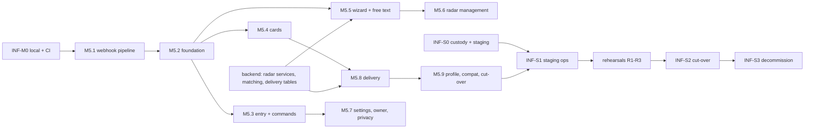

# 11b — Telegram bot (M5) and infrastructure roadmap

Part of the kvadro² → HOMI migration (rules, labels and ID scheme: [`README.md`](README.md)). Milestone IDs come from
[`13-dependency-graph.md`](13-dependency-graph.md); release stages S0–S6 from
[`18-release-and-rollback.md`](18-release-and-rollback.md) §2. The task files live in
[`tasks/telegram/`](tasks/telegram/) (`KV-TG-…`) and [`tasks/infrastructure/`](tasks/infrastructure/) (`KV-INF-…`) and
follow [`tasks/README.md`](tasks/README.md).

- **Status:** plan, 2026-11-09. Every task is `TODO` unless its file says `BLOCKED`; every value and threshold is
  `PROPOSED`; every `DEV-…` row it applies is `PROPOSED` until the developer approves it (`09` §4.2).
- **This document defines the `KV-TG-NNN` and `KV-INF-NNN` identifiers** (the task tables of §2.2 and §3.2). The task
  files are the detail; when a file and this table disagree, the file wins and this table is corrected.
- **Migration policy applied** (`README.md`): legacy bugs and wrong decisions are fixed through the `DEV-…` rows (or the
  "defect fix, no DEV" rows of `09` §4.3); buttons in messages sent by the legacy bot keep working where their
  `callback_data` can be decoded and otherwise answer «Форма устарела» (TXT-BOT-039) without changing state
  (KV-TG-011, KV-TG-058).

## 1. Scope and boundaries

| Area | Owner | Rule |
| ---- | ----- | ---- |
| Bot adapter (`backend/app/Telegram/**`, webhook, conversations, keyboards, texts in `backend/lang/*/bot.php`) | KV-TG, development track | the bot is an adapter over shared application services (`10` §4.1 p.2, `04` §10) |
| Sending once a delivery is due (pacer, instant sender, release sweep, digest message, delivered-card log writes, card edits, broadcasts) | KV-TG, development track | the bot is the only delivery channel (`04` §10 row "Radar delivery"); planning (instant / quiet / digest), quiet windows, digest schedules, the delivered set and its claim, eligibility and merge re-pointing are backend (F-DELIVERY-001, F-DELIVERY-005) |
| Radar matching and delivery planning, radar CRUD, personal lists, votes, settings, owner badges, erasure, LLM gateway, share messages | backend track (`tasks/backend/`) | KV-TG names them by feature / API (§5) |
| Schemas for identity, radars, deliveries, personal lists, migration | database track (`tasks/database/`, candidates in `14` §8) | KV-TG adds only additive columns it alone uses (`telegram_updates`) and the broadcast tables (ENT-013) |
| Test kits (fake Bot API, update factory, conversation DSL), security suites | QA track (KV-QA-003, KV-QA-009, KV-QA-016, KV-QA-017) | KV-TG tasks write their transcripts in the KV-QA-009 format |
| Local tooling, `.env.example`, `config/horizon.php`, CI | KV-INF, development track | shared files go in small separate PRs reviewed by the other developer (`docs/handoff/parallel-work.md` §1) |
| Servers, DNS, TLS, buckets, server `.env`, staging and production bots and webhooks, backups, monitoring, deploys | KV-INF, production track | every action approved by the first developer; production webhook and DNS changes also by the product owner where `18` §6 says so |

The development track uses its own dev bot (`docs/handoff/parallel-work.md` §7). Staging and production bots are touched
only by the production track; `telegram:webhook` and `telegram:profile` refuse staging and production without the
production track's explicit approval flag (KV-TG-005, KV-TG-056).

## 2. M5 — Telegram bot

**Goal (`13` §1):** the HOMI bot answers every command, wizard step, card button, poll, deep link and outbound message
of `@KvadroAppBot` as recorded in `04` §2–§6, with the approved fixes, on the dev and staging bots, so that S1's bot
criterion (`18` §5.1 row "Bot") can be signed. **Depends on:** M1 (identity, dictionaries, listings), M2 (listing
details, photos), M4 (radar services and matching) for the radar parts. **Unlocks:** S1.

### 2.1 Sub-milestones

| Step | Content | Features | Exit criteria | Blockers |
| ---- | ------- | -------- | ------------- | -------- |
| M5.1 Webhook pipeline (HANDOFF T1) | authenticity, ledger, privacy of raw updates, Bot API client, dev webhook command | F-BOT-012, F-PRIVACY-003, F-PRIVACY-004 | `15` §3.3 cases 1–8 green; a `/owner` contact update leaves no phone, name or text in `telegram_updates`; prune scheduled; T1 "Done when" met | DEC-12 (retention value only), DEC-23 (in-house client), DEC-24 (tunnel, optional live check) |
| M5.2 Bot foundation | router and actor, locale and escaping, text catalogues, reply conventions, callback codec, conversation state, stickers | F-BOT-013, F-BOT-015, F-LOCALE-004, F-ACCESS-003, F-BOT-001 | every TXT-BOT text keyed in ru, uz, en (KV-QA-007 green); forged, 65-byte, foreign and legacy callbacks end in TXT-BOT-039 with no state change | Q-BOT-014 (uz/en texts need a proofreader), Q-BOT-018 (TTL), Q-BOT-022 (sticker sources) |
| M5.3 Entry, commands, reachability | `/start` with payloads, hand-off, language, `/app`, `/help`, `/ping`, unknown commands, groups, chat reachability | F-ONBOARD-004, F-ONBOARD-005, F-LOCALE-004, F-BOT-002, F-BOT-014, F-RADAR-008 | transcripts for every payload of `04` §6.1; `users.bot_chat_state` feeds `409 no_chat` | Q-BOT-032, Q-BOT-035, Q-BOT-036, Q-BOT-043; DEV-027, DEV-036, DEV-037, DEV-040, DEV-049 approvals |
| M5.4 Listing cards and personal lists | card renderer and sender, map and photos, favourite, rented, realtor, hide similar, `/fav` | F-BOT-011, F-OWNER-002, F-FAV-002, F-REPORT-002, F-REPORT-003, F-HIDE-004 | every card button transcript green; HTML injection corpus rendered literally (SEC-REQ-020); every sent card logged with `chat_id` + `message_id` | Q-BOT-009, Q-BOT-028, Q-BOT-029, Q-BOT-038; DEV-010, DEV-034 |
| M5.5 Radar wizard and free text | engine, steps 1–8, typed amount, review, relax, step edit, save, starter list, tip, free text, voice | F-BOT-003 … F-BOT-009, F-RADAR-002, F-RADAR-006, F-FILTER-007, F-DELIVERY-005, F-PRIVACY-004 | the three deal branches end-to-end; two taps on save → one radar; free text never stores the message; unsupported city asks for the city | DEC-03 (LLM for free text and voice), Q-BOT-023, Q-BOT-024, Q-BOT-039, Q-BOT-044; DEV-006, DEV-009, DEV-015, DEV-017, DEV-021, DEV-026, DEV-028, DEV-029, DEV-046, DEV-052 |
| M5.6 Radar management and the poll | `/subs`, radar card, pause, resume, mode, hidden rules, delete, edit, «Нашли жильё?» | F-BOT-010, F-RADAR-001, F-RADAR-003, F-RADAR-004, F-RADAR-005, F-HIDE-004, F-DELIVERY-007 | `/subs` flows of `04` §3.11 and the poll of §3.12 green; editing keeps filters the bot cannot show | Q-BOT-006, Q-BOT-026, Q-BOT-030, Q-BOT-045; DEV-030, DEV-031, DEV-033 |
| M5.7 Settings, owner, privacy | `/settings`, `/owner` verify and remove, `/privacy`, «Удалить мои данные» | F-SETTINGS-004, F-SETTINGS-005, F-SETTINGS-006, F-OWNER-001, F-OWNER-002, F-PRIVACY-001, F-PRIVACY-002 | a foreign or forwarded contact is refused; deletion leaves no row with the user's ids (SEC-REQ-039 via the erasure service) | DEC-12, DEC-29, Q-BOT-001, Q-BOT-008, Q-BOT-040, Q-BOT-042; DEV-011, DEV-032, DEV-035, DEV-041 |
| M5.8 Delivery (bot side of M4) | pacer, instant sends, the release sweep for quiet-hours holds and digest slots, the digest message, «Объявление снято», service news (planning itself is backend) | F-DELIVERY-002 … F-DELIVERY-008 | frozen-clock cases of `15` §3.10 green; `429 retry_after` honoured; zero re-sends after a replayed match; digest fan-out for all radars within 10 min on staging (`18` §5.1) | Q-BOT-002, Q-BOT-003, Q-BOT-004, Q-BOT-031, Q-BOT-033, Q-BOT-034; DEC-20, DEC-22 |
| M5.9 Profile, compatibility, cut-over support | BotFather settings as code, command-scope reset, legacy `callback_data` decoder, webhook health, cut-over switches, action log | F-BOT-001, F-BOT-002, F-BOT-012, F-BOT-013, F-ANALYTICS-003 | profile diff against the frozen `get*` dump is empty on staging; R2 drains buffered updates exactly once and in order | Q-BOT-017 (legacy grammar — KV-TG-058 is BLOCKED), Q-BOT-019, Q-BOT-020, DEC-17 |

**M5 exit criteria (all must hold; they are the bot row of `18` §5.1):**

1. Every BOT, BTN and TXT-BOT id of `04` is covered by a passing transcript or an explicit spec-tested case
   (`BotCoverageTest` of KV-QA-009 prints 84/84, 76/76, 88/88 or names each exception with its reason).
2. Legacy `callback_data` is answered by the catch-all with no state change (and decoded where Q-BOT-017 gave the
   grammar); a forged callback with another user's radar changes nothing (KV-QA-016).
3. Outbound pushes, digests, quiet hours and «Объявление снято» pass frozen-clock tests and are checked on the staging
   bot (production track runs the staging checks, G9 of `15` §4.1).
4. The delivery pacing test of SEC-REQ-029 passes; no card delivered before the switch is re-sent after a migrated
   delivered-card log is loaded (KV-DB-019 re-send dry-run).
5. Every DEV row listed for M5 is `APPROVED` or explicitly deferred with the legacy behaviour kept, so G5 can be
   ticked for every bot feature.

### 2.2 KV-TG task list (execution order)

"Needs" names work of other tracks by feature / API / decision (§5); `KV-DB-…` ids are the candidates of `14` §8.

| ID | Task | Step | Cx | Depends on |
| -- | ---- | ---- | -- | ---------- |
| KV-TG-001 | Webhook authenticity: secret header, hook host, body limits | M5.1 | S | KV-QA-003; CF-009 |
| KV-TG-002 | Update ledger: `update_id` dedup, fast ack, `telegram` queue, atomic claim | M5.1 | M | KV-TG-001, KV-QA-003, KV-QA-008 |
| KV-TG-003 | Update ledger privacy: redaction, encryption, `allowed_updates`, scheduled prune | M5.1 | M | KV-TG-002, KV-INF-007; CF-019, DEC-12 |
| KV-TG-004 | In-house Bot API client with error classes and token redaction | M5.1 | M | KV-QA-003; DEC-23 |
| KV-TG-005 | `telegram:webhook set, info, delete` for the dev bot only | M5.1 | S | KV-TG-004 |
| KV-TG-006 | Update router, actor resolution, access guard, per-user limits | M5.2 | M | KV-TG-002, KV-TG-004; needs F-ACCESS-002, F-ACCESS-003, KV-DB-007 |
| KV-TG-007 | Bot locale resolution, translator wrapper, HTML escaping and number formatting | M5.2 | M | KV-TG-006; needs F-LOCALE-003 (CF-017) |
| KV-TG-008 | Russian bot text catalogue and the TXT-BOT key map | M5.2 | M | KV-TG-007, KV-QA-007 |
| KV-TG-009 | Uzbek and English bot texts and the glossary fixes | M5.2 | M | KV-TG-008; Q-BOT-014 |
| KV-TG-010 | Reply conventions: edit vs new, toast / alert / silent, ✅ marks, button styles | M5.2 | S | KV-TG-004, KV-TG-007 |
| KV-TG-011 | Versioned `callback_data` codec and the «Форма устарела» catch-all | M5.2 | M | KV-TG-006, KV-TG-008, KV-TG-010 |
| KV-TG-012 | Server-side conversation state with TTL and staleness | M5.2 | S | KV-TG-006, KV-TG-011; Q-BOT-018 |
| KV-TG-013 | Per-bot sticker and asset registry | M5.2 | S | KV-TG-004; Q-BOT-022 |
| KV-TG-014 | `/start` welcome: sticker, live counters, buttons | M5.3 | M | KV-TG-008, KV-TG-010, KV-TG-013; needs F-FEED-001 counters; Q-BOT-036 |
| KV-TG-015 | `/start` payload parser and attribution | M5.3 | M | KV-TG-014; needs KV-DB-007 (`user_attributions`) |
| KV-TG-016 | Listing hand-off message for `s_<source>--l<id>` and `l_<id>` | M5.3 | S | KV-TG-015; needs F-LISTING-001, CF-003 |
| KV-TG-017 | Language switch and per-chat command menus | M5.3 | M | KV-TG-014, KV-TG-009; needs F-SETTINGS-001 |
| KV-TG-018 | `/app` and `/help` | M5.3 | S | KV-TG-010 |
| KV-TG-019 | `/ping`: `pong` for everyone, details for admins only | M5.3 | S | KV-TG-006 |
| KV-TG-020 | Unknown commands, non-text messages and group chats | M5.3 | S | KV-TG-006, KV-TG-008 |
| KV-TG-021 | Chat reachability: `my_chat_member`, blocked bot, `409 no_chat` source | M5.3 | S | KV-TG-006; needs KV-DB-007 |
| KV-TG-022 | Listing card renderer and `CardSender` with the delivered-card log | M5.4 | L | KV-TG-010, KV-TG-011; needs F-LISTING-001, F-LISTING-004, F-MEDIA-001, KV-DB-009 |
| KV-TG-023 | Card buttons «На карте» and «Ещё N фото» | M5.4 | S | KV-TG-022 |
| KV-TG-024 | Card buttons: favourite set/unset and «Уже сдано» with undo | M5.4 | M | KV-TG-022; needs F-FAV-001, F-REPORT-001 |
| KV-TG-025 | Card button «Это риелтор» with undo and weighted vote | M5.4 | S | KV-TG-022; needs F-REPORT-003; DEV-010 |
| KV-TG-026 | Card submenu «Скрыть похожие» | M5.4 | M | KV-TG-022; needs F-HIDE-002, F-HIDE-003; DEV-034, Q-BOT-028 |
| KV-TG-027 | `/fav` list | M5.4 | S | KV-TG-022, KV-TG-010; needs F-FAV-001 (API-029) |
| KV-TG-028 | Radar wizard engine: frame, step graph, Back, Cancel, entry points | M5.5 | M | KV-TG-011, KV-TG-012; needs F-FILTER-001 |
| KV-TG-029 | Wizard steps 1–3: deal, object, rooms | M5.5 | S | KV-TG-028 |
| KV-TG-030 | Wizard step 4: city, zones, metro, districts | M5.5 | M | KV-TG-028, KV-TG-029; needs KV-DB-006, F-FILTER-004; DEV-015, DEV-026 |
| KV-TG-031 | Wizard step 5: budget presets, median line, «Не дороже рынка» | M5.5 | M | KV-TG-030; needs F-FILTER-006, F-FILTER-007, F-PIPELINE-005; DEV-052 |
| KV-TG-032 | Wizard step 5a: typed budget amount | M5.5 | S | KV-TG-031, KV-TG-006; needs F-SETTINGS-004; DEV-029, Q-BOT-024 |
| KV-TG-033 | Wizard steps 6–8: owner, tenant, pets | M5.5 | S | KV-TG-029; DEV-017 |
| KV-TG-034 | Review screen: summary, flow estimate, warnings, relax | M5.5 | M | KV-TG-033; needs F-FILTER-005 (API-006), F-RADAR-006 (API-023) |
| KV-TG-035 | In-place step edit from the review | M5.5 | S | KV-TG-034 |
| KV-TG-036 | Save a new radar: limit, twins, confirmation, sticker | M5.5 | M | KV-TG-034, KV-TG-021, KV-TG-013; needs F-RADAR-002 (API-019) |
| KV-TG-037 | Starter list after save and the first-radar tip | M5.5 | M | KV-TG-036, KV-TG-022; needs F-DELIVERY-005 |
| KV-TG-038 | Free-text radar queries through the LLM parser | M5.5 | M | KV-TG-034, KV-TG-028, KV-INF-006; needs GAP-003 query parser; DEC-03 |
| KV-TG-039 | Voice radar queries | M5.5 | S | KV-TG-038, KV-TG-004; DEC-03, Q-BOT-005 |
| KV-TG-040 | Poll «Нашли жильё?» | M5.6 | M | KV-TG-011; needs API-032, API-033 |
| KV-TG-041 | `/subs`: radar list and radar card | M5.6 | M | KV-TG-034, KV-TG-011; needs API-018 |
| KV-TG-042 | Radar card: pause, resume, delivery mode | M5.6 | S | KV-TG-041, KV-TG-040, KV-TG-037; needs API-021 |
| KV-TG-043 | Radar card: hidden rules one by one and delete with confirmation | M5.6 | M | KV-TG-041, KV-TG-040; needs API-021, API-022; DEV-033 |
| KV-TG-044 | Edit an existing radar | M5.6 | M | KV-TG-041, KV-TG-035, KV-TG-037; needs API-020; Q-BOT-026, Q-BOT-030 |
| KV-TG-045 | `/settings` panel | M5.7 | M | KV-TG-017, KV-TG-010, KV-TG-011; needs API-024, API-025; DEV-035 |
| KV-TG-046 | `/owner`: share the number and verify | M5.7 | M | KV-TG-003, KV-TG-006, KV-TG-010, KV-TG-012; needs F-OWNER-002; DEV-011, DEC-29 |
| KV-TG-047 | `/owner` when verified: status and removal with confirmation | M5.7 | S | KV-TG-046, KV-TG-011; DEV-032 |
| KV-TG-048 | `/privacy` policy text | M5.7 | S | KV-TG-008; DEC-12, DEV-041 |
| KV-TG-049 | «Удалить мои данные» with confirmation | M5.7 | M | KV-TG-048, KV-TG-012, KV-TG-011, KV-TG-057 (scope reset; a stub until it lands); needs F-PRIVACY-002; DEC-12, Q-BOT-001 |
| KV-TG-050 | Outbound send pacing: global and per-chat limits, `retry_after`, circuit breaker | M5.8 | M | KV-TG-004, KV-INF-006, KV-TG-021, KV-INF-011 |
| KV-TG-051 | Delivery outbox and instant radar pushes | M5.8 | M | KV-TG-050, KV-TG-022, KV-TG-021; needs F-DELIVERY-001, F-DELIVERY-005 (backend planner and delivered set), KV-DB-009 |
| KV-TG-052 | Quiet hours: hold and morning release | M5.8 | M | KV-TG-051, KV-INF-007; needs F-SETTINGS-005; Q-BOT-003 |
| KV-TG-053 | Digest at the user's digest times | M5.8 | M | KV-TG-052, KV-TG-050, KV-TG-022; Q-BOT-003 |
| KV-TG-054 | «Объявление снято» edits of delivered cards | M5.8 | M | KV-TG-051, KV-TG-050, KV-TG-013; needs F-PIPELINE-006, F-ADMIN-002; Q-BOT-031 |
| KV-TG-055 | Service-news broadcasts | M5.8 | M | KV-TG-050, KV-TG-045, KV-TG-021; needs F-ADMIN-001; DEC-22, Q-BOT-004 |
| KV-TG-056 | BotFather settings as code: `telegram:profile sync` | M5.9 | M | KV-TG-009, KV-TG-004; Q-BOT-019, Q-BOT-020 |
| KV-TG-057 | Reset of per-chat command menus and menu buttons | M5.9 | S | KV-TG-056, KV-TG-050, KV-TG-017; Q-BOT-014 |
| KV-TG-058 | Legacy `callback_data` decoder for old cards and keyboards | M5.9 | M | KV-TG-011, KV-TG-024, KV-TG-022, KV-TG-027, KV-TG-037; Q-BOT-017 (BLOCKED) |
| KV-TG-059 | Scheduled webhook health check and bot metrics | M5.9 | S | KV-TG-004, KV-TG-002, KV-INF-007, KV-INF-011 |
| KV-TG-060 | Cut-over switches: pause update processing, send cap, ordered drain | M5.9 | M | KV-TG-002, KV-TG-050; DEC-17, DEC-18 |
| KV-TG-061 | Bot action log events | M5.9 | S | KV-TG-006; needs F-ANALYTICS-003 |

**Critical path inside M5:** KV-TG-001 → KV-TG-002 → KV-TG-006 → KV-TG-007 → KV-TG-008 → KV-TG-010 → KV-TG-011 →
KV-TG-012 → KV-TG-028 → KV-TG-029 → KV-TG-030 → KV-TG-031 → KV-TG-033 → KV-TG-034 → KV-TG-036 → KV-TG-037. The card
group (KV-TG-022 …) and the delivery group (KV-TG-050 …) run in parallel once KV-TG-011 exists, gated by the backend
services they need (§5). KV-TG-056 must be done before the staging bot is configured (KV-INF-017); KV-TG-060 before
rehearsal R2 (KV-INF-030).

**Parallel streams for two agents:** (a) pipeline and foundation KV-TG-001 … KV-TG-013; (b) once (a) reaches
KV-TG-011: wizard KV-TG-028 … KV-TG-039 on one branch per task, cards and lists KV-TG-022 … KV-TG-027 on another;
(c) delivery KV-TG-050 … KV-TG-055 after the radar services, the backend delivery planner and delivered set, and KV-DB-009 exist.

### 2.3 Conventions and decisions recorded in the task files

These came up while the task files were written; each is detailed (and testable) in the named task.

| # | Convention or decision | Where |
| - | ---------------------- | ----- |
| 1 | **DEV switches:** every `PROPOSED` DEV the bot implements sits behind one flag `dev<NNN>` in `backend/config/bot.php`, default = legacy behaviour; tests for the new behaviour are `todo` until the DEV is `APPROVED`, then the flag flips in a one-line PR (`dev006`, `dev009`, `dev010`, `dev027`, `dev028`, `dev029`, `dev030`, `dev031`, `dev033`, `dev037`, `dev046`; `hide_rules.scope` for DEV-034). SEC-REQ fixes are not behind flags (for example `/ping` hides versions from non-admins at once, KV-TG-019) | KV-TG-016, KV-TG-020, KV-TG-025, KV-TG-026, KV-TG-029, KV-TG-031, KV-TG-032, KV-TG-036, KV-TG-038, KV-TG-043, KV-TG-044 |
| 2 | Migrations owned by the bot track: `telegram_updates` gains `update_type`, `chat_id` (additive) and its `payload` becomes encrypted `text` (no production data yet, flagged in the PR); `users.bot_commands_locale`, `users.bot_commands_synced_version` and `users.first_radar_tip_sent_at` only if the identity schema (KV-DB-007) lacks them; `broadcasts`, `broadcast_recipients` (ENT-013) | KV-TG-002, KV-TG-003, KV-TG-017, KV-TG-037, KV-TG-055, KV-TG-057 |
| 3 | Callback actions are registered by their handlers in the codec; beyond the base set, `fl:<page>` pages `/fav` and the hide-rule action carries a fourth argument (target radar) when the user has to choose one | KV-TG-011, KV-TG-026, KV-TG-027 |
| 4 | Open questions closed **by specification** (`oracle: spec`, recorded in the PR; a later capture on a test account can still change them): Q-BOT-005 voice limits; Q-BOT-006 replies to the other poll answers; Q-BOT-007 alert at the 10-radar limit; Q-BOT-009 realtor row only for phone authors; Q-BOT-010 pets row and the «📬 Подборкой» tip reply; Q-BOT-012 blocked users keep active radars but receive nothing; Q-BOT-013 non-text messages get TXT-BOT-043 and the bot leaves groups; Q-BOT-024 typed-amount bounds; Q-BOT-026 filters the bot cannot show survive an edit; Q-BOT-030 a paused radar stays paused after an edit (DEV-031 mode); Q-BOT-038 `/fav` pages of 20, starter list capped at 30; Q-BOT-041 the forced object step returns to the review; Q-BOT-045 resume toast with new matches | KV-TG-020, KV-TG-021, KV-TG-026, KV-TG-027, KV-TG-032, KV-TG-034 … KV-TG-037, KV-TG-039, KV-TG-040, KV-TG-042, KV-TG-044 |
| 5 | Locally Telegram cannot fetch `*.homi.loc` photo URLs, so `telegram.media.upload` switches card photos to file upload in local and test environments | KV-TG-022 |
| 6 | New env names beyond `17` §4 that KV-INF-003 lists: `TELEGRAM_WEBHOOK_SECRET_PREVIOUS`, `TELEGRAM_UPDATES_ENCRYPTION_KEY`, `TELEGRAM_MINIAPP_URL`, `TELEGRAM_SUPPORT_BOT_USERNAME`, `TELEGRAM_SEND_RATE_GLOBAL`, `TELEGRAM_SEND_RATE_PER_CHAT`, `TELEGRAM_CONVERSATION_TTL`, `TELEGRAM_ADMIN_USER_IDS`, `TELEGRAM_STICKER_SET` (optional), `PHONE_HMAC_PEPPER`, `OPS_HEARTBEAT_URL`, `METRICS_TOKEN`, `METRICS_ALLOWED_IPS`, `OPS_DASHBOARD_TELEGRAM_IDS`, `OPS_DASHBOARD_MODE`, `TELEGRAM_BROADCAST_ENABLED`, `TELEGRAM_PROFILE_SYNC_ALLOWED`; `TELEGRAM_UPDATES_RETENTION_DAYS` moves into `.env.example` | KV-TG-001 … KV-TG-019, KV-TG-055 … KV-TG-057, KV-INF-007, KV-INF-011, KV-INF-012 |
| 7 | Possible gap: legacy invite links cannot be decoded (format unknown, Q-API-006); the payload parser reserves `inv_<token>` for HOMI-issued invites only | KV-TG-015 |
| 8 | uz and en drafts are tracked in `translation-status.json`; the F-LOCALE-004 gate stays open until a person proofreads them | KV-TG-009 |
| 9 | Delivery split with the backend: the backend plans (instant / quiet / digest, the per-radar cap of DEC-20), owns the delivered set, eligibility and merge re-pointing; the bot claims through that service and sends. `delivery:reconcile` only reports rows stuck in `sending`, it never re-sends. One `delivery:release-due` sweep every minute releases quiet-hours holds and digest slots | KV-TG-050 … KV-TG-054 |
| 10 | Cut-over and health commands used verbatim by the production runbook: `telegram:intake pause, resume, status, export-buffered`, `delivery:cap <n>, off`, `telegram:health` | KV-TG-059, KV-TG-060, KV-INF-030, KV-INF-031 |
| 11 | KV-TG-049 (data deletion) calls the command-scope reset of KV-TG-057; until KV-TG-057 lands it uses a stub, so KV-TG-049 is not reordered | KV-TG-049, KV-TG-057 |

## 3. Infrastructure milestones

Infrastructure work spans M0 (local and CI foundations, development track) and S0–S3 (production track). It never
blocks M1–M7 development except through PostGIS (KV-INF-005 locally, KV-INF-018 on the shared server) and the Horizon
supervisors (KV-INF-006).

### 3.1 Milestones

| Milestone | Goal | Tasks (order) | Exit criteria | Blockers |
| --------- | ---- | ------------- | ------------- | -------- |
| INF-M0 — local and CI foundations (development track, with M0) | every developer can run the legacy hosts, PostGIS, the new queues and the scheduler locally; CI enforces config and dependency hygiene | KV-INF-001 … KV-INF-013 (KV-INF-008 dropped) | `make dev-check` green with legacy aliases, PostGIS, env parity and the scheduler heartbeat; `security:check` lists no missing key locally; CI audit jobs run; artefact-manifest job fails on a changed legacy file | DEC-07, DEC-09, DEC-23 (CI image), DEC-24 (tunnel tool), Q-APP-016, Q-SEC-019 |
| INF-S0 — custody and staging up (production track) | the team controls the bot, domains and accounts; staging serves HOMI on the HOMI and legacy-alias hosts with its own bot | KV-INF-014 … KV-INF-022 | `17` §15 items 1–6 and 10 done; staging bot answers `/start` through `hook.staging.homi.uz`; `getWebhookInfo` clean; PostGIS on `homi_staging_db`; private `/media` and PMTiles `Range` checks pass on staging | Q-SEC-001, DEC-05, DEC-09, DEC-16, DEC-27, DEC-28, Q-API-053 |
| INF-S1 — staging operations for parity and rehearsals (production track) | staging is deployable, observable, backed up and resettable for R1–R3 | KV-INF-023 … KV-INF-028 | `17` §15 items 7–9 done; alerts of `17` §12 fire from scripted triggers; a restore drill passed within 7 days; staging reset procedure timed; the Operations row of `18` §5.1 signed | DEC-03, DEC-12, DEC-26, KV-DB-012 (import area) |
| INF-S2 — production cut-over (production track) | the kvadro hosts, the webhook and DNS move to HOMI per the `18` §6 runbook, with a rehearsed rollback | KV-INF-029 … KV-INF-032 | certificates on HOMI by T−72 h; runbook dry-run in R2 with rollback and in R3 without; at S2 `getWebhookInfo` shows the HOMI URL with no `last_error_date`; old token answers `401`; DNS and edge switched; `18` §5.4 budgets hold for 72 h | DEC-05, DEC-15, DEC-16, DEC-17, DEC-18, Q-SEC-017 |
| INF-S3 — decommissioning (production track with the product owner) | the legacy system and every copy of its data are gone, secrets held by the legacy operator are revoked | KV-INF-033 | `18` §11 records complete; KV-DB-031 destruction record signed | DEC-18, DEC-21, Q-SEC-011, Q-DATA-044 |

### 3.2 KV-INF task list (execution order)

| ID | Task | Track | Milestone | Cx | Depends on |
| -- | ---- | ----- | --------- | -- | ---------- |
| KV-INF-001 | Dev bot per developer and the tunnel live check | development | INF-M0 | S | KV-TG-005; DEC-24 |
| KV-INF-002 | Local legacy-host aliases `kvadro.homi.loc`, `kvadro-app.homi.loc` | development | INF-M0 | M | CF-008 |
| KV-INF-003 | Environment variable names per feature and `.env.example` parity | development (shared files) | INF-M0 | S | — |
| KV-INF-004 | `security:check` secret inventory (names only) | development | INF-M0 | S | KV-INF-003 |
| KV-INF-005 | PostGIS locally and in `make dev-check` | development | INF-M0 | S | DEC-09, CF-014 |
| KV-INF-006 | Horizon supervisors per workload | development (shared file) | INF-M0 | S | — |
| KV-INF-007 | Scheduler foundation and heartbeat | development | INF-M0 | S | — |
| KV-INF-008 | Trusted proxies and real client IPs for limiters — **DROPPED** (application part in the backend rate-limit work, F-COMPAT-002; server values checked in KV-INF-032) | development | INF-M0 | S | CF-018 |
| KV-INF-009 | Local `/media` internal location and PMTiles Range/CORS | development | INF-M0 | M | KV-INF-002; CF-012 |
| KV-INF-010 | Legacy artefact manifest, CSP hashes and the integrity CI job | development | INF-M0 | M | DEC-07, Q-APP-016 |
| KV-INF-011 | Application metrics for the production monitor | development | INF-M0 | M | KV-INF-006 |
| KV-INF-012 | Dashboard gates and Telescope posture | development | INF-M0 | S | Q-SEC-019 |
| KV-INF-013 | Dependency audit gates in CI | development | INF-M0 | S | — |
| KV-INF-014 | Custody of `@KvadroAppBot`, the kvadro domains and accounts | production | INF-S0 | M | Q-SEC-001, DEC-05, DEC-16 |
| KV-INF-015 | HOMI hosts, TLS and the hook vhost on staging and production | production | INF-S0 | M | ADR-0011, ADR-0013 |
| KV-INF-016 | Staging legacy-host aliases and path routing | production | INF-S0 | M | KV-INF-015, KV-INF-002, KV-INF-010 |
| KV-INF-017 | Staging bot, BotFather settings and webhook | production | INF-S0 | S | KV-INF-015, KV-INF-016, KV-TG-056 |
| KV-INF-018 | PostGIS on the shared PostgreSQL server | production | INF-S0 | S | DEC-09; KV-DB-005 |
| KV-INF-019 | Redis per environment, Horizon under systemd, capacity | production | INF-S0 | M | KV-INF-006; DEC-27, DEC-28 |
| KV-INF-020 | Buckets and the private listing-photo route | production | INF-S0 | M | KV-INF-009; CF-012 |
| KV-INF-021 | PMTiles on `cdn.*` with Range and CORS | production | INF-S0 | S | KV-INF-009; Q-API-053 |
| KV-INF-022 | Scheduler cron and heartbeat on staging and production | production | INF-S0 | S | KV-INF-007 |
| KV-INF-023 | Deploy pipeline, smoke tests and release rollback | production | INF-S1 | L | KV-INF-015; KV-QA-022 |
| KV-INF-024 | Security headers and CSP on every vhost | production | INF-S1 | M | KV-INF-010, KV-INF-016 |
| KV-INF-025 | Monitoring and alerting | production | INF-S1 | M | KV-INF-011, KV-TG-059 |
| KV-INF-026 | Backups and restore drills | production | INF-S1 | M | DEC-12 |
| KV-INF-027 | LLM keys, spend caps and PostHog projects per environment | production | INF-S1 | S | DEC-03, DEC-26 |
| KV-INF-028 | Staging rehearsal environment and reset | production | INF-S1 | M | KV-INF-016, KV-INF-017; KV-DB-012 |
| KV-INF-029 | Certificates and vhosts for `kvadro.app` and `app.kvadro.app` | production | INF-S2 | M | KV-INF-014, KV-INF-016 |
| KV-INF-030 | Cut-over runbook automation and dry runs | production | INF-S2 | M | KV-TG-060, KV-INF-028; KV-DB-026 |
| KV-INF-031 | Production bot token rotation and webhook switch | production | INF-S2 | S | KV-INF-014, KV-INF-030; DEC-05, DEC-17 |
| KV-INF-032 | DNS and edge switch for the kvadro hosts | production | INF-S2 | M | KV-INF-029; DEC-16 |
| KV-INF-033 | Legacy decommissioning and destruction records | production | INF-S3 | S | KV-INF-031, KV-INF-032; KV-DB-031, DEC-18, DEC-21 |

What the production track receives from the development track: the dev-bot and webhook commands (KV-TG-005), the
profile sync (KV-TG-056), the command-scope reset (KV-TG-057), the webhook health check (KV-TG-059), the cut-over
switches (KV-TG-060), env names (KV-INF-003), `security:check` (KV-INF-004), supervisors (KV-INF-006), the scheduler
heartbeat (KV-INF-007), metrics (KV-INF-011) and the artefact manifest with CSP hashes (KV-INF-010).

## 4. Order across the tracks

## 5. What KV-TG needs from the other tracks

| # | Need | Feature / API / decision | Consumed by |
| - | ---- | ------------------------ | ----------- |
| 1 | Telegram user identity without names, the settings record, first-contact creation | F-ACCESS-003, F-SETTINGS-001 (API-024, API-025), KV-DB-007 | KV-TG-006, KV-TG-007, KV-TG-017, KV-TG-045 |
| 2 | Access-gate decision usable by bot handlers | F-ACCESS-002 | KV-TG-006 |
| 3 | Server display formatter and catalogues | F-LOCALE-003, CF-017 | KV-TG-007, KV-TG-022, KV-TG-034, KV-TG-041 |
| 4 | Listing details, public numbers, alias resolution | F-LISTING-001 (API-008), CF-003 | KV-TG-016, KV-TG-022 |
| 5 | Signed listing photos | F-MEDIA-001 | KV-TG-022, KV-TG-023 |
| 6 | Market comparison and medians | F-LISTING-004, F-PIPELINE-005 | KV-TG-022, KV-TG-031 |
| 7 | Gazetteer with legacy codes | KV-DB-006, F-FILTER-004, F-PIPELINE-004 | KV-TG-030 |
| 8 | One filter normaliser (`SearchFilters`) | F-FILTER-001, SEC-REQ-017, DEV-004 | KV-TG-028 … KV-TG-035, KV-TG-038, KV-TG-044 |
| 9 | Price presets, typical price, below-market availability, rates | F-FILTER-006, F-FILTER-007, F-PIPELINE-007, DEV-052 | KV-TG-031, KV-TG-032 |
| 10 | Flow estimate and relax options | F-FILTER-005 (API-006), F-RADAR-006 (API-023) | KV-TG-034 |
| 11 | Radar create / update / patch / delete, limit, uniqueness | F-RADAR-002 … F-RADAR-005 (API-018 … API-022), DEV-009 | KV-TG-036, KV-TG-041 … KV-TG-044 |
| 12 | Unseen matches for starter lists and resume | F-DELIVERY-005, BR-API-079, BR-API-089 | KV-TG-037, KV-TG-042 |
| 13 | Favourites, hidden listings, blocked authors, votes | F-FAV-001, F-HIDE-001 … F-HIDE-003, F-REPORT-001, F-REPORT-003 (API-011 … API-016, API-029) | KV-TG-024 … KV-TG-027, KV-TG-043 |
| 14 | Found survey storage | API-032, API-033 | KV-TG-040 |
| 15 | Owner verification storage and badge matching | F-OWNER-002, DEV-011, DEC-29 | KV-TG-046, KV-TG-047 |
| 16 | One erasure procedure | F-PRIVACY-002, SEC-REQ-039, DEC-12 | KV-TG-049 |
| 17 | Query parser behind the LLM gateway with masking and caps | GAP-003, SEC-REQ-042 … SEC-REQ-044, DEC-03 | KV-TG-038, KV-TG-039 |
| 18 | Radar match events, delivery planning (instant / quiet / digest due items), quiet windows and digest schedules | F-DELIVERY-001, F-DELIVERY-003, F-DELIVERY-004, F-SETTINGS-005 | KV-TG-051, KV-TG-052, KV-TG-053 |
| 19 | Delivery tables (`radar_deliveries`, `bot_listing_messages`, `radar_pending_items`) and the delivered-set service with its atomic claim and re-send dry-run | KV-DB-009, F-DELIVERY-005 | KV-TG-022, KV-TG-037, KV-TG-051 … KV-TG-054 |
| 20 | Listing withdrawn and takedown events | F-PIPELINE-006, F-ADMIN-002 | KV-TG-054 |
| 21 | Operator broadcast UI and roles | F-ADMIN-001, DEC-22 | KV-TG-055 |
| 22 | Action-log ingest | F-ANALYTICS-003 | KV-TG-061 |
| 23 | Live counters for the welcome | F-FEED-001, Q-BOT-036 | KV-TG-014 |
| 24 | Migrated delivered-card log, legacy id map, owner hashes | KV-DB-019, KV-DB-013, KV-DB-020, KV-DB-030 | KV-TG-051, KV-TG-058, KV-TG-046 |

What KV-TG provides to the other tracks: the Bot API client with `savePreparedInlineMessage` for sharing (F-SHARE-001,
API-017), `users.bot_chat_state` for the access gate's `join` reason and for `409 no_chat` (KV-TG-021, BR-BOT-099), the
webhook ledger, and the delivered-card log writes the takedown and privacy flows rely on.

## 6. Coverage

### 6.1 BOT, RADAR, DELIVERY, OWNER and PRIVACY features

Every feature of these five modules in `09` (37 rows) with the KV-TG tasks that carry its bot work. "No bot work" rows
say why.

| # | Feature | Bot work | KV-TG tasks |
| - | ------- | -------- | ----------- |
| 1 | F-BOT-001 identity, profile, menu button, commands | profile and commands per language, stickers, avatar and picture checklist | KV-TG-013, KV-TG-056, KV-TG-057 |
| 2 | F-BOT-002 `/app`, `/help`, `/ping`, unknown commands | all four (DEV-027, DEV-036) | KV-TG-018, KV-TG-019, KV-TG-020, KV-TG-057 |
| 3 | F-BOT-003 wizard start, frame, steps 1–3, Back, Cancel | yes | KV-TG-012, KV-TG-028, KV-TG-029 |
| 4 | F-BOT-004 step 4 | yes | KV-TG-030 |
| 5 | F-BOT-005 step 5 and typed amount | yes | KV-TG-031, KV-TG-032 |
| 6 | F-BOT-006 steps 6–8 | yes | KV-TG-033 |
| 7 | F-BOT-007 review, step edit, relax, flow | yes | KV-TG-034, KV-TG-035 |
| 8 | F-BOT-008 save, starter list, tip | yes | KV-TG-036, KV-TG-037 |
| 9 | F-BOT-009 free text and voice | yes | KV-TG-038, KV-TG-039 |
| 10 | F-BOT-010 `/subs` | yes | KV-TG-041, KV-TG-042, KV-TG-043, KV-TG-044 |
| 11 | F-BOT-011 listing card | yes | KV-TG-022, KV-TG-023 |
| 12 | F-BOT-012 update intake and webhook cut-over | yes (application side; servers in KV-INF-015, KV-INF-017, KV-INF-030, KV-INF-031) | KV-TG-001 … KV-TG-006, KV-TG-059, KV-TG-060 |
| 13 | F-BOT-013 outdated wizards, old cards, legacy `callback_data` | yes | KV-TG-011, KV-TG-012, KV-TG-058 |
| 14 | F-BOT-014 non-text messages and groups | yes | KV-TG-020 |
| 15 | F-BOT-015 interaction conventions | yes | KV-TG-004, KV-TG-006, KV-TG-007, KV-TG-008, KV-TG-010 |
| 16 | F-RADAR-001 radar tab with previews | the tab is Mini App only (legacy client); the bot's list over the same data is `/subs` | KV-TG-041 |
| 17 | F-RADAR-002 create a radar (limit 10) | the bot's create path, limit and twin answer | KV-TG-036 |
| 18 | F-RADAR-003 edit a radar | the bot's edit path | KV-TG-044 |
| 19 | F-RADAR-004 pause, resume, mode, unhide | yes | KV-TG-042, KV-TG-043 |
| 20 | F-RADAR-005 delete a radar | yes | KV-TG-043 |
| 21 | F-RADAR-006 relax suggestions | the review's relax buttons | KV-TG-034 |
| 22 | F-RADAR-007 radar follow nudge | **no bot work**: a Mini App sheet (SCR-040) served by the legacy client | — |
| 23 | F-RADAR-008 bot write access (`409 no_chat`) | the bot maintains chat reachability that the check reads | KV-TG-021 |
| 24 | F-DELIVERY-001 radar matching | **no bot work in the matcher** (backend track); the bot consumes its match events | consumer: KV-TG-051 |
| 25 | F-DELIVERY-002 instant delivery | yes | KV-TG-050, KV-TG-051, KV-TG-060 |
| 26 | F-DELIVERY-003 digest | the digest message and its sending; the schedule is backend | KV-TG-052, KV-TG-053 |
| 27 | F-DELIVERY-004 quiet hours | the release sweep and the held sends; the window is backend | KV-TG-052 |
| 28 | F-DELIVERY-005 delivered-card log and «only new» | log writes for every card, starter list; the delivered set and its claim are backend | KV-TG-022, KV-TG-037, KV-TG-051 |
| 29 | F-DELIVERY-006 «Объявление снято» | yes | KV-TG-054 |
| 30 | F-DELIVERY-007 «Нашли жильё?» | the bot poll and its triggers | KV-TG-040, KV-TG-042, KV-TG-043 |
| 31 | F-DELIVERY-008 service news | sender and opt-out; the operator UI is ARM | KV-TG-050, KV-TG-055 |
| 32 | F-OWNER-001 `/owner` | yes | KV-TG-046, KV-TG-047 |
| 33 | F-OWNER-002 owner badges | the badge on the card and the verification that feeds it; badge matching is backend | KV-TG-022, KV-TG-046 |
| 34 | F-PRIVACY-001 privacy policy | `/privacy` text; the landing page is frontend | KV-TG-048 |
| 35 | F-PRIVACY-002 «Удалить мои данные» | confirmation, call of the erasure procedure, chat-side reset | KV-TG-049 |
| 36 | F-PRIVACY-003 retention purges | the bot's own store (`telegram_updates` prune); the other purges are backend | KV-TG-003 |
| 37 | F-PRIVACY-004 PII minimisation | redaction of raw updates, no names stored, masking before the LLM | KV-TG-003, KV-TG-006, KV-TG-038 |

**Gaps:** none. Two rows have no KV-TG task by design (F-RADAR-007: Mini App only; F-DELIVERY-001: backend matcher).

### 6.2 Other features with bot work

| # | Feature | KV-TG tasks |
| - | ------- | ----------- |
| 1 | F-ONBOARD-004 bot welcome | KV-TG-014 |
| 2 | F-ONBOARD-005 start payloads | KV-TG-015, KV-TG-016 |
| 3 | F-FAV-002 favourites in the bot | KV-TG-024, KV-TG-027 |
| 4 | F-HIDE-004 «Скрыть похожие» | KV-TG-026, KV-TG-043 |
| 5 | F-REPORT-002 bot votes | KV-TG-024, KV-TG-025 |
| 6 | F-REPORT-003 vote weighting (bot side) | KV-TG-025 |
| 7 | F-SETTINGS-004, F-SETTINGS-005, F-SETTINGS-006 | KV-TG-045 (also KV-TG-032, KV-TG-052) |
| 8 | F-LOCALE-004 bot localisation | KV-TG-007, KV-TG-008, KV-TG-009, KV-TG-017 |
| 9 | F-ACCESS-003 identity from Telegram updates | KV-TG-006 |
| 10 | F-FILTER-007 below-market in the bot | KV-TG-031 |
| 11 | F-LANDING-005, F-SEO-010 bot links from landing and SEO | KV-TG-015 (parser and attribution) |
| 12 | F-ANALYTICS-003 action log | KV-TG-061 |
| 13 | F-SHARE-001 prepared share message | backend track; KV-TG-004 provides the client method |
| 14 | F-SUPPORT-001 support bot | links only (KV-TG-018); the support bot itself is deferred to DEC-21 (GAP-026) |

### 6.3 BOT and BTN items → tasks

TXT-BOT-001 … TXT-BOT-088 are keyed in KV-TG-008 (ru) and KV-TG-009 (uz, en) and rendered by the task of the flow that
shows them.

| # | Items | Task |
| - | ----- | ---- |
| 1 | BOT-001 … BOT-005, BOT-007, BOT-008 | KV-TG-056 |
| 2 | BOT-006 | KV-TG-048, KV-TG-056 |
| 3 | BOT-009, BOT-010 | KV-TG-013 (avatar in the KV-TG-056 checklist) |
| 4 | BOT-011, BOT-013, BOT-019; BTN-005, BTN-034 | KV-TG-018 |
| 5 | BOT-012; BTN-001 … BTN-003 | KV-TG-014 (BTN-003 also KV-TG-017) |
| 6 | BOT-014, BOT-036, BOT-050; BTN-024, BTN-025, BTN-030 | KV-TG-028 |
| 7 | BOT-015, BOT-063 … BOT-065; BTN-049, BTN-060 | KV-TG-041 |
| 8 | BOT-016, BOT-072, BOT-073; BTN-066 | KV-TG-027 |
| 9 | BOT-017, BOT-074; BTN-067 … BTN-072 | KV-TG-045 (BTN-070 also KV-TG-017) |
| 10 | BOT-018, BOT-075 … BOT-077; BTN-073, BTN-074 | KV-TG-046 |
| 11 | BOT-078, BOT-079; BTN-075 | KV-TG-047 |
| 12 | BOT-020 | KV-TG-048 |
| 13 | BOT-080; BTN-076 | KV-TG-049 |
| 14 | BOT-021 | KV-TG-019 |
| 15 | BOT-022, BOT-057, BOT-058 | KV-TG-020 |
| 16 | BOT-023 | KV-TG-011, KV-TG-012 |
| 17 | BOT-024 | KV-TG-011, KV-TG-024, KV-TG-058 |
| 18 | BOT-025 | KV-TG-017 |
| 19 | BOT-026 | KV-TG-007 |
| 20 | BOT-027 … BOT-030, BOT-032, BOT-034 | KV-TG-015 |
| 21 | BOT-031, BOT-033; BTN-004 | KV-TG-016 |
| 22 | BOT-035 (support bot payload) | none — support bot deferred (DEC-21, Q-BOT-016) |
| 23 | BOT-037 … BOT-039; BTN-006 … BTN-010 | KV-TG-029 |
| 24 | BOT-040; BTN-011 … BTN-017 | KV-TG-030 |
| 25 | BOT-041; BTN-018, BTN-020 | KV-TG-031 |
| 26 | BOT-042, BOT-043; BTN-019 | KV-TG-032 |
| 27 | BOT-044 … BOT-046; BTN-021 … BTN-023 | KV-TG-033 |
| 28 | BOT-047, BOT-049; BTN-027 | KV-TG-034 |
| 29 | BOT-048; BTN-026 | KV-TG-035 |
| 30 | BOT-051; BTN-028, BTN-029 | KV-TG-036 |
| 31 | BOT-052, BOT-053; BTN-031 … BTN-033 | KV-TG-037 |
| 32 | BOT-054, BOT-055 | KV-TG-038 |
| 33 | BOT-056 | KV-TG-039 |
| 34 | BOT-059; BTN-035, BTN-037 | KV-TG-022 |
| 35 | BTN-036, BTN-038 | KV-TG-023 |
| 36 | BOT-060; BTN-039, BTN-040, BTN-042, BTN-043 | KV-TG-024 |
| 37 | BTN-041 | KV-TG-025 |
| 38 | BOT-061; BTN-044 … BTN-048 | KV-TG-026 |
| 39 | BOT-062 | KV-TG-054 |
| 40 | BOT-066, BOT-067; BTN-055, BTN-056 | KV-TG-044 |
| 41 | BOT-068; BTN-054, BTN-057 … BTN-059 | KV-TG-043 |
| 42 | BTN-050 … BTN-053 | KV-TG-042 |
| 43 | BOT-069 … BOT-071; BTN-061 … BTN-065 | KV-TG-040 |
| 44 | BOT-081 | KV-TG-051 |
| 45 | BOT-082 | KV-TG-053 |
| 46 | BOT-083 | KV-TG-052 |
| 47 | BOT-084 | KV-TG-055 |

## 7. Blockers and decisions in one place

| # | Item | Blocks | Who |
| - | ---- | ------ | --- |
| 1 | Q-BOT-017 legacy `callback_data` grammar (also Q-DATA-041) | KV-TG-058; the old-card part of S1's bot criterion (the catch-all of KV-TG-011 is the fallback) | product owner / legacy operator |
| 2 | Q-BOT-002, Q-BOT-003, Q-BOT-031, Q-BOT-033 outbound formats never observed | final texts of KV-TG-051, KV-TG-053, KV-TG-054 (built and spec-tested now, `oracle: spec`) | product owner or a capture on a test account |
| 3 | Q-BOT-014 uz and en texts beyond `/start` and `/settings` | KV-TG-009 sign-off | product owner + a proofreader |
| 4 | DEC-03 LLM vendor | KV-TG-038, KV-TG-039, KV-INF-027 | product owner + first developer |
| 5 | DEC-05 bot custody and token rotation; Q-SEC-001 | KV-INF-014, KV-INF-031 | product owner + first developer |
| 6 | DEC-12 retention and deletion ADR | KV-TG-003 (value), KV-TG-048, KV-TG-049, KV-INF-026 | product owner + first developer + security review |
| 7 | DEC-17 pending updates at the switch; Q-SEC-017 | KV-TG-060, KV-INF-031 | product owner + first developer |
| 8 | DEC-20 cap on instant cards | KV-TG-050 option | product owner |
| 9 | DEC-21 support bot | links in KV-TG-018; BOT-035 | product owner |
| 10 | DEC-22 ARM roles | KV-TG-019 admins, KV-TG-055 sender | product owner |
| 11 | DEC-23 dependencies (in-house client, CI images) | KV-TG-004, KV-INF-005 CI part, KV-INF-013 | first developer |
| 12 | DEC-24 tunnel tool | KV-INF-001 live check (optional) | first developer |
| 13 | DEC-29 owner hashes; Q-BOT-042 | KV-TG-046 transition window | product owner |
| 14 | DEC-07, DEC-09, DEC-16, DEC-18, DEC-26, DEC-27, DEC-28 | the KV-INF tasks named in §3.2 | first developer / product owner |
| 15 | DEV approvals: DEV-006, DEV-009, DEV-010, DEV-011, DEV-015, DEV-017, DEV-021, DEV-026 … DEV-037, DEV-040, DEV-041, DEV-046, DEV-049, DEV-052 | G5 of the bot features; until approved the tasks build the new behaviour behind the approval and keep the transcripts' expected output on the legacy behaviour | developer (+ product owner where `09` §4.2 names one) |
