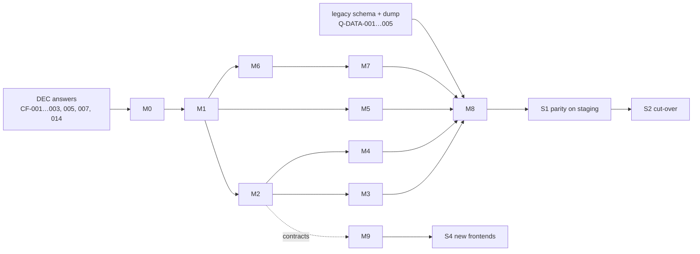

# 13 — Milestones, dependency graph and critical path

Conventions: [`README.md`](README.md). This file fixes the **milestone IDs** that every task file uses. The task-level
graph (section 3) is generated from the `Dependencies` field of the task files in [`tasks/`](tasks/README.md) and
is completed after all task files exist.

## 1. Milestones

Development milestones (`M…`) lead to the release stages (`S…`) of
[`18-release-and-rollback.md`](18-release-and-rollback.md) §2. The development target is **S1**: HOMI's backend and
bot serve the *unchanged* legacy Mini App and old bot buttons on staging with migrated data. New HOMI frontends (M9)
come after the cut-over, although they can be built in parallel against frozen contracts. Architecture decisions are
in [`10-target-architecture.md`](10-target-architecture.md) §3. The decisions that need people (`DEC-…`) are listed
in its §8.

| ID | Milestone | Content | Depends on | Unlocks |
| -- | --------- | ------- | ---------- | ------- |
| **M0** | Decisions and foundations | ADRs for the accepted CF decisions; PostGIS; feature tests on PostgreSQL+PostGIS; the legacy `/api/*` surface skeleton (`{detail}` renderer, `tma` initData middleware, legacy hosts only); the access gate; fix the existing `MediaController` ownership defect | DEC answers for CF-001…003, CF-005, CF-014 | everything |
| **M1** | Core data model and reference data | Users and settings; listings with the preserved public `number`; publications, photos, locations, attributes; dictionaries (cities, districts, zones, metro, landmarks, ЖК, channels, renovation, appliances, presets) and their seeds; code-alias tables | M0 | M2–M7 |
| **M2** | Mini App read path (P0) | `/api/meta`, `/api/cities`, `/api/bot`, feed / count / flow / map, listing details, `/media`, `/tiles`, `/call` — byte-compatible with 08 | M1 | M3, M4, S1 |
| **M3** | Per-user features (P0) | Favourites, history, hidden, blocked authors, votes and reports, share, translate, settings, privacy deletion; ownership checks on every route | M2 | S1 |
| **M4** | Radars and delivery (P0) | Subscription CRUD, relax, flow estimate; matching; instant / digest / quiet hours in `Asia/Tashkent`; delivered-card log; Telegram send-rate limits | M2 (+ M5 webhook for delivery through the bot) | S1 |
| **M5** | Telegram bot (P0) | Webhook pipeline (HANDOFF T1), commands, radar wizard, free-text parsing, listing cards and their buttons, polls, `/owner`, `/privacy`, deep links, handling of legacy `callback_data` | M1 (M4 for radar features) | S1 |
| **M6** | Ingestion pipeline | Channel reading (CF-007 decision), intake (HANDOFF T2), LLM extraction, normalisation, geo, dedup, statuses, medians and market comparison, translation | M1 | fresh data after S2 |
| **M7** | Landing/SEO data, analytics, retention | Landing data jobs, SEO aggregates and the sitemap source, `/api/events`, action log, PostHog under random ids, retention purges | M1, M6 (medians) | S1 |
| **M8** | Data migration and rehearsals | Migration scripts (14), validation suite, staging rehearsals, parity gate runs (15), go/no-go for S2 | M1–M7, legacy dump (Q-DATA-001…005) | **S2** |
| **M9** | New HOMI frontends | Next.js Mini App (DEC on CF-011), landing and SEO pages, ARM admin — against frozen contracts, with contract mocks | M2 contracts (can start early with mocks) | **S4** |

## 2. Critical path

The critical path runs through the decisions (DEC) and the legacy data dump. Neither is engineering work: both need
the product owner and the first developer. Engineering can run ahead with them as stubs: fixtures from 08 and the
parity mocks stand in for the legacy data until the dump exists.

## 3. Task graph

Generated from `tasks/**/KV-*.md`; do not edit the block by hand.

<!-- generated:start -->

Generated by `python3 scripts/migration/task_graph.py` from 383 task files (register: `data/tasks.csv`). Weights for the critical path: S = 1, M = 2, L = 4, XL = 8.

| Track | Tasks |
| ----- | ----: |
| backend | 103 |
| database | 37 |
| frontend | 126 |
| infrastructure | 33 |
| qa | 23 |
| telegram | 61 |

Complexity: S 116, M 223, L 44.

**Broken task references:** 0
**Cycles:** 0

**Critical path by task dependencies** (weight 67, 26 tasks):

KV-QA-001 → KV-DB-005 → KV-DB-006 → KV-DB-008 → KV-BE-122 → KV-BE-123 → KV-BE-124 → KV-BE-128 → KV-BE-129 → KV-BE-131 → KV-BE-132 → KV-BE-134 → KV-BE-139 → KV-BE-140 → KV-BE-158 → KV-BE-164 → KV-BE-159 → KV-FE-101 → KV-FE-103 → KV-FE-114 → KV-FE-115 → KV-FE-117 → KV-FE-119 → KV-FE-118 → KV-FE-123 → KV-FE-127

**Start points** (no task dependencies; many still wait for a DEC/Q): 31 tasks.

KV-BE-001, KV-BE-002, KV-BE-003, KV-BE-008, KV-BE-047, KV-BE-049, KV-BE-120, KV-DB-001, KV-DB-003, KV-DB-004, KV-FE-001, KV-FE-005, KV-FE-006, KV-FE-007, KV-FE-011, KV-FE-015, KV-FE-059, KV-INF-003, KV-INF-005, KV-INF-006, KV-INF-007, KV-INF-008, KV-INF-012, KV-INF-013, KV-INF-014, KV-INF-027, KV-QA-001, KV-QA-002, KV-QA-003, KV-QA-006, KV-QA-023

**Feature ↔ task coverage**

- Features in 09: 147; covered by at least one task: 146; without a task: 1 (by priority: P3 1).
- Features without a task: F-LANDING-011 (P3, DROP_CANDIDATE (decides: development track (Q-API-049))).
- Tasks citing a feature id that 09 does not define: 0.
- Tasks with neither a feature nor the `Technical migration task` marker: 0.

<!-- generated:end -->
