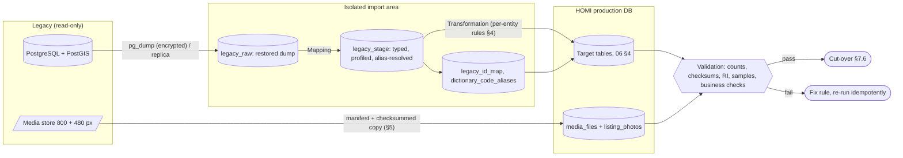

# 14 — Data migration plan

Part of the kvadro² → HOMI migration audit (rules, labels and ID scheme: [`README.md`](README.md)). The entities,
business rules (`BR-DATA`), legacy data defects (`LB-DATA`) and open questions (`Q-DATA`) referenced here are defined
in [`06-database-schema.md`](06-database-schema.md). Tasks `KV-DB-NNN` are defined in §8 of this document.

- **Status:** design. Nothing here can run before the blockers in §1 are closed: the legacy schema, data and
  database access are not available (`Q-SYS-002`). Every legacy table name in a query is a placeholder
  (`<legacy_…>`); HOMI table names are the `PROPOSED` names of `06` §4.
- **Pipeline:** `Legacy DB → Mapping → Transformation → Validation → HOMI DB`, executed by repeatable, idempotent runs
  (§7), rehearsed on staging before the single production cut-over.
- **Policy applied:** features, data and public links are carried over; legacy data defects are fixed during the
  transformation (each fix names its `LB-…` item); fixes that change what users see are deviation candidates for
  `09-feature-parity-matrix.md` and stay `PROPOSED` until the developer approves them.



## 1. Preconditions and blockers

### 1.1 Blockers

| # | Precondition | Why it blocks | Closes with | Blocks |
| - | ------------ | ------------- | ----------- | ------ |
| P1 | Legacy schema (DDL, sequences, extensions) | Every mapping and transformation rule depends on real tables and types | `Q-DATA-001` | everything |
| P2 | Row counts and sizes per table | Capacity, run timing, freeze-window budget, validation baselines | `Q-DATA-002` | §6, §7 |
| P3 | Sanitised sample per table | Profiling: enum values, code spellings, null rates, defects (`06` §5) | `Q-DATA-003` | §4 |
| P4 | Access path and handling agreement (transfer channel, encryption, storage location, who may access, destruction) | Production personal data leaves the legacy owner's control | `Q-DATA-004`, `Q-DATA-044` | R1 and later rehearsals |
| P5 | **Legal basis** for transferring personal data — Telegram ids and behaviour of bot users, phone hashes of verified owners, raw phone numbers of listing authors — under the Law of the Republic of Uzbekistan «On personal data» (ZRU-547), including where the data may be stored; whether users must be notified and the `/privacy` text replaced first | We do not interpret the law; the owner and their adviser must answer before any production copy is made | `Q-DATA-005`; BR-API-132 | R1 and later rehearsals; cut-over |
| P6 | Legacy contract and schema freeze date | A moving schema invalidates rehearsals (production shipped a breaking change on 2026-11-06) | `Q-SYS-005` | R2, R3 |
| P7 | HOMI target design approved: identifiers (CF-003 option A), money (CF-005), users (CF-015), channels, publications and `rent_period` (CF-016), author/phone model, radar model; PostGIS adopted on staging and production (CF-014) | Target tables must exist before any load step | `10-target-architecture.md`; KV-DB-004, KV-DB-005 | load steps |
| P8 | Change tracking for the final delta (`updated_at`, deletes) or a short-enough full re-dump | Decides the freeze-window length | `Q-DATA-043` | §7.6 |
| P9 | Media store access, size and transfer bandwidth | Photos are the largest volume | `Q-DATA-026`, `Q-DATA-050` | §5 |
| P10 | Owner-hash algorithm | Without it migrated verifications cannot match new listings (LB-DATA-005) | `Q-DATA-019` | owner verifications only |
| P11 | Who ingests listings after the cut-over and how publications are keyed | Without (channel, post id) matching, migrated listings get duplicated by the new ingestion | `Q-DATA-045`; CF-007; GAP-001 | listings scope, §4 |
| P12 | Staging bot, staging Mini App URL and a separate PostHog project for rehearsals | `initData` is bound to the bot token; rehearsals must never write to production analytics | About:408-420; `04` §1 | R2, R3 |
| P13 | Brand, domain and bot-identity decision | Stored and generated links (`startapp`, landing `link`, SEO) depend on the bot username and hosts; the webhook switch assumes HOMI keeps `@KvadroAppBot` | `Q-SYS-006`; CF-008; CF-009 | link rewriting rules |
| P14 | Owner-approved test account on the legacy bot | Business checks call the legacy API with a test account's own `initData` (never a real user's) | `04` §9.3 convention | §6.5 |

### 1.2 Personal-data handling during the migration (applies to every run with production data)

- **Minimum necessary.** Only columns listed in §4 are extracted into `legacy_stage`; free-text columns that the
  policy says must be gone (texts and phones of listings withdrawn > 90 days, erased users) are filtered at extract
  time, not later.
- **Isolation.** `legacy_raw` and `legacy_stage` live in a separate PostgreSQL database (not the HOMI application
  database), on the staging/production database host, with a dedicated role; never on developer machines. Rehearsal
  copies are destroyed after each rehearsal; only the masked sample (`Q-DATA-003`) may be used locally.
- **Encryption.** Dumps are encrypted in transit and at rest; their SHA-256 is recorded in `migration_runs`.
- **No PII in logs or reports.** Run reports carry counts, ids and hashes, never phone numbers, Telegram ids in clear,
  or texts (CLAUDE.md, README rules).
- **Phones.** Raw listing-author phones are converted on load into `phone_encrypted` + `phone_hmac` (LB-DATA-009); the
  plaintext never lands in a HOMI table column.

## 2. Scope per entity

`migrate` = rows copied (with transformation); `rebuild` = recomputed in HOMI; `drop` = not carried over;
`config` = deployment configuration. "Mandatory" means the cut-over is `NO-GO` without it.

| Entity | ENT | Decision | Reason | Depends on |
| ------ | --- | -------- | ------ | ---------- |
| User | ENT-001 | migrate (mandatory) | Owner of every user relation; Telegram id is the identity | — |
| User settings | ENT-002 | migrate (mandatory) | Locale, currency, quiet and digest hours drive every message; the server is the source of truth (BR-DATA-013) | users |
| Access grant, beta state | ENT-003 | migrate + config | Admitted users must stay admitted (BR-DATA-007); mode and owner list become configuration | users |
| Beta invitation | ENT-004 | migrate open invites only | Links already sent must keep working; consumed invites are history | `Q-DATA-008` |
| Attribution | ENT-005 | migrate | Acquisition history and the PostHog visit join (BR-DATA-033) | users |
| Analytics identity | ENT-006 | migrate (mandatory) | Otherwise every returning user becomes a new PostHog person (BR-DATA-021) | users |
| Erasure request | ENT-007 | migrate pending + replay | Deletions done on legacy after the dump must be repeated on HOMI (§7.9) | users |
| Radar | ENT-008 | migrate (mandatory) | Full filters, mode, active, counts, `entry`/`relax` statistics; twins merged (LB-DATA-011) | users, dictionaries |
| Radar hide rule | ENT-009 | migrate | User intent; drives `hidden` counts | radars, channels, dictionaries |
| Delivered-card log | ENT-010 | migrate (mandatory) | Without it radars re-send already delivered listings and takedown edits cannot find messages (About:430; BR-DATA-016) | users, listings, radars |
| Pending delivery | ENT-011 | migrate if a queue exists, else rebuild from last-digest timestamps | Items gathered before the switch must reach the next digest exactly once | radars, deliveries |
| Bot conversation state | ENT-012 | drop | Short-lived; every legacy callback is answered by the catch-all (`04` §6.3) | — |
| Service-news broadcast | ENT-013 | drop history; opt-out migrates with settings | History has no user value; the opt-out does (BR-BOT-080) | settings |
| Favourite | ENT-014 | migrate (mandatory) | User data shared by bot and app | users, listings, aliases |
| View history | ENT-015 | migrate | User data; `viewed` flags | users, listings, aliases |
| Hidden listing | ENT-016 | migrate (mandatory) | Users expect hidden listings to stay hidden | users, listings |
| Blocked author | ENT-017 | migrate (mandatory) | Same; entry ids preserved (§3) | users, authors |
| Vote / report | ENT-018 | migrate | Global effects (realtor marks, `rented` thresholds) and anti-abuse history | users, listings, authors |
| Owner verification | ENT-019 | migrate (transitional) | Keeps «Хозяин ✓» badges; legacy hashes phased out (LB-DATA-005) | users, `Q-DATA-019` |
| Found answer | ENT-020 | migrate | Product statistics; `ask_found` suppression | users |
| Action log | ENT-021 | drop (proposed) | Analytics already live in PostHog; 180-day retention; "no texts" promise is violated by `app_error` (LB-DATA-015); minimum-necessary principle. Alternative if anti-abuse needs it: migrate the last 30 days of non-error events | — |
| Support conversation | ENT-022 | out of scope | Support bot not audited (`Q-SYS-003`, `Q-DATA-039`) | — |
| Listing (+ location, attributes, status) | ENT-023, ENT-028, ENT-029, ENT-034 | migrate (mandatory) — see §2.1 | Identity of every public link and user relation | dictionaries, channels, authors |
| Listing alias | ENT-024 | migrate (mandatory) | Old ids in links, favourites and chats keep resolving (BR-DATA-019) | listings |
| Publication | ENT-025 | migrate (mandatory) | Price history, counters, sources; the natural key for matching new ingestion (BR-DATA-020) | listings, channels |
| History event | ENT-026 | migrate | Price timeline cannot be re-read for deleted posts | listings |
| Photo | ENT-027 | migrate files (§5) | Posts get deleted; photos cannot be re-downloaded | listings, Media module |
| Author | ENT-030 | migrate | Blocks, realtor marks, owner-badge rules | listings, `Q-DATA-017` |
| Market comparison | ENT-031 | rebuild + compare | Derived hourly; rebuilt values are compared with a legacy snapshot | listings, medians |
| Median aggregate | ENT-032 | rebuild + compare | Derived | listings |
| Price index series | ENT-033 | migrate published values (frozen) + rebuild + compare | Published, citable numbers must not change (BR-DATA-023) | listings |
| Translation | ENT-035 | drop (default) or migrate if large | Derived third-party text; regenerated on demand; migrate only if `Q-DATA-037` shows a large, costly cache | listings |
| Nearby place link | ENT-036 | rebuild | Derived from POIs | POIs |
| Takedown request | ENT-037 | migrate (mandatory) | Removed listings must never come back (BR-DATA-022) | listings, authors, channels |
| Call link token | ENT-038 | drop | ≈ 10-minute lifetime | — |
| Prepared share message | ENT-039 | drop | Ephemeral | — |
| Channel | ENT-040 | migrate (mandatory) | Source list, owner hashtags, **opt-outs** (BR-DATA-022), per-channel median caps | — |
| Exchange rate | ENT-041 | rebuild from the CBU archive; import legacy history if it exists | Conversions of historical prices must be reproducible | — |
| City, district, zone, quarter, metro, place, POI, renovation, appliance | ENT-042 … ENT-050 | rebuild + migrate legacy codes as aliases; places (ENT-047) migrated from the legacy gazetteer if it can be exported | HOMI owns the Geo module (ADR-0006 jsonb names; GAP-006); legacy codes must keep resolving (LB-DATA-001) | `Q-DATA-028` … `Q-DATA-030` |
| Price preset | ENT-051 | rebuild | Derived or configured | medians |
| Enumerations and presets | ENT-052 | config | Values copied into config and enums | — |
| Translatable names, display strings | ENT-053 | rebuild | Captured from `meta` in three locales + golden fixtures | dictionaries |
| Landing data snapshot | ENT-054 | rebuild | Generated files; snapshot photos regenerated (LB-DATA-016) | listings, photos |
| SEO slice aggregate | ENT-055 | rebuild | Derived | listings, dictionaries |
| Salary reference | ENT-056 | migrate (manual entry) | One published constant per period | — |
| CSP report | ENT-057 | drop | Operational log | — |
| Client device state | ENT-058 | not migrated | Client-side; server settings win at start (BR-API-144) | — |
| Telegram-side chat state | ENT-059 | not migrated; reset plan | Lives at Telegram; per-chat command scopes reset after the switch | settings |

### 2.1 Listings: migrate or re-ingest

| Option | What it means | Keeps | Loses or breaks | Verdict |
| ------ | ------------- | ----- | --------------- | ------- |
| A. Migrate | Copy all legacy listings (active, withdrawn < 90 days, PII-purged statistical stubs), aliases, publications, history, photos, statuses | Ids and every public link; user relations (favourites, history, hidden, votes, delivered log); merges; first-seen dates (index continuity); photos of deleted posts; takedowns | Legacy extraction defects (`06` §5) stay unless re-derived | Required for continuity |
| B. Re-ingest | Read the channels again with HOMI's pipeline (collector push, ADR-0009) and start fresh | Clean HOMI-native parsing | New ids → every shared link, favourite, history row, vote and delivered card breaks; radars re-send everything; deleted posts, merges, price history and first-seen dates are lost; the published index cannot be reproduced | Rejected as the only path |
| C. Hybrid (**proposed**) | A for identity and history; after the cut-over the new ingestion attaches new publications to migrated listings by `(channel, post_id)` and by HOMI dedup; optionally re-extract attributes of migrated, non-purged listings with HOMI's parser later — **without changing ids** | Everything A keeps, plus a path to HOMI-quality attributes | Needs the intake contract to carry channel + post id (`Q-DATA-045`, CF-007, CF-016) and the `kvadro_legacy` source with the lowest trust weight so that collector data wins on conflict | `PROPOSED` |

## 3. ID strategy

Principle: an id that has left the server — in a public link, in a Telegram message, in an old client's memory —
keeps its value. Every other id is new in HOMI, and the correspondence is recorded in `legacy_id_map` so that each
mapping can be verified by a join.

| Entity | Legacy id | HOMI id | Preserve the value? | Why |
| ------ | --------- | ------- | ------------------- | --- |
| Listing | integer | `listings.id` ULID (new); `listings.number bigint unique` = legacy id (CF-003 option A) | **Yes** (`number`) | `startapp=l_<id>`, `--l<id>`, `/media/<id>/…`, SEO and landing links, old client compares numbers (BR-DATA-002; URL-042, URL-048, URL-052 … URL-055) |
| Listing alias | integer | `listing_aliases.alias_number` = legacy id → survivor `listing_id` (ULID) | **Yes** | Old links and chat buttons resolve to the survivor (BR-DATA-019) |
| User | Telegram id | `users.id` new `bigint`; `users.telegram_user_id` = Telegram id (CF-015) | Telegram id yes; internal id new | Identity is the Telegram id |
| Radar | number or string | `radars.id` ULID (new); `radars.number` = legacy value when numeric; non-numeric legacy ids → new `number` + `legacy_id_map` | **Yes** (`number`) | Old `callback_data` may embed it (`Q-DATA-041`); old Mini App sessions open during the switch keep calling `/api/subscriptions/:id` |
| Merged twin radar | number | none; `legacy_id_map` → survivor | Mapped | LB-DATA-011 |
| Blocked-author entry | number or string | `blocked_authors.id` ULID (new); `blocked_authors.number` = legacy value when numeric | **Yes** (`number`) | `DELETE /api/hidden/:id` from sessions open during the switch |
| Author | unknown key | new `bigint` | No — mapped (`legacy_key` → id) | Internal only |
| Publication | (channel, post id) | natural key `(channel_id, post_id)` | Natural key | Matching new ingestion |
| Photo | (listing id, n) | `listing_photos (listing_id, n)`; the path uses `listings.number` | **Yes** (`n`, number) | Path of `/media/<id>/<n>.jpg` |
| Channel | id or handle | new `bigint`; `handle`, `telegram_id` natural keys | No — mapped | Internal |
| Dictionary entries | codes | new `bigint`; legacy codes in `dictionary_code_aliases` | Codes yes (as aliases) | Radars and URLs carry codes |
| Favourite, history, hidden, vote, found answer | composite or surrogate | composite keys in HOMI | No | Never exposed by id |
| Sent card | `(chat_id, message_id)` | same natural key | **Yes** | Telegram addresses messages by it |
| Analytics distinct id | string | `users.analytics_distinct_id` | **Yes**, byte-for-byte | PostHog continuity |
| Invite token | string | stored as a hash of the same token | **Yes** (value) | Links already sent |

**`legacy_id_map`** (migration-only table): `(entity text, legacy_key text, homi_key text, run_id bigint,
first_seen_run bigint, row_checksum bytea)`, unique `(entity, legacy_key)`. Every loaded row writes one map row in
the same transaction; a re-run updates `run_id` and `row_checksum` only when the transformed row changed.

**Sequences.** After the final delta:

```sql
-- Listing numbers: start above anything legacy could have issued (live numbers and alias numbers), plus a gap for
-- rows created between the last dump and the moment the legacy pipeline stopped (sized from Q-DATA-002 growth; at
-- least 7 days of legacy creations). Sequence names follow the final migrations.
SELECT setval('listings_number_seq',
              greatest((SELECT max(number) FROM listings), (SELECT max(alias_number) FROM listing_aliases))
              + :listing_number_gap, false);
SELECT setval('radars_number_seq', (SELECT max(number) FROM radars) + :radar_number_gap, false);
SELECT setval('blocked_authors_number_seq', (SELECT max(number) FROM blocked_authors) + :author_entry_gap, false);
```

Numbers are never reused: a deleted listing keeps its number reserved (alias or tombstone row), an alias number is
never handed to a new listing, and the sequences never move backwards (validation query V-RI-9 in §6.3).

## 4. Transformation rules per entity

Rules are pure functions of the staged legacy row, the mapping tables and the run configuration; the only clock
they read is the run's recorded start time. Every rule that changes a value writes a row to
`migration_changes(run_id, entity, legacy_key, rule, before_hash, after_hash)` so the effect of each fix can be
counted and reviewed. "Tied to" names the rule or defect that justifies the transformation.

### 4.1 Cross-cutting rules

| Rule | Transformation | Tied to |
| ---- | -------------- | ------- |
| Time | Naive legacy timestamps → `timestamptz` using the zone proven by `Q-DATA-035`; `timestamptz` copied as is; business wall-clock values stay local Asia/Tashkent (UTC+5, no DST) | BR-DATA-030; LB-DATA-018 |
| Locale codes | `uz_Latn` → `uz`; `ru`, `en` unchanged; unknown → `ru` + change row | LB-DATA-014; BR-DATA-015 |
| Text | Unicode NFC; strip NUL and control characters except `\n`, `\t`; `original_text` and publication texts are otherwise byte-preserved (they are evidence); names: trim, collapse inner whitespace, canonical Uzbek apostrophes `ʻ`/`ʼ` | `06` §5.1 encodings |
| Labels | Remove markup and entities from any label or name (`<`, `>`, `&…;`) | BR-DATA-029; LB-API-008 |
| Codes | Every city, district, zone, renovation, appliance code resolved through `dictionary_code_aliases`; an unresolvable code is a run error (fix the alias table, re-run), never silently dropped | LB-DATA-001 |
| Money | USD values → `bigint` cents (`round(x * 100)`); currency `USD`; source amount/currency only where legacy stored it (`Q-DATA-023`); never synthesise UZS amounts | BR-DATA-008; LB-DATA-019 |
| Coordinates | `[lat, lon]` and `(lat, lon)` columns → `ST_SetSRID(ST_MakePoint(lon, lat), 4326)::geography`; points outside the Uzbekistan bounding box → `null` + change row | BR-DATA-036 |
| Phones | Normalise to E.164 `+998` + 9 digits; invalid → `null` + change row; valid → `phone_encrypted` (application key) + `phone_hmac` (HMAC-SHA-256, HOMI key) | LB-DATA-009; ADR-0009 |
| Retention at extract | Listings with `withdrawn_at + 90 days < run start` lose phone, texts and photos at extract time, even if legacy still kept them | BR-DATA-006 |
| Erasure at extract | Users on the erasure list (§7.9) and all their rows are excluded at extract time | BR-DATA-031 |
| Takedown at extract | Taken-down listings are migrated as `taken_down` stubs without text, phone or photos | BR-DATA-022 |

### 4.2 Per-entity rules

| Entity | Rule | Tied to |
| ------ | ---- | ------- |
| User | Copy Telegram id (`bigint`), profile flags, account-age estimate, `bot_chat_state` (unknown → `active` + re-probe on first send), `legacy_created_at`; `name`, `email`, `password` stay `null` | BR-DATA-001; BR-DATA-003 |
| User | Set `bot_commands_locale = null` so the first HOMI interaction rewrites per-chat command scopes | ENT-059; `04` §1 note 1 |
| Settings | `quiet` `off` → `quiet_start = quiet_end = null`; `HH-HH` → two `time` values (window may cross midnight); invalid → `off` + change row | BR-DATA-014; LB-API-050 |
| Settings | `digest` `HH[,HH]` → sorted unique `smallint[]`; invalid → legacy default (`09,19` if confirmed by `Q-DATA-007`) + change row | BR-DATA-014 |
| Settings | `locale_chosen` / `city_chosen` true → `*_chosen_at` = legacy timestamp or run start; false → `null` | LB-API-018; BR-DATA-013 |
| Settings | `service_news` copied; unknown → `true` (observed default, BR-BOT-075) + change row | BR-BOT-080 |
| Access | Admitted users → `access_grants.state = admitted`; operator blocks → `blocked` with reason; mode and owner list → config; open invites → `beta_invites` with the token hashed | BR-DATA-007 |
| Attribution | Parse each stored payload with the grammar of BR-DATA-033; keep `raw_payload`; unparsable → `source = 'unknown'` | BR-DATA-033 |
| Analytics id | Copy verbatim; duplicates across users are a run error | BR-DATA-021 |
| Radar | `zone: X` → `zones: [X]` merged with any `zones`, canonical order `center`, `near_center`; drop `zone` | LB-DATA-004; LB-API-028 |
| Radar | Fill the 25-key schema with defaults (`types: ['apartment']`, arrays `[]`, booleans `false`, scalars `null`, `owner: 'any'`) | BR-DATA-009; LB-API-005 |
| Radar | `posted_days` → `null` if `Q-API-014` confirms matching ignores it; otherwise keep and flag | LB-DATA-003 |
| Radar | Remove `types` not allowed for the deal; empty result → `['apartment']`; `tenant` on `rent_daily` per the developer's decision; `pets` and `pets_only` both true → keep `pets_only` (stricter) | BR-DATA-011; LB-DATA-007; LB-API-025 |
| Radar | Several geography modes set → keep `polygon` if present, else `zones`, else `districts` (most specific first); `area_*` / `market` on rent and `appliances` on sale → `null`/`[]`; `min > max` → swap | BR-DATA-011; LB-APP-043 |
| Radar | Price bounds: integer USD → `price_min/max` cents, `price_currency = 'USD'`; `filters_v1` keeps whole dollars; flag implausible bounds (rent `> 20000`, daily `> 1000`) without changing them | LB-DATA-002 |
| Radar | Polygon `[[lat, lon], …]` → closed `geography(Polygon, 4326)` ring in `(lon lat)` order; `ST_IsValid` false → `ST_ConvexHull` (as the client does) + change row | BR-DATA-011 |
| Radar | `filters_hash` = SHA-256 of the canonical JSON without `posted_days` (keys sorted, arrays sorted, `undefined` → `null`), same canonicalisation as the client's `filtersKey` (BR-APP-012); twins merged per LB-DATA-011, twin ids → `legacy_id_map` | LB-DATA-011; LB-API-037 |
| Radar | `entry` copied; `relaxed` → `relax_code` (analytics only) | LB-DATA-017 |
| Hide rule | Channel → `source_channels.id` by handle/id; district → `districts.id` via aliases; author → `listing_authors.id`; unresolvable → keep raw value, null FK, report | LB-DATA-006 |
| Delivered card | `(chat_id, message_id, listing)` copied into `bot_listing_messages` with the **original** legacy number in `legacy_listing_number` and the alias-resolved survivor in `listing_id`; `radar_deliveries` gets one row per (user, survivor listing) with the earliest `sent_at` | BR-DATA-016; BR-DATA-019 |
| Pending delivery | Copy items not yet released; recompute `release_at` from HOMI settings (Asia/Tashkent); if no queue exists, store `last_digest_sent_at` per user so HOMI's first digest covers "matches since then minus `radar_deliveries`" | ENT-011 |
| Favourite, history, hidden | Re-point listing ids through aliases; collisions after re-pointing keep the earliest `created_at` (history: latest `viewed_at`, summed `view_count`); orphans dropped with a count | BR-DATA-017; BR-DATA-019 |
| Blocked author | Author key → `listing_authors` (phone → HMAC + encrypted, source → channel); entry id preserved; duplicates per (user, author) → earliest | LB-DATA-012; BR-DATA-028 |
| Vote | Dedupe per (user, listing, reason) keeping the earliest; copy weight; snapshot current realtor marks and "rented for all" states with `source = 'legacy'`, `at = run start` | LB-DATA-012; LB-DATA-013 |
| Owner verification | Copy `legacy_hash`, `legacy_hash_alg`, `verified_at`; `phone_hmac = null`; `reverify_due_at = cut-over + transition window` | LB-DATA-005 |
| Found answer | Copy; attach `where` rows to the latest `elsewhere` answer of the same user; `channel` from the legacy source if known, else `null` | BR-DATA-032 |
| Listing | Legacy id → `number`; new ULID `id` recorded in `legacy_id_map`; `deal_type` → `deal` + `rent_period` (`rent_long` → `rent`/`long`, `rent_daily` → `rent`/`daily`, `sale` → `sale`); property type copied | CF-003; CF-016; `06` §4.3 items 1, 3 |
| Listing | Price → `price_usd_cents`, `price_kind`, `price_basis` derived from deal, `price_kind` and legacy unit fields; unclassifiable → `price_basis = null` + flag | LB-DATA-019 |
| Listing | `is_owner` tri-state → `owner_status` (`owner`, `agent`, `unknown`); `owner_verified` not stored (recomputed) | BR-DATA-005 |
| Listing | Location: district via aliases, `district_source = 'legacy_unknown'`; place, quarter, metro via aliases; `metro_km`, `center_km`, `geo_radius_m` copied | LB-DATA-020; BR-DATA-036 |
| Listing | Status mapped to HOMI enum; `withdrawn_at`, `pii_purged_at` copied; retention rule of §4.1 applied | BR-DATA-006 |
| Listing | `views_count` copied (if a counter); `first_seen_at`, `last_published_at` converted to UTC | ENT-023; `Q-DATA-038` |
| Listing | One `source_listings` row per listing for source `kvadro_legacy` (`external_id` = legacy id, `status` from the listing) | ADR-0009; `06` §4.1 |
| Alias | Flatten chains (`a → b → c` becomes `a → c`, `b → c`); aliases pointing to missing listings → tombstone listing row (status `merged`, no content) so the id stays reserved | BR-DATA-019 |
| Publication | Channel by handle/id; `post_id` from the URL when not stored; unique `(channel_id, post_id)`; duplicates → keep the one attached to the survivor | BR-DATA-020 |
| History event | Copied; `change_pct` `numeric(6,2)`; `price_usd` → cents | BR-DATA-024 |
| Author | Built from listing phones and source channels; realtor marks and distinct-flat counts copied with `source = 'legacy'` | BR-DATA-028 |
| Channel | Handle lower-cased for matching (Telegram usernames are case-insensitive), display handle kept; opt-outs copied | BR-DATA-022 |
| Takedown | Copied; the listing is forced to `taken_down` regardless of other status | BR-DATA-022 |
| Exchange rate | Legacy history if present; otherwise CBU daily rates fetched for the whole listing date range | BR-DATA-008 |
| Dictionaries | Names in three languages from the legacy tables, or from `GET /api/meta` captured with a test account in `ru`, `uz_Latn`, `en`; SEO slugs from `docs/seo-pages.md`; every legacy spelling (API code, landing code, SEO slug) inserted into `dictionary_code_aliases` | LB-DATA-001 |
| Index series | Published CSV values imported as `frozen = true`; HOMI's recomputation stored separately and compared (§6.5) | BR-DATA-023 |
| Erasure | Pending legacy requests imported; the replay list applied after load (§7.9) | BR-DATA-031 |

## 5. Media and files

**Inventory (blocked by `Q-DATA-026`, `Q-DATA-050`).** Order of magnitude, `UNVERIFIED` inference: ≈ 18.6 k active
listings plus the withdrawn listings of the last 90 days (bounded by ≈ 50 k listing ids in total on 2026-11-08, `06`
ENT-023), each with up to a few photos in two renditions — roughly 10⁵ photos and 10–40 GB. The real figures replace
this before R1.

**What is migrated.**

| Item | Migrated? | Rule |
| ---- | --------- | ---- |
| 800 px JPEG `/media/<id>/<n>.jpg` | yes | Becomes the `media_files` original when no larger original exists |
| 480 px JPEG `.s.jpg` | yes (byte copy) | Stored as the legacy rendition for the old URL shape; byte copy is cheaper than re-encoding and verifiable by hash |
| Larger originals | yes, if they exist | Become the `media_files` original instead of the 800 px file |
| Photos of PII-purged or taken-down listings | no | BR-DATA-006, BR-DATA-022 |
| Landing snapshots `img/snap/<id>.webp` | no | Regenerated (LB-DATA-016) |
| Telegram file ids | as references only | ADR-0009 item 5 |

**Process (idempotent, resumable by `(listing_id, n)`).**

1. Legacy side produces a manifest: `listing_id, n, rendition, bytes, sha256` for every file (run on the media host by
   the owner, or by our read-only tool there).
2. Transfer over an encrypted channel with checksum verification (e.g. `rclone copy --checksum` into a staging
   bucket `homi-tmp`), parallel by listing id range.
3. For each `(listing_id, n)`: the HOMI Media module stores the original content-addressed (`media_files`, unique
   `(disk, sha256)` — a re-run finds the existing row), sets `visibility` per the decision in
   `10-target-architecture.md` (signed legacy URLs suggest private originals with public variants), and queues WebP
   variants on the `media` queue — only 320 and 640 px, because 800 px sources are never upscaled
   (`backend/config/media.php`).
4. The 480 px legacy JPEG is stored under a legacy rendition key in `listing_photos.legacy_jpeg_480_key`; the 800 px
   key in `legacy_jpeg_800_key`.
5. `listing_photos(listing_id, n, media_file_id, …)` is upserted; `n` is preserved (0-based, BR-DATA-025).

**Serving after the cut-over** (CF-012). HOMI implements the legacy route `/media/<listing number>/<n>.jpg` and `.s.jpg` with
`?e=&s=` (same shape, HOMI's own key), returns JPEG (the old client's oldest targets lack WebP, `06` §4.3 item 5) with
`Cache-Control: public, max-age=86400`, and `404` for a bad or expired signature (LB-API-023 fix). URLs signed by the
legacy backend expire within ≈ 1–2 days (BR-DATA-025); they live only in API responses, open Mini App sessions and
CDN-cached SEO pages (≤ 5 minutes). Two options:

- **(a)** obtain the legacy signing algorithm and secret (`Q-DATA-027`) and accept old signatures until their `e`;
- **(b, default)** accept that pre-switch photo URLs show the client's placeholder for at most one session; no
  secret is transferred.

Bot messages are not affected either way: Telegram stores the photos it was sent (inferred; the legacy upload method
is unknown, `UNVERIFIED`).

**Validation.** Per listing, `count(listing_photos)` equals the legacy photo count; every copied file's SHA-256
equals the manifest; every `media_files` row of a migrated photo reaches `ready`; a 1 % random sample of legacy URLs
on HOMI returns `200 image/jpeg` with the same bytes as the legacy file; a visual spot check of 50 photos per rehearsal.

**Retention.** The HOMI 90-day purge job covers migrated photos from the first day (`listing_photos.erased_at`,
media file deletion when no other reference remains).

## 6. Validation

All checks run after every rehearsal and after the final delta; each produces a line in the run report with the
expected value, the actual value and pass/fail. Legacy-side numbers are computed on `legacy_stage` (the staged,
alias-resolved copy) so both sides are compared after the same documented exclusions.

### 6.1 Row counts and reconciliation

For every entity: `legacy rows = loaded + merged + excluded(reason)` must balance exactly; reasons are the closed set
`orphan`, `erased`, `purged`, `taken_down_stub`, `duplicate`, `invalid` and each has a count.

```sql
-- V-CNT-1: every step balances (must return zero rows)
SELECT entity,
       sum(rows_read)    AS read,
       sum(rows_written) AS written,
       sum(rows_merged)  AS merged,
       sum(rows_excluded) AS excluded
FROM migration_run_steps
WHERE run_id = :run_id
GROUP BY entity
HAVING sum(rows_read) <> sum(rows_written) + sum(rows_merged) + sum(rows_excluded);

-- V-CNT-2: HOMI counts per entity for the report
SELECT 'users' AS entity, count(*) FROM users WHERE telegram_user_id IS NOT NULL
UNION ALL SELECT 'radars', count(*) FROM radars
UNION ALL SELECT 'radars_active', count(*) FROM radars WHERE active
UNION ALL SELECT 'favorites', count(*) FROM favorites
UNION ALL SELECT 'listing_views', count(*) FROM listing_views
UNION ALL SELECT 'hidden_listings', count(*) FROM hidden_listings
UNION ALL SELECT 'blocked_authors', count(*) FROM blocked_authors
UNION ALL SELECT 'listing_votes', count(*) FROM listing_votes
UNION ALL SELECT 'radar_deliveries', count(*) FROM radar_deliveries
UNION ALL SELECT 'bot_listing_messages', count(*) FROM bot_listing_messages
UNION ALL SELECT 'listings', count(*) FROM listings
UNION ALL SELECT 'listing_aliases', count(*) FROM listing_aliases
UNION ALL SELECT 'listing_publications', count(*) FROM listing_publications
UNION ALL SELECT 'listing_photos', count(*) FROM listing_photos WHERE erased_at IS NULL;

-- V-CNT-3: listings by deal, term and status, compared with the same grouping on legacy_stage
SELECT deal, rent_period, status, count(*) FROM listings GROUP BY 1, 2, 3 ORDER BY 1, 2, 3;
```

Business count at freeze time: active listings per city and deal on HOMI equal the legacy `GET /api/cities` `counts`
fetched with the test account at the same moment (exact match required while both see the same frozen data).

### 6.2 Checksums (order-independent fingerprints)

Each fingerprint is computed with the same canonical string on `legacy_stage` and on HOMI; equality proves the set,
not only the count.

```sql
-- V-SUM-1: listing numbers and normalised prices
SELECT count(*), sum(number), sum(coalesce(price_usd_cents, 0)) FROM listings;

-- V-SUM-2: favourites as (telegram id, listing number) pairs
SELECT count(*),
       md5(string_agg(u.telegram_user_id::text || ':' || l.number::text, ','
                      ORDER BY u.telegram_user_id, l.number))
FROM favorites f JOIN users u ON u.id = f.user_id JOIN listings l ON l.id = f.listing_id;

-- V-SUM-3: delivered set as (telegram id, listing number)
SELECT count(*),
       md5(string_agg(u.telegram_user_id::text || ':' || l.number::text, ','
                      ORDER BY u.telegram_user_id, l.number))
FROM radar_deliveries d JOIN users u ON u.id = d.user_id JOIN listings l ON l.id = d.listing_id;

-- V-SUM-4: radars as (number, canonical filters hash, active, mode)
SELECT count(*),
       md5(string_agg(r.number::text || ':' || encode(r.filters_hash, 'hex') || ':' || r.active::text || ':' || r.mode,
                      ',' ORDER BY r.number))
FROM radars r;

-- V-SUM-5: settings as (telegram id, locale, currency, quiet, digest)
SELECT count(*),
       md5(string_agg(u.telegram_user_id::text || ':' || s.locale || ':' || s.currency || ':' ||
                      coalesce(s.quiet_start::text || '-' || s.quiet_end::text, 'off') || ':' ||
                      array_to_string(s.digest_hours, ','), ',' ORDER BY u.telegram_user_id))
FROM user_settings s JOIN users u ON u.id = s.user_id;

-- V-SUM-6: analytics ids (must match byte-for-byte)
SELECT count(*),
       md5(string_agg(u.telegram_user_id::text || ':' || u.analytics_distinct_id, ',' ORDER BY u.telegram_user_id))
FROM users u WHERE u.analytics_distinct_id IS NOT NULL;
```

The same pattern covers hidden listings, blocked authors (with entry ids), votes (with reason), publications
(`channel handle:post_id:listing number`), photos (`listing number:n:sha256`) and aliases (`alias_number:survivor number`).

### 6.3 Referential integrity

Foreign keys enforce most relations at load; these queries cover soft references and invariants (each must return
zero, or `true` for V-RI-9):

```sql
-- V-RI-1: aliases point to existing, non-merged listings (a merged survivor would be a chain)
SELECT a.alias_number FROM listing_aliases a LEFT JOIN listings l ON l.id = a.listing_id
WHERE l.id IS NULL OR l.status = 'merged';

-- V-RI-2: an alias number is never also a live listing number
SELECT a.alias_number FROM listing_aliases a JOIN listings l ON l.number = a.alias_number AND l.status <> 'merged';

-- V-RI-3: every radar filter object has exactly the 25 keys and resolvable codes
SELECT id FROM radars WHERE (SELECT count(*) FROM jsonb_object_keys(filters_v1)) <> 25;
SELECT r.id FROM radars r
WHERE r.city_id IS NULL
   OR EXISTS (SELECT 1 FROM unnest(r.district_ids) d WHERE NOT EXISTS (SELECT 1 FROM districts x WHERE x.id = d));

-- V-RI-4: delivered cards and messages reference existing listings and users
SELECT count(*) FROM radar_deliveries d LEFT JOIN listings l ON l.id = d.listing_id WHERE l.id IS NULL;
SELECT count(*) FROM bot_listing_messages m LEFT JOIN users u ON u.id = m.user_id WHERE u.id IS NULL;

-- V-RI-5: user relations resolve to listings (after alias re-pointing)
SELECT count(*) FROM favorites f LEFT JOIN listings l ON l.id = f.listing_id WHERE l.id IS NULL;
SELECT count(*) FROM hidden_listings h LEFT JOIN listings l ON l.id = h.listing_id WHERE l.id IS NULL;
SELECT count(*) FROM listing_views v LEFT JOIN listings l ON l.id = v.listing_id WHERE l.id IS NULL;

-- V-RI-6: live photos have a ready media file
SELECT count(*) FROM listing_photos p LEFT JOIN media_files m ON m.id = p.media_file_id
WHERE p.erased_at IS NULL AND (m.id IS NULL OR m.status <> 'ready');

-- V-RI-7: no PII survives on purged, taken-down or overdue listings
SELECT count(*) FROM listings
WHERE (pii_purged_at IS NOT NULL OR status = 'taken_down'
       OR (withdrawn_at IS NOT NULL AND withdrawn_at < :run_started_at - interval '90 days'))
  AND (original_text IS NOT NULL OR phone_encrypted IS NOT NULL
       OR EXISTS (SELECT 1 FROM listing_photos p WHERE p.listing_id = listings.id AND p.erased_at IS NULL));

-- V-RI-8: every mapped legacy listing id exists in HOMI
SELECT count(*) FROM legacy_id_map m
WHERE m.entity = 'listing' AND NOT EXISTS (SELECT 1 FROM listings l WHERE l.number = m.legacy_key::bigint);

-- V-RI-9: sequences are above every preserved id
SELECT (SELECT last_value FROM listings_number_seq) > (SELECT max(number) FROM listings)
   AND (SELECT last_value FROM listings_number_seq) > (SELECT coalesce(max(alias_number), 0) FROM listing_aliases)
   AND (SELECT last_value FROM radars_number_seq)   > (SELECT max(number) FROM radars);

-- V-RI-10: erased subjects are gone (hmac() from pgcrypto; :erasure_key is the HOMI erasure-log key)
SELECT count(*) FROM users u
JOIN erasure_requests e ON e.subject_hash = hmac(u.telegram_user_id::text, :erasure_key, 'sha256');
```

### 6.4 Sampled field-level comparison

- **DB-level.** For each entity, a random sample of 1 % (minimum 200 rows) is compared field by field between the
  expected transformation of the `legacy_stage` row and the HOMI row; any difference not explained by a
  `migration_changes` row fails the check.
- **API-level.** With the owner-approved test account (P14): for 300 sampled listing ids (stratified by deal, status
  and city, including merged ids and listings with `post_deleted`), fetch `GET /api/listings/:id` from legacy before
  the switch and from HOMI's legacy route against the migrated data, with the test account's locale and currency set
  identically; diff the JSON. Allowed differences: `call_url` token, photo URL signatures, `median_*` within the
  tolerance of §6.6, `stats.views` (if HOMI counts differently). Everything else must be equal, including key presence
  (LB-API-009).

### 6.5 Business-level checks

| Check | How | Pass |
| ----- | --- | ---- |
| Each active radar matches the same listings | For every distinct canonical filter set of an active radar, call legacy `GET /api/feed/count?<filters>` with the test account at the frozen moment and HOMI's legacy route with the same query; rate-limited (≤ 1 request/s) | Equal counts; any difference is investigated per filter key |
| Radars do not re-send | Dry-run of the first HOMI matching cycle with Telegram sending disabled: `SELECT r.id, count(*) FROM radars r JOIN LATERAL radar_matches(r.id, :since) m ON true JOIN radar_deliveries d ON d.user_id = r.user_id AND d.listing_id = m.listing_id WHERE r.active GROUP BY r.id;` (`radar_matches` = HOMI's matching function) | Zero rows; would-be sends per hour within the legacy daily rate (`Q-BOT-034`) |
| Favourites resolvable | V-RI-5, plus `GET /api/favorites` on HOMI for 50 sampled users (impersonated in staging only) returns every item with the strict preview keys | 100 % |
| Hidden and blocked stay effective | For 50 sampled users, none of their hidden listings or blocked authors' listings appear in HOMI feed/map results | 0 leaks |
| Public links resolve | All listing ids in the last landing snapshot (`live.json`, `pins-*.json`) and in 500 SEO card links resolve on HOMI (`200`, or the survivor for merged ids) | 100 % |
| Owner badges | Count of listings with `owner_verified` on HOMI (transitional legacy-hash matching) equals the legacy count | Equal |
| Index CSV | HOMI-generated CSVs for frozen periods equal the published legacy CSVs byte for byte | Equal |
| Medians | Rebuilt district × rooms medians vs the legacy snapshot | Within §6.6 tolerance for ≥ 99 % of slices |
| Analytics | `meta.analytics.id` for 50 sampled users equals the legacy value | Equal |
| Settings | V-SUM-5 equal; `GET /api/settings` for sampled users returns the legacy strings (`quiet`, `digest`, `uz_Latn`) | Equal |

### 6.6 Tolerances and stop rules

- **Zero tolerance:** count reconciliation (V-CNT-1), id preservation (V-RI-8), referential integrity (V-RI-1 …
  V-RI-10), fingerprints V-SUM-1 … V-SUM-6, re-send dry-run, PII checks. Any failure is `NO-GO`.
- **Tolerances for derived data:** medians ± max($1, 1 %) per slice; market tones may differ only where the median
  moved across a tone threshold; feed counts exact at the frozen moment.
- **Change budget:** the number of `migration_changes` rows per rule is reviewed by the developer after R1; an
  unexpected rule volume (for example thousands of radars widened) stops the rehearsal.

## 7. Runs, rehearsals, cut-over and rollback

### 7.1 Tooling

- **Separate import database** (`legacy_raw`, `legacy_stage` schemas) on the HOMI database host, never the
  application database; a read-only role for the transformation code; restored from the encrypted dump.
- **Commands** (to be built, KV-DB-013): one Artisan command per entity group reading `legacy_stage` through a
  second, read-only database connection and writing HOMI tables in batches; a driver command runs the groups in the
  dependency order of §7.3.
- **Bookkeeping tables:** `migration_runs(id, kind: rehearsal|final|delta, dump_sha256, legacy_watermark,
  started_at, finished_at, status, config jsonb)`, `migration_run_steps(run_id, entity, batch_from, batch_to,
  rows_read, rows_written, rows_merged, rows_excluded, excluded_by_reason jsonb, checksum, started_at, finished_at)`,
  `migration_changes` (§4), `legacy_id_map` (§3).

### 7.2 Idempotent, restartable, repeatable

- **Idempotent writes:** every target row is written with `INSERT … ON CONFLICT (natural or legacy key) DO UPDATE …
  WHERE <target> IS DISTINCT FROM EXCLUDED` (postgis agent rule 5), so a second run over unchanged data writes no
  rows.
- **Restartable:** each batch commits its rows, its `legacy_id_map` rows and its `migration_run_steps` row in one
  transaction; a restart resumes after the last committed batch of each entity.
- **Repeatable:** a full run into an empty schema twice from the same dump yields identical fingerprints (V-SUM-*);
  this is a rehearsal acceptance criterion.
- **Deterministic:** no `now()` or random values in transforms; the run start time is a parameter.

### 7.3 Load order

1. Dictionaries, `dictionary_code_aliases`, exchange rates, channels.
2. Users → settings → access grants and invites → attribution → analytics ids.
3. Authors → listings (with location, attributes, status) → aliases → publications → history events → takedowns.
4. Photos (bulk copy runs in parallel from step 3 on; variants are queued work).
5. Radars → hide rules → delivered cards and messages → pending deliveries.
6. Favourites, history, hidden listings, blocked authors → votes → owner verifications → found answers.
7. Erasure replay (§7.9).
8. Derived rebuild: medians, market comparisons, nearby, price presets, index recomputation, SEO aggregates, landing
   snapshot.
9. Sequences (§3), validation (§6), report.

### 7.4 Rehearsals and timings

| Rehearsal | Data | Environment | Goal | Exit criteria |
| --------- | ---- | ----------- | ---- | ------------- |
| R0 | Masked sample (`Q-DATA-003`) | Local / CI (PostgreSQL group of the test suite) | Mapping completeness, transformation rules, validation queries | All rules covered by tests; zero unmapped codes |
| R1 | Full production dump | Staging, isolated import DB, production-grade controls (P4, P5) | Timings per step, change-rule volumes, data-quality report | Report reviewed by the developer; `06` updated with real schema facts |
| R2 | Fresh full dump + simulated delta | Staging with the staging bot and the legacy Mini App build pointed at HOMI staging | End-to-end: load → delta → validation → bot and Mini App smoke tests | All §6 checks pass; total freeze-window steps within budget |
| R3 (dress) | Fresh full dump, ≤ 72 h before cut-over | Staging | Final runbook, exact timings | Same as R2, measured duration ≤ 80 % of the window |

Timing record per step (filled by each rehearsal): `step | rows | duration | rows/s | peak DB load | notes`. The freeze
window budget = final delta extract + delta load + fast validation subset + go/no-go; a target of ≤ 60 minutes is
proposed and confirmed by R2.

### 7.5 Backups

- Before the final load: full physical backup of the HOMI production database (pgBackRest with WAL, postgis agent
  rule 9), restore drill done on staging during R2.
- The final legacy dump is kept encrypted and immutable with its SHA-256 until the rollback window closes, then
  destroyed (§7.9).
- Media: the transfer manifest and the staging bucket are kept until validation passes.

### 7.6 Cut-over sequence

| Time | Step | Owner |
| ---- | ---- | ----- |
| T−14 d | Contract and schema freeze (P6); maintenance window announced (bot service news, if used) | owner + developer |
| T−7 d | R2 passed; go/no-go criteria signed | developer |
| T−1 d | Bulk load of the historical data from a fresh dump (`legacy_watermark = W1`); media bulk copy completed; R3 report | developer |
| T0 | `setWebhook` of `@KvadroAppBot` to HOMI's `hook` host with `drop_pending_updates = false`; HOMI stores every update durably in `telegram_updates` (dedup `(bot_id, update_id)`) with the `telegram` queue **paused** — no user-visible processing yet. Done first so that no update is acknowledged by a frozen legacy receiver; contact shares inside buffered updates are redacted before storage (CF-019) | developer |
| T0 + 1 min | **Freeze legacy writes**: legacy API in maintenance for mutations (the old Mini App shows «Не получилось сохранить» for the window), legacy jobs stopped (channel reading, matching, digests, purges, landing jobs) | owner |
| T0 + 2 min | Final delta: rows changed since W1 (by `updated_at`, plus deletions) — taken after the jobs stopped, so the last legacy deliveries are included — or a full re-dump if `Q-DATA-043` allows nothing better; load; erasure replay | developer |
| T0 + ≤ 45 min | Fast validation subset (V-CNT-*, V-SUM-*, V-RI-*, re-send dry-run); **go/no-go** | developer + owner |
| GO | DNS / Cloudflare: `app.kvadro.app` (`/api`, `/media`, `/call`, `/tiles`, Mini App shell) and `kvadro.app` (landing, SEO, data files) to HOMI, which serves the legacy hosts during the transition (CF-008) | developer |
| GO + 1 min | **Point of no return**: un-pause the `telegram` queue (buffered updates processed in order), open mutations on HOMI legacy routes | developer |
| GO + 5 min | Radar delivery enabled with a send cap and monitoring of sends per minute vs the legacy rate | developer |
| GO + 24 h | Full validation suite re-run on live data; legacy kept read-only for the rollback window | developer |

### 7.7 Point of no return

The point of no return is the first user-visible write processed by HOMI (un-pausing the `telegram` queue or
accepting the first mutation on the legacy routes). Before it, legacy data is untouched and rollback is a re-point.
After it, HOMI holds writes legacy does not have; a rollback would lose them unless re-applied by hand.

### 7.8 Rollback

- **Before the point of no return (any check fails):** `setWebhook` back to the legacy receiver with
  `drop_pending_updates = false` (updates buffered in HOMI since T0 are exported as a list for the owner, because
  Telegram has already delivered them); DNS back; legacy unfrozen; HOMI tables truncated before the next attempt.
  Expected impact: the freeze window only.
- **After the point of no return (triggers: error rate, re-send spike, data corruption):** stop deliveries
  (queue pause, send cap 0), then decide between fix-forward (default) and rollback. Rollback additionally exports
  every HOMI-side write since the point of no return (`favorites`, `radars`, `user_settings`, `hidden_listings`,
  `blocked_authors`, `listing_votes`, `found_answers`, erasure requests) as a report for manual re-application on
  legacy; legacy's own import path for them is unknown (`Q-SYS-001`). The rollback window is proposed at 72 hours,
  after which legacy is decommissioned.

### 7.9 Data retention and deletion requests during the window

- **Between the dump and the freeze:** erasures executed on legacy must reach HOMI. The owner provides the list of
  erased Telegram ids (or their keyed hashes) since W1; HOMI excludes them at extract (§4.1) and deletes any rows the
  bulk load already wrote; rehearsal copies containing them are destroyed.
- **During the freeze:** erasure requests arrive as buffered bot updates and are processed by HOMI after the point of
  no return like any other request.
- **After the cut-over:** HOMI handles erasures; each erasure also covers the retained legacy dump (delete or destroy
  early) and the PostHog person (requests already in flight on legacy are imported with their status, ENT-007).
- **Listing retention:** the 90-day purge rule is applied at extract (§4.1) and HOMI's purge job runs immediately after
  the load; the action log is not migrated (§2), which is compatible with its 180-day promise.
- **Decommissioning:** at the end of the rollback window the legacy database, the final dump, rehearsal databases,
  transfer buckets and media copies are destroyed and the destruction is recorded; legacy backups age out in about
  two weeks (BR-DATA-031) — the owner confirms (`Q-DATA-044`).
- **Owner hashes:** legacy hashes are deleted at the end of the transition window (LB-DATA-005), with a reminder sent
  to verified owners before that.

## 8. Tasks (KV-DB-NNN)

Candidate tasks for this area; `21-development-master-plan.md` orders them and copies them into `tasks/database/`.
All are `PROPOSED`. "Done when" is the acceptance criterion.

| ID | Title | Goal | Depends on | Done when | Status |
| -- | ----- | ---- | ---------- | --------- | ------ |
| KV-DB-001 | Obtain the legacy schema and counts | Close `Q-DATA-001`, `Q-DATA-002` | owner | Redacted DDL and row counts committed under `docs/migration/data/legacy-schema/`; `06` gains a legacy-table column in its index | `PROPOSED` |
| KV-DB-002 | Profile a sanitised sample | Close `Q-DATA-003` and the `U` fields of `06` | KV-DB-001 | Profiling report (null rates, enum values, code spellings, defect counts per `06` §5.1 row) in `docs/migration/data/` | `PROPOSED` |
| KV-DB-003 | Legal basis and data-handling agreement | Close `Q-DATA-004`, `Q-DATA-005`, `Q-DATA-044` | owner (legal) | Written answers recorded; P4 and P5 marked closed in §1 | `PROPOSED` |
| KV-DB-004 | Record the identifier and money decisions for migrated entities | Apply CF-003 (ULID key + preserved `number` for listings, radars, blocked-author entries), CF-005 (normalised USD), CF-016 (`rent_period`); settle ULID vs UUIDv7 for high-volume tables | `06` §4.3; `10-target-architecture.md` CF-003, CF-005, CF-016 | ADR amendments accepted; number sequences and their gaps specified | `PROPOSED` |
| KV-DB-005 | Enable PostGIS in HOMI environments | Make geography columns possible | CF-014 ADR; infrastructure approval | `CREATE EXTENSION postgis` applied on staging and production; PostgreSQL test group runs a geography query in CI | `PROPOSED` |
| KV-DB-006 | Geo dictionaries and code aliases | Design and seed `cities`, `districts`, `city_zones`, `quarters`, `metro_stations`, `places`, `pois`, `renovation_types`, `appliance_types`, `dictionary_code_aliases` | KV-DB-005; `Q-DATA-028` … `Q-DATA-030` | Every legacy code and SEO slug resolves through the alias table (test); names in three languages | `PROPOSED` |
| KV-DB-007 | Identity schema | `users` extension (CF-015), `user_settings`, `access_grants`, `beta_invites`, `user_attributions`, `erasure_requests` | KV-DB-004 | Migrations reviewed (postgis agent output format); factories and feature tests for settings round-trip | `PROPOSED` |
| KV-DB-008 | Listings schema | `listings`, `listing_aliases`, `listing_publications`, `listing_price_events`, `listing_authors`, `listing_photos`, `listing_status_events`, `takedown_requests`, `source_channels` | KV-DB-004, KV-DB-006 | Migrations with the indexes of `06` §4.2 and their EXPLAIN-backed justification | `PROPOSED` |
| KV-DB-009 | Radar and delivery schema | `radars`, `radar_hide_rules`, `radar_deliveries`, `bot_listing_messages` (partitioned), `radar_pending_items` | KV-DB-007, KV-DB-008 | Unique `(user_id, filters_hash)`; GiST on radar areas; partition creation scheduled | `PROPOSED` |
| KV-DB-010 | Personal lists schema | `favorites`, `listing_views`, `hidden_listings`, `blocked_authors`, `listing_votes`, `owner_verifications`, `found_answers` | KV-DB-007, KV-DB-008 | Composite keys and uniqueness per BR-DATA-017; tests for toggle/upsert idempotency | `PROPOSED` |
| KV-DB-011 | Derived-data schema | `listing_market`, `market_medians`, `price_index_points`, `exchange_rates`, `salary_references`, `seo_slices` | KV-DB-008 | Recompute jobs specified; frozen index rows protected from recomputation | `PROPOSED` |
| KV-DB-012 | Import area | Separate database with `legacy_raw`, `legacy_stage`, roles, encryption, restore script | KV-DB-001, KV-DB-003 | A dump restores on staging with the read-only role; access audited | `PROPOSED` |
| KV-DB-013 | Migration framework | `migration_runs`, `migration_run_steps`, `migration_changes`, `legacy_id_map`, batch runner commands, checkpoints | KV-DB-012 | A synthetic entity loads, restarts mid-way and re-runs with zero writes (idempotency test) | `PROPOSED` |
| KV-DB-014 | Load users, settings, access, attribution, analytics ids | Transform rules §4.2 for identity | KV-DB-007, KV-DB-013 | V-SUM-5, V-SUM-6 equal on R0 | `PROPOSED` |
| KV-DB-015 | Load dictionaries mapping | Build `dictionary_code_aliases` from legacy tables, `meta` captures, landing codes and SEO slugs | KV-DB-006, KV-DB-013 | Zero unresolvable codes in radars and listings on R1 | `PROPOSED` |
| KV-DB-016 | Load listings, aliases, publications, history, authors, statuses, takedowns | Transform rules §4.2 for listings | KV-DB-008, KV-DB-015 | V-CNT-3, V-SUM-1, V-RI-1, V-RI-2, V-RI-7, V-RI-8 pass | `PROPOSED` |
| KV-DB-017 | Migrate photos | §5 process with manifest, checksums, Media module storage, legacy JPEG renditions | KV-DB-016; `Q-DATA-026` | Per-listing counts equal; all SHA-256 match; V-RI-6 passes; legacy URL route returns identical bytes on a 1 % sample | `PROPOSED` |
| KV-DB-018 | Load radars and hide rules | Normalisation, twin merge, polygon conversion, hashes | KV-DB-009, KV-DB-015 | V-SUM-4, V-RI-3 pass; change-rule volumes reported | `PROPOSED` |
| KV-DB-019 | Load delivered cards and pending deliveries | `bot_listing_messages`, `radar_deliveries`, pending items or last-digest timestamps | KV-DB-016, KV-DB-018; `Q-DATA-013`, `Q-DATA-014` | V-SUM-3, V-RI-4 pass; re-send dry-run returns zero rows | `PROPOSED` |
| KV-DB-020 | Load personal lists, votes, verifications, answers | Rules §4.2 | KV-DB-010, KV-DB-016 | V-SUM-2 and the analogous fingerprints pass; V-RI-5 passes | `PROPOSED` |
| KV-DB-021 | Rebuild derived data and compare | Medians, market comparisons, nearby, presets, index, SEO aggregates, landing snapshot | KV-DB-011, KV-DB-016, KV-DB-017 | §6.5 median and CSV checks within tolerance | `PROPOSED` |
| KV-DB-022 | Validation suite | All §6 queries and API-level comparisons as a single command producing the run report | KV-DB-013 | Report lists every check with expected, actual, pass/fail; runs in CI on R0 data | `PROPOSED` |
| KV-DB-023 | Delta extraction | Rows changed since a watermark, including deletions | KV-DB-013; `Q-DATA-043` | Simulated delta on R2 loads within the window budget and passes validation | `PROPOSED` |
| KV-DB-024 | Rehearsal R1 | Full dump on staging | KV-DB-014 … KV-DB-022 | Timings and data-quality report reviewed; `06` updated with confirmed facts | `PROPOSED` |
| KV-DB-025 | Rehearsals R2 and R3 | End-to-end with staging bot and legacy Mini App build | KV-DB-023, KV-DB-024 | §7.4 exit criteria met twice | `PROPOSED` |
| KV-DB-026 | Cut-over and rollback runbook | §7.6 – §7.8 as a step-by-step runbook with commands, owners and timings | KV-DB-025; `18-release-and-rollback.md` | Dry-run of the runbook on staging including a rollback before the point of no return | `PROPOSED` |
| KV-DB-027 | Erasure handling during the window | Replay list intake, deletion of loaded rows, rehearsal-copy destruction | KV-DB-014; `Q-DATA-042` | A test erasure between dump and freeze disappears from HOMI and from every copy | `PROPOSED` |
| KV-DB-028 | Retention jobs in HOMI | 90-day listing PII purge, 180-day log partitions, delivered-log retention, legacy owner-hash expiry | KV-DB-008, KV-DB-009 | Jobs scheduled and tested on migrated data; V-RI-7 stays green after a simulated 91-day clock | `PROPOSED` |
| KV-DB-029 | Link migrated publications to the new ingestion | Intake payload carries channel + post id; incoming posts attach to migrated listings | KV-DB-016; `Q-DATA-045`; CF-007; CF-016; intake contract | A collector payload for a migrated post updates the existing listing (same id) in a staging test | `PROPOSED` |
| KV-DB-030 | Owner re-verification campaign | Notify verified owners, accept re-verification, delete legacy hashes at window end | KV-DB-020; LB-DATA-005 | All `legacy_hash` values null after the window; badges preserved for re-verified owners | `PROPOSED` |
| KV-DB-031 | Decommission and destruction record | Destroy legacy dump, import DB, rehearsal copies, transfer buckets after the rollback window | KV-DB-026 | Destruction recorded with dates; owner confirms legacy backups aged out (`Q-DATA-044`) | `PROPOSED` |

## 9. Summary

- **Scope:** 59 entities — 31 migrated (16 of them mandatory for a `GO`), 17 rebuilt (some with legacy values kept
  for comparison or as frozen published data, dictionaries with legacy codes as aliases), 10 dropped, not migrated
  or out of scope, 1 configuration only.
- **Key design choices (all `PROPOSED`):** hybrid listings strategy (migrate identity and history, attach new
  ingestion by `(channel, post_id)`); preserve listing, radar and blocked-author-entry numbers (CF-003 pattern), photo
  numbers and message ids; isolated
  import database with idempotent, checkpointed batches; buffered webhook switch with a single point of no return;
  legacy owner hashes kept only for a transition window.
- **Blockers:** P1 – P5 (schema, counts, sample, access path, legal basis) prevent any executable step; P7 (target
  design and PostGIS) prevents the load steps.
