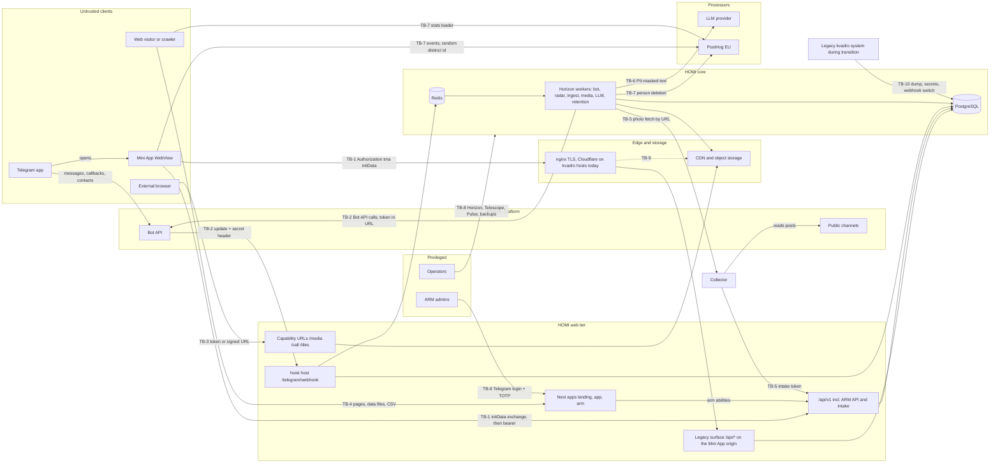

# 16 — Security review: kvadro² → HOMI migration

Part of the kvadro² → HOMI migration audit (rules, labels and ID scheme: [`README.md`](README.md)).

- **Status:** wave 1, 2026-11-09. Review and specification only: no application code was changed. A requirement is a
  proposal until the task, ADR or approval named with it exists. Where a fix changes observable legacy behaviour it is
  a deviation for `09-feature-parity-matrix.md` (a `DEV-…` id is assigned there, not here).
- **Rules followed:** `.ai/agents/security-reviewer.md` (the HOMI layer: storage policy, IDOR, SSRF, rate limits,
  ARM 2FA, detectors that label people, STRIDE, ЗРУ-547 checklist). Generic OWASP guidance lives in the skill
  `laravel-owasp-security` and is not repeated here.
- **Evidence:** the audits `01`–`06`, `08`, `10` (by their IDs); the legacy tree read-only (`$KVADRO_ROOT/docs/*.md`,
  `$KVADRO_ROOT/demo/app/src`, `$KVADRO_ROOT/demo/app/index.html`, `$KVADRO_ROOT/demo/landing/site`); HOMI code at
  `591ceb4` on `docs/kvadro-migration-audit` (repo-relative `path:line`); the installed Next.js 16.4 CSP guide
  (`frontend/app/node_modules/next/dist/docs/01-app/02-guides/content-security-policy.md`). Nothing was run against
  the legacy production system or Telegram. No `.env` file was read; key names come from `backend/.env.example`.
- **Local IDs:** `SEC-NNN` finding (§3), `SEC-REQ-NNN` requirement (§4), `Q-SEC-NNN` open question (§6).
  `scripts/migration/collect_ids.py` already recognises `SEC-` and `SEC-REQ-`; the README ID table lacks both (and
  `CF-`/`GAP-` from `10`) — its owner should add them.
- **Severity** is judged for the moment HOMI serves the legacy contract to real users:
  **High** — personal data exposed at scale, impersonation of users, or a wrong label about a person, reachable by
  anyone with a Telegram account; **Medium** — needs a precondition, exposes limited data, or is a compliance gap
  without a direct exploit; **Low** — hardening or minor disclosure. Nothing is rated Critical: HOMI has no live
  users yet. Several High items become Critical if shipped unchanged.
- **Status labels** on a finding describe the evidence for the behaviour (README labels). Every finding carries a
  **Verified** line: what this review re-read on 2026-11-09 and whether the cited source agrees.
- **Owners:** *dev track* = development track (application code, `HANDOFF.md` §4); *prod track* = production track
  (first developer: staging/production, bots, DNS, TLS, secrets, backups); *product owner*; *lawyer*; *collector
  owner*.

## 0. Scope and the items that matter most

### 0.1 Scope

| Reviewed | Not reviewed (and why) |
| -------- | ---------------------- |
| Legacy Mini App ↔ API contract (34 methods, 22 resources, `08`), Mini App Telegram integration (`05`), client sinks and storage (`03`), bot behaviour (`04`), reconstructed data model (`06`, partial), legacy privacy promises (`$KVADRO_ROOT/docs/telegram-bot.md:852-864`) | Legacy backend source and database — unavailable (`Q-SYS-001`, `Q-SYS-002`); every server-side control is `DOCUMENTED_ONLY` or `UNVERIFIED` |
| HOMI baseline: `backend/bootstrap/app.php`, `backend/routes/{api,hooks,web}.php`, `backend/config/{cors,sanctum,services,telegram,media,telescope,filesystems}.php`, rate limiters, the Telegram webhook stub, the Media module and its tests | Production infrastructure (hosts, nginx, MinIO policies, backups) — no access; the prod track owns them |
| ADR-0003, 0007, 0009, 0011, 0012, 0013 and the conflicts `CF-`/`GAP-` in `10` | `@KvadroSupportBot` (never audited, `Q-SYS-003`, GAP-026) |
| Next.js 16.4 CSP options (nonce vs experimental SRI) from the installed docs | Collector code (`telegram.uz`) beyond the facts in ADR-0009 and `10`; `app.uz`'s `InitDataVerifier` (read-only; must be checked by `reference-reader` before porting, see SEC-REQ-001) |

Data classes in scope: Telegram user ids (personal data), `initData` (identity + bearer credential), listing authors'
phone numbers (third parties who never used the product), owner-verification phone hashes, listing texts and photos
(may show people, documents, interiors), behavioural data (radars, favourites, history, hidden, votes, action log,
attribution, delivered cards), PostHog distinct ids and session replays, secrets (bot token, webhook secret, signing
keys, phone pepper, LLM and analytics keys).

### 0.2 The items that matter most

1. **The bot token is the master key for user identity** (SEC-022 → SEC-REQ-012). `initData` is signed with a key
   derived from the bot token, so whoever holds the `@KvadroAppBot` token can mint valid `initData` for *any* user,
   re-point the webhook and message every user. The legacy operator holds it today; HOMI must rotate it at the
   webhook switch and keep it out of every log.
2. **Phone harvesting is built into the contract** (SEC-002, SEC-003, SEC-015 → SEC-REQ-026, SEC-REQ-028). Listing
   details return raw numbers for sequential integer ids; the old client cannot live without `phone`, so only
   server-side quotas, monitoring and the access gate can contain it during the compatibility window.
3. **Ownership is unverifiable in legacy and must be designed in** (SEC-011, SEC-026 → SEC-REQ-011, SEC-REQ-014).
   Radars and author entries are addressed by client-supplied ids, and Telegram does not authenticate `callback_data`.
   HOMI's own Media module already resolves records without an owner check.
4. **`initData` handling** (SEC-004, SEC-005, SEC-001 → SEC-REQ-001…005, SEC-REQ-018, SEC-REQ-047): unknown
   `auth_date` window, no `401` path in the old client, personal data in every `Authorization` header, and an HTML
   sink in the map that would let a crafted label steal `initData`.
5. **The personal-data lifecycle is a set of public promises nobody has tested** (SEC-018, SEC-019, SEC-030 →
   SEC-REQ-036…041, SEC-REQ-050): immediate deletion, 180/90-day retention, no stored names or messages, backups that
   the legacy privacy text places "на нашем компьютере", and HOMI's raw `telegram_updates` payloads that would break
   the "no names, no messages" promise on day one. The ЗРУ-547 questions in §6 decide hosting and processors. The
   owner cabinet adds owners' numbers kept in plain text by decision (SEC-036 → SEC-REQ-051).

## 1. Assets, actors and trust boundaries

### 1.1 Assets

| Asset | What it is | Legacy location → HOMI target | Why it matters |
| ----- | ---------- | ----------------------------- | -------------- |
| A1 Telegram identity | `user.id` (personal data), `initData` (signed launch data; a bearer credential during its window) | `Authorization: tma` on every request (TMA-007) → legacy `tma` guard + Sanctum tokens (CF-002) | Impersonation; Telegram ids link a person across services |
| A2 Listing author phones | Raw E.164 numbers of third parties taken from public channel posts | `ListingDetails.phone`, `original_text`, `/call/<token>` (LB-API-030, RES-005) → Listings, encrypted at rest (SEC-REQ-036) | Mass harvesting, spam, stalking; authors never consented |
| A3 Owner phone hashes | `/owner` verification: hash + date | ENT-019 → HMAC with a pepper (SEC-REQ-036, SEC-REQ-041) | Reversible if unkeyed (SEC-008) |
| A4 Behavioural data | Radars and filters (incl. lasso polygons around a home or workplace), favourites, history, hidden, blocked authors, votes, survey answers, attribution, action log, delivered cards | ENT-008…ENT-021 → Identity, Listings, Radar | Reveals where and how a person looks for housing |
| A5 Analytics identity | Random PostHog distinct id per user and its mapping; session replays | ENT-006, RES-006 → Analytics module (GAP-018) | Re-identification; cross-border transfer |
| A6 Listing content | Texts and photos copied from channels; landing snapshots | BR-API-054, RES-013 → Media module | Copyright/takedown, PII in photos (faces, documents, EXIF) |
| A7 Secrets | Bot token, webhook secret, media and call signing keys, phone pepper, LLM key, PostHog personal API key, `APP_KEY`, collector tokens | `$KVADRO_ROOT/docs/about.md` §8.5 → per-environment vault (ADR-0011) | Total compromise (A1 via the bot token) |
| A8 Delivery capability | The bot's standing with Telegram (flood limits, spam reports) and the delivered-card log (`chat_id` + `message_id`) | ENT-010 → Radar & Notifications | Availability of the core radar feature |
| A9 Labels about people | Owner/realtor marks, «Хозяин ✓», price tones (`check`, `suspicious`) | BR-API-061, BR-API-103, BR-API-108 → detectors (rule 10) | Reputational harm to private owners |
| A10 Public reach | `kvadro.app` / `app.kvadro.app` domains, DNS, Cloudflare account, SEO equity, `@KvadroAppBot` username | CF-008, CF-009 | Domain or bot takeover = phishing at scale |
| A11 Legacy dump | Full legacy database export for the migration | GAP-024 → `14-data-migration-plan.md` | Concentrated copy of A1–A5 outside any control |

### 1.2 Actors

| Actor | Trust | Interfaces | Notes |
| ----- | ----- | ---------- | ----- |
| Telegram user | Authenticated by Telegram, untrusted input | Mini App (legacy `/api/*`, later `/api/v1`), bot chat, external browser for `/call` | A malicious user has a *valid* `initData`; most attacks below start here |
| Modified Telegram client | Same identity, arbitrary bytes | Bot callbacks with any `callback_data`, contacts of other people, crafted `initData` replays | Telegram does not guarantee that `callback_data` matches a button the bot sent |
| Anonymous visitor, SEO crawler, scraper | Untrusted | Landing, SEO pages, `data/*.json`, CSV, sitemap, `/api/bot`, `/api/csp-report`, `/media` with a signed URL | |
| Listing author, channel admin | Data subjects, not users | Support bot, e-mail takedowns (BR-API-068), channel opt-out (BR-API-043) | Can also inject content (text, photos) into the pipeline by posting |
| Telegram platform | Trusted transport for updates; trusted signer of `initData` | Webhook to `hook.*`; Bot API for outbound calls | Authenticity of webhooks rests only on the secret header |
| Collector (`telegram.uz` or an in-repo collector, CF-007) | Semi-trusted machine client | `/api/v1/intake/*` with an `intake:write` token; photo URLs HOMI fetches | SSRF and content injection surface |
| LLM provider (Gemini for parity; vendor open) | Processor, cross-border | Listing extraction, query parsing, translation | Prompt injection arrives through listing texts |
| PostHog EU | Processor, cross-border | Client SDK, server events, person deletion | |
| Edge (Cloudflare in front of the kvadro hosts today; nginx on HOMI hosts) | Infrastructure | TLS termination, caching | Sees `Authorization` headers if it terminates TLS |
| ARM admin, moderator, support staff | Privileged | `arm.*`, ARM API, bot admin commands, broadcasts | Legacy tooling unknown (`Q-SYS-004`) |
| Operators | Privileged | Horizon, Telescope, Pulse, backups, deploys | Prod track |
| Legacy operator (transition) | Third party after cut-over | Holds the bot token, DNS, Cloudflare, backups, the dump | Must be cut off at the switch (SEC-022) |

### 1.3 Trust boundaries

| Boundary | Crossing | Credential | HOMI component today |
| -------- | -------- | ---------- | -------------------- |
| TB-1 | Mini App WebView → legacy `/api/*` (Mini App origin) and `/api/v1` | `Authorization: tma <initData>` (legacy); `Bearer` Sanctum token (v1, ADR-0003) | `auth:sanctum` group, `api` limiter 120/min (`backend/routes/api.php:14`; `backend/app/Providers/AppServiceProvider.php:64`); no `tma` guard, no token endpoint |
| TB-2 | Telegram Bot API ↔ bot (inbound webhook, outbound calls) | `X-Telegram-Bot-Api-Secret-Token`; bot token in Bot API URLs | Fail-closed stub (`backend/app/Http/Middleware/VerifyTelegramSecretToken.php:20-23`), dedup table, `telegram` queue |
| TB-3 | External browser → `/call/<token>`, `/media/…?e=&s=`, tiles | Capability URL (token or signature) | none (GAP-014, GAP-015; CF-012) |
| TB-4 | Public web → landing, SEO pages, landing data, CSV, sitemap, `/api/csp-report`, `/api/bot` | none | Blank Next apps; no headers or CSP (`frontend/*/next.config.ts`) |
| TB-5 | Collector → intake API; HOMI → photo URLs | `intake:write` token; outbound fetch | Schema only (`10` §1.3) |
| TB-6 | HOMI → LLM provider | Provider key | `laravel/ai` installed, no provider |
| TB-7 | Clients and HOMI → PostHog | Public project key; secret personal API key for deletion | none |
| TB-8 | Admins and operators → ARM API, dashboards, bot admin commands | Telegram login + TOTP (required); dashboard gates | Horizon/Telescope gates by e-mail allowlist (empty) |
| TB-9 | Edge/CDN/object storage ↔ origin | TLS, bucket IAM | `cdn.*` serves the public disk; immutable caching of originals |
| TB-10 | Legacy system ↔ HOMI during the migration | Dump transfer, secret hand-over, one `setWebhook`, DNS switch | none |

### 1.4 Data-flow diagram

Labels name the boundary (TB-n) and what crosses it. Dashed lines are infrastructure paths.

## 2. STRIDE threat model per boundary

Each table: threat → mitigation (requirement) → owner → status today (`open` = nothing in HOMI; `partial` = some
HOMI code exists; `in place`; `accepted` = residual risk to record). Findings are in §3, requirements in §4.

### TB-1 — Mini App WebView → legacy `/api/*` and `/api/v1`

| | Threat | Mitigation | Owner | Status |
| - | ------ | ---------- | ----- | ------ |
| S | Forged or tampered `initData`; `initData` signed by another environment's bot; replay of a captured `initData` inside its window; anyone holding the bot token mints `initData` (SEC-004, SEC-022) | SEC-REQ-001, SEC-REQ-002, SEC-REQ-003, SEC-REQ-012 | dev track; prod track (token) | open |
| T | Tampered ids, filters and bodies; mass assignment; races creating twin radars or an 11th radar (LB-API-037, LB-API-013) | SEC-REQ-014, SEC-REQ-015, SEC-REQ-017 | dev track | open |
| R | A user denies a vote, report or takedown request; no trail of who changed a shared label | Action log (180 days), vote audit (SEC-REQ-045), request id on every line (`backend/app/Http/Middleware/AssignRequestId.php`) | dev track | partial |
| I | Phone harvesting by id iteration (SEC-002, SEC-003); IDOR on per-user resources (SEC-011); XSS through map labels stealing `initData` (SEC-001); `initData` in logs (SEC-005) | SEC-REQ-014, SEC-REQ-018, SEC-REQ-026, SEC-REQ-028, SEC-REQ-047 | dev track | open |
| D | Live `count`/`flow` per filter change and 30-request radar-tab bursts (LB-API-038, LB-API-052); LLM translation and Bot API share per tap (SEC-017); unbounded `/api/events` (SEC-006) | SEC-REQ-022, SEC-REQ-027, SEC-REQ-044 | dev track | partial (one 120/min limiter) |
| E | Gated or `blocked` user calls endpoints other than `/api/meta` (SEC-012); Mini App token carrying `media:write`, `intake:write` or `arm:*`; `tma` accepted on v1 or ARM routes | SEC-REQ-004, SEC-REQ-006, SEC-REQ-046 | dev track | open |

### TB-2 — Telegram Bot API ↔ bot

| | Threat | Mitigation | Owner | Status |
| - | ------ | ---------- | ----- | ------ |
| S | Forged webhook posts; forged `callback_data` from a modified client (SEC-011); someone else's contact sent to `/owner` (SEC-009) | SEC-REQ-008, SEC-REQ-011 | dev track | partial (fail-closed stub) |
| T | Duplicated or re-delivered updates applied twice; out-of-order processing of callbacks | SEC-REQ-009 | dev track | partial (UNIQUE `bot_id`, `update_id`) |
| R | No record of which update changed a radar or a label | Redacted update ledger with request id in job context (SEC-REQ-037) | dev track | partial |
| I | Raw updates keep names, usernames, message texts and contact phones (SEC-030); bot token leaks through exception messages (SEC-REQ-013); third-party HTML in bot messages (SEC-024); `/ping` internals (SEC-007) | SEC-REQ-011, SEC-REQ-013, SEC-REQ-020, SEC-REQ-037 | dev track | open |
| D | Update floods; slow handlers causing Telegram retries; outbound flood limits and `429` getting the bot throttled; one LLM call per free-text message | SEC-REQ-010, SEC-REQ-029, SEC-REQ-044 | dev track | partial (3000/min per IP) |
| E | A non-admin reaches admin answers or broadcasts; an old button acts on another user's radar | SEC-REQ-011, SEC-REQ-046 | dev track | open |

### TB-3 — External browser → capability URLs (`/call`, `/media`, tiles)

| | Threat | Mitigation | Owner | Status |
| - | ------ | ---------- | ----- | ------ |
| S | Guessing or forging tokens and signatures (legacy algorithm unknown, SEC-013) | SEC-REQ-024, SEC-REQ-026 | dev track | open |
| T | Re-using a valid signature for another listing, photo number or expiry | Signature binds number + photo + expiry (SEC-REQ-024) | dev track | open |
| R | Who obtained a phone through a call link | Token bound to the issuing user, issuance logged (SEC-REQ-026) | dev track | open |
| I | Phone exposure through cached call pages, `Referer`, access logs; photos of withdrawn or taken-down listings still served from 24 h–1 year caches (SEC-013, SEC-029) | SEC-REQ-025, SEC-REQ-026, SEC-REQ-047 | dev track; prod track (CDN purge, log format) | open |
| D | Hot-linking and bandwidth abuse on `/media` and tiles | CDN caching, SEC-REQ-027 | prod track | open |
| E | — (no privileges behind these URLs) | — | — | — |

### TB-4 — Public web → landing, SEO pages, landing data, CSV, sitemap, `/api/csp-report`, `/api/bot`

| | Threat | Mitigation | Owner | Status |
| - | ------ | ---------- | ----- | ------ |
| S | Forged CSP reports and events polluting monitoring | SEC-REQ-022 | dev track | open |
| T | JSON-LD or HTML injection through listing-derived strings (districts, landmarks, ЖК names); CSV formula injection; cache poisoning through unkeyed headers on SSR caches | SEC-REQ-021, SEC-REQ-033 | dev track | open |
| R | — (anonymous) | — | — | — |
| I | Phones or texts leaking into `data/*.json`, SEO pages or snapshots (RES-010 test, SEC-014) | SEC-REQ-021, SEC-REQ-025 | dev track | open |
| D | Dynamic rendering cost if nonces force it (CF-011); CSV/sitemap generation; report floods | SEC-REQ-027, SEC-REQ-031 | dev track; prod track | open |
| E | — | — | — | — |

### TB-5 — Collector → intake; HOMI → photo URLs

| | Threat | Mitigation | Owner | Status |
| - | ------ | ---------- | ----- | ------ |
| S | Stolen collector token; a staging token used against production | One token per collector per environment with expiry (ADR-0009 §2, T2); SEC-REQ-034 | dev track; collector owner | partial |
| T | Hostile payloads: HTML, scripts, prompt injection, oversized fields, replays | Idempotency ledger (exists); sanitising allowlist (reviewer rule 4); SEC-REQ-043 | dev track | partial |
| R | Which source sent what and when | `intake_events` raw ledger (exists) | dev track | partial |
| I | Raw payloads keep E.164 phones indefinitely (CF-019) | SEC-REQ-038 | dev track | open |
| D | Floods | `intake` limiter 600/min per token (`backend/app/Providers/AppServiceProvider.php:69`) | dev track | in place |
| E | SSRF through photo URLs into the internal network or cloud metadata | SEC-REQ-023 | dev track | open |

### TB-6 — HOMI → LLM provider

| | Threat | Mitigation | Owner | Status |
| - | ------ | ---------- | ----- | ------ |
| S | — (TLS to the provider's official endpoint) | provider SDK defaults | dev track | open |
| T | Prompt injection in channel posts or user queries changes extracted fields, owner flags or translations (SEC-016) | SEC-REQ-043, SEC-REQ-045 | dev track | open |
| R | A label cannot be explained afterwards | Prompt version, masked-input hash and output kept (SEC-REQ-044) | dev track | open |
| I | Phones, `@handles` and names sent abroad; provider-side retention | SEC-REQ-042; Q-SEC-006 | dev track; lawyer | open |
| D | Cost exhaustion; provider outage stalls ingestion | SEC-REQ-044 (quotas, kill switch, degrade to "no extraction") | dev track | open |
| E | LLM output used as instructions or tool calls | SEC-REQ-043 (no tools; schema-validated data only) | dev track | open |

### TB-7 — Clients and HOMI → PostHog

| | Threat | Mitigation | Owner | Status |
| - | ------ | ---------- | ----- | ------ |
| S/T | Anyone with the public project key can send events under any distinct id | Analytics never feeds security or business decisions | product owner | accepted |
| R | — | — | — | — |
| I | `initData`, phones or listing texts in events and replays; Telegram id used as distinct id (SEC-021) | SEC-REQ-036, SEC-REQ-047; client scrubbing as in TMA-009 | dev track | open |
| D/E | — (third-party service) | — | — | — |

### TB-8 — Admins and operators → ARM API, dashboards, bot admin commands

| | Threat | Mitigation | Owner | Status |
| - | ------ | ---------- | ----- | ------ |
| S | Admin account takeover (stolen Telegram session, SIM swap) | TOTP 2FA mandatory (SEC-REQ-046) | dev track | open |
| T | Malicious or mistaken takedowns, label edits, user blocks | Policies per role, two-step broadcasts (SEC-REQ-046) | dev track | open |
| R | An admin denies an action | Append-only audit log (SEC-REQ-046) | dev track | open |
| I | Bulk export of users or phones through ARM; Telescope or Horizon showing payloads with PII (SEC-034) | SEC-REQ-046, SEC-REQ-047 | dev track; prod track | open |
| D | A broadcast to all users trips Telegram flood limits (A8) | SEC-REQ-029 | dev track | open |
| E | Moderator → admin; a Mini App token used on ARM routes | Abilities + policies (SEC-REQ-004, SEC-REQ-046) | dev track | open |

### TB-9 — Edge, CDN and storage ↔ origin

| | Threat | Mitigation | Owner | Status |
| - | ------ | ---------- | ----- | ------ |
| S | Spoofed `X-Forwarded-For` defeats IP limiters, or every user shares the edge's IP bucket | Trusted-proxy configuration matched to the real edge (SEC-REQ-027) | prod track | open |
| T | Edge caches a personalised legacy response (bare JSON on the Mini App origin) | `Cache-Control: private, no-store` on every `/api/*` response (SEC-REQ-033) | dev track; prod track | open |
| R | — | request id in logs (exists) | — | partial |
| I | TLS terminated abroad sees `initData` (SEC-005, SEC-020); access logs store tokens in URLs | SEC-REQ-047; Q-SEC-006 | prod track; lawyer | open |
| D | Volumetric attacks | edge rate limiting | prod track | open |
| E | Public listing of a private bucket; a writable bucket shared between environments | Per-environment IAM and buckets (ADR-0011) | prod track | partial |

### TB-10 — Legacy system ↔ HOMI during the migration

| | Threat | Mitigation | Owner | Status |
| - | ------ | ---------- | ----- | ------ |
| S | The legacy operator keeps the bot token after the switch: can forge `initData`, re-point the webhook, message users (SEC-022) | SEC-REQ-012; Q-SEC-001 | product owner; prod track | open |
| T | Altered or incomplete dump; erasures made on legacy after the dump are lost and deleted users reappear | Dump checksum; erasure ledger replay (SEC-REQ-039) | dev track | open |
| R | Nobody can say who held the dump and where | Handling record (SEC-REQ-041) | prod track | open |
| I | Dump on laptops, in agent context or the repository; legacy backups on a team computer (SEC-019) | SEC-REQ-041; Q-SEC-011 | prod track; product owner | open |
| D | Two receivers or a gap at the webhook switch; pending updates lost or double-applied | One `setWebhook`, pending-update policy (Q-SEC-017), SEC-REQ-009 | prod track | open |
| E | Legacy owner list or team flags imported as HOMI admins without review | SEC-REQ-046; Q-SEC-018 | product owner | open |

## 3. Findings (`SEC-NNN`)

Each finding names where the behaviour is, the audit items it builds on (not restated), what this review re-read,
the requirement that fixes it and the constraint from the still-running legacy Mini App ("old client").

### 3.1 Legacy behaviour that must not be carried over

- **SEC-001** · High · `CONFIRMED` — Map pins insert the server `label` **and** `tone` into HTML.
  - *Where:* `$KVADRO_ROOT/demo/app/src/features/map/leaflet/icons.js:13` (`label` in the element body, `tone` inside
    `class="…"`); `$KVADRO_ROOT/demo/app/src/features/map/pins.js:72` (`stackPinHtml`, same two fields), used by
    `…/map/gl/markerElements.js:40` and `…/map/gl/useActiveMarker.js:22`. GL single pins are safe
    (`…/map/gl/markerElements.js:17`, `textContent`).
  - *Linked:* LB-API-008, LB-APP-020, API-007, Q-APP-012. Legacy states that the backend sends safe text
    (`$KVADRO_ROOT/docs/about.md:348`) — not verifiable.
  - *Verified:* sinks re-read; the `tone` attribute-context sink is new (the audits list only `label`).
  - *Impact:* a script in the Mini App origin reads `Telegram.WebApp.initData` (a credential, SEC-004) and calls every
    endpoint as the victim, including phone-bearing listing details.
  - *Fix:* SEC-REQ-018 (server emits digits-only labels and enum tones), SEC-REQ-021 (new client renders text),
    SEC-REQ-030 (CSP as a second line). *Old client:* compatible — plain text renders correctly. *Owner:* dev track.
- **SEC-002** · High · `CONFIRMED` — Listing details return raw phone numbers to any authenticated user.
  - *Where:* `$KVADRO_ROOT/docs/api.md:316-317` (`phone`, `phone_display`), `:312` (`original_text`); dialled from the
    client `$KVADRO_ROOT/demo/app/src/lib/telegram/links.js:28`.
  - *Linked:* LB-API-030, API-008, BR-API-113, BR-API-116. Contradicts the legacy claim that numbers open only through
    temporary call links (`$KVADRO_ROOT/docs/about.md:349`).
  - *Verified:* contract and client re-read; the claim and the contract disagree, the code supports the contract.
  - *Impact:* with one Telegram account and SEC-003, a scraper collects every author's number; no rate limit is known
    (Q-API-001).
  - *Fix:* new API never returns a raw number (SEC-REQ-036); legacy routes keep `phone` but under SEC-REQ-028
    (per-user disclosure quota, anomaly alerts), SEC-REQ-006 (gate on every route) and SEC-REQ-027. *Old client:*
    removing `phone` breaks «Позвонить»; a quota that degrades to `phone: null` keeps the shape (Q-SEC-003).
    *Owner:* dev track; product owner (thresholds).
- **SEC-003** · Medium · `CONFIRMED` — Listing ids are sequential integers, so the corpus can be enumerated.
  - *Where:* `$KVADRO_ROOT/docs/api.md:234`; ids 47 265–49 829 in the landing snapshot (`06` §1.2).
  - *Linked:* LB-API-011, CF-003, Q-API-023 (what a withdrawn id returns).
  - *Verified:* contract re-read.
  - *Fix:* CF-003 option A keeps public numbers for links; withdrawn and taken-down listings answer `404` with no
    contact fields (SEC-REQ-025); enumeration patterns feed SEC-REQ-028. *Old client:* numbers are mandatory while it
    runs. *Owner:* dev track.
- **SEC-004** · High · `CONFIRMED` (client) / `UNVERIFIED` (server window) — `initData` is a bearer credential sent
  on every request with an unknown `auth_date` window and no `401` path in the client.
  - *Where:* `$KVADRO_ROOT/demo/app/src/lib/api/client.js:74-86` (header on every call); no `401` branch in
    `$KVADRO_ROOT/demo/app/src/app/useAppBootstrap.js:127-145` (only `403` is special, everything else retried
    silently).
  - *Linked:* TMA-007, BR-API-004, BR-API-005, LB-API-019, LB-API-021, LB-APP-047, Q-API-002, Q-API-003.
  - *Verified:* client re-read; the server window is not visible anywhere.
  - *Impact:* a captured `initData` is a full session for as long as the server accepts it; too short a window breaks
    long sessions (call-link refresh every 8 minutes, `$KVADRO_ROOT/demo/app/src/features/listing/hooks/useListingContact.js:9-10`).
  - *Fix:* SEC-REQ-001…005, SEC-REQ-007. *Old client:* the legacy window must be measured (Q-API-002) and never
    shortened on legacy routes. *Owner:* dev track.
- **SEC-005** · Medium · `CONFIRMED` — The full `initData` (Telegram user object, `start_param`, hash) sits in the
  `Authorization` header of every request, so edges, proxies, access logs and error trackers receive personal data.
  - *Where:* `$KVADRO_ROOT/demo/app/src/lib/api/client.js:77-78`; `$KVADRO_ROOT/demo/app/index.html:78`.
  - *Linked:* LB-API-020, TMA-009 (the client scrubs analytics, not transport), CF-002.
  - *Verified:* re-read. The legacy edge is Cloudflare (`$KVADRO_ROOT/docs/about.md:89`), which terminates TLS.
  - *Fix:* SEC-REQ-047 (redaction everywhere), SEC-REQ-003, SEC-REQ-007 (new client exchanges once). *Old client:* no
    change possible; mitigation is server- and edge-side. *Owner:* dev track; prod track (edge, nginx).
- **SEC-006** · Medium · `CONFIRMED` (client) / `DOCUMENTED_ONLY` (server) — Telemetry and attribution inputs are
  unauthenticated or unbounded: empty-`initData` `app_error` posts, arbitrary event properties, free-text error
  messages in an action log promised to hold "no texts", and `/start` payloads stored from links anyone can craft.
  - *Where:* `$KVADRO_ROOT/demo/app/src/lib/errors.js:101-122`; `$KVADRO_ROOT/docs/api.md:1010-1013`, `:1044`;
    BOT-027…BOT-034 payload grammar.
  - *Linked:* LB-API-001, LB-API-047, BR-API-122, BR-API-124, BR-API-125, BR-BOT-096, Q-API-045; `06` ENT-021.
  - *Verified:* client re-read; the server side is undocumented beyond "reject silently".
  - *Fix:* SEC-REQ-005, SEC-REQ-022, SEC-REQ-027. *Old client:* compatible if unknown events still get `204` and the
    cap is ≥ 2 KB. *Owner:* dev track.
- **SEC-007** · Low · `DOCUMENTED_ONLY` — `/ping` is a public command that reports the database state and the exact
  PostGIS version.
  - *Where:* `$KVADRO_ROOT/docs/telegram-bot.md:105`, `:874-877`.
  - *Linked:* LB-BOT-027, BR-BOT-102.
  - *Verified:* re-read; the reply text is quoted there.
  - *Fix:* SEC-REQ-011 (`pong` for everyone, details for admins only; drop it from the public menu). *Old client:* n/a.
    *Owner:* dev track.
- **SEC-008** · Medium · `UNVERIFIED` — Owner-verification numbers are stored as a hash that is probably unkeyed; the
  Uzbek mobile space is small enough to reverse it by enumeration.
  - *Where:* promise «храним не сам номер, а его хэш» (`$KVADRO_ROOT/docs/telegram-bot.md:822`, `:852`).
  - *Linked:* LB-BOT-029, LB-API-044, BR-BOT-081, ENT-019, Q-BOT-042, Q-API-041.
  - *Verified:* promise re-read; the algorithm is not visible anywhere.
  - *Fix:* SEC-REQ-036 (HMAC-SHA-256 with a per-environment pepper), SEC-REQ-041 (migration re-keys only by matching
    known listing phones, never by brute force). *Old client:* none (never exposed). *Owner:* dev track.
- **SEC-009** · Medium · `UNVERIFIED` — It is unknown whether `/owner` checks that a shared contact belongs to the
  sender; a forwarded contact of another person could earn «Хозяин · номер подтверждён» on that person's listings.
  - *Where:* `04` §3.15 ("Validation: not visible"); `04` §6.3 item 4.
  - *Linked:* Q-BOT-008, BR-BOT-082, BR-API-108.
  - *Verified:* the bot audit records no check; nothing else documents one.
  - *Fix:* SEC-REQ-011 (`contact.user_id` must equal the sender, private chat only), SEC-REQ-045. *Old client:* n/a.
    *Owner:* dev track.
- **SEC-010** · Medium · `DOCUMENTED_ONLY` — Votes and reports label people with weak protection: one `agent` tap is
  announced as marking a number as a realtor's in all its listings, without undo in the bot; thresholds and the
  anti-abuse weighting are unknown; repeats have no stated idempotency.
  - *Where:* `$KVADRO_ROOT/docs/about.md:224`, `:228`; `04` LB-BOT-022.
  - *Linked:* LB-API-042, LB-API-043, LB-BOT-008, LB-BOT-022, BR-API-103, BR-API-106, Q-API-038, Q-API-039,
    Q-BOT-029.
  - *Verified:* documented behaviour re-read through the audits; thresholds absent.
  - *Fix:* SEC-REQ-045 (reviewer rule 10), SEC-REQ-015, SEC-REQ-027. *Old client:* response shape unchanged.
    *Owner:* dev track; product owner (thresholds).
- **SEC-011** · High · `UNVERIFIED` — Ownership of per-user resources cannot be verified: radars and blocked-author
  entries are addressed by client-supplied ids, and bot buttons carry ids in `callback_data`, which Telegram does not
  authenticate (a modified client can send any bytes for any message in its chat).
  - *Where:* `$KVADRO_ROOT/demo/app/src/lib/api/subscriptions.js:30`, `:44`, `:57`, `:67`;
    `$KVADRO_ROOT/demo/app/src/lib/api/user.js:12`; subscription ids are `number | string`
    (`$KVADRO_ROOT/docs/api.md:372`); `callback_data` grammar unknown (`04` §6.3).
  - *Linked:* API-020…API-023, API-027 ("entry belongs to the user — UNVERIFIED"), Q-BOT-017, Q-API-005.
  - *Verified:* client paths re-read; no server rule visible.
  - *Fix:* SEC-REQ-014, SEC-REQ-011, SEC-REQ-015; IDOR matrix in §5.2. *Old client:* compatible — a foreign id answers
    `404` like an unknown one. *Owner:* dev track.
- **SEC-012** · Medium · `UNVERIFIED` — The access gate (`private`, `invite`, `full`, `blocked`, `join`) is visible
  only on `/api/meta`; whether a gated or `blocked` user can still call the other endpoints (including listing
  details with phones) is unknown.
  - *Where:* `$KVADRO_ROOT/demo/app/src/app/useAppBootstrap.js:130-139`; `08` §1.5.
  - *Linked:* LB-API-002, BR-API-011, BR-API-014, Q-API-005.
  - *Verified:* client re-read; only meta, feed, favourites and history are known to answer `403`.
  - *Fix:* SEC-REQ-006. *Old client:* compatible if the five reason strings stay. *Owner:* dev track.
- **SEC-013** · Medium · `DOCUMENTED_ONLY` — Photo URLs are signed with an unknown 32-hex algorithm, live about 1–2
  days, are cached publicly for 24 h, and a missing signature answers `422` while a bad one answers `404`.
  - *Where:* `$KVADRO_ROOT/docs/seo-pages.md:379-387`.
  - *Linked:* RES-001, RES-002, BR-API-055, LB-API-023, LB-API-031, Q-API-024, CF-012.
  - *Verified:* re-read; "MD5 or truncated HMAC" is the legacy team's own guess (🔶).
  - *Impact:* a takedown or the 90-day purge is not effective until the URL and the caches expire; an unkeyed MD5
    would be forgeable.
  - *Fix:* SEC-REQ-024, SEC-REQ-025. *Old client:* keeps the URL shape; only HOMI-issued URLs must validate (legacy
    ones expire within two days). *Owner:* dev track; prod track (CDN purge).
- **SEC-014** · Medium · `CONFIRMED` — The landing republishes third-party listing photos as unsigned static files
  outside any takedown or retention path.
  - *Where:* `img/snap/<listing_id>.webp` referenced by `pins[].photo` (RES-013; landing fixtures).
  - *Linked:* LB-API-054, RES-011, RES-012, BR-API-133.
  - *Verified:* shape re-read from the audit's fixture citations; generation is `DOCUMENTED_ONLY`.
  - *Fix:* SEC-REQ-025. *Old client:* the legacy landing only needs `pins[].photo` to resolve. *Owner:* dev track.
- **SEC-015** · Medium · `UNVERIFIED` (server) / `CONFIRMED` (client TTL) — The call link's TTL is a client constant
  (10 minutes), the refresh endpoint issues new links with no known limit, and single use, user binding and the page
  content are unknown; the token travels in the URL.
  - *Where:* `$KVADRO_ROOT/demo/app/src/features/listing/hooks/useListingContact.js:9-10`; RES-005; API-009.
  - *Linked:* LB-API-045, LB-API-016, LB-APP-028, BR-API-112, Q-API-042.
  - *Verified:* client constants re-read.
  - *Impact:* even after SEC-002 is fixed in the new API, the call page remains a phone-disclosure endpoint.
  - *Fix:* SEC-REQ-026, SEC-REQ-028. *Old client:* links must stay valid ≥ 10 minutes. *Owner:* dev track.
- **SEC-016** · Medium · `DOCUMENTED_ONLY` — LLM processing relies on an unverifiable promise to mask phones and
  `@handles`, and listing texts from any channel author reach the model as input whose output becomes labels, filters
  and translations shown to users.
  - *Where:* `$KVADRO_ROOT/docs/about.md:350`; `$KVADRO_ROOT/docs/telegram-bot.md:854`.
  - *Linked:* BR-API-044, BR-API-045, BR-API-046, BR-BOT-055, BR-BOT-088, Q-API-018, GAP-002, GAP-003, GAP-004.
  - *Verified:* promises re-read; no implementation material exists.
  - *Fix:* SEC-REQ-042, SEC-REQ-043, SEC-REQ-044. *Old client:* n/a. *Owner:* dev track.
- **SEC-017** · Medium · `UNVERIFIED` — No rate limit is known on any legacy route, while the client amplifies load:
  an LLM call per translate tap, a Bot API call per share tap, live `count`/`flow` per filter change, three requests
  per radar per radar-tab visit.
  - *Where:* `08` §5 risky endpoints; `$KVADRO_ROOT/demo/app/src/features/radar/useRadarPreviews.js:41-66`.
  - *Linked:* Q-API-001, LB-API-032, LB-API-038, LB-API-046, LB-API-052, CF-018.
  - *Verified:* client amplification re-read in the audits; server limits unknown.
  - *Fix:* SEC-REQ-027, SEC-REQ-029, SEC-REQ-044. *Old client:* budgets must tolerate a 30-request radar-tab burst;
    a `429` shows a generic error. *Owner:* dev track.
- **SEC-018** · High · `DOCUMENTED_ONLY` — Deletion, retention and takedown promises are public but untested and
  incomplete: «Удалить мои данные» was never pressed, its scope is unknown, and copies outside the main tables
  (snapshots, caches, PostHog, raw stores, delivered cards) are not covered by any documented procedure.
  - *Where:* `$KVADRO_ROOT/docs/telegram-bot.md:852-864`; `$KVADRO_ROOT/docs/about.md:264-275`.
  - *Linked:* BR-API-065, BR-API-068, BR-API-125, BR-API-128…BR-API-132, BR-BOT-085…BR-BOT-094, ENT-007,
    Q-BOT-001, Q-API-048, CF-019, GAP-019.
  - *Verified:* privacy text re-read in full.
  - *Fix:* SEC-REQ-038, SEC-REQ-039, SEC-REQ-040, SEC-REQ-050. *Old client:* n/a. *Owner:* dev track; prod track
    (backups); product owner (text).
- **SEC-019** · High · `DOCUMENTED_ONLY` — Database backups are kept "on the server and on our computer" for about two
  weeks: personal data of all users sits on an uncontrolled endpoint.
  - *Where:* «в резервных копиях базы (на сервере и на нашем компьютере)» — `$KVADRO_ROOT/docs/telegram-bot.md:864`.
  - *Linked:* BR-API-129, BR-BOT-094.
  - *Verified:* re-read verbatim.
  - *Fix:* SEC-REQ-038 (backups encrypted, on controlled hosts, never on personal devices), SEC-REQ-041; the legacy
    copies are inventoried and destroyed after the migration (Q-SEC-011). *Owner:* prod track; product owner.
- **SEC-020** · Medium · `DOCUMENTED_ONLY` — Personal data crosses borders with no documented legal basis and the
  hosting location is unknown: Cloudflare terminates TLS for both hosts, PostHog EU receives events and session
  replays, Gemini receives texts and voice.
  - *Where:* `$KVADRO_ROOT/docs/about.md:89`, `:115-116`; `$KVADRO_ROOT/docs/telegram-bot.md:854-858`.
  - *Linked:* RES-006, RES-021, BR-API-126, NFR-06 in `docs/architecture/requirements.md`.
  - *Verified:* re-read; no processing agreements or localisation statement exist in the material.
  - *Fix:* SEC-REQ-050; Q-SEC-005, Q-SEC-006. *Owner:* lawyer; product owner; prod track.
- **SEC-021** · Low · `CONFIRMED` — Session-replay masking depends on CSS class names applied element by element; any
  new element that shows a phone or a listing text leaks it to PostHog unless someone remembers the class.
  - *Where:* `$KVADRO_ROOT/demo/app/src/lib/analytics.js:126`, `:163-164` (`maskAllInputs`, `.ph-mask`);
    `…/listing/sections/OriginalText.jsx:69`, `…/listing/sections/AuthorSection.jsx:32`,
    `…/settings/HiddenScreen.jsx:79`.
  - *Linked:* RES-006, TMA-009, BR-API-127.
  - *Verified:* configuration and the three masked elements re-read.
  - *Fix:* SEC-REQ-036 (default-deny replay: mask all text, unmask by allowlist, or no replay). *Old client:* keeps
    its own configuration. *Owner:* dev track.
- **SEC-022** · High · `DOCUMENTED_ONLY` — One production bot token serves identity and messaging, and the legacy
  operator holds it. Because the `initData` HMAC key is derived from the bot token, its holder can mint valid
  `initData` for any user, and can also re-point the webhook and message every user.
  - *Where:* `$KVADRO_ROOT/docs/about.md:408-413` (`initData` bound to the token; one receiver per bot), `:446` (token
    in the secrets list).
  - *Linked:* BR-API-008, CF-009, Q-SYS-006.
  - *Verified:* re-read; the key derivation is the Telegram Mini Apps validation scheme.
  - *Fix:* SEC-REQ-012, SEC-REQ-013, SEC-REQ-034; Q-SEC-001. *Old client:* rotating the token invalidates every open
    `initData` — users reopen the Mini App once. *Owner:* product owner; prod track.
- **SEC-023** · Medium · `UNVERIFIED` — Admin operations exist (takedowns, user blocking, beta seats and invites,
  channel opt-outs, «Новости сервиса» broadcasts to all users) but no tooling, authentication or audit is visible.
  - *Where:* `01` §2; `04` §5 (BOT-084).
  - *Linked:* Q-SYS-004, Q-API-058, Q-BOT-004, GAP-023.
  - *Verified:* nothing in the material describes access control for these operations.
  - *Fix:* SEC-REQ-046, SEC-REQ-029. *Owner:* dev track; product owner (roles).
- **SEC-024** · Medium · `UNVERIFIED` — Bot messages render third-party text (listing titles, districts, quoted post
  text in an expandable blockquote) in Telegram HTML; whether it is escaped is unknown. Unescaped text can inject
  links into messages that look like the bot's, or make Telegram reject the message ("can't parse entities") and drop
  the delivery.
  - *Where:* `$KVADRO_ROOT/docs/about.md:309-326` (HTML with expandable blockquote); card format in `04` §3.10.
  - *Linked:* BR-API-141, BOT-081, Q-BOT-002.
  - *Verified:* formatting features re-read; escaping not observable.
  - *Fix:* SEC-REQ-020. *Owner:* dev track.
- **SEC-025** · Low · `UNVERIFIED` — The legacy CSP header is unknown, and `/api/csp-report` is an unauthenticated
  write sink with unknown limits and storage.
  - *Where:* RES-008, RES-015; `$KVADRO_ROOT/docs/about.md:351`.
  - *Linked:* Q-APP-016, Q-API-050, BR-API-138.
  - *Verified:* only the hashing rule is documented; the header was never captured.
  - *Fix:* SEC-REQ-030, SEC-REQ-022; capture the header (Q-APP-016). *Owner:* dev track; prod track.

### 3.2 HOMI baseline gaps the migration would expose

- **SEC-026** · Medium · `CONFIRMED` — Media records are resolved without an owner check: any Sanctum token can read
  any media file (including temporary URLs of private files), and any `media:write` token can delete any file.
  Content-addressed de-duplication shares one record between uploaders, so a second uploader "owns" the first
  uploader's file.
  - *Where:* `backend/routes/api.php:16`, `:22`; `backend/app/Http/Controllers/Api/V1/Media/MediaController.php:46`,
    `:54-56`; `backend/app/Models/MediaFile.php:64-79` (`firstOrCreate` by `disk` + `sha256`, `uploaded_by` of the first
    uploader). No test covers another actor (`backend/tests/Feature/Media/MediaApiTest.php`).
  - *Linked:* CF-012 (listing photos will share objects across listings).
  - *Verified:* code and test names re-read.
  - *Fix:* SEC-REQ-016. *Owner:* dev track (T4).
- **SEC-027** · Low · `CONFIRMED` — Users and sources both hold Sanctum tokens, but the upload prefix and
  `uploaded_by` use only the numeric auth identifier, so user 5 and source 5 collide.
  - *Where:* `backend/app/Http/Controllers/Api/V1/Media/PresignController.php:40`, `:60-62`, `:75`;
    `MediaController.php:27-37`; `personal_access_tokens` is polymorphic (`10` §1.5).
  - *Verified:* re-read.
  - *Fix:* SEC-REQ-016. *Owner:* dev track.
- **SEC-028** · Low · `CONFIRMED` (order) / `UNVERIFIED` (impact) — The uploader decodes the full image before
  checking dimensions; a small file declaring huge dimensions can exhaust worker memory.
  - *Where:* `backend/app/Services/Media/HashedUploader.php:50-58`.
  - *Verified:* re-read; the effect depends on GD and `memory_limit`.
  - *Fix:* SEC-REQ-023. *Owner:* dev track.
- **SEC-029** · Medium · `CONFIRMED` — Public originals are written with `Cache-Control: public, max-age=31536000,
  immutable` behind unsigned, permanent CDN URLs. For third-party listing photos this defeats takedowns and the 90-day
  purge.
  - *Where:* `backend/app/Services/Media/HashedUploader.php:71`; `backend/app/Services/Media/MediaUrlBuilder.php:41-53`.
  - *Linked:* CF-012, BR-API-065, BR-API-068.
  - *Verified:* re-read.
  - *Fix:* SEC-REQ-025. *Owner:* dev track; prod track (CDN purge).
- **SEC-030** · Medium · `CONFIRMED` — `telegram_updates.payload` stores raw updates (names, usernames, message texts,
  voice ids, shared contacts with phone numbers) for 14 days, the prune is not scheduled, and the bot subscribes to
  `edited_message` and `chat_member` updates it does not need. This breaks the inherited promises "имя и контакты бот
  не хранит" and "сами сообщения и голос бот не сохраняет".
  - *Where:* `backend/database/migrations/2026_11_08_171041_create_telegram_updates_table.php:19`;
    `backend/config/telegram.php:26-31`, `:48`; `backend/app/Models/TelegramUpdate.php:54-56`;
    `backend/routes/console.php` (no schedule).
  - *Linked:* CF-019, BR-BOT-055, BR-BOT-085, GAP-022.
  - *Verified:* re-read.
  - *Fix:* SEC-REQ-037, SEC-REQ-038. *Owner:* dev track (T1).
- **SEC-031** · Low · `CONFIRMED` — The webhook route has no host constraint (reachable through `api.*`), and its
  limiter is keyed by IP only, not by bot and IP (reviewer rule 8).
  - *Where:* `backend/routes/hooks.php:15-17`; `backend/app/Providers/AppServiceProvider.php:72`; `HANDOFF.md` T1.
  - *Verified:* re-read.
  - *Fix:* SEC-REQ-008, SEC-REQ-027. *Owner:* dev track (T1).
- **SEC-032** · Low · `CONFIRMED` — Sanctum has no global expiry and an empty token prefix, and nothing schedules
  `sanctum:prune-expired`; ADR-0003 requires an expiry on every token.
  - *Where:* `backend/config/sanctum.php:53`, `:68`; `backend/routes/console.php`.
  - *Linked:* ADR-0003; GAP-022.
  - *Verified:* re-read.
  - *Fix:* SEC-REQ-004, SEC-REQ-035. *Owner:* dev track (T6).
- **SEC-033** · Medium · `CONFIRMED` (absence) — No Next app sets CSP or security headers, and the reviewer default
  `frame-ancestors 'none'` cannot apply to the Mini App, which Telegram Web shows in a frame (to verify, Q-SEC-012).
  The CSP model for the Mini App and the landing is undecided (CF-011).
  - *Where:* `frontend/app/next.config.ts`, `frontend/landing/next.config.ts`, `frontend/arm/next.config.ts`;
    `.ai/agents/security-reviewer.md` rule 5.
  - *Linked:* CF-011, TMA-001, Q-APP-016.
  - *Verified:* configs re-read; no `headers()` and no `proxy.ts`.
  - *Fix:* SEC-REQ-030, SEC-REQ-031, SEC-REQ-033. *Owner:* dev track; prod track (nginx headers).
- **SEC-034** · Medium · `CONFIRMED` — Telescope is enabled by default in every environment (`TELESCOPE_ENABLED` is not
  in `backend/.env.example`), and outside `local` it keeps failed requests, failed jobs and reportable exceptions with
  their payloads; only `_token` is hidden from request parameters. A failed `ProcessTelegramUpdateJob` or a `500` on a
  legacy route would store updates, contacts or event bodies.
  - *Where:* `backend/config/telescope.php:19`; `backend/app/Providers/TelescopeServiceProvider.php:24-50`.
  - *Verified:* re-read (Telescope hides the `authorization` header by default, so `initData` itself is not kept).
  - *Fix:* SEC-REQ-047, SEC-REQ-046. *Owner:* dev track; prod track.
- **SEC-035** · Low · `CONFIRMED` (absence) — CI runs no dependency audit and no secret scan.
  - *Where:* `.github/workflows/*.yml` (no `composer audit`, `pnpm audit` or secret-scan step).
  - *Linked:* reviewer rule 12.
  - *Verified:* workflows grepped.
  - *Fix:* SEC-REQ-035, SEC-REQ-049. *Owner:* dev track; first developer (CI is shared).

### 3.3 The owner cabinet (release `index-CBlEKxdL.js`) and HOMI's decisions on it

- **SEC-036** · High · `UNVERIFIED` — The cabinet keeps the owner's phone number readable with the listing, shows it
  to the owner and hands it to seekers («Дать номер», `open` mode), while `/owner` and the legacy bot's privacy text say
  that only a hash is stored (`02` BR-API-172, LB-API-056; Q-API-072). HOMI keeps the number in plain text by decision
  (DEC-72), so this is carried over on purpose, and the database dumps are not encrypted, by the developer's decision
  of 2026-11-13 (`docs/infrastructure/backup-recovery.md:19`). WP-70's backup line still says "encrypted" (WP-70,
  "Requests to the production track"); that contradicts the decision, and the security review of WP-70 resolves it
  with the production track (SEC-REQ-038). Two earlier decisions predate DEC-72 as well: the link between the
  application and the database is not encrypted and crosses a public network (`docs/ai/reports/production-notes.md`,
  the decision of 2026-11-09, `DB_SSLMODE=disable`), and the media buckets are on a MinIO host shared with other
  projects (`docs/infrastructure/cdn.md`). Before the switch-on the production track confirms whether that link is
  private (a firewall to the application host only) or `DB_SSLMODE` changes, and the breach runbook (SEC-REQ-048)
  names both; these are needs, not decisions of this review.
  - *Where:* `02` BR-API-172, LB-API-056; `08` API-039.
  - *Linked:* DEC-72, DEV-011, RK-38, Q-SEC-021.
  - *Verified:* audit rows re-read; the legacy storage is `UNVERIFIED` (Q-API-072).
  - *Fix:* SEC-REQ-051. *Old client:* n/a. *Owner:* dev track; prod track (database and dump access).
- **SEC-037** · Medium · `CONFIRMED` — A failed client-side conversion uploads the original photo with its EXIF data,
  including the GPS position of the flat (`03` LB-APP-061); whether the legacy server re-encodes an upload is unknown
  (Q-API-073).
  - *Where:* `03` LB-APP-061; `08` API-041.
  - *Verified:* audit row re-read; HOMI's `backend/app/Services/Media/HashedUploader.php:19-24` re-encodes and drops
    metadata.
  - *Fix:* SEC-REQ-052. *Owner:* dev track.
- **SEC-038** · Low · `DOCUMENTED_ONLY` — `GET /api/owner/map-start` derives the caller's position from the request's
  address, «примерно по IP» (`08` API-052, BR-API-168; Q-API-074).
  - *Fix:* DEV-061 (the method is not built). *Owner:* dev track.
- **SEC-039** · Medium · `UNVERIFIED` — The owner sees the seeker's Telegram name; whether legacy stores it is unknown
  (BR-API-180, Q-API-077). HOMI stores the first name with the request (DEC-76) and passes it to the operator with a
  relayed request (DEC-71).
  - *Fix:* SEC-REQ-053. *Owner:* dev track; product owner (the privacy text).
- **SEC-040** · Medium · `DOCUMENTED_ONLY` — Seekers must never learn the exact point of a cabinet flat: legacy serves
  a circle of about 500 m (`shown_point`, BR-API-167), but how it is derived and whether the exact point appears in any
  public answer is unknown (Q-API-074). A filter evaluated on the exact point (a drawn polygon, a distance, the centre
  distance) would let anyone narrow it down.
  - *Fix:* SEC-REQ-052. *Owner:* dev track.

## 4. Requirements for HOMI (`SEC-REQ-NNN`)

Every requirement has an acceptance test. "Legacy surface" = the compatibility route group of CF-001 option A;
"v1" = `/api/v1`. Values marked *PROPOSED* need the approval named in brackets.

### 4.1 Telegram authentication: `initData`, Sanctum and the legacy `tma` scheme

- **SEC-REQ-001** — One `initData` verifier, shared by the legacy `tma` guard and `POST /api/v1/auth/telegram`
  (CF-002, T6). It parses the query string once, rejects duplicate keys, requires `hash` and a JSON `user` with an
  integer `id`, builds the data-check-string from all other fields sorted by key (`key=value`, joined by `\n`),
  derives the secret key as HMAC-SHA-256 keyed with the string `WebAppData` over the **current environment's** bot
  token, computes the hex HMAC-SHA-256 of the data-check-string keyed with that secret, and compares it with `hash`
  using `hash_equals`. Input over 4 KB is rejected before parsing. Before
  `app.uz`'s `InitDataVerifier` (ADR-0003) is ported, `reference-reader` checks it against this list.
  *Acceptance:* a fixture signed with a test token passes; a one-character change in any field, a missing `hash`, a
  duplicate key, a non-integer `user.id`, a signature made with another token and an oversized value each fail; field
  order does not matter; a real `initData` from the dev bot (including a `signature` field, if Telegram sends one)
  passes — this pins the data-check-string rules against the current Telegram documentation.
- **SEC-REQ-002** — `auth_date` window. Legacy surface: accept `initData` up to `TELEGRAM_INITDATA_MAX_AGE` seconds
  old (default 86 400 *PROPOSED* until Q-API-002 is measured; never shorter than the measured legacy window); v1
  exchange: at most 3 600 s *PROPOSED*; `auth_date` more than 60 s in the future is rejected. Expired → legacy
  `401 {"detail":"auth_expired"}`, v1 `401` envelope with `code: auth_expired`. *Acceptance:* frozen-clock tests at
  window − 1 s (pass), window + 1 s (fail), future + 61 s (fail) on both surfaces.
- **SEC-REQ-003** — Replay containment. `initData` is accepted only in the `Authorization` header on the legacy
  surface (never from query strings or bodies) and only in the JSON body of the v1 exchange; HTTPS only (HSTS,
  SEC-REQ-033); a different bot token per environment (SEC-REQ-034) makes cross-environment replay fail; logs carry a
  fingerprint (first 12 hex of SHA-256 of `hash`), never the value. Residual risk, recorded: a stolen `initData` works
  until its window ends. Since the owner-cabinet plan, the v1 contact request (`POST /listings/{number}/contact-request`)
  is a second JSON body that carries `initData`, only to read the seeker's first name of DEC-76; that `initData` issues
  no token and is never stored, logged or echoed, and the security review of WP-70 confirms or replaces this
  integrator default (WP-85). *Acceptance:* a captured `initData` replayed after the window → `401`; replayed inside the
  window from another IP → accepted and logged with the same fingerprint; `?tgWebAppData=` in a URL is ignored.
- **SEC-REQ-004** — Mapping to Sanctum (ADR-0003) and the legacy surface. The `tma` guard is attached only to the
  legacy route group; v1 and ARM routes answer `401` to `Authorization: tma …`; the legacy group accepts only `tma`.
  The user is resolved by `telegram_user_id` and created on first contact without name, username or photo (CF-015).
  The exchange issues tokens with abilities `app:read`, `app:write` only (never `media:write`, `intake:write`,
  `arm:*`), an expiry (24 h *PROPOSED*), at most 5 active tokens per user (oldest revoked), a token prefix (SEC-032),
  and a scheduled `sanctum:prune-expired`; erasure revokes all tokens. *Acceptance:* matrix test — `tma` on v1 → 401,
  bearer on legacy → 401, app token on a `media:write` route → 403, expired token → 401, sixth token revokes the first,
  a new user row has no name columns filled.
- **SEC-REQ-005** — Status semantics. `Authorization: tma ` with an empty value → `401 {"detail":"unauthorized"}`,
  logged at `info`, nothing stored (LB-API-001); `GET /api/bot` ignores any `Authorization` header (API-003 tests);
  `401` is used only for authentication, `403` only for the five access reasons on the legacy surface (LB-API-021).
  *Acceptance:* the API-003 and API-034 auth tests in `08` pass; an empty `tma` produces no stored event and no
  error-level log line.
- **SEC-REQ-006** — The access gate is one middleware on every protected legacy route, v1 route and bot handler:
  `blocked` → `403 {"detail":"blocked"}` everywhere (and no bot actions), beta reasons as configured (Q-API-005,
  GAP-020). *Acceptance:* for each of the five states, every route in the registry returns the expected status; a
  `blocked` user gets no phone through `GET /api/listings/:id` or `GET …/call`.
- **SEC-REQ-007** — The new HOMI Mini App keeps its Sanctum token in memory only and re-exchanges `initData` at each
  launch; no `localStorage`, `DeviceStorage`, `CloudStorage` or cookies for credentials (narrows ADR-0003's accepted
  XSS trade-off for the Mini App; amend ADR-0003). *Acceptance:* a client test asserts that no storage API receives the
  token; reload → new exchange.

### 4.2 Webhook and bot

- **SEC-REQ-008** — Webhook authenticity, fail-closed. `X-Telegram-Bot-Api-Secret-Token` is compared with
  `hash_equals` against the environment's secret (≥ 32 random characters from `A-Z a-z 0-9 _ -`, the Telegram
  alphabet) **before** the body is parsed; missing or wrong → `403` with no processing; an empty or unset secret
  rejects everything; the route is bound to the hook host (SEC-031); body ≤ 1 MB (`backend/config/telegram.php:34`);
  `Content-Type: application/json`. Secret rotation: `setWebhook` with the new secret, accept old and new for at most
  5 minutes. Optional defence in depth: the source ranges Telegram publishes for webhook delivery, checked at nginx.
  *Acceptance:* no header, wrong header, another environment's secret, empty configured secret, `api.*` host and a
  2 MB body are all refused without a row in `telegram_updates`.
- **SEC-REQ-009** — `update_id` idempotency: `insertOrIgnore` on (`bot_id`, `update_id`) before dispatch; a duplicate
  answers `200` without dispatch; the job claims the row (`received` → `processing`) atomically so two workers never
  process one update. *Acceptance:* the same update posted twice sequentially and twice concurrently creates one row,
  one job and one side effect (for example one radar).
- **SEC-REQ-010** — Fast acknowledgement and isolation: answer `200` right after the durable insert; handler failures
  never turn into non-2xx answers (Telegram would redeliver); poison updates end `failed` after the job's tries;
  per-user bot limits (commands and callbacks 30/min, LLM free text 30/h, voice 10/h *PROPOSED*). *Acceptance:* a
  handler that throws still yields `200` and a `failed` row; the 31st callback in a minute is dropped with one notice.
- **SEC-REQ-011** — Bot authorisation. Every handler derives the actor from `from.id` and resolves targets through the
  actor's relations (SEC-REQ-014); `callback_data` is untrusted input: versioned prefix, opaque ids, length ≤ 64
  bytes, parsed by a strict grammar; undecodable or legacy data → the catch-all alert TXT-BOT-039 with no state
  change (`04` §6.3). `/owner` accepts a contact only in a private chat and only when `contact.user_id` equals
  `from.id`. `/ping` answers `pong` to everyone and details only to admins (SEC-007); admin commands check the ARM
  role. Group chats are ignored. *Acceptance:* forged callbacks carrying another user's radar or listing state change
  nothing and show the alert; a forwarded contact or a contact without `user_id` is refused; `/ping` from a non-admin
  shows no versions.
- **SEC-REQ-012** — Bot token custody. Production `@KvadroAppBot` token: rotated (BotFather `/revoke`) at the webhook
  switch so that no legacy holder keeps a working token; stored only in the production vault; dev and staging use
  their own bots (CF-009). Rotation invalidates all open `initData`; the cut-over plan (`18`) schedules it with the
  switch and the old client simply reloads. `telegram:webhook` refuses staging and production (T1). *Acceptance:*
  after cut-over, `getWebhookInfo` shows the HOMI URL and the pre-rotation token gets `401` from the Bot API; a test
  `initData` signed with the old token fails SEC-REQ-001.
- **SEC-REQ-013** — Bot token and secrets never reach logs: the Telegram client builds URLs internally and rethrows
  transport errors with the token replaced by `bot***`; a log processor redacts the bot-token pattern
  (`<digits>:<35 url-safe characters>`) and the webhook secret; job payloads never contain the token. *Acceptance:* a
  forced connection error against a fake Bot API host produces log and Telescope entries without the token.

### 4.3 Authorisation and ownership

- **SEC-REQ-014** — Owner-scoped resolution on every per-user route of the legacy surface, v1 and the bot: radars and
  their relax/patch/delete, hide rules, favourites, history, hidden listings, blocked-author entries, votes and reports,
  survey answers, settings, owner verification, delivered cards, prepared share messages, call links, and since the
  owner cabinet the owner listings with their photos, contact mode, status and requests, the owner's answers and the
  bot's `rq` callbacks (WP-84, WP-85, WP-89). The record is loaded through the owner relation
  (`$user->subscriptions()->findOrFail($id)`), never loaded and checked afterwards (reviewer rule 6). A foreign id
  answers exactly like an unknown id (legacy `404 {"detail":"Not Found"}`). ARM resources use policies. *Acceptance:*
  the IDOR matrix in §5.2 passes for every row; response bodies and timing classes for "foreign" and "unknown" are
  identical.
- **SEC-REQ-015** — Idempotent, race-safe per-user writes: upsert per (user, listing), (user, author), (user,
  listing, reason); the legacy favourite toggle is serialised per (user, listing); radar creation de-duplicated by a
  normalised-filter hash per user and the `max_subscriptions` cap checked under a lock (LB-API-013, LB-API-037,
  LB-API-039, LB-API-043). *Acceptance:* 10 concurrent identical `POST /api/subscriptions` create one radar; 20
  concurrent creates at 9 radars end at 10; a repeated report counts once.
- **SEC-REQ-016** — Media ownership (SEC-026, SEC-027): `show` and `destroy` go through a policy (owner by actor type
  and id, or an ARM role); ownership is a reference table separate from the content-addressed object; deleting a
  reference removes the object only when no reference remains; upload prefixes and owner columns include the actor
  type. *Acceptance:* user B cannot read or delete user A's media (`404`); source 5 cannot register user 5's upload;
  two owners of the same bytes delete independently and the object disappears after the second.

### 4.4 Input validation and output encoding

- **SEC-REQ-017** — One server-side normaliser and validator for filters, shared by the legacy API, v1 and the bot
  (LB-API-025): closed enums, numeric ranges, polygon 3–40 vertices with valid coordinates, positive integer ids below
  2^53, `limit` capped, unknown keys dropped, irrelevant keys stripped; JSON bodies ≤ 16 KB (events ≤ 8 KB); `422` in
  the legacy dialect on the legacy surface. Stored legacy radars are normalised at migration, not rejected.
  *Acceptance:* the Q-API-007 probe set (invalid `deal`, `limit=1000`, negative rooms, 2- and 41-vertex polygons,
  unknown district, SQL-like strings) gives `422` or a normalised value, never `500`.
- **SEC-REQ-018** — Safe map labels and server display strings (SEC-001): `points[].label` is built only from numbers
  and a fixed currency format and never contains `<`, `>`, `&`, `"` or `'`; `tone` is one of the documented enum
  values or `null`; no server string carries HTML entities. *Acceptance:* a listing whose source text, district,
  landmark and price text contain `` and `x" onmouseover="…` yields a label made only of
  digits, separators and the fixed currency/unit tokens of the price format, and an allow-listed tone; contract test
  on `GET /api/map`.
- **SEC-REQ-019** — URLs emitted by the server (`call_url`, `contact_url`, `source_url`, `sources[].url`,
  `offers[].url`, share links, bot `url` buttons) are `https://` only and limited to an allowlist (`t.me`, the Mini
  App origin, HOMI hosts); `contact_url` is `https://t.me/<username>` only. *Acceptance:* collector input with
  `javascript:`, `tg://`, `http://` or a foreign host never appears in a response.
- **SEC-REQ-020** — Bot output encoding (SEC-024): HTML parse mode only, one escaping helper for `&`, `<`, `>` (and
  `"` inside attributes) applied to every interpolated value (listing text, titles, districts, landmarks, user input);
  `<a href>` only to allowlisted `https` hosts; truncation to 4 096 / 1 024 characters happens on the escaped text and
  never splits an entity or tag. If MarkdownV2 is ever used, all its reserved characters are escaped by the same
  helper. *Acceptance:* cards built from `<b>`, `</blockquote>`, `&amp;`, `<a href="tg://…">` and a 5 000-character
  text are accepted by a Bot API stub that validates entities, and render the input literally.
- **SEC-REQ-021** — Web output (landing, SEO, new Mini App, ARM): API strings are rendered as text; the only
  `dangerouslySetInnerHTML` is JSON-LD, serialised with `<`, `>`, `&`, U+2028 and U+2029 escaped; an ESLint rule
  forbids other uses; CSV exports prefix cells starting with `=`, `+`, `-`, `@`, tab or CR. *Acceptance:* a district
  or landmark named `</script>` produces inert JSON-LD; a CSV cell `=HYPERLINK(…)` is
  neutralised; `RES-010` data files contain no phone pattern and no listing text.
- **SEC-REQ-022** — Telemetry and attribution input (SEC-006, SEC-025): `/api/events` body ≤ 8 KB, event names and
  property keys allow-listed for storage (unknown → `204`, dropped), `app_error.message` and `source` scrubbed of
  `tgWebAppData`, phone and e-mail patterns and truncated; unauthenticated events never stored; `/api/csp-report`
  ≤ 16 KB, sampled, stored without query strings; `/start` payloads stored only when they match the BR-BOT-096 grammar.
  *Acceptance:* a 1 MB event → `413` or dropped; a `source` containing `#tgWebAppData=` is stored without it; a
  `/start` payload with Unicode and 64 bytes of junk is not stored as attribution.

### 4.5 Files, media and capability URLs

- **SEC-REQ-023** — Photo ingestion: URLs fetched under reviewer rule 7 (https only, host allowlist for the Telegram
  CDN and known collector CDNs, resolve and reject private, loopback and link-local addresses, 5 s timeout, no
  redirects, size cap); header dimensions checked before decoding (pixel cap, e.g. 40 MP *PROPOSED*); content
  re-encoded (never served as received) with EXIF, including GPS, stripped. *Acceptance:* `http://`, `127.0.0.1`,
  `169.254.169.254`, a redirect to a private address and a DNS name resolving to `10.0.0.0/8` are refused; a 50 000 ×
  50 000 PNG is refused without decoding; a GPS-tagged JPEG comes out without EXIF.
- **SEC-REQ-024** — Legacy media route `/media/{number}/{n}(.s).jpg?e=&s=` (CF-012 option A): `s` = HMAC-SHA-256 over
  (`number`, `n`, `e`) truncated to 128 bits (32 hex), per-environment key with a previous key accepted during
  rotation; `e` at most 48 h ahead (legacy issues midnight UTC 1–2 days ahead); listing status checked on **every**
  request so a takedown or purge answers `404` at once; one uniform `404` for missing, bad or expired signatures (fixes
  LB-API-023); `Content-Type: image/jpeg`, `nosniff`, `robots` disallow kept. *Acceptance:* the RES-001 tests in `08`;
  a valid URL of a taken-down listing → `404`; changed `n` or `number` → `404`; missing `s` → `404`, not `422`.
- **SEC-REQ-025** — Erasure-compatible photo storage (SEC-013, SEC-014, SEC-029): third-party listing photos are not
  served from immutable one-year public URLs; landing snapshots come from the media pipeline; takedown and the 90-day
  purge delete references, unreferenced objects, snapshots and derived sizes, and trigger a CDN purge. *Acceptance:*
  time-travel test — withdraw a listing, advance 90 days, run the scheduler: every legacy and v1 photo URL, snapshot
  and object of that listing is gone and a CDN purge was requested (fake).
- **SEC-REQ-026** — Call page and tokens (SEC-015): a token is a signed, short-lived reference to (listing number,
  issuing user, expiry) or a random stored token; TTL 10 minutes plus clock skew (legacy client timing); the new API
  returns `expires_at` (LB-API-045); the page sends `noindex`, `Cache-Control: no-store`, `Referrer-Policy:
  no-referrer`, a CSP with `default-src 'none'` and no third-party scripts; the phone appears only in the page, never
  in the URL; issuance counts towards SEC-REQ-028; nginx access logs drop the token path segment. *Acceptance:* the
  RES-005 tests in `08`; a token for listing A never shows B; an expired token shows the expiry page; the response
  headers match.

### 4.6 Rate limits and quotas

- **SEC-REQ-027** — Limiters (starting values *PROPOSED*, to be tuned from measured legacy traffic, CF-018). Keys:
  Telegram user on the legacy surface and the bot, actor on v1, IP for anonymous routes, bot + IP for the webhook. The
  client IP is derived through a trusted-proxy list that matches the real edge (nginx, Cloudflare if kept). Over the
  limit: legacy `429 {"detail":"rate_limited"}` with `Retry-After`; v1 envelope `429`.

  | Route group | Key | Limit |
  | ----------- | --- | ----- |
  | Legacy reads: `feed`, `feed/count`, `feed/flow`, `map`, `cities`, `settings`, `subscriptions`, `favorites`, `history`, `hidden` | user | 300/min; a 30-request radar-tab burst must pass |
  | `GET /api/meta` | user | 30/min |
  | `GET /api/listings/:id` (incl. `preview=1`) | user | 120/min, plus SEC-REQ-028 |
  | `GET /api/listings/:id/call` | user | 30/h, plus SEC-REQ-028 |
  | `POST …/translate` | user | 30/h (reviewer rule 8), cache hits free |
  | `POST …/share` | user | 20/h; prepared message cached per user × listing × locale |
  | Personal-list writes (favorite, hide, unhide, block-author, unblock, `DELETE /api/hidden*`, `DELETE /api/history`, `found`) | user | 60/min |
  | `POST …/report` | user | 30/day; one row per (user, listing, reason) |
  | Radar writes (`POST`/`PUT`/`PATCH`/`DELETE /api/subscriptions*`, `relax`) and `PUT /api/settings` | user | 30/min |
  | `POST /api/events` | user | 60/min (excess dropped with `204`) |
  | `GET /api/bot`, `POST /api/csp-report` | IP | 60/min, 30/min |
  | `/media/*`, `/call/<token>` | IP | 1 200/min, 30/min |
  | `POST /api/v1/auth/telegram` | IP; user | 10/min; 5/min |
  | v1 `api`, `uploads`, `intake` | actor | 120/min, 30/min, 600/min (exist) |
  | Webhook | bot + IP | 3 000/min (exists, key to change) |
  | Owner writes (`PATCH`, `DELETE`, photo order and delete, contact mode, status, phone request, publish, answers, waitlist) | user | 60/min; publish 10/h; phone request 10/h |
  | `GET /api/v1/owner/place` | user | 60/min |
  | `GET /api/v1/owner/demand` | user | 30/min; answers cached 5 min per (city, district, rooms, room, price band of 50 USD) |
  | `POST /api/v1/listings/{number}/contact-request` | user | the request limits of WP-85 (10/day, 30/week, a pause after 3 in 10 min) |
  | `POST /api/internal/legacy/relay` (WP-87) | IP | 60/min |
  | ARM API | admin | 300/min; exports 10/h |

  *Acceptance:* one test per limiter (N allowed, N+1 → `429` in the right dialect); two users never share a bucket;
  behind the configured proxy two client IPs get two buckets and a forged `X-Forwarded-For` from outside the proxy
  list is ignored; a recorded radar-tab burst passes.
- **SEC-REQ-028** — Phone-disclosure quota (SEC-002, SEC-003, SEC-015): count distinct listings whose number a user
  received (details with `phone`, call links) per day; above a soft threshold the legacy surface returns `phone:
  null`, `phone_display: null`, `call_url: null` (same shape); above a hard threshold the account is flagged for
  review and may be set to `blocked`; sequential-id walks and bursts raise an alert. Thresholds: product decision
  (Q-SEC-003). *Acceptance:* with thresholds 3/5 in a test config, the 4th listing returns null contacts, the 6th
  flags the user; normal browsing fixtures stay under both.
- **SEC-REQ-029** — Outbound Telegram pacing: global and per-chat send rates within Telegram's documented limits,
  `retry_after` from `429` honoured, a circuit breaker that pauses fan-out on repeated `429`/`5xx`, broadcasts
  throttled and resumable; an optional cap on instant cards per radar per hour with overflow into the next digest
  (*PROPOSED*, product owner — reviewer rule 11 batching conflicts with legacy instant mode). *Acceptance:* against a
  Bot API stub that answers `429 retry_after=3`, no request is sent for 3 s; a 10 000-recipient broadcast stays under
  the configured rate.

### 4.7 Headers, CSP and CORS

- **SEC-REQ-030** — CSP for the legacy Mini App while it is served unchanged (RES-008): a response header computed at
  deploy time from the exact served `index.html` — `script-src 'self' 'sha256-<boot stubs>' 'sha256-<boot script>'
  https://telegram.org`, `connect-src 'self'` plus the analytics and tile hosts from `meta`, `img-src 'self' data:
  blob:` plus tile and OSM hosts, `worker-src blob:` if MapLibre needs it, `style-src 'self' 'unsafe-inline'` (the
  boot screen uses inline styles), `object-src 'none'`, `base-uri 'none'`, `frame-ancestors` allowing only Telegram
  Web (Q-SEC-012), `report-uri /api/csp-report`. Captured legacy header (Q-APP-016) is the baseline; anything looser
  needs a reason. *Acceptance:* a CI step fails when a hash does not match the file; a headless run of the parity
  scenarios produces zero CSP violation reports.
- **SEC-REQ-031** — CSP for the HOMI Mini App and landing (CF-011). Mini App route group: nonce from `proxy.ts` with
  `'strict-dynamic'`; dynamic rendering is acceptable because the content is per-user and client-rendered; the
  pre-hydration boot script carries the nonce. Landing and SEO pages: nonces force dynamic rendering and defeat static
  caching (installed Next guide, "How nonces work"), while hash-based SRI is experimental (`experimental.sri`) — a
  spike (Q-SEC-013) decides between nonce + dynamic, SRI, or `script-src 'self' 'unsafe-inline'` with `object-src
  'none'`, `base-uri 'none'` as a recorded residual risk. The choice goes into the CF-011 ADR. *Acceptance:* E2E runs
  report zero violations; a test-only page that injects an inline script without the nonce is blocked.
- **SEC-REQ-032** — CORS: v1 keeps explicit per-environment origins (`backend/config/cors.php:27`), with a test that
  production config contains no staging or local origin; the legacy surface is same-origin and emits no
  `Access-Control-Allow-Origin` (exclude it from `paths => ['api/*']` or give it an empty origin list); tiles (RES-003)
  allow only the Mini App origins and expose `Range`/`Content-Range`; `supports_credentials` stays `false`.
  *Acceptance:* a preflight from `https://evil.example` to legacy and v1 routes gets no ACAO; a tile `Range` request
  from the Mini App origin succeeds.
- **SEC-REQ-033** — Headers on every host: HSTS, `X-Content-Type-Options: nosniff`, `Referrer-Policy`
  (`strict-origin-when-cross-origin`; `no-referrer` on `/call`), `Permissions-Policy` (geolocation only on the Mini
  App, which uses it, TMA-035), `frame-ancestors 'none'` on landing, ARM and API hosts; every `/api/*` response
  `Cache-Control: private, no-store` (personalised bare JSON must never be cached at the edge). *Acceptance:* a header
  snapshot test per host and per route class.

### 4.8 Secrets per environment

- **SEC-REQ-034** — Secret inventory, separate per environment (dev, staging, production) and never shared: bot token
  and username (`TELEGRAM_BOT_TOKEN`, `TELEGRAM_BOT_USERNAME`), webhook secret (`TELEGRAM_WEBHOOK_SECRET`), `initData`
  window, media URL signing key(s), call-link signing key, phone HMAC pepper, LLM key, PostHog project key (public) and
  personal API key (secret), `APP_KEY` (+ previous keys), Sanctum token prefix, collector tokens. Legacy secrets are
  not imported: HOMI signs its own URLs (legacy media URLs expire within two days, call links within ten minutes).
  Production values live only on the server (ADR-0011); agents never see them. *Acceptance:* a `security:check`
  command (names only, never values) fails when a required key is missing or shorter than 32 bytes; the operator's
  checklist confirms that staging and production hashes of each secret differ.
- **SEC-REQ-035** — Secret scanning in pre-commit and CI with patterns for Telegram bot tokens, Google API keys,
  PostHog personal keys, AWS keys, JWTs, private keys, the Sanctum prefix and password literals (reviewer rule 12).
  *Acceptance:* CI fails on a branch that plants a fake token in a fixture.

### 4.9 Personal data: minimisation, retention, deletion, migration

- **SEC-REQ-036** — Minimisation per field:

  | Data | Rule |
  | ---- | ---- |
  | Telegram user id | Stored (needed for delivery); logs and analytics use the internal user id instead |
  | First/last name, username, photo URL from `initData` or updates | Never stored; only the three booleans and the account-age estimate (BR-API-007) — except the Telegram first name of a seeker, kept with his contact request and erased with it, its text 90 days after the request closed (DEC-76, SEC-REQ-053) |
  | Language code | Only the mapped locale |
  | Owner-verification phone | HMAC-SHA-256 over E.164 with a per-environment pepper, plus the date |
  | Listing author phone | Legacy listings (not stored in Wave 1, DEC-52): encrypted at rest (dedicated key) for the call page, plus an HMAC for matching and opt-outs; never returned raw by v1; erased 90 days after withdrawal |
  | HOMI owner's number | Plain text in `owner_listings.phone` by decision (DEC-72), plus `phone_author_key`; read by two code paths; erased 90 days after the listing left the feed and on erasure (SEC-REQ-051) |
  | PostHog distinct id | Random, migrated byte for byte (ENT-006); session replay default-deny (mask all text, unmask by allowlist) or off |
  | Free-text queries, voice | Never stored (BR-BOT-055) |
  | Geolocation | Never sent to the server (BR-API-131) — except the flat's point that an owner sets in the place picker, «Найти меня» included, stored as the true point and never shown to others (SEC-REQ-052) |
  | IP addresses | Access and application logs only (SEC-REQ-038) |

  *Acceptance:* schema test (no name or username columns on users); an update fixture with names produces no stored
  name anywhere; a DOM test in the new client finds every phone-bearing element masked for replay.
- **SEC-REQ-037** — Raw Telegram updates (SEC-030): `payload` encrypted at rest; after processing, names, usernames,
  `text`, `caption`, `voice`, `contact` and `location` are removed from the stored payload (the row keeps ids, type,
  status, timestamps); failed rows keep the encrypted payload up to the retention limit; `allowed_updates` reduced to
  what the bot handles (`message`, `callback_query`, `my_chat_member`). *Acceptance:* after processing a `/owner`
  contact update, no phone, name or text remains in `telegram_updates`.
- **SEC-REQ-038** — Retention, scheduled and tested with time travel: action log 180 days; withdrawn listings — phone,
  text, photos, translations and the matching raw `intake_events` fields erased after 90 days; taken-down listings
  removed from public surfaces at once; `telegram_updates` 14 days (prune scheduled); delivered-card log until the
  listing's purge; tokens pruned daily; application logs 30 days; Telescope entries 48 h where enabled; backups at most
  14 days (and 7 more days of noncurrent versions), on controlled hosts in the approved jurisdiction, never on personal
  devices (SEC-019), and not encrypted by the developer's decision of 2026-11-13
  (`docs/infrastructure/backup-recovery.md:19`). With DEC-72 the dumps hold owners' numbers in plain text, so the
  decision's consequence is that the private, append-only bucket, the restore credential held by the production
  track, restores only on production-track hosts and the replay of HOMI's erasure ledger after a restore
  (SEC-REQ-039) are the protections that remain; WP-70's line "encrypted" contradicts the decision, and WP-70's
  security review resolves it with the production track. Owner cabinet: an owner listing's number, texts and photos
  90 days after it left the feed; request texts and the seeker's first name 90 days after the request closed; a
  draft not changed for 180 days; a deny-list entry three years after its last hit (WP-84, WP-85). Support data 90
  days / 1 year if the support bot is ported (BR-BOT-091). *Acceptance:* one Pest test per rule (advance the clock,
  run `schedule:run`, assert deletion); a backup runbook entry is reviewed by the prod track.
- **SEC-REQ-039** — Deletion request («Удалить мои данные», BTN-076): a confirmation step, then one procedure that
  deletes or anonymises every row linked to the user — user, settings, radars, hide rules, favourites, history, hidden
  listings, blocked authors, votes (Q-SEC-016), survey answers, owner hash, attribution, action log, delivered cards,
  the user's `telegram_updates`, tokens, and since the owner cabinet the owner listings with both photo disks and
  the public copies, the waitlist, contact requests as seeker and as owner, the request blocks, `bot_notices` (whose
  sent messages are edited first, WP-89) and the relay's erasure notice to the operator (WP-84, WP-85, WP-87, WP-89)
  — and requests a PostHog person deletion (retried, recorded); an erasure
  ledger keyed by an HMAC of the Telegram id lets the migration replay erasures done on legacy after the dump and
  prevents re-import (ENT-007); HOMI's own erasures (users by that HMAC, owner listings by a keyed hash of their id;
  no personal data) are also copied, as they happen, to a store outside the database's backups, and after any
  restore of HOMI's own database, before it serves traffic, the ledger is replayed for every erasure after the dump's
  time (WP-47, WP-84; the production track's restore procedure in `docs/infrastructure/backup-recovery.md`, a need,
  not a decision here). *Acceptance:* a factory user with every relation → deletion → a DB-wide query finds no row
  and no jsonb payload with that user's id or Telegram id; the PostHog fake received one deletion; a re-import of the
  same legacy user is skipped; a restore drill on staging replays one erasure made after the dump.
- **SEC-REQ-040** — Rights of listing authors: takedown by post link or phone through the support channel and ARM;
  it removes the listing from feed, map, SEO pages, landing data, alerts, photos and snapshots within an SLA
  (Q-SEC-007) and edits delivered cards to «Объявление снято»; a phone opt-out list (HMAC) and the channel opt-out
  (BR-API-043) stop re-ingestion. *Acceptance:* E2E — a takedown makes the listing disappear from every surface listed
  and blocks the same phone on the next intake event.
- **SEC-REQ-041** — Migration data handling (`14`): the legacy dump is transferred encrypted, processed only on
  production-track infrastructure, never placed in the repository, agent context, CI artefacts or developer laptops;
  development uses synthetic or sanitised samples (phones replaced, ids remapped); the dump is deleted after
  verification with a record of who held it; owner hashes are re-keyed only by matching against known listing phones,
  unmatched verifications are dropped and the users asked to re-verify, and legacy hashes are never brute-forced.
  *Acceptance:* the import command refuses to run with `APP_ENV=local` unless the input is marked sanitised; the
  handling record exists before the cut-over review.
- **SEC-REQ-051** — The owner's number (DEC-72): stored in plain text only in the owner listing row; read by two code
  paths, the owner's own view and `ContactService::disclose()`; never in a log, an exception context, a job payload,
  the update ledger (only its HMAC), analytics, Telescope and Pulse entries, an outgoing-request record, a command-line
  argument or the operators' notices; masked in every listing text (`PhoneMasker`); erased by «Удалить мои данные»
  and 90 days after the listing left the feed for good; access to the database and its dumps is the production
  track's. *Acceptance:* a leak scan over logs, `failed_jobs`, Horizon payloads, `telescope_entries`, the ledger and
  PostHog after a publish and a `given` request finds no digit sequence of the number; erasure and the 90-day purge
  are tested with time travel; after the first switch-on run on staging, the production track's SQL scan of
  `telescope_entries`, the Laravel log and `failed_jobs` finds no test number.
- **SEC-REQ-052** — Owner listing location and photos: the true point is returned only to its owner; every public use
  (preview, map points, centre distance, metro distance, polygon filter) reads the shown point, derived only from the
  owner and the 100 m grid cell of the true point with `SHOWN_POINT_SECRET` (never from the exact point or the
  listing), 50 … 420 m from the cell's centre, at most 491 m from the true point and so always inside the 500 m circle
  (WP-84); uploads are decoded and re-encoded without metadata (`HashedUploader`), the declared size checked before
  decoding and GIF refused, private until publish; public copies live under `owner/<token>/<n>.jpg` with a random
  token new for every version and no listing number, and are deleted at once when the listing is held, withdrawn,
  let or removed (a deleted key can stay in the edge cache for up to an hour). Residuals, recorded: a pin moved across
  a cell boundary shows two neighbouring cells; an owner who erases his data and returns gets new shown points; the
  district comes from the true point, so a circle on a district boundary may be halved. *Acceptance:* shrinking
  polygons around a native listing never isolate its true point; 1 000 random points give at most 491 m from the
  true point and 50 … 420 m from the cell's centre; two owners at one point get different shown points; a stored
  photo has no EXIF block; no public key holds a listing number; a held listing's former photo addresses answer `404`
  once the edge cache has expired.
- **SEC-REQ-053** — Requests between seekers and owners: the seeker's first name only from verified launch data
  (DEC-76), stored with the request and erased with it, the texts 90 days after the request closed; request limits
  and blocks per seeker; a relayed request passes only the first name and the form's answers to the operator (DEC-71),
  named in the privacy text; no request text or first name in logs, Telescope and Pulse entries, an outgoing-request
  record or a command-line argument; the owner's sent bot messages lose the name and the message when the seeker is
  erased (WP-89). *Acceptance:* the erasure of a seeker removes his requests and names and edits the sent messages;
  the relay payload holds exactly the listed fields; the production track's SQL scan of `telescope_entries`, the
  Laravel log and `failed_jobs` after the first switch-on run on staging finds no test first name.

### 4.10 LLM

- **SEC-REQ-042** — PII masking before any LLM call (extraction, query parsing, translation, support summaries):
  phones in every common local format, `@handles`, `t.me/` links, e-mails and card-like numbers are replaced by stable
  placeholders inside the provider wrapper, so no call can bypass it. *Acceptance:* a corpus of ≥ 50 positive and
  negative cases in ru, uz-Latn, uz-Cyrl and en (synthetic numbers only) — 100 % recall on positives, and the provider
  fake never receives an unmasked pattern.
- **SEC-REQ-043** — Prompt-injection containment: untrusted text is passed as delimited data, never as instructions;
  outputs use a JSON schema and are validated server-side (enums, ranges, gazetteer codes, lengths); the model has no
  tools; output is never rendered as HTML; translation output is shown as plain text with URLs, phones and handles
  stripped; `is_owner` cannot be set by the model alone — it needs the deterministic rule of BR-API-046.
  *Acceptance:* an injection corpus ("ignore previous instructions", fake JSON, "owner=true", "price 1$", link
  injection) yields schema-valid results only, no owner flag without the rule, and no URL in translations.
- **SEC-REQ-044** — LLM quotas and audit: per-user quotas (SEC-REQ-027, SEC-REQ-010), a translation cache per listing
  × language, a daily cost cap per environment with a Pennant kill switch that degrades to "no extraction" or "no
  translation"; for extraction, keep prompt version, model, masked-input hash and output (not the raw text, so the
  90-day erase holds, Q-SEC-010). *Acceptance:* with the cap reached, translate answers a defined error and ingestion
  continues without extraction; the audit row has no raw text.

### 4.11 Detectors that label people

- **SEC-REQ-045** — Owner/realtor marks, `agent` and `rented` votes, «Хозяин ✓» and the price tones follow reviewer
  rule 10: a weighted threshold of distinct voters for global effects (one tap never relabels a number), per-user vote
  limits, undo for the voter (LB-BOT-008), a dispute path for verified owners, an audit trail of inputs and outputs, a
  kill switch per detector, neutral wording (legacy «Проверьте цену» stays); «Хозяин ✓» requires SEC-REQ-011's
  contact check and the ≤ 2-flat rule (BR-BOT-082). HOMI's own owner checks (DEC-77) and votes on native listings: a
  signal never refuses or withdraws without an operator — the automatic realtor check and every vote threshold hold
  the listing with the reason and the evidence (`owner_check_results`: signal and counts, never a key or a number),
  the operators decide, the owner sees «На проверке» and is never told that he was marked; only the operators' deny
  list refuses a number; `owner.checks.agent` is the kill switch of the realtor check (WP-84). *Acceptance:* one
  `agent` vote leaves the phone unmarked; the configured number of distinct, weighted voters marks it; the kill switch
  removes all marks from responses; a native listing that crosses a threshold is held, not withdrawn, with its
  `owner_check_results` row.

### 4.12 Admin (ARM) and operator access

- **SEC-REQ-046** — ARM: Telegram sign-in plus mandatory TOTP (reviewer rule 9); roles (moderator, operator, admin)
  with policies on every resource; admin tokens with `arm:*` abilities, short expiry (8 h *PROPOSED*), usable only on
  ARM routes; append-only audit log (actor, action, resource, IP, user agent, UUIDv7, monthly partitions, triggers
  rejecting `UPDATE`/`DELETE`); broadcasts need a second confirmation and go through SEC-REQ-029; bulk exports
  rate-limited and audited; Horizon, Telescope and Pulse reachable only by admins (Q-SEC-019), Telescope off or
  reduced to exceptions in production. Legacy owner and team lists are not imported as admins without review
  (Q-SEC-018). The operators' «Снять» in HOMI's bot (WP-89) is an admin action outside ARM and without TOTP: accepted
  because it only holds (reversible; release, withdraw and deny only from the console), it is confirmed twice, the
  presser is checked against `OWNER_MODERATOR_IDS` at the press, each id is confirmed by a test notice before the
  switch-on, and every press writes a row of the append-only `owner_moderation_actions` (WP-84); `owner:deny-phone`
  never takes a number as an argument. *Acceptance:* a moderator cannot reach admin routes; a token without TOTP
  confirmation is refused; the audit table rejects `UPDATE`; a broadcast without the second confirmation does not
  send; a «Снять» press by an id outside the list holds nothing.

### 4.13 Logging and monitoring

- **SEC-REQ-047** — Logging without PII: never log `Authorization`, `initData`, the bot token, the webhook secret,
  phones (masked `+998***`), message texts or event bodies; logs reference the internal user id; nginx log format
  without the `Authorization` header and without query strings on `/media`, on `/api/v1/owner/place` and the token
  segment on `/call`; Telescope hides `authorization`, `x-telegram-bot-api-secret-token` and payload fields, and
  filters job payloads. Since the owner cabinet, outside `local`: Telescope records none of the cabinet's requests,
  jobs, queries or models with values — the filter of WP-84 rejects the request entries under `api/v1/owner` and
  `api/v1/listings/*/contact*`, the cabinet's job entries, the query entries that name its tables and the model
  entries of `OwnerListing` and `ContactRequest`, whatever `telescope.record_all` says; `hideRequestParameters` adds
  `init_data`, `initData`, `phone`, `lat`, `lon`, `message`, `move_in`; the webhook path and the Bot API host are
  not recorded (WP-88); the relay callback and the relay's legacy calls are not recorded with bodies (WP-87); a
  `QueryException` on the cabinet's tables is reported with its placeholders and SQLSTATE only. These ship with the
  code that first stores a number (WP-84, WP-88), before any switch-on; whether `TELESCOPE_RECORD_ALL` changes on the
  servers is a need put to the production track, not a decision here. *Acceptance:* a feature test captures logs
  across an auth failure, a webhook failure, a Bot API failure and an `app_error` event and finds none of the
  patterns; with Telescope on and the database storage, a webhook contact inside a phone window, a publish, a show, a
  contact request with `init_data`, a `given` answer and a `ct` press leave no digit run of the number, no first name,
  no message and no `init_data` in `telescope_entries`; a sampled-log check runs monthly (ЗРУ-547 security
  measures).
- **SEC-REQ-048** — Monitoring and incident readiness: alerts on `401` spikes, phone-quota trips, vote bursts against
  one phone, webhook `403`s, CSP report bursts, LLM cost, outbound `429`s; a breach runbook (who decides, who informs
  users and the regulator, timelines per Q-SEC-008) rehearsed once before the cut-over (reviewer rule 13).
  *Acceptance:* each alert fires in staging from a scripted trigger; the rehearsal is recorded.

### 4.14 Supply chain

- **SEC-REQ-049** — `composer audit` and `pnpm audit` in CI (fail on high and critical; CVSS ≥ 9 patched within
  48 h); every new package (Telegram client, LLM SDK, PostHog, test runner) through the approval rule with a short
  vetting note (maintenance, licence, transitive dependencies); lockfiles committed, npm scripts disabled where the
  toolchain allows; the legacy Mini App served from the exact production artefacts with a committed hash manifest,
  not rebuilt from decompiled sources with a fresh install (Q-SEC-015); third-party scripts limited to the Telegram
  SDK (platform requirement, host pinned by CSP) and the analytics loader (consider self-hosting).
  *Acceptance:* CI fails on a known-vulnerable test dependency; the served legacy files match the manifest.

### 4.15 ЗРУ-547 compliance work

- **SEC-REQ-050** — Before HOMI processes real users' data (reviewer checklist; verify against the current law with
  a lawyer): hosting of web, database, object storage and backups confirmed in Uzbekistan and the database registered
  as the law requires (Q-SEC-005); a processor register with agreements (hosting, LLM provider, PostHog, Telegram,
  edge if kept, Q-SEC-006); a privacy policy in uz, ru and en that matches actual processing, versioned, with the
  version and time of consent recorded per user (`consented_at`, policy version) and a notice to migrated users
  (Q-SEC-009), and for the owner cabinet the time and policy version of an owner's consent to keep his number
  (`phone_consented_at`, `phone_consent_version`, WP-84) and the version a request was sent under (WP-85); working
  access, correction and deletion paths and a contact channel. *Acceptance:* the cut-over
  checklist (`18`) contains each item with evidence; `/privacy` texts match SEC-REQ-036…040 line by line.

## 5. Security test plan (input to `15-testing-strategy.md`)

Pest feature tests unless stated; "legacy" = the compatibility route group; fixtures use synthetic data only.

### 5.1 Negative authentication

| Case | Legacy surface | v1 |
| ---- | -------------- | -- |
| No `Authorization` | `401` (except `GET /api/bot` → `200`) | `401` envelope |
| `tma ` with empty value | `401`, not stored, no error log | `401` |
| `Bearer` token on legacy; `tma` on v1 or ARM | `401` | `401` |
| Missing `hash`; wrong-length `hash`; duplicate key; non-JSON `user`; non-integer `user.id`; > 4 KB | `401` | `401` (exchange) |
| One character changed in `user`, `auth_date`, `start_param` | `401` | `401` |
| Fields reordered | `200` | `200` |
| Signed with another environment's bot token | `401` | `401` |
| `auth_date` at window − 1 s / + 1 s / 61 s in the future | `200` / `401 auth_expired` / `401` | same with v1 window |
| `initData` only in query string or body (legacy) | `401` | — |
| Expired, revoked or pruned token; sixth token | — | `401`; oldest revoked |
| App token on `media:write`, `intake:write`, `arm:*` routes | — | `403` |
| Each access state (`private`, `invite`, `full`, `join`, `blocked`) × every protected route | `403 <reason>` | `403` |

### 5.2 IDOR matrix

Actors: A (owner), B (another user), U (unknown id), G (gated or `blocked` user), N (no auth). Expected: A → `2xx`;
B → `404 {"detail":"Not Found"}` (legacy) or `404` envelope (v1) **and no state change for A**; U → `404`; G → `403`
with the reason; N → `401`.

| Resource / action | Legacy route | Bot equivalent | Extra check |
| ----------------- | ------------ | -------------- | ----------- |
| Radar update | `PUT /api/subscriptions/:id` | edit flow from `/subs` | A's filters unchanged after B's call |
| Radar pause, resume, mode, unhide | `PATCH /api/subscriptions/:id` | radar card buttons | `no_chat` evaluated for the caller, not the owner |
| Radar delete | `DELETE /api/subscriptions/:id` | delete button | — |
| Radar relax | `POST /api/subscriptions/:id/relax` | relax buttons | — |
| Radar list | `GET /api/subscriptions` | `/subs` | only own radars, count = own count |
| Blocked-author entry | `DELETE /api/hidden/:id` | — | a listing id passed as `:id` does nothing |
| Hidden lists clear | `DELETE /api/hidden` | «Показать скрытое» | only own entries removed |
| Listing per-user state (favorite, hide, unhide, block, unblock, report) | `/api/listings/:id/*` | card buttons, forged `callback_data` | B's action never changes A's rows |
| Favourites, history | `GET /api/favorites`, `GET`/`DELETE /api/history` | `/fav` | only own rows |
| Settings | `GET`/`PUT /api/settings` | `/settings` | — |
| Call link | `GET /api/listings/:id/call` | — | token records the requester; counts towards SEC-REQ-028 |
| Prepared share | `POST /api/listings/:id/share` | — | prepared for the requester only |
| Owner verification | — | `/owner`, «Убрать номер» | forwarded contact refused |
| Media | `GET`/`DELETE /api/v1/media/{id}` | — | B cannot read a private temporary URL of A |
| ARM resources (when built) | `/api/v1/arm/*` | admin commands | moderator vs admin vs app token |
| Owner listing (`/api/v1/owner/listings/{id}` and its sub-routes) | — | `o_<id>` launch | B's id → `404`, A unchanged; A's photo id under A's other listing → `404` |
| Owner answer (`/api/v1/owner/requests/{id}/answer`) | — | `k1:rq:…` | the seeker of the request → `404`; another owner → the stale alert in the bot |
| Contact request (`/api/v1/listings/{number}/contact-request`) | — | `c_<number>` | the state is the caller's only |
| Operators' «Снять» | — | `k1:mo:…` | an id outside `OWNER_MODERATOR_IDS` → the stale alert, nothing held |

### 5.3 Webhook forgery and bot input

- No secret header, wrong secret, another environment's secret, empty configured secret → `403`, no row.
- Correct secret on a non-hook host → `404`; body over 1 MB → `413` before parsing.
- Same `update_id` twice in sequence and concurrently → one row, one job, one effect; same `update_id` for another
  `bot_id` → independent.
- Handler exception → `200`, row `failed`, retried within the job's tries only.
- Forged `callback_data`: another user's radar id, malformed bytes, 65 bytes, every known legacy prefix (once
  Q-BOT-017 is answered) → alert TXT-BOT-039, no state change.
- `/owner`: forwarded contact, contact without `user_id`, contact in a group → refused; reply-keyboard contact
  without an active `/owner` state → accepted only if it is the sender's own (`04` §6.3 item 4).
- `/ping` from a non-admin → no version data; group messages → ignored.

### 5.4 Replay and expiry

- `initData` replay after the window → `401`; inside the window from another IP → `200` with the same log
  fingerprint.
- Revoked or rotated bot token: `initData` signed with the old token → `401` (cut-over rehearsal).
- Media URL after `e`, with changed `n`/`number`, of a taken-down listing → `404`; call token after TTL → expiry
  page; call token of listing A against B → `404`.
- Old `update_id` re-posted after pruning → no side effect (radar state unchanged).

### 5.5 Injection payloads

| Sink | Payload (synthetic) | Expected |
| ---- | ------------------- | -------- |
| Map `label` / `tone` (`GET /api/map`) | listing text and price text with ``; tone forced to `x" onmouseover="…` | digits-and-unit label, enum tone |
| Bot cards and digests | `<b>`, `</blockquote>`, `&amp;`, `<a href="tg://…">`, 5 000 characters | literal rendering, Bot API stub accepts entities |
| SEO JSON-LD, page titles | district / landmark / ЖК name `</script><script>…` | escaped, inert |
| CSV exports | `=HYPERLINK(…)`, `+cmd`, `@SUM(…)` | neutralised |
| Filters | `districts=' OR 1=1--`, 41-vertex polygon, `NaN` coordinates, `limit=100000` | `422` or normalised |
| `/api/events` | 1 MB body, 100-level nesting, `source` with `#tgWebAppData=…`, CRLF in `message` | bounded rejection or `204`; scrubbed; one log line |
| LLM extraction and query parsing | injection corpus (SEC-REQ-043) | schema-valid output only, no owner flag by instruction |
| Translation | source text that asks the model to output a link or a phone | plain text, URL and phone stripped |
| `/start` payloads | 64 bytes of junk, Unicode, `s_web_<41 chars>` | welcome; not stored as attribution |
| Server URLs | collector `source_url` with `javascript:`, `http://`, foreign host | absent from responses |

### 5.6 File and media abuse

- Polyglot JPEG+HTML, SVG, HTML renamed `.jpg`, MIME mismatch → refused (existing `HashedUploaderTest` cases extended).
- Pixel flood (small file, 50 000 × 50 000) → refused without decoding; > 25 MB → refused.
- GPS-tagged JPEG → stored and served without EXIF.
- Presign/register with a key under another actor's prefix, including user 5 vs source 5 → refused.
- Collector photo URLs: `http://`, `127.0.0.1`, `169.254.169.254`, redirect to a private address, DNS name resolving to
  a private range, 30 s slow response, 100 MB body → refused within the limits.
- Cross-user media `show`/`destroy` → `404` (§5.2).
- Owner photo: an animated GIF and a 50 000 × 50 000 PNG of a few KB refused before decoding; a GPS-tagged JPEG stored
  without EXIF; A's draft photo URL not readable by B after its 10 minutes; two owners of the same bytes delete
  independently (SEC-REQ-016).

### 5.7 Rate limits

- Every limiter in SEC-REQ-027: N allowed, N+1 → `429` with the right dialect and `Retry-After`.
- Bucket isolation per user; client IP derivation behind the configured proxy; forged `X-Forwarded-For` ignored.
- A recorded legacy traffic profile (radar tab with 10 radars, filter session with live count/flow) passes without a
  `429`.
- Phone-disclosure quota (SEC-REQ-028) with test thresholds; outbound Bot API `429` honoured (SEC-REQ-029).

### 5.8 Privacy, retention and logging

- Deletion completeness (SEC-REQ-039) and re-import skip.
- Retention jobs with time travel for each rule in SEC-REQ-038.
- No names, texts, contacts in `telegram_updates` after processing (SEC-REQ-037).
- Log scrubbing (SEC-REQ-047) and Telescope redaction in a non-local configuration.
- New client: no `initData` or phone in PostHog payloads; replay masking covers every phone element.

### 5.9 Headers, CSP, CORS

- Header snapshot per host and route class (SEC-REQ-033); legacy CSP hashes equal the served inline scripts
  (SEC-REQ-030); zero CSP reports during E2E (SEC-REQ-031); foreign-origin preflights get no ACAO (SEC-REQ-032).

### 5.10 Post-deploy monitoring

Queries and alerts from SEC-REQ-048: distinct phones disclosed per user per day (top 20), `agent` votes per phone per
day, `401 auth_expired` rate after releases, webhook `403` rate, CSP reports per directive, LLM spend per day, outbound
`429` per hour, ARM audit anomalies (actions outside working hours, bulk exports). Since the owner cabinet: distinct
native numbers disclosed per user per day (top 20); `request_new` notices per owner per hour and requests per listing
per day; `agent` vote weight per native listing per day and holds by the check or by votes per day;
`owner_check_results` by result and the share of held listings the operators release (the precision input of the
realtor check); operators' holds and denials outside 07:00 – 23:00 Tashkent; a daily production-track count of
`telescope_entries` matching the Uzbek phone pattern (expected 0).

## 6. Open questions and summary

### 6.1 Open questions (`Q-SEC-NNN`)

| ID | Question | Linked | Check that closes it | Who |
| -- | -------- | ------ | -------------------- | --- |
| Q-SEC-001 | Who holds the `@KvadroAppBot` token, the `kvadro.app` DNS, registrar and Cloudflare accounts today, and does the legacy operator agree to token rotation and account transfer at the cut-over? | SEC-022, SEC-REQ-012, CF-008, CF-009 | Written answer and a hand-over plan in `18` | product owner |
| Q-SEC-002 | Does the legacy backend enforce ownership on `/api/subscriptions/:id`, `/api/hidden/:id` and bot callbacks? | SEC-011, Q-API-005, Q-BOT-017 | With owner approval, two test accounts: B calls A's radar and author-entry ids; record status and A's state | test accounts |
| Q-SEC-003 | Soft and hard thresholds for the phone-disclosure quota, and is degrading to `phone: null` for heavy users acceptable? | SEC-002, SEC-REQ-028 | Product decision with distinct-phones-per-user statistics from legacy logs if available | product owner |
| Q-SEC-004 | Should the new API mask phones inside `original_text` (a deviation; the source post stays public on `t.me`)? | SEC-002, LB-API-030 | Product decision recorded as a `DEV-…` in `09` | product owner |
| Q-SEC-005 | Where are the legacy servers and HOMI's hosts (ADR-0011) physically located, is the legacy database registered in the State Register of personal-data bases, which legal entity is the operator, and does moving the database to HOMI change the operator? | SEC-020, SEC-REQ-050 | Hosting contracts; registration certificate; lawyer's note | product owner; lawyer |
| Q-SEC-006 | Legal basis for cross-border processing by the LLM provider, PostHog EU (including session replay) and Cloudflare (TLS termination); keep or drop each? | SEC-020, SEC-005, SEC-021 | Lawyer's note; processor agreements | lawyer; product owner |
| Q-SEC-007 | Legal basis for processing listing authors' phones and photos taken from public channels; are hashed phones personal data; what takedown deadline do we promise? | SEC-REQ-040, SEC-REQ-036 | Lawyer's note | lawyer |
| Q-SEC-008 | Breach-notification deadline and authority under ЗРУ-547 as amended | SEC-REQ-048 | Lawyer's note | lawyer |
| Q-SEC-009 | Do migrated users need a new consent or only a notice; must HOMI add a data-access/export path (legacy has deletion only)? | SEC-REQ-050, SEC-REQ-039 | Lawyer's note | lawyer; product owner |
| Q-SEC-010 | Reviewer rule 10 wants a 3-year audit trail of detector inputs and outputs, the privacy text erases listing texts after 90 days: is "outputs + masked-input hash" enough? | SEC-REQ-044, SEC-REQ-045 | Decision recorded in the retention ADR (CF-019) | product owner; security reviewer |
| Q-SEC-011 | Which legacy backups exist (server, the team computer named in `/privacy`), are they encrypted, and when are they destroyed after the migration? How will the dump be transferred? | SEC-019, SEC-REQ-041 | Inventory from the legacy operator; destruction record | product owner; prod track |
| Q-SEC-012 | Does Telegram Web embed the Mini App in a frame (so `frame-ancestors` must allow it), and what is the legacy CSP header? | SEC-033, SEC-REQ-030, Q-APP-016 | `curl -sI` of the Mini App origin from an allowed machine; open the dev Mini App in Telegram Web with `frame-ancestors 'none'` and observe | dev track |
| Q-SEC-013 | Does Next 16.4 `experimental.sri` remove the need for `'unsafe-inline'` for Next's own inline scripts on statically rendered landing pages? | SEC-REQ-031, CF-011 | Spike: build the landing with SRI and a strict CSP, count violations | dev track |
| Q-SEC-014 | NFR-03 says phones are stored only hashed, but the call page needs listing authors' numbers, and DEC-72 keeps HOMI owners' numbers in plain text: amend NFR-03 to "user phones hashed; legacy listing phones not stored in Wave 1 (encrypted, erased after 90 days if ever stored); HOMI owners' phones in plain text by DEC-72, erased 90 days after the listing left the feed"? | SEC-REQ-036, SEC-REQ-051, GAP-015, DEC-72 | Amendment approved in `docs/architecture/requirements.md` (a shared file, the first developer's follow-up PR) | first developer; product owner |
| Q-SEC-015 | During the transition, serve the original production Mini App artefacts (hash manifest) or a rebuild from the decompiled sources? | SEC-REQ-049, RES-008 | Decision in the compatibility ADR (CF-001, CF-011) | dev track; prod track |
| Q-SEC-016 | Votes of a deleted user: delete (marks may flip) or anonymise (keep counts, drop the link)? | SEC-REQ-039, SEC-REQ-045, Q-API-048 | Product decision | product owner |
| Q-SEC-017 | At the webhook switch, drop pending updates or process them on HOMI? | SEC-REQ-009, TB-10 | Decision in `18` with the legacy operator | product owner; prod track |
| Q-SEC-018 | Which Telegram accounts become ARM admins and moderators, and is TOTP acceptable to them? Is the legacy owner list (`private` mode) imported? | SEC-REQ-046, Q-SYS-004 | Named list approved by the product owner | product owner |
| Q-SEC-019 | How do admins reach Horizon, Telescope and Pulse in staging and production, given that gates check e-mail and users sign in with Telegram only? | SEC-REQ-046, SEC-034 | Prod-track decision (gate by role, or SSH tunnel only) | prod track |
| Q-SEC-020 | Is `@KvadroSupportBot` migrated (GAP-026)? If yes, it needs its own review (texts with names, LLM translation, 90-day mapping). | SEC-018, BR-BOT-091 | Product decision; then a review | product owner |
| Q-SEC-021 (defined in `24` §8.2) | The legal basis, policy text and hosting statement HOMI needs before real users, now that it also stores owners' numbers in plain text, photos, true locations and requests with a seeker's first name, and passes requests to the operator | SEC-036, SEC-039, SEC-REQ-050 … SEC-REQ-053, DEC-13 | Lawyer's note; the privacy page of the landing | product owner |

### 6.2 Existing questions this review depends on

Q-API-001 (rate limits), Q-API-002 and Q-API-003 (`auth_date` window and error answers), Q-API-005 (gate on other
endpoints), Q-API-024 (media signature), Q-API-038 and Q-API-039 (vote idempotency and thresholds), Q-API-041 and
Q-BOT-042 (phone hash), Q-API-042 (call link), Q-API-045 and Q-API-046 (events), Q-API-048 and Q-BOT-001 (deletion
scope), Q-API-050 (CSP reports), Q-APP-012 (HTML in labels), Q-APP-016 (CSP header), Q-BOT-008 (`/owner` contact
check), Q-BOT-017 (`callback_data` grammar), Q-BOT-029 (vote thresholds), Q-SYS-004 (admin tooling), Q-SYS-006
(brand, domains, bot).

### 6.3 Summary

Findings by severity and evidence:

| Group | High | Medium | Low | Total | `CONFIRMED` | `DOCUMENTED_ONLY` | `UNVERIFIED` |
| ----- | ---: | -----: | --: | ----: | ----------: | ----------------: | -----------: |
| Legacy behaviour (§3.1, SEC-001…SEC-025) | 7 | 15 | 3 | 25 | 8 | 8 | 9 |
| HOMI baseline (§3.2, SEC-026…SEC-035) | 0 | 5 | 5 | 10 | 10 | 0 | 0 |
| Owner cabinet (§3.3, SEC-036…SEC-040) | 1 | 3 | 1 | 5 | 1 | 2 | 2 |
| **All findings** | **8** | **23** | **9** | **40** | **19** | **10** | **11** |

High findings: SEC-001 (HTML sink in map pins), SEC-002 (raw phones), SEC-004 (`initData` window and replay),
SEC-011 (ownership unverifiable, incl. `callback_data`), SEC-018 (deletion and retention reach), SEC-019 (backups on a
team computer), SEC-022 (bot token custody), SEC-036 (owners' numbers in plain text, DEC-72).

Requirements by area:

| Area | Requirements | Count |
| ---- | ------------ | ----: |
| Telegram authentication | SEC-REQ-001…SEC-REQ-007 | 7 |
| Webhook and bot | SEC-REQ-008…SEC-REQ-013 | 6 |
| Authorisation and ownership | SEC-REQ-014…SEC-REQ-016 | 3 |
| Input validation and output encoding | SEC-REQ-017…SEC-REQ-022 | 6 |
| Files, media, capability URLs | SEC-REQ-023…SEC-REQ-026 | 4 |
| Rate limits and quotas | SEC-REQ-027…SEC-REQ-029 | 3 |
| Headers, CSP, CORS | SEC-REQ-030…SEC-REQ-033 | 4 |
| Secrets | SEC-REQ-034, SEC-REQ-035 | 2 |
| Personal data | SEC-REQ-036…SEC-REQ-041, SEC-REQ-051…SEC-REQ-053 | 9 |
| LLM | SEC-REQ-042…SEC-REQ-044 | 3 |
| Detectors | SEC-REQ-045 | 1 |
| ARM and operators | SEC-REQ-046 | 1 |
| Logging and monitoring | SEC-REQ-047, SEC-REQ-048 | 2 |
| Supply chain | SEC-REQ-049 | 1 |
| ЗРУ-547 | SEC-REQ-050 | 1 |
| **Total** | | **53** |

Open questions: 21 (`Q-SEC-001`…`Q-SEC-021`; Q-SEC-021 is defined in `24` §8.2 and listed in §6.1) — product owner
14, lawyer 5, prod track (incl. first developer) 5, dev track 3, test accounts 1, security reviewer 1 (a question can
have several owners).

Work that lands in existing tasks: T1 (SEC-REQ-008…010, 013, 037), T3 (`viewApiDocs` gate), T4 / ADR-0014
(SEC-REQ-016, 023…025), T6 (SEC-REQ-001…005, 007), the compatibility ADR for CF-001/CF-002 (SEC-REQ-004…006, 017,
018, 027, 028, 030, 032), the retention ADR for CF-019 (SEC-REQ-036…039), the CF-011 ADR (SEC-REQ-031), `14`
(SEC-REQ-041), `17` (SEC-REQ-033, 034, 038 backups), `18` (SEC-REQ-012, Q-SEC-017).
